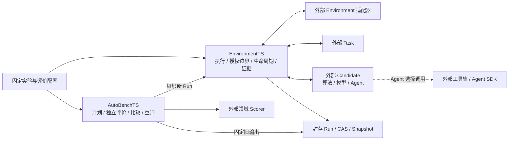

# GymTS

[中文文档](https://gymts-docs.zrr9392.chatgpt.site/zh/) · [English docs](https://gymts-docs.zrr9392.chatgpt.site/en/)

**时序实验、环境执行与独立评价框架。**

中文 · [English](README.en.md) · [完整使用手册](docs/user-guide.md) · [API / CLI](docs/reference.md) · [适配开发](docs/adapter-development.md)

GymTS 把一次实验中“看到了什么、运行了什么、发生了什么、依据什么评分”关联起来。
你可以替换数据来源、任务、算法、模型或 Agent，保存实际轨迹，再用新增或修订的参考
对原有输出重评。最终交付是可扩展的框架；接入项目以独立适配包提供。

当前实现版本为 **0.5.0**，公共合同为 **1.2.0**。核心使用 Python **3.9+**，默认
JSON 工作流没有第三方运行依赖；本地存储后端面向 **Linux / macOS**。原生模型、
仿真和服务适配器各有依赖与平台要求。下文使用源码安装，不假定 PyPI 已发布此版本。

## 为什么使用 GymTS

- **实验可解释。** 固定组件版本、数据视图、任务、seed 与执行限制，保留输入、输出、操作和失败证据。
- **执行与评价分开。** EnvironmentTS 管执行和证据，AutoBenchTS 管评价计划、Scorer、比较和 Gate。
- **来源和方法可替换。** 合成、静态、仿真和 live 来源通过相同生命周期接入；任务、Candidate 和 Scorer 分别注册。
- **旧输出可以重评。** 后到标签或新评分规则创建新报告，保持原 Run 与原始输出不变。
- **项目独立交付。** 框架不导入具体项目实现，也不要求安装某个工具集或模型。

适合离线回放、方法比较、时序问答、受控仿真、Agent 实验取证，以及为外部训练后端
准备可追溯数据。多租户控制台、通用远程 worker、进程隔离和自主 Agent 工具循环
仍需独立实现与验收；当前能力表见[项目状态](docs/project-status.md)。

## 五分钟运行完整实验

以下命令在包含 0.5.0 代码的完整源码检出中运行。首次使用建议独立虚拟环境：

```bash
git clone https://github.com/Jurmean/GymTS.git
cd GymTS
python3 -m venv .venv
source .venv/bin/activate
python -m pip install .
python examples/quickstart.py --root /tmp/gymts-quickstart
```

如果使用共享文件系统或对象存储挂载，请把活动的 SQLite / CAS 放本机 POSIX 路径，
例如上述 `/tmp` 目录；长期保留时换成自己的持久本机路径。`/tmp` 不是备份。

示例不需要 GPU、数据下载、模型服务或 API key，完成：预测运行、三次控制动作、
两个候选的评价、追加独立标签、对同一组 Run 重评。输出中应包含：

```json
{
  "counter_operations": 3,
  "initial_verdict": "insufficient_evidence",
  "rescored_verdict": "pass",
  "mae": {"last-value": 1.0, "window-mean": 2.0},
  "same_run_ids": true,
  "original_results_unchanged": true
}
```

实际输出还包含本次生成的 Run ID 和记录目录。缺少标签时的 `insufficient_evidence`
是正常结果；流程结束、证据充分和指标达标是三个不同判断。

仅体验源码示例也可直接运行 `python3 examples/quickstart.py --root /tmp/gymts-demo`；
使用 `gymts` 命令或其他 Python 程序时，仍需安装框架。

## 两个稳定职责与可替换角色



Source 声明数据来源；Environment 适配器实现读取、推进和操作；Task 定义问题与公开
信息；Candidate 运行方法；Scorer 使用独立依据评分。共享领域合同也是独立包，
不因为被多个项目使用就进入核心。

工具由 Agent 选择，适配器负责调用转换与取证。新增环境读写必须经过 Task 和 Runner
检查。当前固定算法、工具包装及 Research 父轨迹分别有验收，但不能据此宣称已有
通用自主工具选择循环，详见[Agent 与工具集](docs/agent-toolsets.md)。

## 命令行与 Python

所有命令从仓库根目录运行；全局选项放在子命令之前：

```bash
gymts --store /tmp/gymts-cli plan examples/forecast_experiment.json
gymts --store /tmp/gymts-cli validate examples/forecast_experiment.json
gymts --store /tmp/gymts-cli run examples/forecast_experiment.json --output /tmp/gymts-run.json
gymts --store /tmp/gymts-cli evaluate examples/forecast_evaluation.json --output /tmp/gymts-evaluation.json
gymts --store /tmp/gymts-cli plugins
```

`plan` 生成纯装配计划，`validate` 检查配置，`run` 执行一个实验；`evaluate` 固定候选、
案例和重复计划后运行并评价；`score` 对已有 Run 评分。`inspect RUN_ID --events` 读取
轨迹。完整命令、退出码和后到标签流程见[参考](docs/reference.md)与[使用手册](docs/user-guide.md)。

```python
import json
from pathlib import Path
from gymts import GymTS

spec = json.loads(Path("examples/forecast_experiment.json").read_text())
with GymTS("/tmp/gymts-python") as gym:
    validation = gym.validate(spec)
    if not validation["valid"]:
        raise ValueError(validation["issues"])
    result = gym.run(spec)
    run = gym.records.get_run(result["run_id"])
    print(result["status"], len(run["events"]))
```

JSON 为默认格式。YAML 需额外安装 `python -m pip install '.[yaml]'`，Parquet 资源读取
需 `python -m pip install '.[datasets]'`。`datasets` extra 不等于 HF Hub 接入；后者来自
独立 HF 适配包。

## 数据集、benchmark 与存放

数据目录属于 **EnvironmentTS**，可复用 benchmark 的登记、解析与评价属于
**AutoBenchTS**。资源以不可变资产、版本化清单、Dataset Card / BenchmarkDefinition
组织；同名别名不能被静默改指到另一份内容。

```python
from gymts import GymTS

with GymTS("/tmp/gymts-runs", data_home="/tmp/gymts-data",
           cache_home="/tmp/gymts-cache") as gym:
    print(gym.environment_ts.datasets.list_datasets())
    print(gym.autobench.list_benchmarks())
```

登记后，公开 DatasetHandle 提供索引、`select`、`filter`、`iter_batches`；私有参考由
评价角色读取。`data_home` 保存长期资源，`cache_home` 保存可重建缓存，Run root 保存
本次执行的 SQLite / CAS。生产数据与凭证不会因安装适配器自动导入。

参见[资源管理](docs/user-guide.md)、[目录设计](docs/dataset-benchmark-catalog-design.md)
和[HF 静态来源](adapters/hf_datasets/README.md)。五份既有问答附件按测评资源登记，
不自动进入训练；附件、权重和本地实验输出不随核心包发布。

## 按需安装独立适配包

安装负责让包可发现，**显式启用**才注册其组件。默认只启用确定性参考插件。

```bash
python -m pip install ./adapters/timeseries ./adapters/chatts
```

```python
from gymts import GymTS

print(GymTS.available_integrations())  # 仅读取已安装入口元数据
with GymTS("/tmp/gymts-chatts", integrations=("chatts",)) as gym:
    print(gym.enabled_integrations)
```

也可使用 `gymts --integration chatts run CONFIG.json`；这里的 `CONFIG.json` 需要是该
适配器支持的完整配置。原生依赖、数据和服务按各适配包说明单独准备。

| 独立包 / 启用名 | 用途 | 使用文档 |
| --- | --- | --- |
| `gymts-timeseries` / `timeseries` | 中立数值来源、七类时序任务与评分 | [README](adapters/timeseries/README.md) |
| `gymts-libraryts` / `libraryts` | 指定 NetmanAIOps/sktime 的真实工具、loader 与方法 | [README](adapters/libraryts/README.md) |
| `gymts-chatts` / `chatts` | ChatTS 数据、生成、模型 codec、HTTP Candidate | [README](adapters/chatts/README.md) |
| `gymts-timesigma` / `timesigma` | 原生数据、Schema、CPU 模型、工具与 Research 父轨迹 | [README](adapters/timesigma/README.md) |
| `gymts-rl` / `rl` | GSM8K / ChatTS rollout、TRL GRPO、检查点与独立评价 | [README](adapters/rl/README.md) |
| `gymts-bench-tsqa` / `bench-tsqa` | 五份评价专用问答资源、原题和私有参考 | [README](adapters/bench_tsqa/README.md) |
| `gymts-hf-datasets` / `hf-datasets` | 固定 HF 提交、save_to_disk、本地文件冻结 | [README](adapters/hf_datasets/README.md) |
| `gymts-interaction` / `interaction` | 外置中立控制合同、Task、策略与 episode Scorer | [README](adapters/interaction/README.md) |
| `gymts-gymnasium` / `gymnasium` | 原生 Gymnasium 仿真实例 | [README](adapters/gymnasium/README.md) |
| `gymts-openenv` / `openenv` | 官方 OpenEnv 持久 WebSocket 会话 | [README](adapters/openenv/README.md) |
| `gymts-prometheus` / `prometheus` | 只读实时数值指标、接收时间、历史缓存 | [README](adapters/prometheus/README.md) |

Gymnasium / OpenEnv 示例同时启用 `interaction`。HF 当前支持有限一维数值预测视图；
OpenEnv / Prometheus 已验证本机真实服务。更多安装命令、时钟、所有权和支持范围见
[环境接入](docs/environment-adapters.md)与[全部适配包](adapters/README.md)。

## 轨迹、独立评价与训练

一次 Run 保存解析后的配置、组件身份、公开观测、TaskInput、CandidateOutput、环境
操作和回执、错误及清理摘要。需要模型或工具级记录时，适配器通过公开 capture 接口
提交实际请求、响应、用量、ToolCall 和关联 ID；框架不会自动推断任意第三方 SDK 的
内部行为。记录粒度与采集失败政策由配置声明。

AutoBenchTS 在执行前固定全部预期单元，保留失败、取消、未启动、缺失和无效结果。
Outcome 可以后到或修订；新评分使用固定视图创建新报告，不覆盖旧输出。不同领域的
计数单位和指标由外置 Scorer 定义。

需要训练时，公开 DatasetBuilder 接口把固定快照导出为版本化训练制品，具体
reward、token / mask 和数据用途由外部 provider 校验；当前 RL 适配复用 TRL，
不是另写训练框架。[RL 指南](docs/rl-integration.md)列出实际后端、单轮 profile 和限制。

## 文档与示例

| 目标 | 从这里开始 |
| --- | --- |
| 第一次使用、完整实验、后到标签和重评 | [使用手册](docs/user-guide.md) |
| CLI、Python 入口、配置字段与退出码 | [接口参考](docs/reference.md) |
| 了解项目目标、架构和已实现边界 | [项目说明](docs/overview.md)、[框架指南](docs/framework.md)、[项目状态](docs/project-status.md) |
| 接入自己的项目、数据、方法或工具 | [适配开发](docs/adapter-development.md) |
| 运行不同来源与外部服务 | [环境接入](docs/environment-adapters.md) |
| 找到可运行配置 | [示例目录](examples/README.md) |
| 排查依赖、权限、存储和指标问题 | [FAQ](docs/faq.md) |
| 查看正式字段或设计来源 | [文档总目录](docs/README.md)、[合同 1.2.0](docs/feishu/GymTS接口规范/GymTS接口规范.md) |
| 本地构建文档 | [文档维护](docs/documentation.md) |

## 开发、验证与贡献

```bash
python -m pip install -e .
python -m pip install 'setuptools>=58' wheel
python -B -m unittest discover -s tests -v
python -B scripts/check_release.py --output /tmp/gymts-core-check.json
python -B scripts/check_adapters.py --output /tmp/gymts-adapter-check.json
```

构建工具准备完成后，两个发行检查脚本离线运行，覆盖 wheel / sdist、源包重建、源码
目录外安装、显式注册和旧 Run 重评。适配器科学依赖单独准备，最小环境的跳过项不能
冒充原生验收。现有[环境验收](docs/reports/environment-acceptance-2026-10-19.json)
记录了十一包构建与共存、新环境原生调用、失败轨迹和同 Run 重评；这些结果不是模型
质量或生产服务规模的结论。

新增项目优先适配，修改核心时需说明具体未满足需求、适配器不能解决的原因和旧项目
兼容证据。贡献、Issue / PR、发布与安全流程分别见
[CONTRIBUTING](CONTRIBUTING.md)、[维护者指南](docs/maintainer-guide.md)、
[SECURITY](SECURITY.md)和[行为准则](CODE_OF_CONDUCT.md)。问题与支持入口见
[SUPPORT](SUPPORT.md)。

## 项目状态、路线与引用

- [CHANGELOG](CHANGELOG.md) 区分当前工作树与实际发布记录。
- [路线图](docs/roadmap.md) 列出接入验收、通用 Runtime 和 Agent 工作流的后续方向，不承诺交付日期。
- [引用说明](docs/citing.md)与 [CITATION.cff](CITATION.cff) 提供软件引用，不虚构论文或 DOI。
- [第三方来源](THIRD_PARTY.md)说明依赖、数据和模型资产的独立许可边界。
- [MIT 许可说明](docs/licensing.md)说明项目代码与第三方资产的许可边界。

## 许可证

GymTS 采用 **MIT License**，完整条款见 [LICENSE](LICENSE)。本仓库的框架、独立
适配包、教学示例及文档遵循该许可；另有声明的第三方内容遵循其原有许可。
外部项目、模型权重、数据集和用户附件不会因接入 GymTS 改为 MIT，使用或分发这些
资产时仍须遵守其来源条件，详见[第三方来源](THIRD_PARTY.md)。
