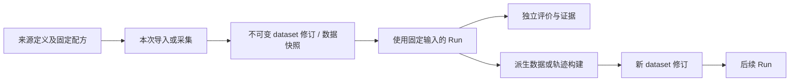

# ADR 0001：将四类数据组织与存储纳入核心

日期：2026-10-21。决策已确认；GymTS **0.5.1**、公共接口规范 **1.3.0** 的实现已冻结为 F1，独立四类真实来源、可移植读取及零模型重评已通过技术验收，不表示已经发行或模型质量通过。F0 的 GymTS 0.5.0 / 接口 1.2.0 及既有报告保持原身份。

## 真实需求与当前差距

用户要求 GymTS 自身管理合成、静态、仿真和外部 live 四类数据。统一的不只是一次执行中的 ObservationBatch，还包括长期可发现的来源、实际取得的数据、使用这些数据的 Run，以及实验产物回到数据目录的过程。

原[总体设计](../feishu/GymTS总体设计/GymTS总体设计.md)与[环境接入指南](../environment-adapters.md)已区分四类来源。0.5.0 的 Environment 协议能执行四类来源，数据目录却主要表达已物化的静态公开/私有 shard：

| 来源 | 已有实现 | 尚缺的统一组织 |
| --- | --- | --- |
| 静态 dataset | 内容寻址资产、SourceDatasetRevision、split 与 reader | 新接入项目仍可能只保存自己的文件和 Run CAS，未登记长期目录 |
| 合成 generator | 外部生成器与 seed、实际生成值可留轨迹 | 可复用生成配方的目录身份，以及配方与每份实际生成数据的关联 |
| 仿真 simulator | 原生 reset/step/close、episode 轨迹和独立评分 | 可发现的仿真来源、一次 episode 产生的数据及其快照关联 |
| 外部 live | 实际请求、样本时间/接收时间、交付区间可留轨迹 | 可复用连接定义、固定采集窗口和该次实际数据的独立身份 |

五项目冻结接入进一步暴露了差距：Data-Juicer 派生结果已登记源数据目录；TimeCopilot、ITFormer、Chronos 与 AReaL 源数据主要仍由各自 prepare manifest 和 Run CAS 管理。其独立 EvaluationSpec 也不等于登记了可复用 BenchmarkDefinition。旧实验的执行证据有效，但不能据此声称已经形成统一数据层。

## 为什么需要改核心

适配器可以补单个项目的导入器，也可以在任意 metadata 中保存 seed、episode 或采集窗口。但仅靠这些约定，通用调用方无法用同一套服务发现来源、绑定固定配置、取得数据、查询来源与数据的关系，或把数据交给另一个项目复用。来源的组织规则若各由项目定义，就不能作为框架的稳定交付。

因此，把**通用数据组织、目录与存储服务**放入核心。具体项目的格式、生成函数、仿真 API、网络协议、codec 和领域评分继续外置。这里修正的是“数据层是否属于框架”的边界，不是把外部项目实现搬入框架。

沿用已有 schema/version、用途策略、内容摘要与 CAS 机制；新增接口围绕用户需要的数据链，不另建一套校验或权限平台。

## 决策与两个主模块

**EnvironmentTS** 同时负责通用数据管理、环境执行与证据。**AutoBenchTS** 继续负责 benchmark 定义、评价计划、独立评分与重评。数据服务不是第三个主模块，来源目录也不是新的模型或工具注册表。

核心增加两类互补资源：

- **DataSourceDefinition**：可复用的来源定义，声明四类来源之一、固定配置和 provider/Environment 绑定。静态来源可指向已固定数据；动态来源定义本身不冒充未来观测的不可变版本。
- **SourceDatasetRevision v2**：实际数据的不可变修订。在已有公开输入、私有参考、split 和用途基础上，统一描述来源、实际生成/采集范围、episode 或窗口，以及直接父资源/Run 的血缘。

公共流程保持简洁：**登记来源 → 绑定本次配置 → 采集或导入实际数据 → 使用固定 dataset 运行 → 显式登记派生数据**。静态/已生成数据可直接登记快照，无需 Run；`run_data` 组合来源绑定、原实验运行和运行后采集，保留原 ExperimentSpec 的真实 Task/Candidate，不替换或创建假 Candidate，也不另建无 Candidate 的采集引擎。可执行示例在接口与实现一致后补充。

Provider 仍由独立包提供。核心理解来源类别与共同的数据关系，不解释 HF 列、ChatTS 占位符、Gymnasium 状态、PromQL 或模型输出。

## 来源、数据、Run 与回流

同一 generator 定义可产生多份带 seed/实际值身份的数据；同一 simulator 定义可产生多个 episode；同一 live 定义可产生多个实际采集窗口。它们共享来源身份，实际数据修订分别固定。live 的连接名称或查询配置不是采集值的版本。

数据进入 Run 后保留其目录身份和当时使用的快照。派生数据指向实际父 dataset、Run 或 RecordSnapshot；内容变化产生新修订。回流是调用方显式动作，不能把模型生成标签自动提升为 gold，也不能把评价专用数据自动改作训练。

BenchmarkDefinition 继续固定 dataset 修订与领域 resolver，解析成既有 EvaluationSpec。一次 EvaluationSpec 可直接执行，但只有显式登记的定义才是可复用 benchmark。

## 存放位置

| 位置 | 负责保存 |
| --- | --- |
| `data_home` | 长期来源定义、dataset/benchmark 清单、不可变原始或派生资产 |
| `cache_home` | 可重建的本地读取缓存 |
| Run root 的 SQLite / CAS | 本次执行、实际采集证据、所用数据引用、结果与报告 |
| 独立 provider 的部署目录 | 上游代码、模型与后端运行依赖；不打进核心包 |

活动数据、缓存、Run store 与验证使用本机 POSIX 路径；本轮工作目录位于 `/tmp`。关闭后的证据可显式归档。核心不会因为登记一个来源就自动下载模型、启动外部服务或公开私有数据。

## 兼容与版本

新增 `gymts.source-dataset/2` 与 `gymts.data-source/1`，以 additive 方式扩展目录；旧 `gymts.source-dataset/1`、BenchmarkDefinition `/1`、Run 和训练导出 `gymts.dataset/1` 继续保持各自身份与读取语义。不把训练 DatasetManifest 与长期源数据修订混为一个协议。

旧清单不回写，旧 Run/Outcome/报告不补改。旧组件调用和既有直接 ExperimentSpec 路径继续可用；新来源与 v2 数据通过新的公开服务接入。需要迁移时发布新资源并保留原引用，不能把旧 revision 改指向新内容。

当前版本为 0.5.1 / 1.3.0。实际签名、168 项核心回归及源码外安装已核查；四类真实外部来源、可移植读取与零模型重评通过。旧十六包 F1 兼容检查为 407 项发现、346 项执行通过、61 项可选依赖跳过，含当前 AReaL V13 CPU 草案；不改写其原生训练或留出评价状态。本 ADR 不代替发布记录。

## F1 冻结与验收

先完成并冻结一个确切 F1 core wheel、源树和版本，再通过独立外部适配包接入四类真实来源。验证来源登记/发现、实际数据采集与快照、使用固定 dataset 的 Run、血缘回流、AutoBench 独立评价，以及同一封存输出重评。冻结后适配新项目不得继续修改核心；若出现真实缺口，另行记录并形成下一基线。

旧 `/1` 资源、旧 benchmark、历史 Run 读取和原 quickstart 必须继续工作。F0 与五项目证据保留为上一基线的结果；AReaL 兼容路线及留出评价的 pending 状态不因本数据层开发改变。

这轮验证针对数据组织与框架兼容，不预告模型质量成功。完整 HF 远程 Hub、跨主机分布式事务、任意 streaming 与操作系统沙箱不在本决策的交付范围。

F1 核心代码树摘要为 `dad5d6a1785c4fa440a51dd4c93307f47ca000aa0d955daa70e68e32dcfac319`；真实四类外部验收固定使用的 wheel SHA-256 为 `8944f39ffe516dbe22b7800f57fd18266cf6b3a4e84cf3a35b32cb6261ac2f1a`。原 19 个核心 schema 与 F0 的规范化摘要全部相同；新增仅 `gymts.data-source/1`、`gymts.source-dataset/2`、`gymts.data-capture-row/1`、`gymts.data-capture/1`。另行发行检查会重建 wheel/sdist，其归档字节摘要与 F1 可不同，但必须核对同一核心代码树，不能混称同一个 wheel。
