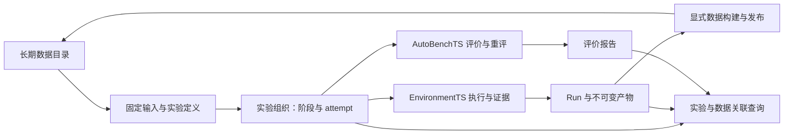

# ADR 0002：将实验组织、数据回库与关联查询纳入核心

日期：2026-10-21。决策：采用。实现目标基线为 GymTS 0.6.0 / 接口规范 1.4.0；不表示已经发行。本文记录 F1 之后的新增组织能力；它不修改 F1 的冻结身份，也不替代该基线的验收报告。使用入口见[实验组织指南](../experiment-organization.md)。

## 真实需求

GymTS 的主线是**存储数据、接入数据、组织实验、记录实验**。调用方应能给定固定的数据引用与实验清单，运行多个有依赖的阶段，保存各次尝试和产物，事后查询所用数据、实际执行和结果。一个阶段失败后，已完成的证据不能被覆盖。

F1 已有来源与数据集目录、单次 ExperimentSpec、EvaluationSpec 评价矩阵、Run 轨迹、不可变产物和独立重评。四类来源已通过真实外部接入验证。剩余缺口集中在三处：

1. 多个 Run 与非 Run 阶段仍由项目脚本串联。产物引用常需手工复制，框架没有共同的阶段、依赖和尝试身份。
2. `gymts.dataset/1` 构建结果保存在 Run CAS，与长期 `source-dataset` 目录之间缺少共同的显式发布入口。
3. Run 证据本身完整，但从实验或数据出发查询整条执行链仍需理解项目自己的 journal。

这些需求不要求 GymTS 复用完整项目、内化训练算法或代替 Agent 作研究决策。

## 为什么适配器无法独立解决

适配器可以解释格式、生成原生配置、执行训练或评分，也可以自行写一个父日志。然而，若每个适配器分别定义阶段状态、失败续接、数据引用与 Run 关系，框架调用方仍必须理解每个项目的组织习惯。

共同的身份、状态、引用与存储关系属于组织层。它们应在核心表达一次，适配器只返回本领域的事实和固定产物。核心无需解释 checkpoint 结构、时序列名、奖励函数或网络协议。

## 决策一：不可变实验定义与可追加执行尝试

新增四个组织协议：`gymts.experiment-group/1`、`gymts.stage-request/1`、`gymts.stage-attempt/1`、`gymts.experiment-event/1`。既有 23 个核心 schema 保留原身份，兼容检查按规范化摘要逐一比较。实验定义采用 `gymts.experiment-group/1`。实验定义具有 `group_id` 与内容固定的 `revision`，包含有名阶段。每个阶段声明固定版本的 `executor_ref`、原有配置 `spec`、输入、依赖、输入绑定和具名输出。

- `spec` 继续使用现有 ExperimentSpec、EvaluationSpec、ScoreSpec 或相应数据服务配置；不复制这些执行协议。
- 输入可以引用固定 dataset、source、CAS artifact，或已完成阶段的具名输出。
- 输入绑定使用 JSON Pointer 写入本次执行配置；输出使用 JSON Pointer 从本阶段返回对象选择值。领域转换由独立 executor 或适配器完成。
- 每次实际调用阶段都创建新的 attempt。成功、失败及中断尝试保留各自状态与结果，重试不会改写旧 attempt 或旧 Run。
- 默认沿用成功阶段，只执行就绪的 pending 或 stale 阶段。failed/cancelled 用 retry_failed 显式重试，interrupted 用 rerun 显式重跑；重跑上游后，其依赖者变 stale。阶段仅在依赖成功后执行。修改定义产生新 revision。

组织服务选择阶段并记录执行，不另建 Environment 执行器、模型 Runtime 或领域评价器。内置 executor 委托现有 Run、评价、重评、采集与发布服务；外部 executor 按相同组织接口调用其自己的实现。

## 决策二：保持 EnvironmentTS 与 AutoBenchTS 职责

实验组织是共同服务入口，不是第三个领域运行模块。EnvironmentTS 仍管理数据组织、实际执行和证据；AutoBenchTS 仍定义预期评价单元、调用 Scorer、保存报告并独立重评。实验组织层不能将阶段成功解释为模型质量达标。

## 决策三：构建结果显式发布到长期数据目录

保留两种不同协议：

- `gymts.dataset/1` 描述由固定证据构建的训练或其他导出产物，保留 BuildSpec、RecordSnapshot、shard、奖励与 tokenization 等引用。
- `gymts.source-dataset/1` 或 `/2` 描述长期可发现、可读取的数据集修订。

显式发布复制必要字节到 `data_home`，固定其内容身份并保留构建与来源关系。不能把 Run CAS 的临时路径当成长期资源 URI。

没有真实注册来源的构建结果使用已有 `source-dataset/1`，不为满足 `/2` 字段而虚构 generator 或 live 来源。若确有来源定义，可按已有快照或采集路径登记 `/2`。Reader 继续由独立适配器提供，核心不假定所有导出都是 JSONL。

发布不改变用途授权。父数据或输入证据禁止训练时，不能通过换一个构建器或发布数据集解除限制。派生数据也不会自动成为 gold 或 benchmark。

## 决策四：统一记录关系与查询

实验定义、阶段 attempt、解析后的输入配置、返回值与错误进入现有本地记录和不可变制品体系。由某 attempt 建立的 Run，在建立时关联该 attempt，避免后补日志遗漏已发生的执行。

阶段声明输入的权限与 provenance 通过 attempt 上下文传播到嵌套 Run 和评价计划，包括自定义执行器调用。StageRequest 固定绑定状态、执行器、用途、输入、配置、数据清单身份与 provenance；绑定失败同样留下失败尝试证据。

查询从实验或固定数据集引用出发，列出关联的阶段、各次 attempt、Run、产物与结果。阶段关系保存在组织记录中；评分已有 Run 时增加关联，不改写其原始 organization 元数据或归属。原 Run、Outcome 与评价报告继续保留原 schema 和身份。

中断恢复的含义是辨认并标记未完成 attempt，使调用方可以创建新的尝试。它不证明外部后端已停止，不自动重发未知状态的环境操作，也不在原 Run 内伪造续跑事件。调用方只应在确认旧执行已结束后显式恢复。仅 gymts.run 阶段可显式采纳其唯一已封存 Run；其他阶段在边界重新尝试，不承诺评价矩阵内部续接。

## 存储与兼容

| 资源 | 位置与规则 |
| --- | --- |
| 来源、数据集、benchmark 与长期数据字节 | 既有 `data_home`；固定修订与不可变资产 |
| 实验定义、阶段状态、attempt 与 Run 关系 | 现有 Run root 的本地记录存储；新增组织索引 |
| 完整定义、解析配置、返回值与错误证据 | 现有 Run root 的 CAS；固定制品引用 |
| 原生模型、数据格式、训练和评分实现 | 独立适配包及其运行环境 |

这些变更是新增资源和服务。旧的 `gym.run`、`gym.run_data`、AutoBench `evaluate/score`、数据读取和 DatasetBuilder 接口继续可直接使用，不要求先建立 experiment group。

既有数据库通过新增表保留历史 Run；不迁移或重新解释旧事件。没有组织关联的历史 Run 仍是有效执行事实，不能宣称它原本属于新 group。历史数据清单与 F0/F1 报告不回写。

F1 固定为 GymTS 0.5.1 / 接口规范 1.3.0，其核心代码树 SHA-256 为 `dad5d6a1785c4fa440a51dd4c93307f47ca000aa0d955daa70e68e32dcfac319`，真实四源验收 wheel SHA-256 为 `8944f39ffe516dbe22b7800f57fd18266cf6b3a4e84cf3a35b32cb6261ac2f1a`。本轮新增能力须另记版本、冻结身份与验收结果，不能沿用 F1 名称声称通过。

## 冻结验证反馈：父数据查询（F2 → F2.1）

独立冻结验证发现：publish-build 阶段可以仅声明构建 Manifest 的 artifact 输入，同时在 spec.parents 提供固定 DatasetRef。发布结果已保存父关系，但原 F2 按父数据集 ID/revision 查询时遗漏该实验组。数据已回库却无法沿已声明父关系找到实验，违反本 ADR 的统一查询要求。

适配器只能正确发布父引用，不能修改框架全局 query 的检索语义。因此核心查询补读标准 source-dataset/2 的 lineage.parents，以及官方构建发布结果 source-dataset/1 的 features.parent_datasets；后者须同时存在 dataset_build 标记。只使用这些明确清单关系，不递归扫描任意领域 payload，也不改变 list_runs 对实际 Run 数据的查询含义。

修复不增加 schema、不改旧清单或 Run，也不回写已有 attempt；修正的是已有声明关系的可发现性。原 F2 wheel 与失败探针保留，修复后须以新的 F2.1 冻结身份重新验证，工作树版本仍为未发行的 0.6.0 / 1.4.0。另有 18 处独立包依赖上界从 <0.6 扩至 <0.7，使包元数据允许安装新核心。兼容探针随后发现 ITFormer 的冻核守卫仍只接受稳定 0.5.x；仅将该守卫扩至稳定 0.5.x/0.6.x，并保留安装来源、完整 payload、逐字节与独立 wheel 摘要检查。领域实现未改；十六包兼容检查单独验证，不能用元数据或守卫修改本身声称兼容通过。

## 验收要求

1. 用固定数据引用与一份实验定义执行有依赖的多个阶段，后续阶段自动取得前序具名产物。
2. 成功、失败及重新尝试都有独立证据；重试不覆盖历史，未满足依赖的阶段不执行。
3. Run 与 attempt 的关联可查询，按数据与实验能查到固定配置、实际 Run、返回产物和评价报告。
4. 将真实构建结果显式发布到长期目录，在原 Run store 不可用时仍可读取公开数据；用途限制与私有参考边界保持。
5. 旧核心回归和直接使用入口继续通过。冻结新核心后，以独立适配包验证一次阶段调用，执行、留轨迹、独立评价与重评不再修改核心。

验证组织闭环不等于训练质量提升。远程 Hub、分布式调度、任意后端进程接管和自动研究决策不属于本 ADR 的验收要求。

## F2.1 验证记录

[2026-10-21 机读报告](../reports/experiment-organization-2026-10-21.json)记录确切 F2.1 wheel、源码摘要、旧 23 个 schema 不变、196 项源码外核心回归，以及 16 包兼容检查的 356 项通过与 61 项可选依赖跳过。源码包和重建 wheel 也通过安装检查。

[独立 CSV 适配示例](../../examples/adapters/organization_demo/README.md)在冻结核心上将 ETTh1 的 32 行视图入库，完成四阶段、两个真实 Run、独立数值评分、新进程重评，以及卸载适配包后的读取、查询与重评。核心运行文件未改，原 Run 结果与事件保持不变。该例未设质量 Gate，因此报告保留 insufficient_evidence；这不是全量 ETT 或模型质量通过声明。

构建数据发布经删除原 Run 目录后读取验证；父数据查询在确切 F2.1 wheel 上验证。原 F2 查询遗漏、两次适配配置失败和后续成功证据均保留。封存证据已本地归档，并经解包摘要、CAS/资源资产和再次独立重评核验；活动环境和缓存不随源码上传。
