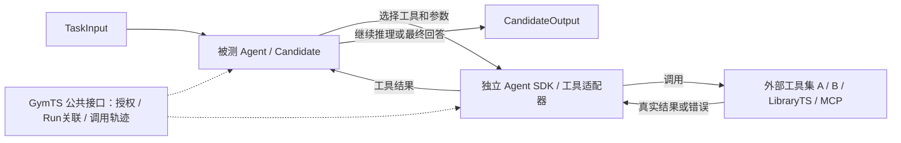

# 外部工具集与 Agent 的职责

LibraryTS、TimeSigma 工具、MCP 服务和其他工具集都是框架外部的提供方。GymTS 核心不包含、管理或强制安装任何具体项目，不把某个工具集当作框架固定组成部分。同仓库 `adapters/` 是可独立发行的接入实现，其目录位置不改变这一边界。

工具集提供能力，Agent 决定何时调用哪个工具、传入什么参数，以及怎样使用返回结果继续推理。Agent 平台或外部执行后端实际运行工具；GymTS 提供与实验有关的公共接口、授权边界、调用关联和证据记录。工具调度不由 EnvironmentTS Runner 根据 LibraryTS 等项目名称决定。

## 1. 工具在一次实验中的位置

被测对象可以是普通算法、模型、流水线或 Agent。被测对象为 Agent 时，Agent 的原生 SDK 保留其会话和工具循环，工具适配器把选定提供方转换成该 SDK 接受的接口。GymTS 不要求将 Agent 改成固定算法，也不另外实现一个 Agent 推理引擎。

实验配置选择本次允许使用的工具提供方、固定版本、工具名单、作用范围和预算。配置可限定可用能力，但不是预先替 Agent 决定每一步工具调用。多个外部工具集可以同时供一个 Agent 使用；换工具提供方应修改外部适配与配置，核心不增加项目清单。

## 2. 各方负责什么

| 对象 | 负责 | 对外边界 |
| --- | --- | --- |
| Agent | 判断是否调用工具、选择工具及参数、消费结果、继续推理或结束 | 使用已授权工具，保留原生调用 ID 与会话 |
| 外部工具集 | 算法/API、实现和依赖、工具自身资产管理与发布 | 提供真实执行、结果或错误 |
| 工具/Agent SDK 适配器 | 暴露工具说明和 schema、映射调用、连接执行后端、报告真实效果与轨迹 | 单向依赖 GymTS 公共 SDK，不进入核心项目分支 |
| Task 与实验配置 | 任务含义、公开信息、允许能力、环境请求解释 | 不根据模型或工具集名称代替 Agent 规划 |
| EnvironmentTS | 组织 Run；检查实验环境读写；保存输入、输出和实际调用证据 | 不实现某个工具集的算法与资产平台 |
| AutoBenchTS | 按独立依据评价 Agent 的任务结果和声明的约束 | Scorer 不把私有答案交给被测 Agent |

框架需要的是通用工具接入、固定身份、权限和证据合同。LibraryTS 的统一资产目录、原生模型保存和审核发布属于该外部项目自身；如需与 GymTS 实验衔接，通过固定引用或适配器完成，不能列成 GymTS 内部项目建设。

## 3. 按每个工具的实际效果选择路径

同一工具集可以混合多种效果，不能把整份目录一律开放给 Run 内 Agent。

| 效果 | 谁调用、怎样执行 | 例子 |
| --- | --- | --- |
| 对当前获准 TaskInput 的计算 | Agent SDK 在会话内调用外部适配器，结果回到同一 Agent；保存 ToolCall | 对已有数组做预测、特征、季节性或距离计算 |
| 读取新的实验环境数据 | Agent 提出意图，Task 生成 TaskRequest，Runner 检查后调用 Environment，观测返回同一会话 | 查询新的时间窗、读取未交付传感器数据 |
| 操作实验环境 | TaskRequest → Runner → Environment.act，记录 operation_id 与回执后恢复会话 | 仿真 step、设备控制、改变现场状态 |
| 创建实验、读取数据资产、导出或发布 | 由具备独立授权的 Run 外调用方/Research Agent 经相应公开服务调用 | GymTS.run、AutoBenchTS.evaluate、加载新数据、独立实验 |
| 私有评价 | 由 AutoBenchTS/独立 Scorer 调用，参考仅在评价角色可见 | 使用私有标签计算 MAE 或准确率 |

工具叫 `dataset.load` 并不自动获准读取任意数据，叫 `experiment.run` 也不自动成为当前 Run 内的纯计算。LibraryTS 的 `forecast.*` 与 `dataset.load/labts.run/labts.analyze/labts.metrics` 因此不能共享同一默认 Agent 授权。

内部工具的临时计算允许使用当前输入，不读取未来值或私有参考、不跨调用隐式学习。需要持久训练时使用显式训练授权与固定训练视图。工具通过参数接受一段数组，并不意味着它有权自行打开完整数据目录。

## 4. Run 内 Agent 与 Run 外 Research Agent

Run 内 Agent 是被测 Candidate。工具调用和模型调用关联当前 run_id、input_id、output_id；同一模型请求产生多个工具调用时保存其原生 ID 到 call_id/parent_call_id 的映射，每次真实执行保存 attempt_id、固定 tool_ref、参数、结果/错误和时间。纯计算的 environment_request_id/operation_id 可为空；实验环境读写必须关联 Runner 的真实请求与操作。

Run 外 Research Agent 可以同时调用任意获准工具集，也可将 `GymTS.run`、`AutoBenchTS.evaluate/score` 作为实验工具。Research 会话轨迹由 Agent 平台或其独立 journal 适配器管理，以真实子 Run/报告引用关联；不能把父会话中每个普通工具调用虚构成一个 GymTS Run。

Agent SDK 的聊天消息出现 tool_call 只表示调用意图，不能据此声称工具执行成功。请求、实际执行结果、失败或未知状态必须分别保存。只取得 IO 时记录 IO，不编造 tokens、logprobs 或隐藏推理。

## 5. 当前实现与剩余接入

| 能力 | 当前状态 |
| --- | --- |
| 核心与项目分离 | 已实现：核心无项目导入；独立包显式安装启用 |
| 通用模型/工具调用证据 | 已实现：公开 TraceCollector 与 ModelCall/ToolCall 合同 |
| 环境取数/动作路径 | 已有 TaskRequest → Runner → Environment 及回执/续轮基础 |
| LibraryTS 工具包装 | 已有 `LibraryTSTools`，保存真实请求、成功与失败；当前输入工具与其他效果已按 scope 区分 |
| 固定算法 Candidate | `libraryts-qa` 按配置固定选择 estimator，是算法基线，不是 Agent 自主选工具 |
| Research 父轨迹 | TimeSigma 适配器已有显式调用 journal；不是通用自主 Agent 引擎 |
| 通用工具目录/分派服务 | core 没有统一 ToolRegistry/ToolBroker，也没有自动注入任意工具集；v2 中的 ToolBroker 是草案 |
| Agent 选择工具并消费结果的完整验收 | 尚未完成可替换 Agent SDK + 多种工具提供方的真实模型闭环验收，不能用固定调用脚本替代 |

现有 LibraryTS 适配器可在 `scope='current_input'` 下仅暴露五项输入内计算工具；其固定算法 Candidate 显式使用这一范围。工具清单的 scope/effect 是该适配器的声明，非核心项目登记表。独立调用保留原目录能力，实验环境读写与私有评分不能借当前输入 scope 绕过授权。

后续 Agent 适配优先复用已有 SDK：底层 AgentHarness 等实现原生模型/工具循环，独立适配包注入获准工具及 GymTS 记录服务。TimeSigma 原生 Research worker 有专用 Evidence 和工具名单，不能直接改名充当通用框架接口。

最小正式验收应包含真实模型产生调用意图、原生外部工具执行、结果送回模型、模型继续给出输出，并保存完整关联；再替换另一工具提供方验证核心无项目改动。额外检查失败、未知状态、越权工具、预算和多轮环境恢复。未执行的真实模型验收保持未完成，不重新解释旧算法或 journal 报告。

本轮范围修正已完成独立安装原生 14/14 回归，并针对显式 current_input 重验五个允许工具；独立源包重建与无科学依赖环境的合同测试通过。真实当前输入预测及五类拒绝的请求/失败 CAS 已归档，见[作用范围验收](reports/toolset-scope-validation-2026-10-19.json)。这是工具适配与边界验收，没有调用真实模型做自主工具选择。此前原生实验报告保留其当时 wheel 身份，不把本轮新增范围校验写回历史结果。
