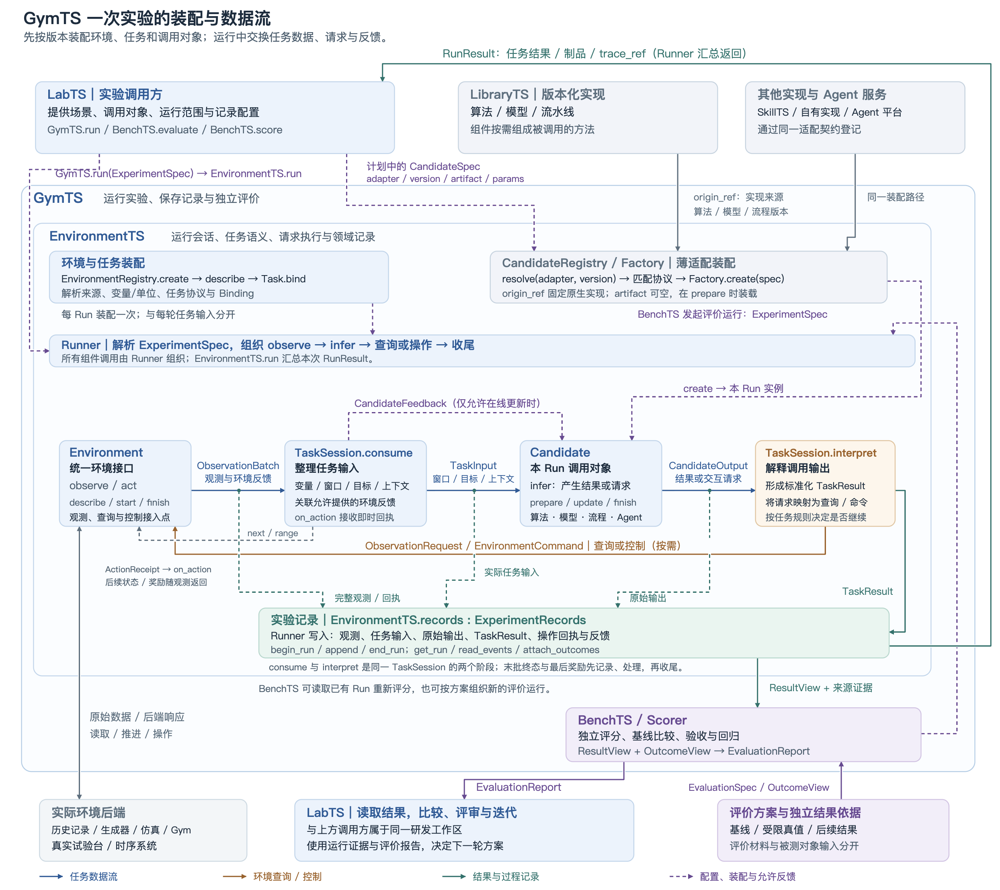

# GymTS 运行机制

EnvironmentTS 怎样把一份计划运行成结果与记录，BenchTS 怎样使用它们完成评价。

## EnvironmentTS 内部怎样分工

Runner 在运行过程中调用选定的方法。这个可调用实例在接口中称为 Candidate，可以包装算法、模型、流水线或 Agent；它不承担环境接入、实验组织或独立评价的所有职责。

原生实现可以在本进程、已有服务或 Agent 平台上执行。适配层解决调用和数据格式，Runner 保留本次实验的流程控制。

## 一次 Run 从提交到返回

### 2\.1 装配：把计划落到实际对象

1. 解析环境、任务、被调用对象和制品的固定版本。

2. 创建 Environment，读取其变量、操作和时间能力；Task/Binding 绑定所需变量、单位、窗口和操作。

3. 检查被调用对象与任务契约匹配，创建本次逻辑实例或会话。

4. 建立 Run 记录；启动环境，保存实际会话、来源和时间范围。

5. 准备被调用对象。固定模型装载已有制品，需要拟合时只使用明确指定的训练输入和标签；Agent 建立本次会话状态。

对 LibraryTS 方法，第 3 步会根据计划中的适配名称和版本取得声明，再由对应工厂创建 Candidate。声明关联库中的原生实现，计划另选本次参数和模型制品；第 5 步才完成加载和准备。之后的 TaskInput 来自本次环境与任务，LibraryTS 提供的是处理这些输入的方法。

同一真实服务可以持续运行，本次实验只建立和结束自己使用的连接/会话，不要求重启后端或模型服务。

### 2\.2 运行：观测成为输入，输出成为结果或请求

1. **取观测。** Runner 根据任务需求调用 Environment，取得下一批数据、指定片段或交互反馈。

2. **记录原始交付。** 保存观测、可见时间、回执/奖励与来源。即使这一批不足以形成任务输入，仍有其运行含义。

3. **构造任务。** Task 整理共同变量、单位、窗口与目标，产生零个、一个或多个 TaskInput。

4. **处理允许的学习反馈。** 已到达且计划允许用于学习的反馈，先交给支持更新的方法，再处理本批新输入。

5. **执行调用。** Runner 逐个交付 TaskInput，保存收到的原始输出，再交给 Task 解释。

6. **分配去向。** 任务结果写入记录；查询请求转成环境读取；控制请求转成环境命令。

7. **继续交互。** 查询结果、即时回执和后继观测回到任务。需要继续的任务形成下一轮输入，已完成的任务转入下一任务实例。

实际调用都由 Runner 组织；流程图中的箭头说明数据去向，不表示环境直接调用算法。

### 2\.3 收尾：任务结束，证据仍然可以补充

最后一批即使带有结束标记，也先记录并交给 Task 处理：完成任务规则允许、决策时点仍在运行范围内的检测、分析或预测，再收尾。预测是否处于运行范围内看发出时点，不按未来目标时点裁剪；环境已终止时不再发出控制动作。

达到运行边界后不建立范围外的新决策。计划若允许收集延迟结果，就进入 draining 阶段，在规定截止范围内继续读取并处理允许的反馈，不再产生新的预测或控制。最终状态和最后奖励无论是否形成下一次调用，都保留在记录中。

之后依次结束被调用实例、任务和环境会话，保存产物、摘要和 RunResult。records 结束本次运行记录，但仍允许将后来确认的结果关联到原输出；原始预测和原始记录保持不变。

## 三种运行方式怎样共用这个过程

这些方式共用装配、环境协议、任务定义和记录。流式是提供和消费数据的方式，真实试验台是来源；一个真实试验台既可以只读，也可以在支持操作时做闭环实验。

## 不同来源怎样变成同一份观测

一次取数有三层转换，每层有不同责任：

数据可以直接放在观测中，也可以通过固定 DataViewRef 交付。读视图的服务返回本次选定的数据范围，任务不需要理解原数据库的连接方式。若实时源无法提供可长期复核的固定引用，记录实际取得的快照。

各来源的读取动作不同：

- 历史回放按范围读取，时间可以快于真实时钟。

- 仿真器按其原生机制推进、采样；控制与推进是否一体由后端决定。

- 原生 Gym 环境的动作调用已经产生下一状态，后续 observe 只交付该结果。

- 实时系统自己运行，适配器按时间窗查询、轮询或订阅；尚未有可交付内容时返回等待状态。

## 时间与反馈怎样保持含义一致

### 5\.1 分清发生时间和可取得时间

观测保留事件时间与可用时间；本次会话还说明当前开放的读取范围。历史文件中存在某个未来数据点，不代表回放到当前时刻的任务就可以读取它。

主流 next 交付新的时间窗或状态；query 查阅已开放片段，不推进主游标；range 用于允许的完整片段读取。等待不是时间窗已完成，空窗则可以表明一个区间已经经过。这些区别让在线检测、预测和诊断共用取数接口而不混淆数据时机。

### 5\.2 分清请求、回执和后果

一次控制请求至少涉及三个不同事实：提出了什么操作、后端是否接收/完成、后续状态怎样变化。记录把这些事实通过输出和操作标识关联。

回执立即交给任务处理。原生 Gym 的成功 step 结果要先被读取，才能执行下一动作，避免重复推进或覆盖未消费的结果。异步真实操作则在后续观测中交付状态变化；请求被接收本身不表示业务目标已达成。

### 5\.3 多轮 Agent 使用同一条交互路径

诊断 Agent 可以先提出指标查询，收到下一轮输入后再查询或给出报告；同一任务的 case 保持一致，轮次递增。Agent 保留本次会话状态，内部推理和通用计算工具可使用原有平台；实验环境的数据查询和操作经过任务及 Runner。

这种会话进展不等于模型训练。固定参数的 Agent 仍可利用本次已经取得的信息继续推理；学习更新只有在任务和计划允许时才执行。

## 运行记录怎样支撑输出与后续工作

记录至少关联四组内容：

原始末状态和奖励不依赖“是否还有下一次方法调用”而存在，所以单独保存完整 observation。工具/模型内部过程若需复核，由调用适配或平台提供相应记录引用，再与本 Run 关联；Environment 无法推断方法内部做过的计算。

记录服务只组织实验语义和关联，可使用已有采集与存储设施。保存证据、用同一输入重跑方法、重新执行真实环境实验是不同操作；真实轨迹记录并不保证物理过程可完全重现。

## BenchTS 怎样形成评价报告

1. **固定评价安排。** 取得案例、候选及基线版本、评分规则、比较条件与结果来源。

2. **取得运行结果。** 需要新Runtime调用 EnvironmentTS；已有 Run 足够时直接取其原始输出及标准结果。

3. **取得评价依据。** 按目标实体、变量、时间或任务键匹配标签、仿真事件、后续实际值等 OutcomeView。

4. **评分与比较。** Scorer 计算规定指标；BenchTS 按案例/条件聚合，给出基线差异与门槛判断。

5. **交付报告。** 引用所用 Run、结果/评分版本、计分数量、缺失范围和未覆盖条件。

独立测试、回归和开发反馈可以复用计算方法，但使用的案例、允许调整的范围和用途不同。BenchTS 按既定方案比较；如何选择下一轮方法、怎样评审和批准由 LabTS 组织。

后到结果或评分规则更正后，可以对原输出重新评分；新报告保留对原 Run 的引用，不替换当时预测或悄悄覆盖旧报告。领域可选择效果、延迟、成本或约束等指标，框架不为所有任务强行规定一套相同评分。

## 新场景怎样复用这套机制

- 新来源：实现环境适配和描述，复用任务、运行组织、记录和评价。

- 新任务：明确输入输出含义、绑定和适用评分，复用已有环境连接。

- 新算法或 Agent：提供调用适配及支持的任务声明，参与已有运行过程。

- 新评价方式：实现 Scorer 和对应案例/依据，不重新生成已有原始输出。

- 已有部件的新组合：主要增加场景配置与评价计划。

LibraryTS 的完整方法可以直接作为被调用对象，组件可在流水线内组合，生成器和评分函数则分别用于环境与评价扩展。

