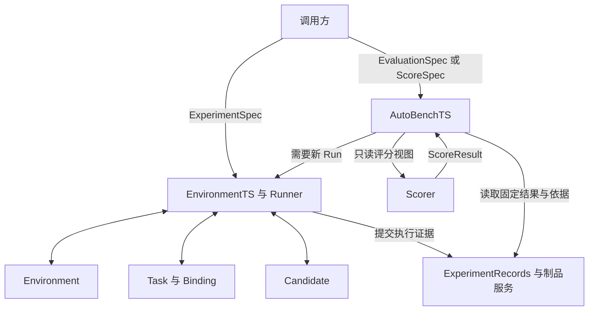

# GymTS 接口规范

| 项目 | 内容 |
| --- | --- |
| 规范版本 | 1.1.0 |
| 更新日期 | 2026-10-18 |
| 状态 | 框架实现与插件接入基线 |
| 核心模块 | EnvironmentTS、AutoBenchTS |
| 适用对象 | 框架开发者、环境与任务接入者、算法与 Agent 适配者、评价与训练集成开发者 |

GymTS 接收有明确边界的时序实验计划，由 EnvironmentTS 组织环境交互、任务执行与证据记录，交付 RunResult；AutoBenchTS 根据固定评价计划、原始运行结果和独立结果依据生成 EvaluationReport。算法、模型、流水线和 Agent 通过同一 Candidate 契约接入。

本规范固定服务入口、消息结构、状态转换、记录要求和接入验收。接口签名表达逻辑契约；当前 SDK 的覆盖与限制见[框架实现指南](../../framework.md)。实现顺序为公共合同、核心框架、插件接入。新任务原则上通过插件和配置接入，不向 Runner 增加按任务名称判断的分支。

阅读路径：搭建框架先读第 3—10、13—14、16 节；接入任务重点读第 5—8、11、15、17 节；LLM 采集与训练数据接入重点读第 10、12 节。

## 1 适用范围与规范用语

### 1.1 实现范围

基础实现采用进程内同步调用、每 Run 一个环境会话和一个 Candidate 实例、单实例串行执行。一个部署可以运行多个相互隔离的 Run；并行调度、分布式 worker、远程 RPC 和训练器不属于基础调用合同。

实现能力分为三个可独立声明的 profile：

| Profile | 必须实现的能力 |
| --- | --- |
| `core` | 实验配置、环境与任务协议、Candidate 调用、证据记录、AutoBenchTS 评价 |
| `llm_trace` | 在 core 之上采集模型与工具内部调用，关联真实请求、响应和调用身份 |
| `training_export` | 从固定证据快照构建有版本和血缘的 SFT、偏好或 RL 数据 |

所有实现必须支持 core。普通时序算法不必实现 token 字段；声明扩展能力的实现必须遵守该扩展的条件必需字段。训练导出工具属于记录的读取加工或外置适配，不增加 GymTS 的主要模块。

### 1.2 规范用语与兼容性

- **必须**表示实现及接入验收的硬性要求；**应**表示默认采用、偏离时需在能力声明中说明；**可**表示选用能力。
- 字段表中的必需表示键必须出现；类型含 `null` 时允许显式空值。可选字段缺省按表中默认值处理，解析后的配置必须补齐默认值并保存。
- 本规范明确给出协议版本的消息或制品必须包含 protocol_version 字段。
- `protocol_version` 固定消息合同，例如 `gymts.experiment/1`；`version` 固定适配或插件实现，例如 `1.0.0`。两者不得混用。
- 增加可选字段可提升规范次版本；改变必需字段、字段含义或调用顺序必须提升协议主版本。未声明兼容的主版本必须拒绝。
- 未知配置字段必须报错；扩展信息仅放在已声明 schema 的 `params`、`options`、`extensions` 或 Payload 中。不得静默忽略拼写错误。

## 2 模块职责与身份关系

### 2.1 职责边界

| 对象 | 负责 | 交付或调用 |
| --- | --- | --- |
| EnvironmentTS | 校验与装配实验、运行、记录、清理 | RunResult |
| Runner | 协调 Environment、Task、Candidate 与记录顺序 | 内部运行流程 |
| Environment | 连接历史数据、生成器、仿真或真实系统，执行获准读写 | ObservationBatch、ActionReceipt |
| Task 与 Binding | 定义任务含义、变量/单位/窗口、决策目标、请求与结果解释 | TaskInput、TaskResult、TaskRequest |
| Candidate | 调用选定算法、模型、流水线或 Agent，保留原生计算 | CandidateOutput、更新制品 |
| ExperimentRecords | 保存原始证据、领域关联和后到结果 | RunRecord、事件和结果视图 |
| AutoBenchTS | 固定评价计划、安排 Run、独立评分、比较与门槛判断 | EvaluationReport |
| Scorer | 按固定结果、依据和参数计算指标 | ScoreResult |
| 外置训练器 | 消费获准数据、优化权重、发布新制品 | 下一 Run 可选的模型制品 |

LibraryTS、SkillTS 和已有服务提供实现或制品，经适配参与上述角色。LabTS 或调用方负责方案选择、评审与发布批准；运行成功和评价通过均不代表发布批准。



环境字段解析归 Environment；公共单位换算、窗口、重采样归 Task/Binding；方法自身的插补、特征、归一化和编码归 Candidate。采样周期不得隐含插值、求和或平均操作。

### 2.2 身份与关联

| 标识 | 含义与生成方 |
| --- | --- |
| `run_id` | 一次有边界实验，由 Runner 分配 |
| `session_id` | 本 Run 的环境会话，由 Environment 分配 |
| `case_id` | 一个窗口、预测发出时点、诊断问题或控制决策，由 Task 分配 |
| `turn_id` | 同 case 的输入轮次，整数，从 0 递增，由 Task 分配 |
| `input_id` | 一份实际 TaskInput，由 Task 分配 |
| `output_id` | 一次 Candidate 返回的原始输出，由 Runner 在调用前预分配 |
| `request_id` | 一次环境读取或任务请求，由 Runner/Task 分配并建立映射 |
| `operation_id` | 一次环境操作及回执/后果的关联标识，由 Runner 在 act 前分配 |
| `feedback_id` | 一条原始反馈的稳定身份，由来源适配器分配 |
| `event_id` | 一条持久事件的稳定身份，由事件生产方分配 |
| `call_id`、`attempt_id` | 内部模型/工具逻辑调用及一次具体尝试，由采集适配器分配 |
| `evaluation_id` | 一次评分与比较，由 AutoBenchTS 分配 |
| `episode_id`、`sample_id` | 派生训练回合及样本，由版本化导出规则分配 |

这些标识不得默认互相等同。一个 Run 可以包含多个 case；一个 case 可以有多次 query/turn 和多个模型调用；训练 episode 可以包含一个或多个 case。导出必须显式保存 episode 与 Run/case/turn/output 的映射。

除 turn_id 外，上表身份 ID 为不透明字符串，跨记录存储全局唯一；turn_id 为同 case 内从 0 递增的整数，不要求全局唯一。用于重试的同一逻辑记录必须复用原标识；不得通过重新分配 ID 绕过去重。

## 3 公共数据与引用约定

### 3.1 基础类型

| 类型 | 结构与约束 |
| --- | --- |
| `JSONValue` | 可序列化的标量、数组或对象；浮点值必须有限，不使用 NaN/Infinity |
| `TimePoint` | RFC3339 时间字符串，或非负整数 step；由环境 clock domain 固定，不得混用 |
| `TimeScope` | `{start: TimePoint, end: TimePoint \| null}`；非空范围采用 `[start,end)` |
| `Duration` | 带单位字符串，如 `60s`、`5min`；允许单位由协议公布，拒绝裸数值 |
| `SchemaRef` | 已登记的结构版本引用，精确标识字段与验证规则 |
| `ComponentRef` | `{name, version, origin_ref: string \| null}`；固定实现身份 |
| `ArtifactRef` | 见 3.2；指向已提交的不可变制品 |
| `Payload` | `{schema_ref, storage: inline \| artifact, value?, artifact_ref?}`；inline 必须有 value，artifact 必须有 artifact_ref，二者互斥 |

系统记录时间 `recorded_at/created_at/started_at/ended_at` 必须是 UTC RFC3339 字符串；来源时间在 Environment 中依据原时区解析并规范化。step 环境仍使用 UTC 字符串记录系统时间。`Clock`（字段名 clock）必须声明 `{domain: event_time \| wall_time \| step, now: TimePoint, visible_until: TimePoint}`；`visible_until` 是本次会话已经开放的读取前沿。

### 3.2 ArtifactRef 与 DataViewRef

ArtifactRef 必须包含：

| 字段 | 类型 | 规则 |
| --- | --- | --- |
| `artifact_id`、`revision` | string | 固定身份与不可变修订 |
| `uri` | string | 获准调用方可解析的位置，不携带明文凭证 |
| `content_hash` | string \| null | 内容摘要；仅在后端提供等价的不可变修订保证时可为空 |
| `media_type` | string | 序列化格式或媒体类型 |
| `schema_ref` | SchemaRef \| null | 结构化内容必需，模型二进制可空 |
| `size_bytes` | int \| null | 字节大小，未知时为空 |

URI 可变时必须保存独立快照并给出内容摘要，不能仅用可变文件路径充当证据。`save_artifact` 成功才可返回可供后续使用的引用；临时文件不得发布为已提交制品。

DataViewRef 为 `{view_id, revision, source_refs: list[ArtifactRef], selection: Payload, as_of: TimePoint | null, purpose: prepare | runtime | evaluation | dataset_build}`。它表示获准且固定的视图，不开放整个仓库。动态源可以在运行前解析为固定查询定义，但实际读取结果必须形成快照；原查询定义和实际快照分别保存。

### 3.3 现场服务与用途

```python
class EnvironmentServices:
    def resolve(self, ref: ArtifactRef) -> LocalResource: ...
    def credential(self, ref: str) -> Credential: ...
    def read_view(self, ref: DataViewRef) -> Payload: ...
    def save_artifact(self, content: bytes, metadata: ArtifactMetadata) -> ArtifactRef: ...
```

`LocalResource` 是适配层可消费的受控位置或句柄；`Credential` 为不可进入普通记录的凭证对象；`ArtifactMetadata` 包含 media_type、schema_ref、来源及用途。实现不得把这些对象的私有连接或凭证整包透传给 Candidate。

TaskContext 只获得本次允许的读取视图和保存能力；CandidateContext 只获得本次模型制品、明确选定的训练/运行视图及采集出口。评价专用视图只交给评分侧。允许运行读取、允许长期留存、允许训练导出是不同用途，来源策略必须分别确认。

## 4 对外服务入口

```python
class GymTS:
    def validate(self, spec: ExperimentSpec) -> ValidationReport: ...
    def run(self, spec: ExperimentSpec) -> RunResult: ...

class EnvironmentTS:
    def validate(self, spec: ExperimentSpec) -> ValidationReport: ...
    def run(self, spec: ExperimentSpec) -> RunResult: ...

class AutoBenchTS:
    def evaluate(self, spec: EvaluationSpec) -> EvaluationReport: ...
    def score(self, spec: ScoreSpec) -> EvaluationReport: ...
```

GymTS.run/validate 委托 EnvironmentTS；不得重复创建 Run。`validate` 可以解析配置、读取能力和检查权限，但不得 reset、推进环境、执行操作或训练模型。

ValidationReport 包含 `{valid, resolved_spec_ref, issues}`；每个 issue 为 `{code, path, message}`。有效时 resolved_spec_ref 指向展开默认值、精确组件版本和来源修订的配置快照；无效时可以为空。`run` 必须重新确认该快照与实际资源仍可用。

静态校验失败抛出 GymTSError，不启动环境。建立 Run 后的运行失败在记录可用时交付 `status=failed` 的 RunResult。持久记录自身失效、无法可靠封存时抛出携带 run_id 和已确认引用的 GymTSError，不能伪造已完成的 RunRecord。

基础接口为同步返回；不规定 HTTP 路由、任务队列和远程取消 API。重复调用 run 默认创建新 Run，调用方不得把整体 run 的重试当成环境操作幂等。

## 5 ExperimentSpec 与配置校验

### 5.1 顶层结构

协议为 `gymts.experiment/1`。

| 字段 | 类型 | 必需性与默认值 |
| --- | --- | --- |
| `protocol_version` | string | 必需 |
| `name` | string \| null | 可选，默认 null |
| `purpose` | development \| regression \| acceptance \| training_collection | 可选，默认 development |
| `scene` | SceneSpec | 必需 |
| `candidate` | CandidateSpec | 必需 |
| `execution` | ExecutionSpec | 必需 |
| `recording` | RecordingSpec | 必需 |
| `extensions` | JSONValue | 可选，默认空对象，须符合登记 schema |

SceneSpec 为 `{environment: EnvironmentSpec, task: TaskSpec, binding: BindingSpec}`。也可在输入层使用固定 scene_ref；解析后必须展开成这三个对象，禁止 scene 与 scene_ref 同时出现。

### 5.2 EnvironmentSpec、TaskSpec 与 BindingSpec

| 对象 | 字段 |
| --- | --- |
| EnvironmentSpec | `protocol_version=gymts.environment/1`、`adapter`、`version`、`source`、`mapping`、`options` |
| SourceSpec | `kind: dataset \| generator \| simulator \| live`、`locator`、`revision: string \| null`、`connection: object`、`credential_ref: string \| null` |
| TaskSpec | `plugin`、`version`、`params: object` |
| BindingSpec | `variables: map[str,VariableBinding]`、`operations: map[str,OperationBinding]` |
| VariableBinding | `source: string`、`unit: string`、`transform: ComponentRef \| null` |
| OperationBinding | `source: string`、`arguments_schema_ref`、`transform: ComponentRef \| null` |

`mapping` 是环境原始字段解析配置，`options` 是已登记的后端选项；schema 由对应 adapter 声明。live 的 source.revision 可以为空，但 SessionInfo 必须声明实际连接身份和快照策略。dataset/generator/simulator 的来源与实现修订必须在启动前固定。

Binding 必须显式检查变量类型、维度、单位和操作参数。transform 必须使用固定实现版本；不执行隐式单位换算。仅同名变量不得视为语义相同。

### 5.3 CandidateSpec

| 字段 | 类型 | 规则 |
| --- | --- | --- |
| `adapter`、`version` | string | 必需，指定调用适配 |
| `artifact` | ArtifactRef \| null | 必需；无需模型文件的函数为 null |
| `params` | object | 必需，符合 CandidateManifest.params_schema_ref |
| `inherited_state` | list[ArtifactRef] | 可选，默认空列表；跨 Run 记忆/状态必须显式列出 |

实现版本、适配版本、模型制品修订分别记录。CandidateManifest.implementation_ref 固定原生实现身份，component_ref 固定适配身份，component_refs 固定组合实现的组件；CandidateSpec 固定本次参数和加载制品。

### 5.4 ExecutionSpec

| 字段 | 类型 | 规则 |
| --- | --- | --- |
| `mode` | batch \| stream \| interactive | 必需；不表示物理来源类型 |
| `start` | `{mode: reinitialize \| attach}` | 必需；由环境能力检查可用性 |
| `scope` | TimeScope | 必需，限制新任务/动作的决策时点 |
| `feedback_until` | TimePoint \| null | 可选，默认 null；非空且晚于 scope.end 时允许 draining |
| `seed` | int \| null | 可选，默认 null；不支持指定 seed 的环境必须拒绝非空请求 |
| `learning` | LearningSpec | 必需 |
| `limits` | RunLimits | 必需，见下文 |

LearningSpec 为 `{prepare: load_only | fit, online: frozen | update, training_view: DataViewRef | null, training_targets: DataViewRef | null, alignment_schema_ref: SchemaRef | null, allowed_feedback_sources: list[str]}`。

- `load_only` 不得拟合权重；`fit` 只允许使用指定训练视图，是否需要 targets 由 CandidateManifest 声明。
- `frozen` 不调用 Candidate.update；Agent 在本 Run 内积累上下文和规划状态仍合法。`update` 要求 Candidate 声明能力，且只消费已到达、来源获准的 CandidateFeedback。
- training_targets 非空时必须有固定配对规则；AutoBenchTS 私有依据不得自动成为准备数据或在线反馈。
- frozen 的外部模型服务必须固定可实际执行的 revision/handle，不能在 Run 中悄悄热更新。允许在线更新时，每次变更必须记录前后策略身份。

RunLimits 为 `{max_inputs: int | null, max_operations: int | null, max_turns_per_case: int, max_wall_time_s: number | null}`；默认值分别为 null、null、32、null。max_inputs 计 Candidate.infer 调用尝试，max_operations 计 Environment.act 尝试，max_turns_per_case 计同 case 的输入轮次；均为正数。scope.end、max_inputs、max_operations、max_wall_time_s 至少一项构成实际可达的有限停止边界；仅限制动作数不能约束不产生活动的实时等待，实时会话必须有时间截止或 wall 限制。

Task.describe 提供 warmup 要求，Runner 据此编译 read_scope，规则如下：

1. 时间域且 history 能力可用时，read_scope.start=scope.start-warmup.duration；duration 为空或无 history 时从 scope.start 开始积累。仅 min_points 不能推断历史时长，也不保证启动时立即有完整窗口。
2. scope.end 非空时，feedback_until 必须为空或不早于 scope.end，read_scope.end 为两者中的较晚者。scope.end 为空时，feedback_until 必须为空，read_scope.end 也为空，靠明确 limits 结束。
3. read_scope.end=null 表示无时间上界，推进公式不执行与 null 的 min 运算。仍受 wall 限制、权限和当前可见前沿约束。
4. 基础版 step 时间域仅支持 transition，warmup.duration 必须为空；不定义一步对应多少秒。时间窗口及 Duration 加减仅适用于时间字符串域。
5. start 返回实际可用范围后，effective_scope 为请求 scope 与 actual_scope 的交集；空交集在 infer/act 前失败。TaskExecutionContext 和记录必须保存 effective_scope，所有决策使用该范围，不能因后端扩大范围而扩大本次计划。

feedback_until 只延长读取。min_points 未满足时 Task 不产生输入，不得以未来数据补齐。

### 5.5 RecordingSpec

| 字段 | 类型 | 默认与规则 |
| --- | --- | --- |
| `store_ref` | string | 必需，记录后端配置引用 |
| `inputs`、`outputs` | full \| reference | 必需；reference 必须指向固定快照 |
| `artifacts` | reference | 必需 |
| `model_calls` | none \| io \| native_rollout | 可选，默认 none |
| `on_capture_failure` | fail_run \| mark_incomplete | 可选，默认 fail_run；仅适用于可选内部调用采集 |
| `redaction_policy_ref` | ArtifactRef \| null | 可选，默认 null；实际脱敏变换必须记录 |
| `extra_event_kinds` | list[str] | 可选，默认空列表，类型须预先登记 |

核心观测、输入、原始输出、任务结果、操作、反馈、更新、制品与终态不得关闭。核心记录提交失败必须停止新的调用和操作；mark_incomplete 不适用于核心证据丢失。model_calls 声明期望能力，实际采集完整性另存，不能由配置值推断采集已经成功。

## 6 Environment 协议

### 6.1 方法与生命周期

```python
class Environment:
    def describe(self) -> EnvironmentDescription: ...
    def start(self, spec: EnvironmentStart) -> SessionInfo: ...
    def observe(self, request: ObservationRequest) -> ObservationBatch: ...
    def act(self, command: EnvironmentCommand) -> ActionReceipt: ...
    def finish(self) -> EnvironmentSummary: ...
```

一个实例只允许一个会话。正常路径为 `created → active → exhausted → closed`；active 也可直接 finish 为 closed。start 后不得再次 start；exhausted 允许查询已授权历史及 finish，不再 act。finish 必须幂等并返回缓存摘要；启动部分失败时也必须支持清理。

### 6.2 能力描述与启动信息

EnvironmentDescription 包含以下必需字段：

| 字段 | 类型与含义 |
| --- | --- |
| `environment_id`、`adapter_ref` | 环境身份与 ComponentRef |
| `clock_domain` | event_time \| wall_time \| step |
| `observation_granularity` | time_window \| transition |
| `advance_mode` | on_observe \| on_action \| external |
| `variables` | map[str,VariableSpec] |
| `operations` | map[str,OperationSpec]；只读环境为空 |
| `capabilities` | `{range, query, history, reinitialize, attach, seed, operation_idempotency}`，每项 bool |
| `context_schema_ref`、`native_schema_ref` | SchemaRef \| null，公开上下文及原生观测结构 |
| `default_command` | `{name: string, arguments: Payload}` \| null；仅明确声明的 on_action 推进操作 |

VariableSpec 为 `{dtype, shape: list[int | null], unit, time_semantics, schema_ref}`；OperationSpec 为 `{arguments_schema_ref, receipt_schema_ref, changes_state: bool, idempotent: bool}`。dtype、time_semantics 的允许值由公开 schema 固定；动态维度显式用 null，不以名称猜测。

EnvironmentStart 为 `{run_id, mode, scope, read_scope, feedback_until, seed, permitted_variables, permitted_operations}`，由 Runner 编译，Task 不另选起点。对于 reinitialize，后端只有在能力允许时才创建/重置；attach 不得重置已运行的真实系统。

SessionInfo 为 `{session_id, run_id, environment_id, source_revision, actual_mode, actual_scope, read_scope, clock, initial_cursor, seed_used, ownership, public_context}`。source_revision/seed_used 不可取得时显式为 null；ownership 为 created/attached；public_context 为符合公开 schema 的 Payload。actual_scope 的起止时间由真实启动结果确定，差异必须记录。

### 6.3 观测请求

ObservationRequest 的公共字段为 `{request_id, kind, entities, variables}`；entities/variables 为显式选择列表，空列表的含义必须在 schema 中固定，基础合同使用空列表表示不选择任何项。

| kind | 条件字段 | 语义 |
| --- | --- | --- |
| `next` | `cursor`；time_window 时 `advance_by: Duration`；`max_wait_ms: int` | 获取下一次主流交付，transition 不使用 advance_by |
| `range` | `scope: TimeScope` | 读取指定获准片段，不改变主游标 |
| `query` | `scope: TimeScope`、`query: Payload \| null` | 查阅当时已经开放的信息，不改变主游标 |

max_wait_ms 非负，不表示允许越过读取前沿。range/query 必须受 read_scope、permitted_variables 和 clock.visible_until 限制；batch 回放可按启动能力一次开放选定片段，stream/interactive 不得因文件中已有未来值而提前开放。

### 6.4 ObservationBatch

| 字段 | 类型与约束 |
| --- | --- |
| `batch_id`、`request_id`、`session_id` | string，必需 |
| `status` | data \| waiting \| end |
| `cursor` | string，不透明交付令牌 |
| `clock` | Clock 结构，包含 now 和 visible_until |
| `coverage` | TimeScope \| null；本次交付的事件时间区间 |
| `snapshot_time` | TimePoint \| null；原生 transition 的状态时点或快照时点 |
| `data` | `{time_series: TimeSeriesData \| null, native: Payload \| null}` \| null |
| `context` | Payload \| null；仅公开字段 |
| `feedback` | list[EnvironmentFeedback] |
| `end` | EndInfo \| null；status=end 时必需 |

EndInfo 为 `{reason: source_exhausted | read_scope_end | backend_terminated | backend_truncated, terminated: bool, truncated: bool, detail: JSONValue | null}`。terminated/truncated 保留原生值，允许同时为 true；到达范围边界不等于任务成功。

必须满足：

1. range/query 即使为空也返回 status=data；不得以 end 表示查询完成。越权明确报错，不伪装成空数据。
2. waiting 的 data/coverage/snapshot_time 为 null，feedback 为空，cursor 和 visible_until 不变；wall clock.now 可前进。
3. next/time_window 的合法空窗返回 data 与 coverage，并推进主游标；空 query/range 仍返回 data，但不推进主游标。transition 不套用时间空窗推进规则。
4. end 可以携带最后 data、context、feedback；源耗尽后重复 next 返回相同 end，不重发最后数据/奖励。
5. query/range 不改变主游标；cursor 是会话令牌，不是时间戳、跨 Run 恢复点或后端恰好一次保证。失效时抛 cursor_mismatch，不倒带。

### 6.5 时序数据与推进规则

TimeSeriesData 为 `{series: list[Series]}`。Series 必需字段如下：

```text
entity: string
variable: string
unit: string
timestamps: list[TimePoint]
values: list[scalar | tensor | null]
valid_mask: list[bool]
available_at: list[TimePoint] | null
```

timestamps、values、valid_mask 逐点等长；available_at 非空时也等长。mask=false 对应值为 null，mask 表达整个时点值；不等间隔、缺失整行和显式无效点分别保留。tensor 的结构由 VariableSpec 固定。

available_at 表示实际可被会话读取的时间；历史源没有该字段时，可在 options 声明 event_time 假设并记录，不能宣称恢复了实际传输延迟。迟到点按到达顺序在后续批交付，保留原 timestamps/available_at；Task 决定是否修订窗口。配置丢弃迟到点时必须记录策略与数量。

对 time_window，读取前沿 p；read_scope.end 非空时 q=min(p+advance_by, read_scope.end)，为空时 q=p+advance_by，本批 coverage=[p,q)。回放/可推进仿真完成区间后推进；external 源尚未到达 q 或未完成读取时返回 waiting。到达反馈或壁钟上限时结束等待，不隐式扩大读取范围。

对 transition/on_action，顺序必须为：start 缓存初态 → observe 消费初态 → act 执行一次原生 step 并缓存转移 → observe 消费转移。最多一个未消费转移；未消费不得再次 act；observe 不再次 step。纯观察任务需 default_command 推进时，Task 的能力要求和解析计划必须显式允许该操作，Runner 以 origin=runner_default 执行 act 并记录，不虚构 Candidate 输出。

### 6.6 操作与反馈

EnvironmentCommand 为 `{operation_id, request_id, output_id: string | null, origin: candidate | runner_default, trigger_batch_id: string | null, name, arguments: Payload, idempotency_key: string | null}`。candidate 来源必须有 output_id；runner_default 必须有触发 batch_id，output_id=null，不得伪造输出关联。Runner 在执行前持久记录意图；name 必须属于获准 operations。非幂等后端拒绝使用声称幂等的重试策略。

ActionReceipt 为 `{receipt_id, operation_id, request_id, status, received_at, payload: Payload | null, feedback: list[EnvironmentFeedback]}`；status 为 accepted/completed/rejected/unknown。accepted 只表示接收，completed 只表示该操作完成，均不表示任务目标达成。超时且可能已经生效时必须返回 unknown 或带 operation_id 的不确定错误，不得自动重发。

EnvironmentFeedback 为 `{feedback_id, operation_id: string | null, kind, event_time, available_at, source_ref: ComponentRef, payload: Payload, reward: RewardValue | null}`。kind 为 operation_status/reward/event；RewardValue 为 `{name, value: finite number, unit}`。后续 observe 交付新状态和新反馈，不重复交付已回执的同一条反馈。

Task/Binding 将任务请求转换成环境命令；适配器再转为原生调用。即时回执先交 TaskSession.on_action，再处理后继观测。单列反馈与 batch 内相同反馈复用 feedback_id，计奖和学习按 ID 去重。

### 6.7 清理与摘要

EnvironmentSummary 为 `{session_id: string | null, actual_scope: TimeScope | null, last_cursor: string | null, final_clock: Clock | null, end: EndInfo | null, counts, pending_operations, artifact_refs, backend_disposition}`。

counts 包含 batches/points/operations/late_points/dropped_points，均为非负整数；pending_operations 为未确认完成的 operation_id 列表；backend_disposition 为 closed/detached/not_started。created 释放本次创建的资源，attached 仅关闭本次连接或订阅，不关闭真实业务系统、不撤销已执行操作。

## 7 Task 与任务消息

### 7.1 方法契约

```python
class Task:
    def describe(self) -> TaskDescription: ...
    def bind(self, spec: TaskSpec, binding: BindingSpec,
             environment: EnvironmentDescription,
             execution: TaskExecutionContext) -> TaskSession: ...

class TaskSession:
    def next_observation(self) -> ObservationRequest: ...
    def consume(self, batch: ObservationBatch) -> TaskUpdate: ...
    def on_action(self, receipt: ActionReceipt) -> TaskUpdate: ...
    def interpret(self, task_input: TaskInput, output: CandidateOutput,
                  output_id: str) -> TaskEffect: ...
    def finish(self, reason: str) -> TaskSummary: ...
```

TaskFactory 按 TaskSpec 创建 Task；describe 无环境推进副作用。TaskDescription 为 `{plugin_ref, task_protocol_ref, input_schema_ref, output_schema_ref, result_schema_ref, outcome_schema_ref, alignment_schema_ref, required_variables, required_operations, required_capabilities, use_default_command, warmup}`。

其中 schema 字段为 SchemaRef，outcome_schema_ref 可空；required_variables 给出公共变量类型、单位和形状要求；required_operations 给出任务操作名并经 Binding 检查；required_capabilities 使用 EnvironmentDescription 中能力名称；use_default_command 为 bool，默认 false，只有 true 时才把已声明默认推进操作编译进 permitted_operations；warmup 为 `{duration: Duration | null, min_points: int}`。TaskExecutionContext 包含 `{run_id, session: SessionInfo, effective_scope: TimeScope, execution: ExecutionSpec, data: RestrictedDataServices}`，仅提供受限数据服务。

绑定校验在 start 前依据 describe 完成；start 后 bind 得到实际会话信息，创建逐 Run 的 TaskSession。方法自己的特征和学习保留在 Candidate 内部，Task 不强制所有方法采用同一数组形状。

### 7.2 TaskInput、TaskUpdate 与 CandidateFeedback

| 对象 | 必需字段 |
| --- | --- |
| TaskInput | `run_id, case_id, turn_id, input_id, task_protocol_ref, decision_time, alignment_key, observation_refs, payload` |
| TaskUpdate | `inputs: list[TaskInput], feedback: list[CandidateFeedback], closed_cases: list[CaseClosure], done: bool` |
| CandidateFeedback | `feedback_id, source_feedback_ids, source_ref, input_id: string \| null, output_id: string \| null, available_at, payload` |

TaskInput.payload 为 Payload；alignment_key 为符合 alignment_schema_ref 的对象，例如实体、变量、发出时点和目标时点；observation_refs 为原观测事件 ID 或固定快照引用。decision_time 必须落在 effective_scope 内；预测 target_time 可位于 scope 之后。

CaseClosure 为 `{case_id, status: completed | incomplete, reason: string}`；closed_cases 可选，默认空列表。它允许 Task 根据查询/操作反馈直接关闭 case，无需额外调用 Candidate。同一返回不能同时关闭 case 又为它生成新输入；关闭已关闭 case 的相同内容幂等，不同终态报冲突。

Task.consume 可以产生零个或多个有序输入。窗口不足时返回空列表；不得制造补齐结果。基础 Runner 一次只推进一个当前交互，排队输入不能越过尚未完成的 case。TaskUpdate.done 一旦为 true 不得回到 false，表示不再建立新的主流决策，不代表环境物理终止；已排队且范围合法的输入仍处理。done 后允许已开始交互的查询续轮，但不能创建新主流 case。

TaskEffect.complete=false 且无 requests 表示等待下一主流观测；Task 必须在后续 consume 产生当前 case 的续轮或结束它。complete=false 且有请求时先处理请求；同 case 的续轮优先于其他排队 case。complete=true 后关闭当前 case，其后到反馈仍按原 ID 关联。source end、done 或运行边界使等待无法继续时，Runner 记录未完成 case 并收尾，不死循环。

query 的 consume 和回执的 on_action 返回值都重新进入反馈去重/更新及输入队列步骤；不得只保存回执而丢弃其中新输入。基础 Runner 保持 FIFO 排队，同一 case 的续轮可插到队首；其他 case 不得越过尚未完成的当前交互。

CandidateFeedback 是任务允许用于更新的投影，不等于全部环境反馈。Runner 必须再次检查 learning.online、allowed_feedback_sources、available_at 和去重状态；Task 不得自行扩大授权。

### 7.3 TaskEffect、TaskResult 与 TaskRequest

TaskEffect 为 `{results: list[TaskResult], requests: list[TaskRequest], complete: bool}`。基础协议单次 effect 最多有一个环境请求；结果可以与 command 同时出现。TaskResult 为 `{result_id, run_id, case_id, turn_id, input_id, output_id, task_protocol_ref, decision_time, alignment_key, status, payload}`，status 为 valid/invalid，invalid 原因必须在任务结果 schema 中给出，不能伪造有效数值。

TaskRequest 为以下判别联合：

| kind | 字段 | 规则 |
| --- | --- | --- |
| `query` | `request_id, case_id, output_id, observation: ObservationRequest` | observation.kind 为 query 或 range；complete 必须为 false |
| `command` | `request_id, case_id, output_id, operation: string, arguments: Payload` | 经 Binding 转为 EnvironmentCommand；complete 可为 true 或 false |

query 的结果必须通过 consume 回到同一 case 的下一 TaskInput，turn_id 加一。TaskEffect.complete=true 的正常关闭等同于 CaseClosure.completed，由 Runner 记录 case_end。command 是否结束当前决策由 Task 明确；回执先进入 on_action，反馈关联不得因 case 完成而丢失。禁止 Candidate 通过内部工具绕过这条路径读取新的实验环境数据或推进系统。

原始 CandidateOutput 必须先分配 output_id 并持久保存，再解释为 TaskEffect；interpret 不得使用后来真值修改原输出。finish 返回 TaskSummary：`{cases_started, cases_completed, cases_incomplete, results_valid, results_invalid, pending_requests, artifact_refs}`，所有计数非负，重复 finish 返回缓存摘要。

## 8 Candidate 与原生实现适配

### 8.1 方法与上下文

```python
class Candidate:
    def prepare(self, context: CandidateContext,
                training: DataViewRef | None) -> PreparationResult: ...
    def infer(self, task_input: TaskInput) -> CandidateOutput: ...
    def update(self, feedback: CandidateFeedback) -> UpdateResult: ...
    def finish(self) -> list[ArtifactRef]: ...
```

CandidateContext 包含 `{run_id, task_protocol_ref, candidate_spec, implementation_ref, session_context, training_targets, alignment_schema_ref, learning, resources, traces}`。resources 为受限制品/视图服务；traces 为可空的内部采集出口。框架在 infer 期间将采集上下文绑定到当前 input_id 和预分配 output_id，不要求方法算法自己生成领域 ID。

PreparationResult 为 `{model_revision: string | null, state_refs: list[ArtifactRef], training_provenance_ref: ArtifactRef | null}`。fit 必须保存训练来源和实际产生的状态身份；load_only 不得隐式拟合。

CandidateOutput 为 `{input_id, task_protocol_ref, produced_at, model_revision: string | null, payload: Payload}`。payload 保留原生输出，是否表示预测、查询或命令由任务输出 schema 定义，框架不靠自然语言猜测。没有权重的函数允许 model_revision=null；外部模型未知修订必须明确记录未知，不得填一个虚构版本。

UpdateResult 为 `{feedback_id, before_revision: string | null, after_revision: string | null, state_refs: list[ArtifactRef]}`。支持在线更新的适配器必须说明状态身份和保存方式；frozen 模式不得调用 update。

### 8.2 状态与能力

状态为 `created → prepared → closed`；prepare 失败后仍需 finish 清理。infer/update 仅在 prepared 状态调用。finish 幂等，产物必须是已提交的 ArtifactRef。每 Run 创建独立逻辑实例或服务会话，不能隐式共享可变记忆；跨 Run 继承只使用 CandidateSpec 中明确固定的制品。

CandidateManifest 见第 13 节。它必须声明支持的任务协议、输入/输出 schema、fit/update 能力、模型修订能力和采集能力。名称相同不构成兼容；所有适配边界在装配时检查。

内部工具可处理已有输入、计算特征和维护规划；取得新的环境数据或产生实验操作时必须返回 TaskRequest。接入原生 Agent 不要求把它改写为单次分类器，但必须能够在环境请求边界暂停和恢复交互。

## 9 Runner 调用顺序与运行状态

### 9.1 装配顺序

1. 校验 ExperimentSpec，解析固定组件、schema、模型、来源和用途；展开默认值。
2. 创建 Environment、Task，读取 describe；检查 Binding、warmup、能力、范围、Candidate 兼容性和记录后端可用性。此时不得推进或操作环境。
3. 分配 run_id，保存解析计划并 begin_run；编译 EnvironmentStart。
4. start 环境，保存 SessionInfo；按实际会话 bind TaskSession，创建 Candidate。
5. prepare Candidate，保存实际模型/状态身份；进入 running。

若实际会话与预校验能力不同，必须重新检查并在任何 infer/act 前停止不兼容运行。校验通过不免除实际读取时的可见性和权限检查。

### 9.2 正常循环

1. Task.next_observation 提供主流请求，Runner 检查并调用 Environment.observe。
2. 先提交完整 ObservationBatch，再调用 Task.consume；末批也按此顺序处理。TaskUpdate 的输入先持久保存再入队，closed_cases 记录 case_end 后更新当前交互状态。
3. 对已到达且获准的 CandidateFeedback 去重；在线更新在本批新 infer 之前完成并记录。
4. 逐个取出已保存的 TaskInput，预分配 output_id，建立调用上下文，再执行 Candidate.infer。
5. 保存原始 CandidateOutput；Task.interpret 产生结果或环境请求。
6. 保存 TaskResult；query 持久记录请求后读取，command 持久记录操作意图后 act。
7. 保存回执/反馈，交给 Task.on_action 或 consume；当前交互结束后再推进下一 case。

任何受控调用不得越过 limits。max_turns_per_case 达到上限时结束该 Run 为 limit_reached，保留未完成 case；不隐式丢弃历史上下文继续调用。

### 9.3 末批、draining 与状态

Run 生命周期为 `preparing → running → draining → succeeded`；running 可直接 succeeded，任一非终态可进入 failed/cancelled。draining 与环境 exhausted 独立：进入 draining 时真实环境可以仍然 active。

- end 批先保存并 consume，保留最终状态、最后奖励、terminated/truncated；允许处理范围内的非控制 TaskInput，禁止再 act。
- 达到新决策边界后不创建范围外预测/动作；若 feedback_until 允许则进入 draining，仅继续读取和处理获准反馈，不产生新 infer 或 act。
- on_action 后端若无法无动作取得新反馈，不得为等待反馈追加动作。
- waiting 仅继续读取，不重复 infer，不重发已经接受的操作。
- 基础实现停止后不恢复相同 Run 的环境执行；恢复训练数据读取与重新执行环境是不同能力。

成功、失败、取消均依次尽力结束 Candidate、Task、Environment，再封存记录；一个清理步骤失败不得阻止其余清理。主要错误与清理错误分别保留。核心记录不可用时停止新副作用，尽力清理并向调用方返回未封存错误。

### 9.4 RunResult 与 RunRecord

协议为 `gymts.run-result/1`。

| 字段 | 类型与含义 |
| --- | --- |
| `protocol_version`、`run_id`、`purpose` | 固定合同与身份 |
| `status` | succeeded \| failed \| cancelled；表示执行流程终态 |
| `completion` | scope_reached \| source_exhausted \| backend_terminated \| backend_truncated \| task_completed \| limit_reached \| error \| cancelled |
| `started_at`、`ended_at` | UTC 记录时间 |
| `resolved_spec_ref`、`result_ref`、`trace_ref` | 已提交 ArtifactRef；result_ref 可指向空结果集 |
| `artifact_refs` | list[ArtifactRef]，本次输出制品 |
| `evidence_status` | complete \| partial；完整性范围由 recording 固定 |
| `errors` | list[ErrorInfo]，含阶段与相关 ID |
| `summary` | `{stop_reason, counts, cleanup, environment_end}` |

summary.counts 至少包含 observations/inputs/outputs/results/operations/feedback/updates/cases_completed/cases_incomplete；cleanup 列出 Candidate/Task/Environment 的成功、失败或未启动状态。触及限制可以是正常流程终止，必须保留具体 completion；执行成功不表示任务效果达标。

RunRecord 为 `{run_id, metadata, session: SessionInfo | null, preparation: PreparationResult | null, result: RunResult | null, execution_snapshot_ref, outcome_snapshot_refs}`；未封存运行的 result 可空。metadata 包含已解析计划、组件版本、创建时间、来源用途及来源类型。导入生产片段必须标记 origin=imported，并保留原生产身份，不伪装为本次新执行；正常 Runner 生成 origin=executed。

## 10 ExperimentRecords 与内部轨迹

### 10.1 持久记录接口

```python
class ExperimentRecords:
    def begin_run(self, meta: RunMetadata) -> RunRef: ...
    def append(self, run_id: str, events: list[EventDraft]) -> AppendReceipt: ...
    def end_run(self, run_id: str, result: RunFinalization) -> RunResult: ...
    def get_run(self, run_id: str) -> RunRecord: ...
    def read_events(self, run_id: str, query: EventQuery) -> EventPage: ...
    def attach_outcomes(self, run_id: str,
                        outcomes: list[OutcomeRecord]) -> OutcomeSnapshotRef: ...
    def snapshot(self, run_ids: list[str], query: SnapshotQuery) -> RecordSnapshot: ...
```

RunMetadata 为 `{run_id, resolved_spec_ref, component_refs, created_at, origin, source_refs, usage_policy_ref}`；RunRef 为 `{run_id, record_uri}`。begin_run 对同 run_id 同内容幂等，不同内容报 conflict。

append 成功表示配置存储已确认提交，不能仅放入可消费的内存训练队列。EventDraft 不含记录服务分配的 seq/recorded_at；AppendReceipt 为 `{positions: map[event_id,int], committed_at}`。同 event_id 同规范化内容重写幂等，同 ID 不同内容报 conflict；批次未完整提交不得发布成功 receipt。基础存储可以使用现成 SQL 与对象存储，不要求自建数据库。

RunFinalization 包含第 9.4 节 RunResult 的全部字段，但不含 trace_ref；Runner 提交的是封存草案。end_run 先构造 run_end 终态摘要，载荷只含 status/completion/ended_at/summary/errors，不引用最终 trace。随后形成包含 run_end 的不可变执行快照，得到 trace_ref，最后一致发布完整 RunResult 并返回。这样不会出现 trace 内容引用自身摘要的循环。

同草案重复封存返回缓存 RunResult，不同草案报 conflict。封存后拒绝新执行事件；既有 event_id 的同内容重试仍返回原提交回执，不同内容仍冲突。后续 attach_outcomes 和新评价记录不改变原事件或原 RunResult。

EventQuery 为 `{after_seq: int, limit: int, kinds: list[str] | null, snapshot_ref: ArtifactRef | null}`；limit 为 1 至 1000，默认 100。EventPage 为 `{events: list[TraceEvent], next_after_seq: int | null}`。空 kinds 表示不选任何类型，null 表示全部；顺序由 seq 决定，禁止按事件时间重新排列执行事实。

SnapshotQuery 为 `{through_seq: map[run_id,int] | null, outcomes_as_of: UTC timestamp | null, outcome_refs: list[OutcomeRef] | null}`；非空 as_of 与显式 outcome_refs 互斥。through_seq=null 在创建时固定当前已提交边界；as_of 和 outcome_refs 均为空时，在创建时固定当前可用且已提交的 outcome 集合，不能在以后读取时重新查询。

RecordSnapshot 为 `{snapshot_ref: ArtifactRef, captured_at: UTC timestamp, runs: list[{run_id, through_seq, result_ref: ArtifactRef | null, status}], outcome_refs: list[OutcomeRef]}`；snapshot_ref 是返回包络字段，不写入其引用的内容。每项边界和结果必须固定，未封存 Run 的 result_ref 可空。OutcomeSnapshotRef 为固定 outcome 列表对应的 ArtifactRef。

attach_outcomes 对 (outcome_id,revision) 同内容幂等、异内容 conflict；服务分配 recorded_at。outcomes_as_of 同时要求 available_at 和 recorded_at 不晚于截止，防止后来回填的旧标签进入历史快照。显式 outcome_refs 则选择已提交的指定修订；用途和训练截止约束仍须另行检查。

### 10.2 事件包络与类型

EventDraft 必需字段为 `{event_id, run_id, kind, producer_ref: ComponentRef, source_event_time: TimePoint | null, caused_by: list[event_id], links, payload: Payload}`。links 包含可空的 session_id/case_id/turn_id/input_id/output_id/request_id/operation_id/feedback_id/call_id/attempt_id；按 kind 存在的关联必须填写。TraceEvent 在此基础上增加 `seq: int`、`recorded_at: UTC timestamp`，由记录服务分配。

seq 是单 Run 单调增加的提交顺序；不是模型调用开始顺序或物理因果顺序。caused_by 引用前置事件；并发采集必须保留 call_id、parent_call_id 和来源时间，不能用数组位置代替身份。

| kind | 载荷与关键关联 |
| --- | --- |
| `run_start`、`run_end` | 已解析计划、实际终态 |
| `observation` | 完整 ObservationBatch 或固定快照；batch/request/session |
| `input`、`candidate_output` | TaskInput 与原始 CandidateOutput；input/output/case/turn |
| `task_result` | TaskResult；result/output/input |
| `case_end` | CaseClosure；case 及触发 batch/receipt 或 output |
| `environment_request`、`environment_operation` | 只读请求或执行前命令意图；request/operation/output |
| `environment_receipt`、`environment_feedback` | ActionReceipt 或 EnvironmentFeedback；operation/feedback |
| `candidate_prepare`、`candidate_update` | PreparationResult 或 UpdateResult；来源与状态变化 |
| `model_call`、`tool_call` | 内部调用制品，见 10.3 |
| `artifact`、`error` | 固定产物或 ErrorInfo |

任务结果、原始输出与观测是不同证据，不得互相替代。末状态和奖励即使没有后续 TaskInput 也必须保存。原生 info 只按公开字段映射到 context/feedback，剩余信息可保留为受限调试制品，不能整包交给 Candidate。

### 10.3 ModelCallArtifact 与 ToolCallArtifact

本节内部采集的基础范围是 Candidate.infer；prepare/update 及评价侧内部调用可通过另行登记的阶段事件扩展，不伪造 input_id/output_id。model_call 的载荷指向 ModelCallArtifact，协议为 `gymts.model-call/1`：

| 字段 | 类型与规则 |
| --- | --- |
| `call_id`、`attempt_id`、`parent_call_id` | 逻辑调用、具体尝试及可空父调用 |
| `run_id`、`input_id`、`output_id` | 必需领域关联；output 是预分配身份 |
| `status` | succeeded \| failed \| cancelled \| unknown |
| `started_at`、`ended_at` | UTC 时间；未确认结束可为 null |
| `model_ref`、`adapter_ref` | ComponentRef，声明模型和适配身份 |
| `policy_revision` | string \| null，实际服务该次调用的权重/模型修订 |
| `request_ref`、`response_ref` | ArtifactRef \| null；已发生且可取得的请求必须保存，成功 io 采集必须有响应 |
| `requested_params`、`effective_params` | object，分别保存调用方参数和实际生效参数 |
| `tokenizer_ref`、`chat_template_ref` | ArtifactRef \| null，取得时固定版本 |
| `native_inputs_ref` | ArtifactRef \| null，时序张量/多模态附件及预处理版本 |
| `prompt_token_ids_ref`、`response_token_ids_ref` | ArtifactRef \| null，原生 token 序列 |
| `logprobs_ref` | ArtifactRef \| null，指向下述 LogprobArtifact |
| `usage`、`error` | object \| null、ErrorInfo \| null |
| `capture` | `{requested_profile, acquired_fields, missing_fields, transforms, completeness}` |

LogprobArtifact 为 `{source: captured | recomputed, call_id, attempt_id, prompt_sequence_hash, response_sequence_hash, values: list[number], policy_ref: ArtifactRef | null, policy_revision: string | null, distribution: model | sampling, effective_params: object, computation_ref: ComponentRef | null}`。values 保存自然对数概率（log probability），与对应 response token 等长且有限；model 分布与经 temperature/top-k/top-p 等处理的 sampling 分布必须区分。captured 无法取得权重制品时 policy_ref 可空但要声明实际 revision；recomputed 必须有可加载 policy_ref 和固定 computation_ref。分布或参数未知时不能宣称满足要求这些信息的 RL 合同。

capture.completeness 为 complete/partial/none；missing_fields 逐项给出原因，transforms 固定脱敏/裁剪版本。不得将未公开或未取得的 reasoning 字段臆造为轨迹。request/response 保存可取得的结构化 messages、tools、tool calls 与附件引用；工具实际执行另存 tool_call，不从聊天消息推定执行成功。

ToolCallArtifact 为 `{call_id, attempt_id, parent_call_id, run_id, input_id, output_id, tool_ref, started_at, ended_at, status, arguments_ref, result_ref, error, environment_request_id, operation_id}`；结果和关联 ID 可按是否发生而为空。环境工具必须关联 Runner 路径，普通计算工具允许 operation_id=null。

对于 ChatTS 等原生时序模型，native_inputs_ref 必须能恢复实际输入张量、mask、时间/窗口及编码/预处理版本，并关联 TaskInput；不能只保存一段文本摘要冒充实际输入。

## 11 AutoBenchTS 评价协议

### 11.1 两个入口与失败出口

`evaluate(EvaluationSpec)` 固定案例、候选/基线、重复次数、评分器、结果依据与比较门槛，保存计划后生成 ExperimentSpec 并调用 EnvironmentTS。`score(ScoreSpec)` 读取指定旧 Run 的原结果，禁止调用 Candidate 重新生成预测。两者均交付有固定版本的 EvaluationReport。

评价计划必须在首个 Run 前固定；运行结果与实际评分依据在取得后分别形成不可变快照。后到真值或评分器变更时使用新的 ScoreSpec 与 evaluation_id，不修改旧报告。AutoBenchTS 通过注入的制品服务保存计划、单元清单、评分视图和报告。

计划校验失败抛 GymTSError，不执行 Run。个别 Run 失败继续登记其终态并按 FailurePolicy 评分；scorer_failure 或 invalid_result_policy=abort 形成 status=failed 的报告，保留已取得证据。无法提交计划或报告时才抛出携带 evaluation_id 和已提交引用的错误，不伪造完成报告。

### 11.2 EvaluationSpec、ScoreSpec 与计划对象

协议分别为 `gymts.evaluation/1`、`gymts.score/1`。

| 对象 | 必需字段 |
| --- | --- |
| EvaluationSpec | `protocol_version, name, purpose, cases, candidates, baseline_id, repetitions, scoring, comparison, failure_policy` |
| ScoreSpec | `protocol_version, name, purpose, runs, baseline_id, scoring, comparison, failure_policy, previous_evaluation_id` |

purpose 为 development/regression/acceptance；name 可空。EvaluationCase 为 `{evaluation_case_id, scene: SceneSpec, execution: ExecutionSpec, recording: RecordingSpec, tags: map[str,scalar]}`，tags 可选且默认空；evaluation_case_id 是测试条件身份，不等于 Task 内 case_id。

candidates 为 `{candidate_id, spec: CandidateSpec}` 列表，ID 唯一；baseline_id 为空或引用其中一个 ID。repetitions 为 `{count: int, seeds: list[int | null]}`，count≥1 且 seeds 长度等于 count。非空 seed 覆盖本次执行 seed，空项沿用案例配置。评价展开为案例×候选×重复次数，每个预期单元先分配稳定 unit_id。

RunSelection 为 `{unit_id, evaluation_case_id, candidate_id, repetition: int, run_id: string | null, unavailable_reason: string | null, unit_spec_ref: ArtifactRef | null}`；unit_spec_ref 可选，默认 null，指向原预期单元的固定解析 ExperimentSpec。ScoreSpec.runs 使用此结构；run_id 为空必须说明原因并提供 unit_spec_ref，以取得 task/schema、候选与期望条件；不得从其他候选的 Run 猜测。正常已有 Run 从其记录解析这些字段。unit_id 不得重复，基础版同一 Run 不得伪装成多个重复实验单元；baseline_id 必须属于本次候选集合。实际 Run 的实现/适配/起始制品、参数和准备策略必须与 candidate_id 的分组身份一致，不能只信调用方填写的标签；显式重复实验的 fit 随机性和所得制品另行记录。

规范 1.1.0 为 RunSelection 增加可选 `tags: map[str,scalar]`，默认空对象；消息主版本仍为 `gymts.score/1`。标签由评分调用方明确提供并固定到新评价计划，供 `tags.*` 分组使用，不据此改写原 Run 或推定其执行事实。重评分沿用原分组时，调用方应从原 EvaluationPlan 复制相应 tags；缺少所请求分组键必须拒绝，不能静默丢弃该分组。

| 对象 | 固定字段与用途 |
| --- | --- |
| EvaluationPlan | `protocol_version=gymts.evaluation-plan/1, evaluation_id, spec_ref, resolved_component_refs, expected_units: list[EvaluationUnit], created_at` |
| EvaluationUnit | `unit_id, evaluation_case_id, candidate_id, repetition, seed, resolved_spec_ref, task_protocol_ref, result_schema_ref, tags` |
| RunManifest | `protocol_version=gymts.run-manifest/1, evaluation_id, entries: list[UnitExecution]` |
| UnitExecution | `unit_id, run_id: string \| null, status: succeeded \| failed \| cancelled \| not_started, run_result_ref: ArtifactRef \| null, error: ErrorInfo \| null` |

score 的 plan 由选择的旧 Run 和评分安排构成；缺失 Run 和无法创建 Run 的单元也必须进入清单。重评分改变选择范围时必须作为新计划记录，不能继续声称覆盖原计划全部单元。

基础版同一次评价要求 Task 协议、结果 schema 和依据 schema 同构；异构任务分别生成报告，不默认对不同任务指标混合聚合。环境、候选和测试条件可以不同，但必须逐项通过 Task/Candidate/Scorer 兼容校验。

### 11.3 ScoringSpec、匹配与证据要求

| 字段 | 类型与约束 |
| --- | --- |
| `scorer` | `{adapter, version, params}`，固定实现 |
| `outcomes` | `{sources: list[DataViewRef], as_of: UTC timestamp \| null}`；实际评分时固定快照，允许空快照 |
| `alignment` | `{schema_ref, keys: list[str], matching: exact \| interval \| tolerance, params: object, duplicate_policy: error \| latest_available}` |
| `metrics` | list[str]，非空，必须由 ScorerManifest 声明 |
| `evidence_requirements` | `{min_scored: int, min_coverage: number, overrides: map[metric_id,{min_scored,min_coverage}]}`；overrides 可选，默认空 |
| `missing_outcome_policy` | report_insufficient；基础版本不默认填零或插补真值 |

min_scored≥0，min_coverage 在 [0,1]；要求分别应用于每个候选、预期分组和指标，有覆盖时使用 overrides。eligible 集合在丢弃缺标签/坏结果之前，按 ScorerManifest.metrics[metric_id].eligibility_ref 固定生成；不得用有效匹配子集反推分母。

alignment 由任务决定：预测可包含实体、变量、发出时点和目标时点；检测可以按点或区间；控制可以按操作或 episode。时间容差、区间匹配和重复依据选择不得隐含。latest_available 只在指定 as_of 内选择，同修订冲突仍报错。

每个指标分别报告 eligible/scored/missing/invalid/excluded，且 eligible 等于后四项之和。coverage=scored/eligible；eligible=0 时 coverage=null、证据不足。延迟与 roc_auc 等指标可以有不同 eligible 单元，不能共用一个缺失分母。

部分标签缺失时，可以在合法匹配子集上计算指标；其自身条件和证据门槛均满足才为 ready。ROC-AUC 等指标自身条件不满足时返回 null 和原因。需要真值但完全没有可计分依据时为 insufficient_evidence；不需要真值的指标仍可正常计算。不得因一条缺失标签把所有指标一律置空，也不得静默删掉缺失数量。

### 11.4 单元评分与分组结果

```python
class Scorer:
    def score(self, results: ResultView, outcomes: OutcomeView,
              context: ScoringContext) -> ScoreResult: ...
```

每次 Scorer.score 只处理一个 unit_id 的同构输入，AutoBenchTS 负责附加候选/重复身份并组织分组，不把多个候选混入一个平面指标值。

| 对象 | 字段 |
| --- | --- |
| ResultView | `view_ref: ArtifactRef, unit_id, task_protocol_ref, schema_ref, run_manifest_ref, records_ref, event_snapshot_ref, selection: Payload` |
| OutcomeView | `view_ref: ArtifactRef, schema_ref, as_of, source_refs, records_ref` |
| OutcomeRecord | `outcome_id, revision, alignment_key, payload, event_time, available_at, recorded_at, source_ref, supersedes_ref, allowed_uses` |
| ScoringContext | `evaluation_id, unit: EvaluationUnit, plan_ref, scoring: ScoringSpec, services: RestrictedScoringServices` |
| ScoreResult | `metrics: map[str,MetricResult], item_scores_ref: ArtifactRef \| null, diagnostics_ref: ArtifactRef \| null` |
| MetricResult | `value: number \| null, status: ready \| insufficient_evidence \| error, counts, reason: string \| null` |
| MetricEntry | `level: unit \| group \| aggregate, candidate_id, group_key: object, unit_id: string \| null, repetition: int \| null, metric_id, result: MetricResult` |

ResultView.records_ref 指向带 unit_id 的 TaskResult 固定快照，不修改原 TaskResult。event_snapshot_ref 提供本次获准的执行证据，例如计算成本或延迟时所需记录。MetricEntry 的 unit 层保留 unit_id/repetition，group/aggregate 层两者为空；candidate_id 始终保留，不作为可聚合掉的维度。

OutcomeRef 为 `{outcome_id, revision}`；supersedes_ref 为可空 OutcomeRef，source_ref 为固定 ArtifactRef。event_time 使用任务时间域；available_at 为实际可用的 UTC 时间，recorded_at 为服务确认提交的 UTC 时间（attach 输入可空，由服务填写）。as_of 同时约束二者，固定实际参与评分的版本。

allowed_uses 必须是无重复字符串列表，当前实现支持 evaluation/training_export/online_feedback 三种用途，未知用途明确拒绝；关联到 Run 不扩大访问权限。RestrictedScoringServices 只读指定结果/依据并保存评分产物，不提供 Candidate 调用或修改原预测能力。

### 11.5 聚合、Gate 与报告

ComparisonSpec 为 `{group_by: list[str], repetition_aggregation: none | mean, aggregation: none | macro_mean, baseline_method: difference | relative_change, gates: list[Gate]}`。

基础版 group_by 必须包含 evaluation_case_id，可增加固定 tags 字段；candidate_id 始终作为独立轴。repetition_aggregation=none 时每个重复成为独立分组；mean 时先在候选×案例组内平均重复，再形成 group 指标。只有全部预期重复的该指标为 ready 且证据门槛满足，group 才可为 ready，单位结果始终保留。group/aggregate 的 counts 为所含单元计数之和，分数平均与覆盖计数合并分别处理，不平均计数。

macro_mean 对所有预期 group 等权平均，任一预期组不足时 aggregate 也不足；none 不生成 aggregate。基础版不提供 micro，申请该能力须报 unsupported_capability，不自行猜测可合并统计量。不同含义或单位的指标不得混合求平均。

Gate 为 `{metric: string, target: absolute | difference | relative_change, candidate_ids: list[str] | null, for_metric: string | null, operator: ge | gt | le | lt, threshold: number, scope: aggregate | all_groups}`。

- candidate_ids=null 表示所有非基线候选；若只有单一候选则选择该候选。显式列表不得为空或包含未知 ID。
- absolute 判定原指标；difference 判定候选减基线；relative_change 判定该差除以基线绝对值。后两者要求有效基线，基线为零的相对变化不可计算。
- all_groups 遍历计划中的全部预期分组，缺分组为证据不足；不能只检查实际取得分数的分组。aggregation=none 时 scope=aggregate 必须在计划校验时拒绝。
- metric 可为请求指标、run_failure_rate 或 scored_coverage。coverage Gate 必须用 for_metric 指定指标；其余 for_metric=null。两个框架内置值只支持 target=absolute。
- run_failure_rate 按对应组全部预期单元计算；scored_coverage 按指定指标的独立 counts 计算。原始指标方向由 ScorerManifest 声明，不能只凭差值正负判断改进。

FailurePolicy 为 `{partial_results: include | exclude, invalid_result_policy: report | abort}`。include 仅使用已保存且合法的部分结果；exclude 记录排除项。失败、取消、未启动和无输出单元仍进入 RunManifest。run_failure_rate 的分母是全部预期单元，分子为 failed/cancelled/not_started，不仅使用成功 Run。

ComparisonEntry 为 `{candidate_id, baseline_id, group_key, metric_id, method, value: number | null, status, reason: string | null}`；status 为 ready/insufficient_evidence/error。GateResult 为 `{gate_index, candidate_id, group_key: object | null, status: pass | fail | insufficient_evidence, value: number | null, reason: string | null}`。

EvaluationReport 必需字段：

```text
protocol_version: gymts.evaluation-report/1
evaluation_id: string
previous_evaluation_id: string | null
status: completed | failed
created_at: UTC timestamp
plan_ref: ArtifactRef
run_manifest_ref: ArtifactRef
result_view_refs: list[ArtifactRef]
outcome_view_ref: ArtifactRef | null
scorer_ref: ComponentRef
metrics: list[MetricEntry]
comparisons: list[ComparisonEntry]
gate_results: list[GateResult]
coverage: {expected_units, succeeded_runs, failed_runs, cancelled_runs, not_started_units}
verdict: pass | fail | insufficient_evidence
reasons: list[string]
evidence_refs: list[ArtifactRef]
errors: list[ErrorInfo]
```

每个指标的覆盖计数在 MetricEntry 内保存；报告 coverage 只统计执行单元。status 表示评价流程，verdict 表示门槛结论。任一可判定 gate 不通过则 fail；否则必需依据、覆盖率或 gate 数据不足则 insufficient_evidence；全部 gate 与证据要求满足才 pass。未配置 gate 时只报告指标，verdict=insufficient_evidence，reason=no_acceptance_gate。评价流程 failed 不得输出 pass。

新结果到达时追加 OutcomeRecord；更正使用新 revision 和 supersedes_ref。新 score 保存新的依据快照与报告，原输出和旧报告保留。报告通过不自动训练，也不自动发布模型。

## 12 训练数据构建扩展

### 12.1 入口与边界

```python
def build_dataset(spec: DatasetBuildSpec,
                  records: ExperimentRecords,
                  artifacts: ArtifactServices) -> DatasetManifest: ...
```

ArtifactServices 提供 resolve/read/save 已授权制品，不提供环境操作。构建过程只读取固定记录和获准依据，不调用 Candidate，不重新执行环境。记录封存不要求真值已经完备；每次构建固定 outcome 截止点和具体修订。

Trinity-RFT、Agent Lightning 和其他后端通过独立适配器消费导出结果或调用有边界的 GymTS Run。它们负责训练采样、优化和权重同步；训练队列消费不影响 GymTS 原始证据留存。

### 12.2 DatasetBuildSpec

协议为 `gymts.dataset-build/1`。

| 字段 | 类型与约束 |
| --- | --- |
| `build_id`、`name` | string、string \| null |
| `builder_ref` | ComponentRef，必需，固定构建与样本身份生成实现 |
| `input_snapshots` | list[ArtifactRef]，固定 RecordSnapshot，不使用动态查询代替 |
| `target` | `{format: sft \| preference \| rl, schema_ref, backend_ref: ComponentRef \| null}` |
| `selection` | Payload，固定筛选、质量、用途和去重规则 |
| `episode_mapping` | Payload，固定 Run/case/turn/output 到 episode 的映射 |
| `splits` | Payload，固定分组键、时间范围、比例/分区规则、seed 与跨界处理 |
| `transforms` | 有序 `{component_ref: ComponentRef, params: object}` 列表 |
| `reward_mapping` | `{mapper_ref: ComponentRef, params: object, source_refs: list[ArtifactRef]}` \| null |
| `pairing` | Payload \| null；preference 条件必需 |
| `tokenization` | 见 12.3；无需 token 的消息数据可为空 |
| `missing_data_policy` | reject_build \| exclude_samples；排除必须记录原因和数量 |
| `require_sealed_runs` | bool，默认 true；使用未封存记录须明确固定事件边界与风险 |

本次构建必须保存完整 BuildSpec 和解析后的输入/依据引用。相同问题的多次采样不能因 prompt 一致自动去重；过滤重试、分支或重复数据必须由 selection 明确，并保留原事件到输出样本的映射。

同 case 的多轮记录不得无说明拆到不同数据分区。重叠时序窗口、预测目标跨界、实体/来源相关性按任务 split 规则隔离、清除或报告；不能仅随机打散行后声称无泄漏。实际输入重建必须遵守决策当时的 available_at，事后监督标签使用另行获准的结果视图。

### 12.3 原生 token 与事后重建

TokenizationSpec 为 `{mode: native_rollout | reconstructed, tokenizer_ref: ArtifactRef | null, chat_template_ref: ArtifactRef | null, mask_builder_ref: ComponentRef, reconstructor_ref: ComponentRef | null, logprob_policy: captured | recompute | not_required, recompute_policies: list[{call_id, attempt_id, policy_ref: ArtifactRef, computation_ref: ComponentRef, distribution, effective_params}]}`。reconstructed 必须指定 reconstructor_ref；重算策略逐调用映射，不能仅提供没有对应关系的一组 checkpoint。

- native_rollout 使用生成时实际 prompt/response token IDs，并保留实际策略身份、生成参数、原生时序/多模态输入及来源调用。action/loss mask 可以由固定 exporter 根据模型输出与工具/观测边界构造，不能把工具返回当成模型动作。
- reconstructed 从保存的 messages/输入重新套模板和 tokenize，记录重建器、tokenizer/template 版本，不能宣称等同于当时实际生成序列。
- logprob_policy=captured 使用实际记录的概率；必须验证 prompt/response 序列摘要与训练序列及切片位置精确对应。reconstructed 默认不得挂 captured 概率，只有能证明 token 完全一致并保存验证结果时才允许。recompute 要求能定位并加载对应行为策略和原输入，记录逐调用来源、分布与计算参数；不得把事后不同权重算出的概率冒充 rollout logprobs。
- not_required 仅在目标训练合同允许时使用。缺 logprobs 不一律拒收，是否可重算由目标后端合同决定；缺原生 tokens、实际策略身份或必要张量时，不得静默降级为完整原生 RL 样本。
- 上下文压缩、模板变化或 token 前缀不匹配时，轨迹如何分段必须由固定转换规则决定；每段奖励归因显式记录。截断样本不得无说明继续沿用完整任务奖励。

### 12.4 RewardRecord 与数据集交付

RewardRecord 为 `{reward_id, target_refs, granularity: run | episode | case | call | token, value: number | list[number], source_refs, mapper_ref: ComponentRef, created_at}`。source_refs 指向获准环境反馈、标注或评价版本；token 粒度必须与相应 token 序列等长。shaping 产生新 RewardRecord，不改写原环境 reward 或 AutoBenchTS 指标；缺真值不默认填零。

DatasetManifest 为：

```text
protocol_version: gymts.dataset/1
dataset_id: string
revision: string
build_id: string
build_spec_ref: ArtifactRef
builder_ref: ComponentRef
input_snapshot_refs: list[ArtifactRef]
output_schema_ref: SchemaRef
shards: list[{split, artifact_ref: ArtifactRef, sample_count: int}]
counts: {input_units, accepted_samples, excluded_units}
lineage_ref: ArtifactRef
exclusion_summary_ref: ArtifactRef
tokenization_ref: ArtifactRef | null
reward_refs: list[ArtifactRef]
created_at: UTC timestamp
```

目标 output_schema 必须包含 sample_id，RL 与多轮数据还必须包含 episode_id。lineage_ref 使用固定 gymts.lineage/1 schema，逐样本记录 Run/事件/调用/输入/输出、token 范围与分段规则、奖励分配来源和 outcome/reward 修订；偏好样本同时关联 chosen/rejected 及配对规则。构建全部输出提交成功后才发布 Manifest；失败不得发布看似完整的数据集。数据集重新加工产生新 revision，原版本保留。

## 13 扩展注册与兼容性检查

### 13.1 注册接口

```python
class EnvironmentRegistry:
    def register(self, manifest: EnvironmentManifest,
                 factory: EnvironmentFactory) -> None: ...
    def resolve(self, adapter: str, version: str) -> EnvironmentManifest: ...
    def create(self, spec: EnvironmentSpec,
               services: EnvironmentServices) -> Environment: ...

class TaskRegistry:
    def register(self, manifest: TaskManifest, factory: TaskFactory) -> None: ...
    def resolve(self, plugin: str, version: str) -> TaskManifest: ...
    def create(self, spec: TaskSpec) -> Task: ...

class CandidateRegistry:
    def register(self, manifest: CandidateManifest,
                 factory: CandidateFactory) -> None: ...
    def resolve(self, adapter: str, version: str) -> CandidateManifest: ...
    def create(self, spec: CandidateSpec) -> Candidate: ...

class ScorerRegistry:
    def register(self, manifest: ScorerManifest, factory: ScorerFactory) -> None: ...
    def resolve(self, adapter: str, version: str) -> ScorerManifest: ...
    def create(self, spec: ScorerSpec) -> Scorer: ...
```

每种 Factory.create 与对应 Registry.create 的参数和返回类型一致。ScorerSpec 为 `{adapter, version, params}`。重复登记同名称/版本不同内容必须报 conflict，不允许覆盖；未登记或兼容性不明必须拒绝启动。

### 13.2 Manifest 字段

本节四类组件注册 Manifest 必须有 `{component_ref, protocol_versions: list[str], params_schema_ref: SchemaRef | null, origin_ref: ArtifactRef | null}`，并补充下列字段；此要求不适用于 DatasetManifest：

| 类型 | 条件与专属字段 |
| --- | --- |
| EnvironmentManifest | `source_schema_ref, mapping_schema_ref, options_schema_ref`；EnvironmentSpec 无 params，公共 params_schema_ref=null，其他三类为非空 SchemaRef |
| TaskManifest | `task_protocol_ref, input_schema_ref, output_schema_ref, result_schema_ref, outcome_schema_ref, alignment_schema_ref`；outcome 可空 |
| CandidateManifest | `implementation_ref: ComponentRef, component_refs: list[ComponentRef], supported_task_protocols, input_schema_refs, output_schema_refs, supports_fit, fit_requires_targets, supports_update, model_revision_mode: none \| fixed \| tracked \| unknown, capture_profiles` |
| ScorerManifest | `supported_task_protocols, result_schema_refs, outcome_schema_refs, metrics` |

ScorerManifest.metrics 为 `map[metric_id,{direction: higher_better | lower_better | descriptive, unit: string, requires_outcome: bool, eligibility_ref: ComponentRef, eligibility_schema_ref: SchemaRef}]`。schema 必须先登记；配置、输入、输出、标准结果与依据在各自边界验证。eligibility_ref 固定每个指标的计数单元与选择规则，eligibility_schema_ref 固定其键结构；计数规则不得随标签可用性改变。兼容关系必须显式声明，不能仅比较文件名或组件名称。固定快照中禁止出现未解析的 latest 或可变分支名。

## 14 错误与重试

ErrorInfo 为 `{code, stage, method, message, run_id: string | null, links: object, retryable: bool, side_effect: none | possible | confirmed}`。GymTSError 携带 ErrorInfo；私有凭证和敏感请求体不得进入 message。

| code | 含义与处理 |
| --- | --- |
| `invalid_config`、`schema_mismatch` | 配置/消息不符合合同，启动前拒绝或停止当前 Run |
| `unsupported_capability` | 请求环境/方法未声明的能力，禁止静默降级 |
| `permission_denied` | 越过视图、时间、变量、操作或用途边界 |
| `invalid_request`、`invalid_state` | 请求字段或调用顺序错误 |
| `cursor_mismatch` | 交付令牌失效，禁止自动倒带 |
| `conflict` | 同身份不同内容、重复版本覆盖或结果修订冲突 |
| `backend_failure` | 后端读取/调用失败，记录副作用是否可能发生 |
| `candidate_failure`、`task_failure`、`scorer_failure` | 对应执行阶段失败，保留已提交证据 |
| `recording_failure`、`capture_incomplete` | 核心记录失效或可选采集不完整，按 5.5 处理 |
| `deadline_exceeded` | 超过明确截止；操作可能生效时不能自动重发 |

合法请求被业务拒绝使用 ActionReceipt.rejected，不伪装成协议错误。unknown 与 waiting 也不是同一种失败。基础 Runner 对 infer、update、interpret 和非幂等 act 不自动重试；读请求和声明幂等的操作仅可由已配置适配策略重试，必须保存 attempt 及结果。不承诺跨后端物理操作恰好一次。

## 15 配置与交互示例

示例名称与 schema 是接入样例，必须由插件登记后才能运行；示例 URI 和 Run ID 需替换为实际资源。规范不声明这些适配器已经实现。完整配置也单独保存于 [experiment_kpi_replay.yaml](../../examples/experiment_kpi_replay.yaml) 和 [score_existing_runs.yaml](../../examples/score_existing_runs.yaml)。

### 15.1 KPI 回放检测 ExperimentSpec

场景为 server-7 的分钟 CPU 数据；Task 每分钟使用最近 60 点，Binding 显式将 percent 转成 ratio。源文件需覆盖预热范围，窗口不足时不产生输入。

```yaml
protocol_version: gymts.experiment/1
name: server-cpu-detection-example
purpose: development
scene:
  environment:
    protocol_version: gymts.environment/1
    adapter: local-kpi-replay
    version: '1.0.0'
    source:
      kind: dataset
      locator: local://datasets/server-7-cpu
      revision: example-v1
      connection: {}
      credential_ref: null
    mapping:
      time: {field: timestamp, timezone: Asia/Shanghai}
      entity: {field: server_id}
      variables:
        cpu_utilization: {field: cpu_pct, dtype: float64, unit: percent}
    options: {availability: event_time}
  task:
    plugin: point_anomaly_detection
    version: '1.0.0'
    params:
      variables: [cpu]
      sample_period: 1min
      window_points: 60
      decision_every: 1min
      missing: preserve_mask
      output: point_anomaly_score
  binding:
    variables:
      cpu:
        source: cpu_utilization
        unit: ratio
        transform: {name: divide_by_100, version: '1.0.0', origin_ref: null}
    operations: {}
candidate:
  adapter: library-window-detector
  version: '1.0.0'
  artifact: null
  params: {}
  inherited_state: []
execution:
  mode: stream
  start: {mode: reinitialize}
  scope:
    start: '2026-09-01T08:00:00+08:00'
    end: '2026-09-01T10:00:00+08:00'
  feedback_until: null
  seed: null
  learning:
    prepare: load_only
    online: frozen
    training_view: null
    training_targets: null
    alignment_schema_ref: null
    allowed_feedback_sources: []
  limits:
    max_inputs: null
    max_operations: null
    max_turns_per_case: 32
    max_wall_time_s: 60
recording:
  store_ref: local://records/default
  inputs: reference
  outputs: full
  artifacts: reference
  model_calls: none
  on_capture_failure: fail_run
  redaction_policy_ref: null
  extra_event_kinds: []
extensions: {}
```

### 15.2 对已有 Run 独立评分

此例固定标签视图与评分截止点。首次无标签时可以使用 sources=[] 形成缺依据报告；后到标签后重新 score，必须使用新 evaluation_id。

```yaml
protocol_version: gymts.score/1
name: server-cpu-detection-score
purpose: regression
runs:
  - unit_id: cpu-detector-repeat-0
    evaluation_case_id: server-7-cpu
    candidate_id: window-detector
    repetition: 0
    run_id: example-run-001
    unavailable_reason: null
baseline_id: null
scoring:
  scorer:
    adapter: point-anomaly-scorer
    version: '1.0.0'
    params: {}
  outcomes:
    sources:
      - view_id: server-7-cpu-labels
        revision: example-labels-v1
        source_refs:
          - artifact_id: server-7-cpu-labels
            revision: example-labels-v1
            uri: local://labels/server-7-cpu/v1
            content_hash: null
            media_type: application/json
            schema_ref: gymts.example/point-anomaly-outcomes/1
            size_bytes: null
        selection:
          schema_ref: gymts.example/entity-selection/1
          storage: inline
          value: {entities: [server-7]}
        as_of: '2026-09-02T00:00:00Z'
        purpose: evaluation
    as_of: '2026-09-02T00:00:00Z'
  alignment:
    schema_ref: gymts.example/point-anomaly-alignment/1
    keys: [entity, variable, target_time]
    matching: exact
    params: {}
    duplicate_policy: error
  metrics: [roc_auc]
  evidence_requirements: {min_scored: 60, min_coverage: 0.95}
  missing_outcome_policy: report_insufficient
comparison:
  group_by: [evaluation_case_id]
  repetition_aggregation: mean
  aggregation: none
  baseline_method: difference
  gates:
    - metric: roc_auc
      target: absolute
      candidate_ids: [window-detector]
      for_metric: null
      operator: ge
      threshold: 0.90
      scope: all_groups
failure_policy:
  partial_results: exclude
  invalid_result_policy: report
previous_evaluation_id: null
```

content_hash=null 在此例要求资源服务保证 example-labels-v1 真正不可变；如果该 URI 可变，必须先保存快照并填入摘要，不能直接执行评分。

### 15.3 多轮诊断的关联

| 顺序 | 消息或事件 | 必须保持的关联 |
| --- | --- | --- |
| 1 | 输入诊断问题 | run=R、case=C、turn=0、input=I0 |
| 2 | 模型生成窗口查询 | output=O0；model call 关联 I0/O0 |
| 3 | Task 解释为 query | request=Q0，complete=false；Runner 执行获准读取 |
| 4 | 查询结果回到 Task | observation 关联 Q0；case=C、turn=1、input=I1 |
| 5 | 模型生成诊断报告 | output=O1；TaskResult 回到 C/I1/O1，complete=true |
| 6 | 迟到确认结果 | 新 OutcomeRecord 关联 C 或任务 alignment key |
| 7 | 重评分或训练导出 | 新评价/数据集版本引用固定原事件和依据 |

O0/O1 必须保留原始输出；工具结果不计为模型生成 token；C 是否形成一个训练 episode 由 episode_mapping 固定，不能由 Run ID 自动推断。

## 16 框架组织与任务接入交付

### 16.1 首轮框架组织

下列是实现职责划分；当前本地 core 对应目录已建立，具体能力边界见[框架实现指南](../../framework.md)：

```text
gymts/
  contracts/          公共消息、协议、状态、错误与 schema
  environment_ts/     Runner、环境/任务/Candidate 的运行组织
  autobench_ts/       评价计划、结果视图、Scorer 调度与报告
  registries/         固定版本声明、Factory 与兼容性检查
  storage/            ExperimentRecords 与制品服务适配
  plugins/            具体环境、任务、方法与评分插件
  integrations/       Agent 平台、采集与外置训练后端适配
```

公共合同不依赖具体时序模型、数据云或训练框架。Runner 只依赖声明与接口；存储和服务通过注入提供。训练器不嵌入 Runner 的 infer 循环，模型更新与新制品必须有明确边界。

### 16.2 一个任务接入包

| 交付项 | 必须说明 |
| --- | --- |
| TaskManifest 与 schema | 任务协议、参数、输入、原始输出、标准结果、alignment、可选 outcome |
| TaskFactory 与 TaskSession | 窗口/目标/轮次、完成条件、请求与结果解释 |
| 环境与 Binding 配置 | 实际来源、时间可见性、单位、范围、允许查询/操作 |
| Candidate 适配与 Manifest | 原生实现/制品、支持能力、实际输入输出转换 |
| Scorer 与评价计划 | 适用指标、依据来源、匹配、缺失/失败政策与门槛 |
| 最小运行材料 | 固定输入 fixture、一份 ExperimentSpec、一份 ScoreSpec、预期身份与结果 |
| 接入验收记录 | 第 17 节适用条目的结果及不支持能力说明 |

不依赖真值的任务可令 outcome_schema_ref=null，并仅声明可计算指标。新环境或新 Candidate 可以复用已有 Task；已有部件的新组合主要交付配置，不复制 Runner。

### 16.3 实现与接入顺序

1. 固定 core 数据对象、schema/Registry、引用与错误，完成配置校验和记录提交语义。
2. 用本地回放、一个窗口 Task、一个简单 Candidate 和 Scorer 打通 Run→记录→AutoBenchTS。
3. 接入预测与迟到结果、多轮诊断查询、原生 Gym 控制、实时只读等能力，逐项执行同一合同验收。
4. 对 LLM Candidate 增加 llm_trace，再增加 training_export；训练后端通过 integrations 接入。

每轮接入以合同验收为完成标准；具体任务和优先级可调整，公共语义变更按第 1 节版本规则处理。

## 17 合同验收清单

| 编号 | 验收情形 | 必须满足的结果 |
| --- | --- | --- |
| C01 | 缺字段、未知字段、错版本或不兼容 schema | 启动前明确拒绝，不发生环境操作 |
| C02 | 同名但单位/维度/能力不同 | 由 Binding/Manifest 检出，不默认兼容 |
| C03 | 窗口不足、空窗、waiting | 分别表达；waiting 不推进 cursor，不产生虚构输入 |
| C04 | query 越过 visible_until/变量权限 | permission_denied；合法空查询仍返回 data |
| C05 | 无效 cursor | cursor_mismatch，不自动倒带 |
| C06 | 原生 Gym 连续两次 act 未消费转移 | 第二次拒绝，observe 不重复 step |
| C07 | 末批包含最后状态与奖励 | 完整保存、去重处理，不因无下次 infer 丢失 |
| C08 | act 超时但可能已执行 | unknown/possible 明确，非幂等操作不自动重发 |
| C09 | 冻结 Agent 累积上下文 | 合法；权重修订不得无记录改变 |
| C10 | 在线反馈先于本批新输入 | 仅授权且已到达的反馈先 update，一条反馈不重复学习 |
| C11 | Candidate/Task/记录失败或取消 | 保留阶段与部分证据，尽力清理，不伪成功 |
| C12 | attached 真实系统 finish | 仅脱离本次会话，不停业务、不撤销操作 |
| C13 | event_id 重写 | 同内容幂等，不同内容 conflict |
| C14 | Run 后到/更正真值 | 追加版本；原输出和旧报告不变 |
| C15 | score 已有 Run | 不调用 Candidate，不重新预测 |
| C16 | 缺真值、失败 Run、未启动单元 | 不静默删分母，不以零代替缺失，必需依据不足不 pass |
| C17 | io/native_rollout 采集能力不足 | 明确缺失原因；按策略失败或标记不完整 |
| C18 | 同 prompt 多次采样、重试与上下文压缩 | 原事件均保留，导出规则明确去重/分段和奖励来源 |
| C19 | 训练缓冲消费或删除 | 原始证据仍可读取，Manifest 可追溯并重建 |
| C20 | 数据集转换/提交失败 | 不发布完整 Manifest，不覆盖已有版本 |

core 必须通过 C01—C16；llm_trace 加 C17—C18；training_export 加 C19—C20。仅无关能力可以标记不适用，必须说明依据；不能用不适用绕过已经声明的能力。

## 18 命名迁移与资料入口

原模块名 BenchTS 统一更名为 **AutoBenchTS**，服务类使用 AutoBenchTS，建议包名为 autobench_ts；evaluate/score 的职责保持。当前没有需兼容的已发布 SDK，本规范不设置旧类名别名。

旧版接口中的 learning 字符串拆为 LearningSpec；append 增加提交回执，end_run 接收封存草案并返回完整 RunResult，update 增加状态变更结果；引用与交付对象补齐固定版本；内部轨迹和训练导出按 profile 选用。旧示例配置应按第 15 节迁移，不与新版字段混用。

- [总体设计](../GymTS总体设计/GymTS总体设计.md)
- [运行机制](../GymTS%20运行机制/GymTS%20运行机制.md)
- [场景接入](../场景接入/场景接入.md)
- [改写前历史快照](../../archive/2026-10-12-before-api-v1/feishu/GymTS接口规范/GymTS接口规范.md)

本文件是当前实现合同。历史 PDF、PPT、导入快照及其中图片用于保留来源，不承担字段级规范；现行文本文档与本规范冲突时，以本规范为准。
