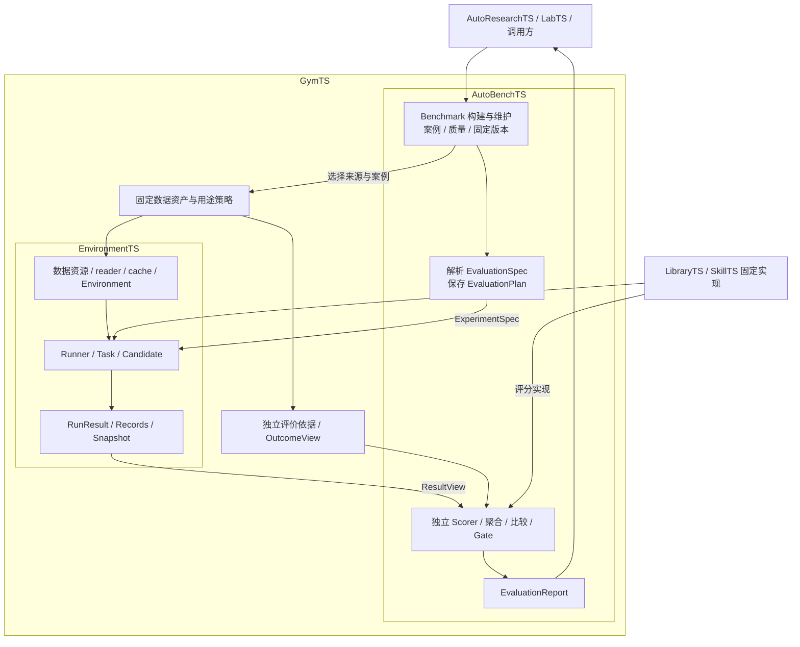

# EnvironmentTS 数据资源与 AutoBenchTS 基准管理设计

状态：设计提案，2026-10-19。本文中的新目录、协议、Python API 和 CLI 尚未实现。现行基线是 GymTS 0.4.1、接口规范 1.1.0。已拆分项目适配包，新增通用训练构建入口、中立领域合同、LibraryTS 适配和 RL 旧 Run 正式评分；这些不代表本文的数据/benchmark 目录功能已实现。

本稿已按用户反馈修正模块归属。上一稿的独立 `bench.evaluate()`、BenchmarkPlan、benchmark run ID 和父 BenchmarkReport 设计撤回。GymTS 仍只有 **EnvironmentTS 与 AutoBenchTS 两个主模块**；数据目录是资源服务，Benchmark 的构建、维护、评价组织属于 AutoBenchTS。

交付遵循[框架演进与可插拔设计 §0](pluggability-design.md)：持续用项目验证和修正公共框架，项目适配与资产独立交付。模块职责属于框架，不意味着每个具体数据集、任务或 benchmark 都要内置于核心安装包。

设计依据：[总体设计](feishu/GymTS总体设计/GymTS总体设计.md)、[运行机制](feishu/GymTS%20运行机制/GymTS%20运行机制.md)、[正式接口规范 §11](feishu/GymTS接口规范/GymTS接口规范.md)以及[当前项目说明](https://netman.aiops.org/contacts/projects/)。项目说明明确将复现、验收、回归、安全评价及 benchmark 构建维护归 AutoBenchTS；这些是目标职责，当前代码已实现的入口仍为 `evaluate/score`，目录管理需要补充。

用户已明确：本次五份 JSONL **全部是测评 benchmark**。其逻辑分区统一为 `test`，用途为 `evaluation`，划分来源记为 `user_declared_evaluation`。不生成训练集或验证集，不供 RL、SFT、prepare/fit 使用；文件名包含 `rlvr` 不改变这一约束。

## 1. 设计结论

增加类似 HF Datasets 的按 `namespace/name` 发现、按 revision 读取体验，服务现有两模块：EnvironmentTS 通过数据适配取得观测，AutoBenchTS 选择数据与参考、构建案例、固定评价方案并调用 EnvironmentTS。目录本身不组织模型运行、评分或发布。

| 对象 | 管理内容与归属 | 身份 |
| --- | --- | --- |
| SourceDatasetRevision | EnvironmentTS 数据资源服务：数据、schema、分区、使用约束、源文件与导入血缘 | `dataset_id + config + content revision` |
| BenchmarkDefinition | AutoBenchTS 的可复用资源：案例、数据修订、Task/Binding、解析与评分、基线和运行条件 | `benchmark_id + definition revision` |
| EvaluationSpec / EvaluationPlan | AutoBenchTS 现有评价安排与实际固定计划：案例×候选×重复次数 | 现有 `evaluation_id`、plan_ref、unit_id |
| EvaluationReport | AutoBenchTS 现有指标、覆盖、基线差异、Gate 与证据报告 | 现有 EvaluationReport 修订与引用 |

数据更新产生新的 SourceDatasetRevision；更改评分器或解析容错产生新的 BenchmarkDefinition 修订。Definition 是可复用的评价配方，由 AutoBenchTS 解析为现行 EvaluationSpec；不另建评价执行器或报告体系。一个数据集可以支持多个 benchmark 配置，一个 suite 可以引用多个数据集。

网页中的 AutoResearchTS 提出研制和测试安排、组织评审；本地规范将方案选择、评审与发布批准交给 LabTS 或调用方。这里按职责对应，不认定发生过名称迁移。AutoBenchTS 给出固定评价依据和结论。LibraryTS 提供被测方法、生成器、数据处理算子和评分实现，经适配分别用于 Candidate、Environment 和 Scorer。数据文件不等于 LibraryTS 方法，评价通过也不等于发布批准。

现有 `gymts.dataset/1` 已用于**执行轨迹的训练导出**，继续保持原语义。新源数据协议采用 `gymts.source-dataset/1`，不能复用训练 Manifest 冒充 HF 式源数据目录。

HF 支持多种输入格式、固定 revision 与 split 加载，使用 Arrow 作为本地缓存；其 Dataset Card 保存来源与使用说明。本设计借鉴这些方式，同时增加 GymTS 的评测用途、输入/答案隔离和执行血缘。参考：[加载接口](https://huggingface.co/docs/datasets/en/loading)、[Arrow 缓存](https://huggingface.co/docs/datasets/en/about_arrow)、[Dataset Cards](https://huggingface.co/docs/hub/en/datasets-cards)。

## 2. 存放位置

| 内容 | 建议位置 | 存储性质 |
| --- | --- | --- |
| 通用数据资源合同、发现与读取调度；通用基准定义解析与评价编排 | 主仓库 `gymts/environment_ts/` 与 `gymts/autobench_ts/` | 框架能力；不包含具体题库或项目名称分支 |
| 具体数据定义、Dataset Card、reader 配置与导入器 | 独立数据资源/适配包，或显式配置的外部 catalog | 作为 EnvironmentTS 数据资源注册；不随核心 wheel 发布 |
| 具体 Benchmark 定义、案例配置、质量与版本说明 | 独立 benchmark 资源/适配包，或显式配置的外部 catalog | 由 AutoBenchTS 管理和解析；不随核心 wheel 发布 |
| 原始文件、规范化 Parquet、时序数据、不可变发布清单 | `GYMTS_DATA_HOME`，本机建议 `/zzr/data/gymts` | 长期数据资产；适合共享目录/对象存储 |
| 已下载 shard、Arrow 缓存、可重建 catalog 查询索引 | `GYMTS_CACHE_HOME`，默认 `$XDG_CACHE_HOME/gymts` 或 `~/.cache/gymts` | 本机 POSIX 文件系统；可删除后重建 |
| 活动实验数据库、Run CAS、轨迹、报告 | 显式 `GymTS(root=...)`，例如 `~/.local/state/gymts/experiments/<id>` | 本机 POSIX 文件系统 |
| 完成后的实验证据归档 | `GYMTS_DATA_HOME/archives/evaluations/` | 按 evaluation_id 保存长期不可变归档 |

`/zzr/data` 已存在，`/zzr/data/gymts` 是拟定的新子目录，本轮未创建。当前 `/zzr` 是 S3FS 挂载；适合存不可变数据与归档。SQLite WAL、现有 ArtifactStore 的原子发布以及 Arrow mmap/锁需要本地 POSIX 存储，不能直接放在共享 S3FS 上。

拟定目录：

```text
主仓库/                                 # 核心/适配包分层已建立；资源包及目录仍为提案
  gymts/environment_ts/                 # 现有执行模块；通用数据资源服务待扩展
  gymts/autobench_ts/                   # 既有 evaluate/score；benchmark 目录服务待扩展
  adapters/                            # 已有 chatts/、timesigma/、rl/、timeseries/、libraryts/ 独立包
    bench-tsqa/                         # 拟新增资源/适配包，尚未创建
      pyproject.toml
      src/gymts_bench_tsqa/
        datasets/local/tsexam-mcq/dataset.json
        datasets/local/tsexam-mcq/README.md
        datasets/local/bedtime/dataset.json
        benchmarks/local/tsexam-mcq/benchmark.json
        benchmarks/local/ts-qa-suite/benchmark.json
        ...

/zzr/data/gymts/
  objects/sha256/<前两位>/<完整内容hash>
  datasets/local/tsexam-mcq/revisions/<revision>/manifest.json
  autobench/benchmarks/local/tsexam-mcq/revisions/<revision>/benchmark.json
  archives/evaluations/<evaluation_id>/evidence.tar.gz

~/.cache/gymts/
  objects/sha256/...                 # 经过 hash 校验的本地副本
  arrow/<dataset_revision>/<view>/   # 可重建的本地查询缓存
  catalog.sqlite3                   # 可重建索引，不是数据真相来源

~/.local/state/gymts/experiments/<id>/
  records.sqlite3
  artifacts/                        # 现有 Run CAS
```

内容对象按 hash 去重。Manifest 中记录逻辑文件名（例如 `inputs/test-00000.parquet`）、对象地址、SHA256、字节数、媒体类型和行数。原始附件不依赖 Codex 的临时 attachment 路径长期存在，也不加入源码 wheel。

随资源包发布的定义通过 `importlib.resources` 读取，并明确纳入该资源包的 wheel/sdist；不能假定安装后还存在源码 checkout。复用既有插件发现与显式启用机制，并补充版本化资源声明，具体注册 API 尚待实现；只读取定义不触发数据下载、模型加载或训练。资源包可以同时提供 reader/Task/Scorer 工厂，但执行代码遵循插件显式启用合同。

支持额外配置的外部 catalog，同名不同定义必须报冲突，不能静默覆盖。这里的 catalog 只表示可搜索、可定位的资源目录，不是第三个 GymTS 主模块。上面的包名和 `/zzr/data/gymts` 是本项目的部署示例；框架不硬编码包名、数据集名或绝对数据路径。新项目添加资源/适配包与配置即可登记，移除本批题库后框架和其他接入仍可工作。

## 3. 存放形式

每个源数据修订保留五类资产：

| 资产 | 推荐格式 | 作用 |
| --- | --- | --- |
| 原始附件 | 原样 JSONL | 字节级 SHA256、来源行号与回溯；包括原始题目和参考 |
| 公开输入 | 分片 Parquet | 问题、时序引用、列名、公开任务标签 |
| 时序表 | 分片 Parquet，变长数值列表 | 按内容 hash 复用相同时序，支持多序列、不同长度 |
| 私有参考 | 独立 Parquet | answer、attributes、结构化目标与评分依据 |
| 发布/质量清单 | JSON；说明卡用 Markdown | 固定版本、schema、使用范围、导入器、完整性与质量问题 |

Arrow 是本地派生缓存，Parquet 是长期规范数据。小数据也允许受控 JSONL reader，但原始 JSONL 不作为每次实验重复解析的唯一运行格式。HF/PyArrow 是可选读取后端，不成为默认 GymTS 的强制依赖。

五份文件存在 1–33 条序列/样本、长度 1–2048、ragged 长度组合，不能固定成 `[1,1024]`。本批数值可规范为 Float64，记录 dtype/shape/顺序，保留原始字节；不预先转成模型的 FP16/BF16。模型 processor 的转换属于运行时变换并进入原生轨迹。

公开输入的一行建议为：

```json
{
  "sample_id": "稳定的源样本身份",
  "content_id": "问题与有序时序内容的hash",
  "group_id": "时序bundle或源曲线族身份",
  "source_row": 1,
  "split": "test",
  "task_kind": "mcq_label",
  "messages": [{"role": "user", "content": "原始问题文本"}],
  "series_ids": ["sha256:..."],
  "cols": ["ts"],
  "public_metadata": {}
}
```

参考表通过 `sample_id` 对齐，使用明确的 `target_kind`、`target_schema_ref` 与 `target_json`（canonical JSON 字符串）保存不同结构的参考，避免 Arrow 把字符串、字典、列表混成同一个不稳定列类型。来源中的原始 `answer/attributes/type` 保留在原始资产或私有 provenance 中；经过逐字段审查后，才提升为公开 metadata。

同一时序的多道题保留各自 sample，不进行静默去重。`content_id`、原子 series hash、group_id 用于重复检查和跨数据源污染检查；排序、筛选、取子集形成新的固定 View，不改原数据修订。调试子集的报告明确标记 subset，不能冒充全量 benchmark 结果。

## 4. 本次五份附件

先使用 `local/` 命名空间，不凭文件名声称已核实官方来源或许可证。

| 建议 dataset ID | 原文件 | 行数 | 完整时序 bundle 数 | 初始用途 |
| --- | --- | ---: | ---: | --- |
| `local/bedtime` | bedtime.jsonl | 394 | 192 | test / evaluation |
| `local/dataset-a-rlvr` | dataset_a_rlvr.jsonl | 411 | 136 | test / evaluation |
| `local/mcq2` | mcq2.jsonl | 100 | 100 | test / evaluation |
| `local/timemqa-full` | timemqa_full.jsonl | 17,703 | 17,363 | test / evaluation |
| `local/tsexam-mcq` | tsexam_mcq.jsonl | 746 | 724 | test / evaluation |
| 合计 | | **19,354** | | |

全部 JSONL 可解析，数值有限，序列/列名/时序占位符数量对应；每行的 attributes 和 ability_types 长度均为 1。五文件之间未发现完全相同的输入、完整 bundle 或单条序列，检查采用统一数值表示后的内容 hash。

逐文件 SHA256、尺寸、题型和分组、重复及待审证据保存在本地附件只读审计 `docs/examples/benchmark-upload-audit-2026-10-19.json`。该文件包含私有题目和参考摘录，不随源码公开；它描述此次附件，不是已发布的 SourceDatasetRevision。（发布整理注：本段仅更新审计材料的分发说明。）

必须分别固定解析和评分规则：

- `bedtime`：197 道判断题与 197 道选择题，分别绑定布尔和 MCQ 解析规则。
- `mcq2`：每题两条时序、四个文本选项；参考开头的 `1.` 是**题号**，不是选项编号。应按导入器解析成稳定 choice ID 并保留原文本映射。
- `tsexam-mcq`：按题干选项解析字母参考，保留 choice 顺序与原始题干。
- `timemqa-full`：6,904 道布尔题、10,799 道字母选择题，必须按任务配置解析，不能仅按数据集名选择一个 parser。
- `dataset-a-rlvr`：有噪声、趋势和局部事件等结构化/文本参考；文件名不代表任何答案都已可用确定性 reward 验证。

质量问题必须随版本保存，不能导入时静默改题或提高分数：

1. `answer` 与 `attributes[0]` 在三个文件中完全相同。它们是参考依据，不能作为公开模型输入。
2. `dataset-a-rlvr` 存在 22 条额外重复公开输入，9 组相同输入有不同参考表示。例如第 11/13 行位置和幅值相同，类别分别为一个类别列表与单个类别。可能是同义/粗细类别或标注差异，尚不能判定为错误；记录 `ambiguous_targets`，等待原评分脚本或显式多参考规则。
3. `tsexam-mcq` 有 5 条额外完全相同输入重复，未发现参考冲突；默认保留源行，评测去重/加权需另一个显式配置。
4. `timemqa-full` 的部分选择题没有可识别的显式选项，部分题干疑似残缺。启发式检测的 398 条“未解析选项”和 538 条“参考字母未出现在已解析选项”只是待审 flags，不等于人工确认错误数，二者也不能直接相加当排除量。

数据可先登记和浏览，AutoBenchTS 在 benchmark 构建与维护中记录这些质量问题。原始 full 配置保留全部 19,354 个源行身份、重复与同曲线多题。格式/Task/Scorer 合同缺失在计划校验阶段报错；参考未决由固定评分规则报告 missing/insufficient_evidence 和 coverage，不自动剔除题目或缩小 eligible 分母。若建立 reviewed 子集，由 AutoBenchTS 发布独立 Definition/config，固定 inclusion/exclusion 清单与相对 full 的覆盖率，不能替代原始 full。

## 5. 最小的版本清单

SourceDatasetRevision（新协议 `gymts.source-dataset/1`）至少包含：

```json
{
  "protocol_version": "gymts.source-dataset/1",
  "dataset_id": "local/tsexam-mcq",
  "config": "default",
  "revision": "sha256:<规范manifest内容hash>",
  "schema_ref": "gymts.ts-qa-sample/1",
  "splits": {"test": {"row_count": 746, "split_origin": "user_declared_evaluation"}},
  "usage_policy": {"allowed_uses": ["evaluation"], "training_allowed": false},
  "source_files": [{"name": "tsexam_mcq.jsonl", "sha256": "<原文件hash>", "size_bytes": 8984435}],
  "importer_ref": {"name": "ts-qa-jsonl-importer", "version": "1.0.0", "origin_ref": null},
  "inputs": ["<公开Parquet shard资产引用>"],
  "series": ["<时序Parquet shard资产引用>"],
  "targets": ["<私有参考shard资产引用>"],
  "quality_report_ref": "<固定质量报告引用>"
}
```

这里的 shard 资产引用需新增明确的 DatasetAssetRef（uri、sha256、size_bytes、media_type），不能把共享目录路径伪装成现行 ArtifactRef。具体字节对象经过 reader 下载/校验/materialize，才成为当前 Run CAS 的正式 ArtifactRef。

修订 hash 固定源字节、schema、导入器/变换、分区及用途等语义内容；缓存位置、下载时间与访问计数不进入内容身份。同样内容重复导入应幂等。`v1.0.0` 等易读标签在计划创建时解析为不可变 hash；执行不能追逐 `latest`。

AutoBenchTS 的 BenchmarkDefinition（拟定资源格式 `gymts.autobench.benchmark/1`，不是新的执行协议）至少固定：

- dataset ID/config/不可变 revision、split、样本选择与排除清单。
- Task 协议/版本，public projection、提示模板、时序变换与可见信息。
- parser、verifier/scorer 的 ComponentRef、实现来源和参数；选择题编号/标签、容错、数值 tolerance、同义/多参考策略。
- 所需 Candidate 能力，模型上下文/输出限制、重复次数、seed 和输入顺序。
- 指标、分母、格式错误/失败/截断/缺参考的处理、覆盖率与聚合规则。
- 需要拟合或归一化时的可见数据和另获授权训练源；这五份 eval-only 源不能隐式提供训练前缀。

聚合使用 AutoBenchTS 既有 ComparisonSpec/ScorerManifest，不另写分母、failure rate 或 Gate 逻辑。现行 group_by 必须包含 evaluation_case_id，可加 tags.dataset/task_kind；增加 group_id 标签本身不等于已经实现曲线级重加权。macro_mean 按所有预期组等权、先聚合重复；不足依据不得静默忽略。需要 micro、加权总分或其他聚合时，作为 AutoBenchTS 的显式扩展提出，而不是由目录层偷偷计算。

## 6. AutoBenchTS 怎样构建和维护 Benchmark

AutoBenchTS 的职责覆盖测评前后，流程如下：

1. 根据测试目标选择历史数据、已有 benchmark、trace/annotation、生成器、仿真或试验台，形成案例草案及 Task/Binding；不把所有场景降格成静态文件问答。
2. 检查覆盖、重复、标注、时间/信息可见性和候选能力，保存质量问题与版本建议。原始 full 案例不因自动检查而被删除；基准纳入与修订按上位调用方的评审/授权记录固定。
3. 冻结 BenchmarkDefinition、数据修订、参考修订、parser/scorer、预期案例、运行约束、比较基线与 Gate。
4. 将 Definition 与本次候选、重复 seed 和目的解析为现有 EvaluationSpec。由 AutoBenchTS.evaluate 在首个 Run 前保存 EvaluationPlan、展开预期单元，再调用 EnvironmentTS。
5. AutoBenchTS 使用独立 OutcomeView 调用 Scorer，组织指标、覆盖、基线比较和门槛结论，交付原生 EvaluationReport。
6. 后到真值、参考修订或 scorer 更正时形成新 ScoreSpec，由 AutoBenchTS.score 复用旧 Run；不重新生成原输出，不覆盖旧报告。

复现、验收、回归、安全测试是 AutoBenchTS 的目标用途。现行 EvaluationSpec.purpose 只有 development/regression/acceptance；复现与安全配置要显式映射既有 purpose 和案例 tags，或正式扩展合同，不能直接填入不支持的 purpose。五份 QA benchmark 不能证明现场控制、延迟或安全要求已覆盖；这些由相应 Environment/Task/Scorer 和验收条件另行定义。

## 7. 怎么调用

已有可执行入口仍是 `gym.run(ExperimentSpec)`、`gym.autobench.evaluate(EvaluationSpec)` 与 `gym.autobench.score(ScoreSpec)`。以下目录管理与解析方法属于**拟新增能力**，实际评价两行保持原入口：

```python
from gymts import GymTS

with GymTS(root="/root/.local/state/gymts/experiments/tsexam-run") as gym:
    # 拟新增：EnvironmentTS 的数据资源服务，仅负责资源读取。
    ds = gym.environment_ts.datasets.load_dataset(
        "local/tsexam-mcq", revision="1.0.0", split="test")

    # 拟新增：AutoBenchTS 内部的基准发现、登记和配置解析。
    print(gym.autobench.list_benchmarks())
    evaluation_spec = gym.autobench.resolve_benchmark(
        "local/tsexam-mcq", revision="1.0.0",
        candidates=[{"candidate_id": "chatts", "spec": candidate_spec}],
        purpose="regression")

    report = gym.autobench.evaluate(evaluation_spec)  # 现有入口

    # 后续更正依据/评分时，score_spec 明确选择已有 Run 与新参考版本。
    rescored = gym.autobench.score(score_spec)         # 现有入口
```

`resolve_benchmark` 只解析与固定资源，输出现有字段，不自行再展开一份 expected unit 清单。案例×候选×重复次数、unit_id、计划提交、执行失败出口和报告均由现有 evaluate 负责。

Dataset handle 可逐步提供 info/features、索引/批读取、select/filter、iter_batches、streaming 与可选 HF/NumPy 适配。HF 风格的顶层 load_dataset 如需提供，只是 EnvironmentTS 数据资源服务的便利封装。它不拥有候选调用、评分或报告权限；`ds[0]` 为公开题目，参考由 AutoBenchTS 的获准服务单独读取。

五份测评资源请求 train/validation、training target、训练准备或 RL label export 时明确拒绝。另获授权的训练来源单独注册，不改变这五份 benchmark 身份。

CLI 中数据命令是资源便利入口，benchmark 管理归 AutoBenchTS，执行和重评分继续使用已有命令：

```bash
# 下列目录/管理命令拟新增。
gymts datasets list
gymts datasets info local/tsexam-mcq --revision 1.0.0
gymts autobench list
gymts autobench resolve local/tsexam-mcq --revision 1.0.0 --candidate candidate.json --output evaluation.json

# 现行原生入口，使用解析好的正式配置。
gymts evaluate evaluation.json
gymts score score.json
```

没有完整 Task/parser/scorer 合同的配置在执行前报错，数据仍可登记和浏览。自由文本不自动触发付费 judge；如配置 LLM judge，需显式版本、预算与调用证据。

## 8. 两模块中的位置与必要适配



需要明确完成、不能假定已有的适配：

1. **EnvironmentTS 数据资源扩展。** 现有 DataView 只支持 JSON all/rows/json_pointer；Parquet、streaming、Arrow 和内容下载由 reader 提供。选定内容显式 materialize 为当前 store 的 ArtifactRef，再形成 SourceSpec/DataView，不往现行 ArtifactRef 中塞 file/http URI。
2. **公开输入与独立参考。** RestrictedServices 授予整个 source ArtifactRef 的读取权限，columns/json_pointer 不构成隐藏真值。Environment/Candidate 仅获得获准输入；完整 source manifest、私有参考与评分依据通过另一路授权给 AutoBenchTS。
3. **Task、Candidate 与 Scorer 绑定。** 现有 RL Task/Candidate 仅支持 GSM8K 数字和 ChatTS summary，不能给这五份附件直接评分。新增 boolean/MCQ/结构化 QA Task/Scorer，复用 LocalPolicy 后端与已有 Registry；核心 Runner 不按 benchmark 名称分支。
4. **同构与异构评价。** 协议/result/outcome schema 及评分语义兼容的多个数据集可组成一份 EvaluationSpec，用 tags.dataset/task_kind 分层；真正异构时由 AutoBenchTS 分成多份原生 EvaluationSpec/Report。需要 suite 导航时保存这些报告引用的普通索引制品，不另建 BenchmarkPlan、BenchmarkReport、调度器或总分机制。
5. **用途保留。** 源用途为 evaluation；公开 DataView 可为 runtime，评分 DataView 为 evaluation，Outcome.allowed_uses 仅为 evaluation。test→某 adapter 的 eval 枚举转换是记录在案的视图投影，不授权训练。
6. **来源与基准血缘。** RunMetadata.source_refs/usage_policy_ref 尚未从新目录传播，各 SourceSpec.connection schema 也严格。需设计通用 provenance 入口和装配传播。AutoBench 的 EvaluationSpec/Plan 需要显式 benchmark_definition_ref 等来源关联时，必须同步 schema、校验和正式接口次版本；当前 _common 会拒绝未知字段，不能声称已经能传入。
7. **模型和随机性身份。** 基础权重/adapter 与实际实现固定为候选身份；seed 通过执行条件/任务运行上下文传递，作为 repetitions 的变化，不借随机 seed 把一个候选拆成不同方法。每个预期候选的实现、参数与准备策略仍按 AutoBench 原校验固定。
8. **版本、计划与归档。** Definition、源/参考和投影先固定，EvaluationPlan 在首个 Run 前提交；失败单元仍保留。RecordSnapshot 表示实际执行与 Outcome，不是源数据修订。数据资产独立于任一活动 Run，评价归档保存选中内容与正式报告，重评分仍调用 score。

## 9. 现有 RL 交付与 AutoBenchTS 的真实边界

现有 RL 接入验证了真实模型采样、原生轨迹、reward、GRPO 参数更新、adapter 重载和留出样本推理。训练命令 `train.py` 的自动 heldout 路径仍调用 `rollouts(split="eval")`，汇总 verifier 诊断；其中 `evaluation_status` 只检查 Run 成功，不能代替 AutoBenchTS 报告或 Gate。

0.4.1 已增加独立 `rl-qa-scorer`，声明 accuracy/format_valid 与固定 eligibility，通过 `gymts_rl.evaluation.score_rollout_runs` 或 `gymts-rl score` 将已封存 eval Run 与获准 evaluation Outcome 形成正式 ScoreSpec，由现有 AutoBenchTS.score 生成 EvaluationReport。显式选择新的 Outcome revision 可重评同一输出，不加载模型、不重训；缺参考保留 missing，非法参考保留 invalid，train-only 用途拒绝，无 Gate 不自动通过。验证包含新参考修订、原 Run 不变和零新增 Candidate 调用。这补齐旧 Run 的独立评价，不把原 rollout.metrics 重命名成正式报告。

历史 RL seed 位于 CandidateSpec.params，模型身份来自常驻对象；重评分按原配置与捕获的实际修订保留候选身份，不强行合并 seed。未来正式 benchmark 的新 `evaluate` 路径仍需补可装载 checkpoint/执行 seed 绑定，再由 AutoBenchTS 预先固定候选与重复单元。旧 Run ScoreSpec 只说明明确选中的历史单元，不声称补齐未执行的候选/案例组合。

训练扩展同时已有公开 `gymts.training.build_dataset(spec, records, artifacts)`、DatasetBuilderProvider/Registry 和选中 provider 的 entry point。核心核对固定 ComponentRef、公共 Manifest/BuildSpec 及 CAS 身份，领域 profile 保留在适配包；具体 RL exporter 继续保持原 schema/builder/sample 身份。既有 TRL 后端通过注入 rollout provider 消费已发布 native shards，并以小型 CPU 上游 loss/backward、真实 optimizer.step 和参数变化核验连接。训练扩展没有成为第三个主模块，也不提供这里拟议的源数据/benchmark 目录。调用说明见[框架指南](framework.md)与[RL 接入指南](rl-integration.md)。

## 10. 落地顺序与验收

第一阶段完善 EnvironmentTS 的数据资源读取与 AutoBenchTS 的 benchmark 目录/登记，五份源保持 eval-only。AutoBenchTS 建立 full 案例定义、Task/scorer 绑定与质量记录；不在一个独立 catalog 项目里形成新测评流程。

第二阶段打通一份已明确评分规则的 benchmark：AutoBenchTS.resolve → 原生 EvaluationSpec → evaluate → EnvironmentTS Run → Scorer → 原生 EvaluationReport。随后用新参考/评分版本通过 score 重评同一 Run，核对模型调用次数没有增加。

第三阶段由 AutoBenchTS 扩展更多 benchmark、同构多数据集与异构 suite 索引，覆盖复现、验收、回归及具体安全案例；同步补数据流式读取、HF 导出和资产迁移。测试既有 baseline、repetitions、eligible 分母、缺参考、失败/取消、Gate 和不可变报告，不能在便利接口中复制这些逻辑。

本提案的数据目录 API、BenchmarkDefinition 协议及便捷 CLI 仍未实施；五份附件尚未导入长期数据仓库。0.4.1 的独立包、公开训练构建服务、中立领域协议、LibraryTS 和 RL 旧 Run 评分均不实现本提案的资源发现、下载、登记或这五份 benchmark 的测评接线。适配包交付状态见[适配包入口](../adapters/README.md)，未提交 Git。
