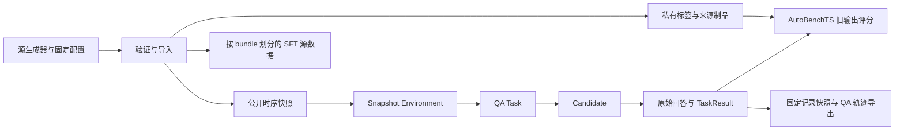

# ChatTS 合成数据与实验 Pipeline

本接入使用 GymTS `/1` 消息合同，当前随 GymTS 0.3.1 提供。数据导入需要另外取得兼容的 ChatTS 生成器仓库或已有 profile；这些材料不随 GymTS 分发。运行时不依赖源仓库的 Python 模块。生成阶段通过子进程调用源生成器，保留其配置、seed、文件摘要、代码摘要和 Git 工作区状态。

已完成数据生成/导入、按 bundle 划分训练与评价集、原生时序 SFT 源数据导出、Environment、Task、原生 ChatTS 与普通文本 LLM 两类 HTTP Candidate、数值基线、Scorer、AutoBenchTS 评价、标签追加、旧 Run 重评分和固定快照的 QA 轨迹导出。真实 ChatTS 权重实验需要一个可连通的原生时序推理服务；普通文本 LLM 使用独立的 `chatts-text-http` 接口。训练器与 GPU 训练不在这条默认流水线中。

## 一条命令运行

在 GymTS 项目根目录执行：

```bash
python3 -B -m gymts.integrations.chatts.pipeline \
  --source-repo /path/to/ChatTS-Bench-new \
  --output .gymts/chatts-experiment-001
```

默认复用源仓库的 `.conda/task-system/bin/python`，也可以用 `--python /path/to/python` 指定已有环境。GymTS 核心、导入、评价与 HTTP Candidate 仅使用标准库；源生成器需要其自己的 NumPy/PyYAML 等依赖。不会安装依赖、修改源代码或下载模型。输出目录必须是新目录，以免覆盖实验。

默认 Candidate 是 `chatts-signal-baseline`，使用公开数值信号计算趋势、异常、预测及其他任务答案。这是接口集成验收基线，报告中的分数属于该算法，不代表 ChatTS 模型能力。默认仅评价 bundle 留出的 `eval` split。

连接模型时修改 [Candidate 配置](../examples/chatts_http_candidate.json) 中的服务地址、模型、部署版本和可用的 `expected_system_fingerprint`，再执行：

```bash
python3 -B -m gymts.integrations.chatts.pipeline \
  --source-repo /path/to/ChatTS-Bench-new \
  --candidate-config examples/chatts_http_candidate.json \
  --output .gymts/chatts-model-001
```

此时同时比较模型和数值基线；`--no-baseline` 仅运行配置的候选。配置文件可为单个 `{candidate_id,spec}` 或此类对象的数组。凭证使用 `api_key_env` 指定环境变量名称，不能把明文密钥写入配置。

## 使用普通文本 LLM（DeepSeek）

[deepseek_candidate.json](../examples/deepseek_candidate.json) 使用独立注册的 `chatts-text-http@1.0.0`，复用同一公开 TaskInput、严格解析、评价与重评分流程。运行前通过本地密钥管理方式在当前进程环境中设置 `DEEPSEEK_API_KEY`；配置只保存变量名，不保存密钥。示例选择 `deepseek-flash` 服务别名，`thinking_mode=disabled`、`json_object=true`，实际请求带 `thinking={"type":"disabled"}` 和 `response_format={"type":"json_object"}`。

优先复用已生成的两个 profile，在项目根目录先运行每任务一个留出样本的连接验收：

```bash
python3 -B -m gymts.integrations.chatts.pipeline \
  --profile-dir /path/to/profiles/native \
  --profile-dir /path/to/profiles/classical \
  --candidate-config examples/deepseek_candidate.json \
  --no-baseline --max-per-task 1 \
  --output .gymts/deepseek-text-smoke-001
```

上述 source 路径是已有生成材料；若在其他机器运行，请替换成当地的 profile 目录。删除 `--max-per-task 1` 可评价完整留出集；删除 `--no-baseline` 可加入数值基线比较。每次选择新的输出目录，已有实验不会被覆盖。命令本身不代表调用成功或模型结果，实际结果由该输出目录中的报告与原始响应确定。

文本候选使用 `openai-chat-timeseries-text/v1`，将所有公开序列按原顺序、名称和完整数值写入 `named_numeric_json/v1` JSON 文本：

```json
{
  "representation": "named_numeric_json/v1",
  "series": [{"name": "Series 1", "values": [0.12345678901234566, -1.2345678901234567e-12]}]
}
```

数值采用可往返解析的 JSON 序列化，不归一化、舍入、抽样或截断。请求使用普通文本 messages，不发送 ChatTS 顶层 `timeseries`、`<ts><ts/>` 占位符或专有数据 envelope。原生数组仍保留在 GymTS TaskInput 与记录中，因此可以核对原始数值和实际发送的文本表示；私有标签、源样本 ID 与生成元数据不会进入 wire。

服务别名不等于 checkpoint。示例中的 `model_revision=deepseek-flash-api-alias` 只说明配置声明的服务身份；制品记录 `revision_provenance=configured_alias`、`model_revision_semantics=configured_service_alias`、`weights_pinned=false`，不能据此声称固定了底层权重。文本候选的 `evidence.kind=text_llm_http`，原生候选为 `chatts_http`，两类输入表示在报告和轨迹中保持可辨认。

## 其他运行入口

其他入口：

```bash
# 使用已经生成的两个 profile，不再运行生成器
python3 -B -m gymts.integrations.chatts.pipeline \
  --profile-dir /path/to/native --profile-dir /path/to/classical \
  --output .gymts/chatts-import-001

# 小规模重复实验；限定 task 也可加 --tasks pattern.trend_direction
python3 -B -m gymts.integrations.chatts.pipeline \
  --source-repo /path/to/ChatTS-Bench-new \
  --max-per-task 2 --repetitions 2 --output .gymts/chatts-smoke-001
```

安装后也可使用 `gymts-chatts`。`--evaluation-split all` 可以做全数据集成验收，但会包含导出训练集中的样本；研究结果应采用独立评价 split。`--seed` 控制 bundle 划分和执行重复种子；生成 seed 来自源生成器配置，并独立记录。

## 任务与组件

| Task / 源版本 | 默认 profile 样本数 | 输出 | 指标 |
| --- | ---: | --- | --- |
| `pattern.trend_direction / 0.2.0` | 36 | trend_direction | accuracy |
| `anomaly.point_indices / 0.2.0` | 48 | indices | event_f1，容差 0 |
| `forecast.numeric / 0.2.0` | 32 | forecast | MAE、RMSE |
| `pattern.seasonality_profile / 0.1.0` | 36 | profile | accuracy |
| `process.stationarity_type / 0.1.0` | 48 | type | accuracy |
| `relation.lagged_dependence / 0.1.0` | 36 | direction、lag | exact_match |
| `similarity.shape_retrieval / 0.1.0` | 48 | candidate_id | accuracy |

通过 `GymTS(integrations=("chatts",))` 或 `gym.enable_integration("chatts")` 显式注册，组件版本均为 `1.0.0`。默认 `GymTS()` 不导入该集成。专用 pipeline 和 `gymts-chatts` 命令自行启用；通用 CLI 使用 `gymts --integration chatts ...`：

| 角色 | adapter / plugin | 实现 |
| --- | --- | --- |
| Environment | `chatts-synthetic-snapshot` | [environment.py](../gymts/integrations/chatts/environment.py) |
| Task | `chatts-synthetic-qa` | [task.py](../gymts/integrations/chatts/task.py) |
| Candidate | `chatts-http`、`chatts-signal-baseline` | [candidate.py](../gymts/integrations/chatts/candidate.py) |
| 文本 LLM Candidate | `chatts-text-http` | [text_candidate.py](../gymts/integrations/chatts/text_candidate.py) |
| Scorer | `chatts-qa-scorer` | [scoring.py](../gymts/integrations/chatts/scoring.py) |
| 导入/导出 | `import_profiles`、`generate_profiles`、`export_sft` | [data.py](../gymts/integrations/chatts/data.py) |
| 编排 | `run_pipeline` | [pipeline.py](../gymts/integrations/chatts/pipeline.py) |

所有任务使用协议 `gymts.task/chatts-qa/1`；每份评价报告固定一个源 Task/版本。异质任务不合成单一总分。Forecast 的总分是逐样本 MAE/RMSE 的平均，各 horizon 样本等权。

## 数据边界



源 `instance_id`、`bundle_id`、`view_id` 含有 increasing、clean 等答案线索，生成元数据和 series.properties 也包含标签。导入后公开样本只保留不透明 SHA-256 token、源 Task 身份与白名单模型输入；原始 ID、gold、元数据和归因保存在另一个私有制品中。

Environment 通过 `SourceSpec.connection.artifact_refs=[public_snapshot_ref]` 显式获得公开快照的读取权限。Runner 只授权该列表中的精确不可变引用，不递归授权嵌套引用。Task 和 Candidate 不继承 Environment 的制品权限；Candidate 仅接收本次 TaskInput，也不能读取整份公开快照或私有 gold。

TaskInput 的 `payload.value` 直接为：

```json
{
  "messages": [{"role": "user", "content": "..."}],
  "timeseries": [[0.1, 0.2, 0.3]],
  "series_names": ["Series 1"],
  "output_schema": {"type": "object"},
  "context": {}
}
```

序列顺序与公开名称一一对应，包含五条序列的 shape retrieval 不假定第一条就是 query。输入保留原生数值，不提前做模型归一化。源数据没有真实时间戳/缺失 mask，接入也不伪造这些观测字段；Environment 的 step 是样本索引。Forecast 的公开 horizon 从源提示提取，再与私有目标形状核对，future 数值不会进入输入。

## 推理与采集

`chatts-http` 支持两个已存在于源项目中的 wire dialect：

- `chatts-timeseries/v1`：原始 messages 加顶层 `timeseries` 数组。
- `chatts-vllm-text-envelope/v1`：消息 content parts 中的 `chatts-timeseries:v1:` 原生数据 envelope。源提示没有占位符时，按名称追加附件与 `<ts><ts/>`；已有完整占位符时逐个对应插入，禁止重复或部分匹配。

两类 HTTP Candidate 每次 `infer` 均只发送一次非流式请求，使用独立 I/O 超时。HTTP 错误、超时和未知状态均不自动重发。原生输入、实际 wire payload、响应对象、usage、finish_reason 和模型返回的 fingerprint 保存为不可变制品，其引用进入 `CandidateOutput.payload.evidence`；完整回答文本进入 `raw_text`，由 Runner 先保存再交 Task 解释。

原生 `chatts-http` 的 `model_revision` 表示配置声明的固定外部部署，prepare 证据明确记录 `revision_provenance=configured`、`revision_verified=false`。部署方需固定 checkpoint；提供 `expected_system_fingerprint` 时每次响应严格核对。在同一个 Run 中观察到 model/fingerprint 变化也会失败。每样本一个 Run，跨 Run 固定服务身份需要配置预期 fingerprint，不能将客户端字符串当成已验证的权重摘要。`chatts-text-http` 则按上述服务 alias 语义记录身份。

当前保存的是原生数值数组与 QA 请求/响应，`recording.model_calls=none`。未捕获 processor 内部张量、token IDs、logprobs 或 response mask；不会把服务返回的 token 数量视为 token 级轨迹。泛化 `TraceCollector`、Agent Lightning/Trinity-RFT 后端和 RL rollout 构建器仍需单独接入。

## 解析、评价与失败

Task 使用源 structured_json 严格口径的标准库实现：不修复 Markdown fence、解释文字、重复 key 或非有限数。异常索引必须非负、严格递增且不越界；预测必须完整覆盖公开 horizon；lag 与方向必须一致。格式失败保留原始文本并产生 invalid TaskResult，空字符串也可以进入这一流程，不因此虚构模型答案。

每个 evaluation unit 固定一个样本，每个 Scorer 调用最多一个结果，eligible=1。模型异常、缺结果、缺标签和 invalid 结果保留在计划中。计数满足 `eligible=scored+missing+invalid+excluded`，无效输出不自动作为可解析零分。每份报告同时给出覆盖率与执行失败数；七个任务分别评价。

Pipeline 先运行无标签评价，再将源 gold 以 `allowed_uses=[evaluation]` 追加到已封存 Run，生成固定 OutcomeView，调用 `AutoBenchTS.score` 重评分。相同样本在候选与重复之间复用同一不可变标签版本。重评分前后核对 Run ID 和 RunResult 摘要，不再次推理。

默认 Gate 只检查执行失败率为 0、评分覆盖率为 1，表示接口验收通过，不表示准确率达标。缺失或格式失败会令 pipeline 返回非零退出码，同时保留报告与失败证据。

## 输出和后续消费

```text
output_dir/
  source_profiles/                  fresh 源生成物与 source_provenance.json
  records/                          SQLite 与不可变 CAS 制品
  import.json                       固定公开/私有/归因引用
  configs/*.evaluation.json         每任务完整评价配置
  configs/*.score.json              复用旧 Run 的评分配置
  reports/*.before_labels.json      无标签初始报告
  reports/*.json                    标签到达后的正式版本报告
  datasets/synthetic_sft/            train.jsonl、eval.jsonl、manifest.json
  datasets/trajectories/             qa_trajectories.jsonl、manifest.json
  summary.json                      实验汇总、实现摘要与结果引用
```

`synthetic_sft` 是带 `model_input` 和 `answer` 的 GymTS 原生多模态监督源格式，明确标注 `answer_source=synthetic_gold`，按完整反事实 bundle 分层划分。它未直接套用某训练器的数据格式；实际训练还需要 trainer exporter、模型模板、processor 与训练配置。该导出不等于训练已经执行。

`qa_trajectories.jsonl` 从固定 RecordSnapshot 中的 RunResult 引用读取已封存 trace，保存 input/output/result、Candidate 身份和血缘。失败后的缺失 output 保留为 null；manifest 明确 `native_rollout=false`、缺失 token/logprob 字段、`training_eligibility=not_assessed`。数值基线输出不会混成 synthetic_gold 或 ChatTS 模型输出。

普通 CLI 可以直接消费保存的配置，重评分不会调用模型：

```bash
python3 -B -m gymts --integration chatts --store /path/to/output_dir/records \
  score /path/to/output_dir/configs/pattern_trend_direction.score.json
```

已有真实生成与数值基线验收材料见 `output/experiments/chatts-synthetic-v0.2-2026-10-12/summary.json`（本地产物，不随源码分发）。两个 source profile 总计 284 条、88 bundles；seed=7 时 train=236/eval=48，bundle 无交叉。留出 48 个样本覆盖全部七任务。

2026-10-12 的 本地 DeepSeek 实验报告 `output/experiments/deepseek-eval-2026-10-12/REPORT.md`复用该留出集：48 次真实 API 调用全部返回，47 条通过严格解析，1 条异常检测回答长度截断而 invalid；异常检测评分覆盖率 Gate 失败，六类任务通过。该真实失败保留原文、计划分母及证据，没有自动重试或修复。另有每类一条的 本地 smoke 汇总 `output/experiments/deepseek-smoke-2026-10-12/summary.json`。源 profile 声明 `formal_benchmark=false`，这些小规模开发材料不构成广泛模型能力结论。

可用只读审计脚本独立核对已有实验，不读取凭证、不调用 API：

```bash
python3 -B scripts/audit_chatts_http_experiment.py \
  output/experiments/deepseek-eval-2026-10-12 \
  --output .gymts/deepseek-evidence-audit-001.json
```

脚本检查 CAS 摘要、公开输入与实际 wire 的完整数值/名称投影、raw 响应保存、评分分母、重评分前后 RunResult 引用及内容，拒绝覆盖已有审计文件。`audit_status=pass` 表示证据一致；模型存在 invalid 时，实验的 `pipeline_status=failed` 仍保留。

## 验证

```bash
python3 -B -m unittest discover -s tests -v
```

新增测试覆盖导入完整性与白名单、bundle 隔离、真实 Task/Runner 边界、原生与普通文本 HTTP wire、数值精度、凭证脱敏、原始文本保留、严格解析、评分分母、多候选与重复标签关联、旧 Run 不变及固定快照导出。HTTP 测试使用明确标记的 fixture，真实模型成绩必须由实际服务调用产生。
