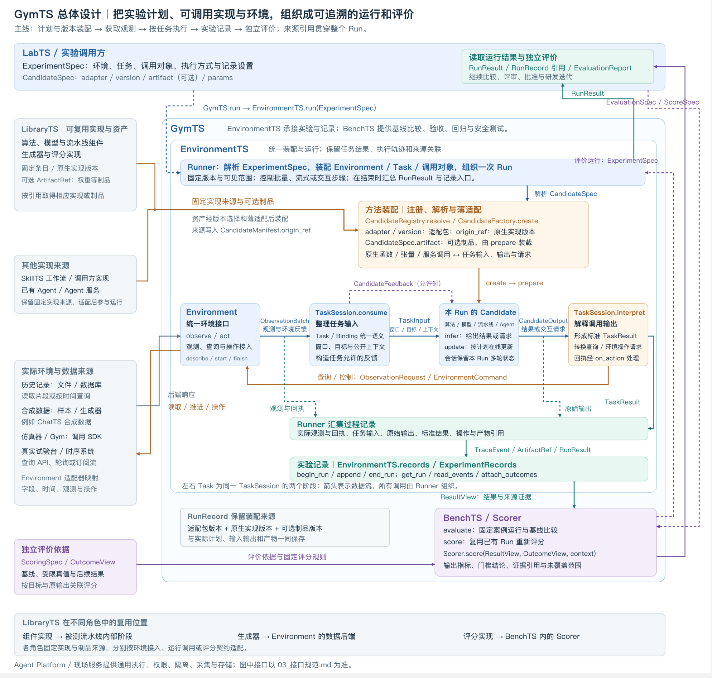

# GymTS总体设计

GymTS 接收一份时序实验计划，从指定的数据或系统中取得观测，按任务规则组织运行，交付任务结果和运行记录；需要测试、比较或验收时，再按独立评价方案生成报告。

**整套设计围绕一条主线：实验计划 → 环境观测与交互 → 任务结果及其证据 → 评价结论。**

## GymTS 要解决什么问题

面向具体现场开发时序方案，需要在现场数据、运行条件和业务要求下开展实验，判断方案的表现、适用范围以及是否满足交付要求。方案交付为 Time Series Agent 后，数据、工况或需求的变化又会引出新的改进与验证工作。

**GymTS 的目标是为这一研发过程提供实验与测试支撑，使方案能够运行、交互和比较，使每次改动都有可复核的实验与测试依据。**

## GymTS 接收什么（Input）

一次普通实验使用 ExperimentSpec；它引用所需数据和实现，实际观测由环境适配器按计划取得。

需要评价时，另给 EvaluationSpec：测试案例、候选与基线版本、评分规则、比较方法及评价依据。

已有运行结果需要重新评分时，用 ScoreSpec 指定原 Run 和本次评分安排。

## GymTS 对外交付什么（Output）

1. RunResult 用 `result_ref` 指向任务结果、`trace_ref` 指向运行记录、`artifact_refs` 指向产物。数据可以留在现场存储，交付对象携带可解析的固定引用，不要求把全部数据嵌进一次返回。

2. 运行完成就可以交付结果和记录；评价报告在执行评价流程后产生。没有标签时仍能交付预测或检测结果，但不能凭这些输出计算有监督准确率。

3. 在运行过程中，GymTS 还会向被调用对象提供 TaskInput 和任务允许的反馈。这是内部交互接口，与交给实验发起者的上述三类产物分开。

## 两个主要模块怎样完成这些职责

GymTS 内部的主要模块是 **EnvironmentTS 和 AutoBenchTS**。

## 贯穿整套设计的四项关系

### 5\.1 一份计划确定一次 Run

Run 有明确的任务、环境、被调用版本和运行范围。批量处理一段数据、连续观察一段时间、运行一个控制回合，都可以构成 Run。

计划在开始时解析为具体版本和配置，实际启动信息再补入记录。之后的输入、输出、操作和反馈都关联这个 Run；长期生产服务不会因为采用同一算法就自动成为同一个实验。

### 5\.2 任务含义连接环境观测与处理结果

环境说明“能提供什么观测、支持什么操作”；任务说明“本次要看哪些信息、何时调用、结果对应什么目标”。

例如，环境提供 `cpu_utilization` 百分比序列，任务绑定把它对应为 `cpu` 比例值，再按 60 点窗口构造输入。模型自己的插补、归一化和特征处理属于被测方法，不由框架默认代做。

### 5\.3 运行结果必须能关联到当时证据

核心关联是：

`计划与版本 → 当时观测/任务输入 → 原始输出 → 标准任务结果 → 后续结果`

有交互时再加入 `输出 → 操作 → 回执/后继观测`。原始预测不会因未来真值到达而被改写；新真值与原输出关联，重评分产生新报告。

### 5\.4 运行与评价使用不同的信息范围

运行侧只交付任务当时允许使用的数据和反馈。评价侧使用预定标签、未来实际值或其它结果依据，计算规定指标。

这既允许在线学习，也保留独立评价：学习所用反馈必须由任务和计划明确，不能把评价专用真值自动送回运行中的方法。报告通过某项门槛，也不等于版本已经获准发布。

这四项关系决定了接口、记录与扩展方式。

## 数据从哪里来，怎样进入 GymTS

已有 Gym 类接口通过桥接接入，其背后可以是仿真或实际设备。它是接口形式，不另外定义一种物理数据来源。所有来源统一交付 ObservationBatch，后端的时钟、可读范围、操作和重置能力由自身描述。

算法、模型和工作流的代码/制品是另一类输入来源。LibraryTS 提供的这些资产通过运行适配调用；它们与环境观测不能都笼统称为“数据输入”。

## LibraryTS 的实现怎样成为本次运行的 Candidate

**LibraryTS 保存可复用的实现与制品；Candidate 是 GymTS 在一次 Run 中使用这些实现的调用实例。** 两者的关系需要经过选择和适配：

`LibraryTS 条目及固定版本 → 调用适配与声明 → 按实验计划装配 → 本 Run 的 Candidate`

例如，LibraryTS 中的一份检测实现可以在两个 Run 中分别使用不同参数；两个 Candidate 都关联同一个实现版本，但各有自己的运行状态、输入和结果。已有模型或 Agent 服务也可以复用，本次装配只创建对应的调用会话。

LibraryTS 与 Candidate 不是一一对应：若干组件可以组成一个 Candidate；同一实现也可以被多个实验调用。库中的生成器由环境适配使用，评分函数由 AutoBenchTS 的 Scorer 使用。Agent 等实现还可来自 SkillTS、已有代码或服务，经同一调用契约参与实验。

## 与周边系统的分工

交付后的业务 Agent 运行结果可以成为下一轮研发的材料；被选入实验的片段按来源和可见时间接入，生产轨迹不要求全部经过 GymTS。实验中的 Agent 则只是被调用对象，身份由它在本次工作的角色决定。

