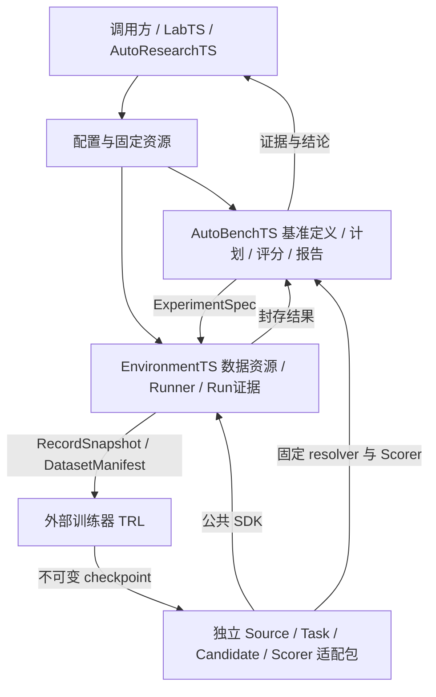

# GymTS 0.5.0 设计对齐与交付记录

日期：2026-10-20。正式基线为[接口规范 1.2.0](feishu/GymTS接口规范/GymTS接口规范.md)。本文对照[原始项目理解](项目理解.md)、[可插拔设计](pluggability-design.md)、[资源设计](dataset-benchmark-catalog-design.md)及[项目网页](https://netman.aiops.org/contacts/projects/)，区分本轮实际验收与完整设计目标。

当前已形成可运行、独立交付的本地实验与评价框架，主线与设计一致；完整的平台执行能力和资源运营流程尚未交付。没有给整个设计计算一个完成百分比：静态问答、本地原生训练、现场交互和分布式部署的验收标准不同，不能按文件数或测试数合成进度。

## 1. 三项目标的实际边界

| 目标 | 本轮交付 | 验收与限制 |
| --- | --- | --- |
| 数据与 benchmark 可按 ID/revision 使用 | EnvironmentTS 数据目录；AutoBenchTS 基准登记/解析；私有参考隔离；源用途与血缘；独立 TSQA 资源包 | 五份源共 19,354 行已登记；全量 TSExam 746 行原生 evaluate 与同 Run score；其他四份可读，但未声称全量模型评测完成 |
| 训练后产物进入正式评价 | 真实 TRL 更新；固定权重/adapter/tokenizer/processor/血缘 archive；新进程 Candidate；重复 execution seed；独立重评 | 微型 CPU 模型工程验收，非零梯度、权重变化、重载一致；仅 2 个官方 GSM8K train 题有效优化，ChatTS 真实准备及留出评价；本轮 processor=None，未验收原生 ChatTS processor；实际准确率 0.0 |
| 用异构项目验证适配标准 | 纯 describe/compatibility 与 plan；Run 建立后实际打开；TimeSigma 原生 AR fit/score/replay；LibraryTS 真实方法回归 | 源码与安装核心按冻结 hash 核验；项目适配不向核心增加项目名分支；合成 AR fixture 是接口验收，非业务 benchmark |

最后一轮统一冻结核心的验收已通过，原始报告列在下表。之前的候选验收与完整证据保留，最终结论绑定实际安装的 wheel 与源码内容身份。

## 2. 框架与项目的交付边界

核心只有 EnvironmentTS 与 AutoBenchTS 两个主模块，以及共享的合同、Registry、存储和训练构建服务。默认核心不导入项目包、不依赖 PyArrow/torch/TRL/sktime。六个独立适配发行包是 timeseries、libraryts、chatts、timesigma、rl、bench-tsqa；可按需安装和显式启用。共享领域合同不因为多个项目使用就变成核心业务代码。

这一边界适用于所有项目。LibraryTS 只是外部工具集的一种适配，框架不内化它或其他项目的工具目录、算法与资产平台。Agent 是工具调用的决策主体，工具提供方实现调用，GymTS 提供通用接口、执行边界和证据关联；具体职责与 Run 内/Run 外两类 Agent 位置见 [Agent 与工具集接入边界](agent-toolsets.md)。

Source 提供公开来源事实，Task 定义任务语义，Candidate 的 codec 构造原生模型请求，Scorer 持有独立评价依据。已有兼容组合可替换；不兼容的任务、维度、训练语义必须明确拒绝，不宣称所有模型都能处理所有 Task。LibraryTS 来源仍为用户指定的 NetmanAIOps/sktime 固定提交。

本记录中的 LibraryTS 固定算法 Candidate、standalone 工具调用及 TimeSigma Research journal 各自证明了真实执行与记录，没有验收通用的“Agent 选择工具 → 执行 → 结果续推”循环。已有输入上的纯计算可以由 Run 内 Agent 调用外部工具；新增实验环境数据或动作须经 TaskRequest、Task、Runner 与 Environment。Run 外 Research Agent 调用实验/评价 API 时，应以父轨迹关联子 Run，不能把原生库的独立实验入口当作 Run 内纯计算工具。

网页将研发、评审与业务 Agent 更新分给 AutoResearchTS/EvolveTS；GymTS 提供实验和评价证据。完整 Research/Memory 自动循环、资产发布批准、业务部署和共享 ChatTS FM 更新不因此进入核心范围。训练是可选外部扩展，轨迹不自动等于奖励。

## 3. 本轮发现的合同缺口及处理

| 触发问题 | 修改归属 | 最终行为 |
| --- | --- | --- |
| validate 构造组件会访问模型/数据 | 公共 Registry、EnvironmentTS 装配生命周期及各适配器纯 hook | plan/validate 只读配置和声明；实际资源检查 deferred_to_open；打开失败保留 Run |
| seed 位于 Candidate 参数导致 repetitions 改变候选身份 | CandidateContext 与适配器 | 每 Run execution_seed/rng；记录实际生效值；历史显式 seed 配置保留原语义 |
| 源数据和轨迹训练导出复用名称会混淆 | 独立资源合同与两模块服务 | source-dataset 与已有训练 dataset 协议分开；BenchmarkDefinition 解析为原生 EvaluationSpec |
| 公开读取可能带入参考或丢失源用途 | 数据服务、AutoBenchTS provenance、训练构建入口 | 公开/私有分路；精确选源；eval-only 的训练/prepare/dataset_build 用途在读取、训练 Run 和导出边界被拒绝 |
| 原 benchmark 被通用 QA 提示改写 | 独立 bench-tsqa Task/codec/parser | 保存完整原题与数值，仅附件标记可逆投影；显式记录本地评分规则 |
| Definition 中规则可被静默忽略 | bench-tsqa resolver | 严格允许五个规则字段及支持值，错误策略和未知 selection/scorer 明确 unsupported |
| 并发 writer 可重绑同一 release alias | 通用 ResourceStore | 同机 POSIX 持久 sidecar 锁包住检查与原子提交；实际多进程竞争回归；不承诺跨主机事务 |
| 训练产物依赖进程内常驻 policy | RL 适配包 | 单 archive 固定资产与训练血缘；新进程从 CAS 装载；发布时基础文件不符训练加载身份、外部基础装载 hash 不符、内嵌 provenance 不符原引用摘要时拒绝；内嵌发布后原工作目录可移除 |

0.5.0 的 Python SDK 装配行为有显式迁移：Environment/Task 需要纯描述 provider，validate 返回内联 resolved_spec，resolved_spec_ref 为 null；不能依靠旧构造副作用通过校验。既有 `/1` 运行消息、历史组件和旧 Run 身份保留。完整 v2 wire/Runtime 仍是草案，不能由这些增量推断已实现。

## 4. 最终验收与证据

核心源码回归 160/160 通过；六适配包独立发行检查通过。干净标准库环境中科学依赖相关用例显式跳过，随后独立 opt-in 环境的 TSQA 7/7、RL 87/87、TimeSigma 75/75、LibraryTS 10/10 全部通过且无跳过。ChatTS 71/71 与共享时序合同 7/7 在独立安装检查中通过。以上本机验证使用 Python 3.11，不代替其他解释器版本的 CI 结果。[最终交付核验](reports/framework-goal-acceptance-2026-10-20.json)汇总六份报告、三份完整归档校验、源码冻结身份、文档链接与 Git 未提交状态。

| 验收 | 原始报告 | 范围 |
| --- | --- | --- |
| 核心独立发行与回归 | [core-package-check-2026-10-20.json](reports/core-package-check-2026-10-20.json) | wheel、sdist 重建、源码目录外安装、公开 SDK 外部插件与核心回归 |
| 六适配包独立发行 | [adapter-package-check-2026-10-20.json](reports/adapter-package-check-2026-10-20.json) | 每包独立安装、显式启用、移除、旧 Run 重评分及共同启用；科学测试另行 opt-in |
| 全量 746 行原生评价与重评 | [bench-tsqa-full746-final-2026-10-20.json](reports/bench-tsqa-full746-final-2026-10-20.json) | Python/CLI 读取与 resolve；全部源输入一致；私有隔离和用途拒绝；score 不改变原 Run |
| 训练 → 新进程 → evaluate → score | [rl-checkpoint-loop-2026-10-20.json](reports/rl-checkpoint-loop-2026-10-20.json) | 实际 TRL 两步；2 留出任务 × 3 seed，重复一次；checkpoint 制品/训练血缘与 token 复现 |
| 异构原生项目 | [timesigma-frozen-core-final-2026-10-20.json](reports/timesigma-frozen-core-final-2026-10-20.json) | 原生 AR 训练、无训练推理、新进程重放、8 项原生评分及相同封存 Run 重评 |
| LibraryTS 原生回归 | [libraryts-native-final-2026-10-20.json](reports/libraryts-native-final-2026-10-20.json) | 指定上游实现、工具、原生数据、模型与独立 Scorer |

[冻结身份记录](reports/core-frozen-identity-2026-10-20.json)与精确核心 wheel 已一起归档至 `output/frozen-core-final-2026-10-20/core/`。最终冻结源码范围为 `gymts/**/*.py + setup.cfg`，tree SHA-256 为 `8990de5a08378498c47853f238f7ae27c6f0072c1ea61bd29328294c6b8b9e20`；实际 native 验收核心 wheel SHA-256 为 `cea1ab0bdccf479820d9e9cf20cfc4a82c733978e7c722151601067e8925d226`。源码构建的 ZIP 元数据可能不同，因此同时核验安装文件与源码内容，不能只比较版本号。

最终记录保留在本机 `output/` 的忽略目录，compact JSON/log 在 docs/reports。数据资产不进入 Git 源码包。没有调用付费 LLM，没有 Git stage、commit 或 push。

## 5. 距离完整设计还差什么

| 优先方向 | 当前可用 | 尚需交付 |
| --- | --- | --- |
| 适配器公共规范 | 同步 `/1` 生命周期、纯计划、真实资源打开、领域合同与三侧替换 | 完整 v2 Source/Method/Runtime 消息、通用 worker/RPC、取消和强制超时、并行恢复 |
| benchmark 构建与维护 | 固定资源登记、质量记录、Definition、evaluate/score | 更多原 verifier、reviewed 子集、异构 suite 导航、人工审核与版本发布流程 |
| Agent 与外部工具集 | LibraryTS 十个原生工具、数据 loader、两个算法 Candidate、Scorer；通用 ModelCall/ToolCall 与环境请求基础 | 验收可替换 Agent 对不同工具集的选择、执行、结果续推及完整轨迹；完善实际暴露的公共合同缺口。工具集资产管理、持久模型发布和审核由外部项目或调用方负责 |
| 训练后端 | 原生 QA rollout、证据导出、TRL GRPO、checkpoint 评价链 | 更多真实模型/任务、SFT/偏好/多轮 profile、verl/分布式桥接及质量验收 |
| 现场与平台能力 | 历史/合成输入、通用交互合同、本地证据 | 真实系统、成熟仿真/试验台适配、延迟与闭环控制安全验收、凭证/隔离/多团队治理 |
| 资源读取体验 | 固定 ID/revision、Parquet/JSONL、select/filter/batches、可选 HF 导出 | 远程 catalog 同步、流式超大数据、跨主机并发事务和资源运营 UI |

后续继续用真实项目触发最小缺口，不以一次性重写 v2 代替接入验收。格式/算法/模型差异留在适配器；生命周期、权限、身份或证据的通用缺口才修改核心，并同步正式规范、兼容说明及旧项目回归。每个新项目是否需要改核心，应由实际合同缺口判断，不能预先承诺永远只改配置。
