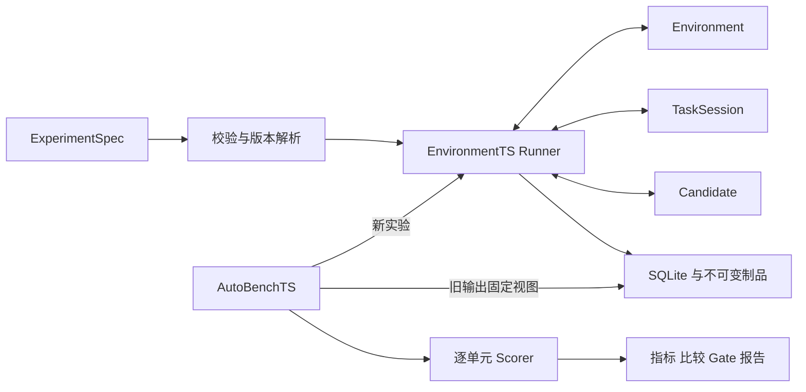

# GymTS 0.3.1 框架实现与任务接入指南

更新于 2026-10-18。本文说明已经实现的本地框架及接入方法；字段合同以[接口规范 1.1.0](feishu/GymTS接口规范/GymTS接口规范.md)为准。1.1.0 只向 ScoreSpec 增加可选 tags，现有 `/1` 消息及无 tags 配置保持兼容。

## 实现结构

对外消息采用 JSON 字典，公共类型位于 `gymts.contracts.types`，插件方法通过 `typing.Protocol` 表达。`TypedDict` 提供静态类型，运行时由 schema 和服务边界检查。普通函数、算法、模型和 Agent 均可实现 Candidate，无需继承框架基类。



`GymTS(root)` 装配内置插件、本地 ArtifactStore、LocalExperimentRecords、EnvironmentTS 和 AutoBenchTS。高级调用方也可分别构造这些对象，注入自己的存储、Registry 和服务。

默认装配不导入或注册 ChatTS。使用该集成时显式传入 `GymTS(root, integrations=("chatts",))`，或在现有实例调用 `gym.enable_integration("chatts")`。`GymTS.available_integrations()` 仅读取已安装入口元数据，不导入集成实现。CLI 使用全局选项 `--integration chatts`；专用 `gymts-chatts` 命令自行启用。

独立分发包可声明 `gymts.integrations` entry point，值指向 `register(registries, schemas)` 函数，例如 setup.cfg 中的 `myteam = mypackage:register`。用户安装后显式启用 `myteam`，不需要修改 Runner 或内置注册函数。启用只适用于可信插件，不提供 Python 沙箱。

## 一次运行

1. 展开已规定的默认值，拒绝未知字段；检查环境/任务/Candidate 的协议、参数、schema、单位、维度、能力、固定来源与制品。
2. 保存解析后的 ExperimentSpec，建立 Run 并提交 run_start。
3. 启动环境，记录 SessionInfo，检查真实来源、范围、时钟、所有权及公开上下文；计算 effective_scope 后绑定 TaskSession。
4. 为本 Run 创建 Candidate，prepare 后记录实际修订和制品。
5. 请求并提交观测，交 Task 消费；保存输入，先处理允许的在线反馈，再调用 Candidate。保存原始输出后解释结果/查询/动作。
6. 环境请求和操作意图先提交，再调用后端。query 回到 consume；动作回执回到 on_action；同 case 的续轮优先于其他排队 case。
7. 达到决策边界后，按配置继续只读反馈；尽力清理 Candidate、Task、Environment，记录未完成 case，封存 Run。

末批仍完整处理。对于原生 transition，范围内合法动作产生的边界状态与奖励属于执行证据，必须保存；决策输入仍遵守半开 effective_scope。`waiting` 不推进游标，不重复推理；合法空时间窗必须推进 coverage 和游标。

`max_inputs`、`max_operations` 计尝试，`max_turns_per_case` 限制同 case 的调用次数。框架不自动重试 infer/update/interpret/act。操作回执为 unknown 时保存不确定性并停止该 Run，不自动重发。

## 接入一个任务

先从 [forecast.py](../gymts/plugins/forecast.py) 和 [counter.py](../gymts/plugins/counter.py) 选择接近的交互形式，按以下顺序交付。

| 交付 | 具体要求 |
| --- | --- |
| schema | 参数、输入、原始输出、标准结果、alignment、可选 outcome；配置对象使用 `additionalProperties=false` |
| Task | `describe` 明确变量/操作/schema/预热；`bind` 为每 Run 创建 Session；实现 consume/interpret/on_action/finish |
| Environment | describe/start/observe/act/finish；声明来源修订、可见前沿、查询和操作能力、所有权及原生结束状态 |
| Binding | 逐变量固定来源/单位、逐操作固定参数 schema；不依赖同名推断语义 |
| Candidate | Manifest 声明兼容任务与 I/O、fit/update/修订能力；prepare/infer/update/finish 保留原生计算 |
| Scorer | 固定 eligibility 实现和键 schema；只读固定结果/依据，返回独立计数和缺失原因 |
| 材料 | 小型固定 fixture、ExperimentSpec、EvaluationSpec/ScoreSpec、相应合同测试 |

注册可以在业务入口中完成：

```python
from gymts import GymTS

with GymTS(root=".gymts", register_builtins=False) as gym:
    # register_my_plugins 按本项目 plugins/__init__.py 的模式登记
    # schema 和完整 Manifest；factory 可以是函数或实现 create 的对象。
    register_my_plugins(gym.registries, gym.schemas)
    result = gym.run(my_experiment)
```

业务的 `register_my_plugins`、Manifest、schema 与配置需要实际实现，以上仅表示组合方式。注册必须早于 validate/run，不修改公共 Runner。注册名称和版本不能覆盖已有不同实现。

TaskInput 的 observation_refs 使用已提交事件 ID 或不可变制品引用。Task 可通过 `execution['data'].observation_ref(batch_id)` 取得本次观测事件 ID，不能把未持久保存的临时数据路径当作证据。

Candidate 通过 `context['resources']` 访问指定模型/状态/训练视图并保存新制品；Task 使用 `execution['data']`。不向 Candidate 提供环境连接或评价专用依据。反馈源授权可以使用精确名称或 `name@version`；同一 feedback_id 的不同内容会冲突，同内容只学习一次。

文件/快照型 Source 可在其 Manifest 的 connection schema 中声明 `artifact_refs` 列表，Runner 验证并仅将这些精确不可变引用授予 Environment；该权限不传递给 Task/Candidate，也不递归授权嵌套引用。ChatTS 接入仅授权公开时序快照，gold 使用独立评价视图。完整接入及代码见 [ChatTS 指南](chatts-integration.md)。

所有插件均为受信任的进程内代码；访问授权通过服务方法约束。对不可信代码、强制超时或资源隔离，应使用外置执行器，不能将 Python 对象封装视为操作系统隔离。

## 独立评价和后到结果

AutoBenchTS 在第一次新 Run 前保存全部预期单元。每个 Scorer 调用只处理一个 unit_id。缺标签不填零，不缩小 eligible 分母；失败、取消和未启动的执行单元始终保留。配置中的证据阈值在候选/组层应用，重复均可计算后才进行平均；macro 对所有预期组等权平均。不同任务合同分别评价。

任意领域的计数单位由版本化 Scorer 决定。框架检查 `eligible=scored+missing+invalid+excluded` 并保存 eligibility_ref；它不能从一个失败且无输出的 Run 推断任意任务的领域样本数。这种单元保持不足，执行失败率仍以全部预期单元为分母。

追加标签使用 `gym.records.attach_outcomes(run_id, records)`，返回固定 OutcomeRef 列表的制品引用。读取完整标签使用 `read_outcomes`，再将固定结果保存成 JSON 制品、组成 `purpose=evaluation` 的 DataViewRef。`available_at` 与服务分配的 `recorded_at` 同时受评分截止约束；修订追加新 revision，不能覆盖旧版本。完整方式见 [quickstart.py](../examples/quickstart.py)。

`score` 只读取旧 Run，不调用 Candidate。RunSelection 可选 tags 默认空；重评分需要原 tags 分组时，从原 EvaluationPlan 复制对应标签到选择项，新计划会将其固定。标签是本次评价安排，不改写执行事实；缺少分组键仍明确拒绝。评分报告持久化后，返回报告对象，并可通过 `last_report_ref` 保存/恢复该版本。

## 本地证据存储

默认根目录 `.gymts/`：

```text
records.sqlite3       Run/事件/Outcome 的事务索引
records.sqlite3-wal   SQLite 正在使用的 WAL（存在时）
artifacts/blobs/      按 SHA-256 保存的不可变字节
artifacts/refs/       固定媒体/schema/内容身份的引用清单
```

`local` 与 `local://records/default` 均映射到注入的本地记录后端。append 返回前事务已提交；制品采用先同步字节、再原子发布引用。读制品会验证引用和内容摘要，不能通过修改 URI/元数据读取其他路径。

封存时先产生不引用自身 trace 的 run_end，再保存包含它的执行快照，最后一致发布 RunResult。封存失败回滚记录事务；未引用的制品可能留下，后续可增加垃圾回收。封存后新执行事件被拒绝，已有同 ID/同内容重试仍幂等；标签和评价不改写执行记录。

该后端适用于本地部署，不包含远程对象存储、多租户授权、备份/容灾或执行恢复。备份正在使用的 SQLite 时应使用 SQLite backup API 或先关闭连接，不能只复制主数据库文件而漏掉 WAL。

当前本地制品后端使用 POSIX 目录描述符和禁止跟随符号链接的文件操作，支持范围为 Linux/macOS；Windows 未验证，也不承诺等价的本地存储保证。

## 尚需接入的能力

| 能力 | 本轮行为与接入位置 |
| --- | --- |
| 绑定单位/参数转换 | 非空 transform 明确拒绝；后续注入固定版本转换服务，并登记输入/输出单位与 schema |
| 真实文件/云数据与实时系统 | 已支持 ChatTS 源 profile 导入为不可变公开快照；其他文件/云/实时系统仍需 adapter |
| 凭证 | 默认没有 credential provider；真实适配器通过环境侧专用服务注入，不能写入普通记录 |
| llm_trace | 目前只允许 model_calls=none；ChatTS HTTP 已保存 QA 原生数值与请求/响应制品，未捕获模型内部 token/logprob/张量 |
| training_export | 已有 ChatTS synthetic_gold 监督源数据与固定 RecordSnapshot 的 QA IO 导出；训练器格式转换、偏好/RL 构建器仍需实现 |
| Lightning/Trinity-RFT | 尚无后端桥接；按模型调用身份/token/策略版本和数据集血缘合同逐一接入 |
| schema | 内置支持明确 JSON Schema 子集；未知关键词注册时拒绝；全量词汇可替换 SchemaRegistry |
| DataView | 本地 JSON selector 支持 all/rows/json_pointer；as_of 必须为空，时间截止先解析成固定结果，评分本身仍检查 Outcome 双截止 |
| 调度与超时 | 同步串行；wall limit 在调用边界检查，I/O 需后端超时；隔离/强制中断/并行另加执行器 |

接入 LLM 时，先打通 TaskRequest 暂停/恢复和真实请求/响应采集，再增加原生 token、张量、logprobs 和策略修订；缺失字段按规范明确报告。训练导出与后端消费应保持独立版本，不能把可消费缓冲区当作原始轨迹仓库。

## 验收方式

执行 `python3 -B -m unittest discover -s tests -v`。测试文件按合同校验、Runner、存储、插件、AutoBenchTS 与 CLI 划分。运行 `python3 examples/quickstart.py --root .gymts/demo` 可复核实际完整链路。

这些验证使用确定性本地材料及故障注入，不表示真实业务连接器、生产 Agent 或 GPU 训练已通过验收。新插件应补充自身 fixture 和接口规范第 17 节适用的合同测试，再进入下一项接入。

