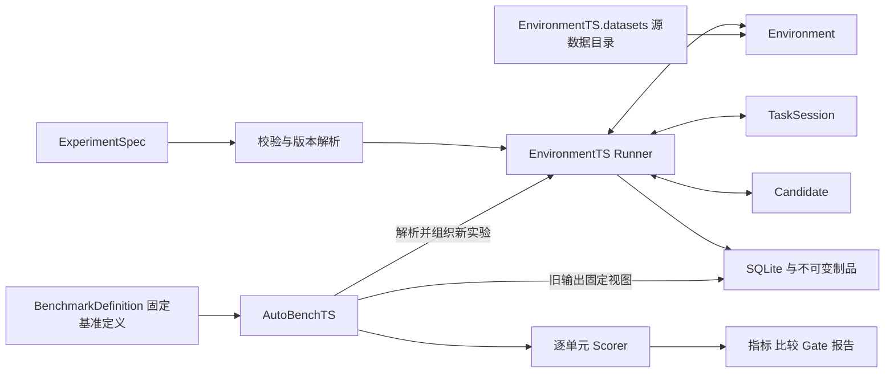

# GymTS 0.5.0 框架实现与任务接入指南

本文说明已经实现的本地框架及接入方法；本轮环境接入验证日期为 2026-10-19。字段合同以[接口规范 1.2.0](feishu/GymTS接口规范/GymTS接口规范.md)为准。0.5 增加声明式装配、执行 seed 与数据/benchmark 资源服务，既有 Environment/Task/Candidate 的 `/1` 方法消息保留；缺少纯描述的旧插件需显式迁移。完整 v2 消息及通用 Runtime 仍为草案。

## 实现结构

对外消息采用 JSON 字典，公共类型位于 `gymts.contracts.types`，插件方法通过 `typing.Protocol` 表达。`TypedDict` 提供静态类型，运行时由 schema 和服务边界检查。普通函数、算法、模型和 Agent 均可实现 Candidate，无需继承框架基类。



`GymTS(root)` 装配内置插件、本地 ArtifactStore、LocalExperimentRecords、EnvironmentTS 和 AutoBenchTS。高级调用方也可分别构造这些对象，注入自己的存储、Registry 和服务。

默认安装不包含项目适配器。先安装独立的 `gymts-chatts`（源码安装为 `pip install . ./adapters/timeseries ./adapters/chatts`），使用该集成时显式传入 `GymTS(root, integrations=("chatts",))`，或在现有实例调用 `gym.enable_integration("chatts")`。`GymTS.available_integrations()` 仅读取已安装入口元数据，不导入集成实现。CLI 使用全局选项 `--integration chatts`；专用 `gymts-chatts` 命令自行启用。

ChatTS、TimeSigma、RL 和 LibraryTS 均位于 `adapters/`，独立安装并通过公共机制接入；核心没有项目清单或项目 CLI。五个原适配包为 0.2.0，新增 `gymts-bench-tsqa` 为 0.1.0，均依赖核心 `>=0.5,<0.6`。项目模块分别为 `gymts_chatts`、`gymts_timesigma`、`gymts_rl`、`gymts_libraryts`，科学运行依赖由适配包或显式原生运行时承担，详见[适配包指南](../adapters/README.md)。

新增的独立领域包 [gymts-timeseries](../adapters/timeseries/README.md) 提供中立数值快照/CSV 来源、七类 QA Task 与 Scorer。其 TaskInput 使用公开数值、任务含义与响应 schema，不含 ChatTS 消息、占位符或模型 processor；本包不包含模型，也不依赖具体模型适配器。[LibraryTS 适配包](../adapters/libraryts/README.md) 依赖这些公共领域合同，接入固定 NetmanAIOps/sktime 原生工具、真实数据 loader、两种数值候选和原生预测评分。当前候选在每次获准窗口上实际执行原生 fit/predict，丢弃临时估计器，不提供持久训练或跨调用学习。中立领域包仍是独立插件，不是新增核心主模块；此次接入不表示 v2 Source/Method/Runtime 草案已实现。

LibraryTS 只是外部工具集的一种接入示例，与其他工具提供方遵守相同边界。框架不内化任何项目的算法、模型、工具目录或资产平台；项目保留实现与依赖，GymTS 提供通用接口、实验生命周期、访问边界和证据记录。外部工具集的模型资产管理或发布流程由其自身与上位调用方负责。

独立分发包可声明 `gymts.integrations` entry point，值指向 `register(registries, schemas)` 函数，例如 setup.cfg 中的 `myteam = mypackage:register`。用户安装后显式启用 `myteam`，不需要修改 Runner 或内置注册函数。启用只适用于可信插件，不提供 Python 沙箱。

本轮另增五个 0.1.0 独立包：`gymts-hf-datasets`、`gymts-interaction`、`gymts-gymnasium`、`gymts-openenv` 和 `gymts-prometheus`。它们通过同一公共 SDK 接入冻结核心；中立 interaction 领域包也在核心之外，不增加第三个主模块。

## Agent 与外部工具集

使用工具的决策主体是 Agent。Run 内的 Agent 经 Candidate 适配接收任务输入，选择工具与参数，消费工具结果并继续决策；工具集适配器只提供可调用实现与版本、输入输出和效果声明。工具集不是新的核心主模块，也不要求每个工具都注册为一个 Candidate。算法直接作为 Candidate 运行仍是合法实验方式，但它与 Agent 选择工具的实验应分别验收。

对已有获准输入做预测、特征或距离计算，可在 Agent 会话内部调用外部工具并记录 ModelCall/ToolCall。取得新的实验环境数据或执行操作，必须由 Agent 请求经 Task 解释为 TaskRequest，再通过 Runner 检查范围并调用 Environment，结果返回同一会话。边界按每项工具的实际效果判定，不能把包含数据加载和独立实验入口的整个工具目录都当作纯计算工具开放。

Run 外的 Research Agent 还可以把 `GymTS.run` 和 `AutoBenchTS.evaluate/score` 当作实验编排工具，父轨迹串联子 Run；它与 Run 内完成任务的 Agent 是两个位置。现有 LibraryTS 固定算法 Candidate、standalone 工具调用和 TimeSigma Research journal 证明了对应调用与记录能力，尚未验收通用的“Agent 选择工具 → 执行 → 结果续推”循环。现行 core 没有通用 ToolBroker；完整职责与待验收项见 [Agent 与工具集接入边界](agent-toolsets.md)。

## 合成、静态、仿真与外部来源

既有生成器继续产生确定性观测，独立 ChatTS 生成接口保持；HF 适配器将固定 Hub 提交、save_to_disk 或明确本地文件冻结为版本化静态资源。Gymnasium 适配器创建自有原生环境；OpenEnv 适配器通过官方持久 WS 新建自有会话；Prometheus 适配器只读附着外部指标服务。格式、原生 API、公开投射和领域评分不进入框架。真实验收与调用见[环境接入指南](environment-adapters.md)。

静态资源公开输入与私有参考分开存放。交互 Source 只在 act 执行一次 step，observe 消费缓存并保存末状态奖励；scope 结束单列 scope_limited，不改写原生 terminated/truncated。只有 done 的外部源使用既有 EndInfo.detail 保存未知原因，相关分类指标 missing。实时来源区分样本时间、接收可用时间和交付 coverage；查询只访问已交付历史，结束只释放本次连接。来源 seed/attach 能力不能实现时明确拒绝。

本轮在源码目录外安装新包，并核对实际核心与冻结 wheel 一致，未改核心或正式字段。已有 TaskRequest.command、native Payload、EndInfo.detail、受限 CAS 和 ResultsView.event_snapshot_ref 足以支持这些差异。HF 限有限一维数值预测视图；本机真实 OpenEnv/Prometheus 服务验收不等于用户生产 testbed 或因果在线预测验收。示例固定策略也不等于已完成 Agent 的工具选择循环。

[本轮十一包独立发行检查](reports/environment-adapter-package-check-2026-10-19.json)已通过构建、源码重建、独立安装、共同启用与移除；最小环境条件跳过和真实原生零跳过结果分开记录。原有 ChatTS、TimeSigma、RL、LibraryTS 与 benchmark 适配保持独立，没有因新来源接入而内化项目。

## 纯计划与实际打开

`gym.plan(spec)` 返回 `gymts.assembly-plan/1`，`gym.validate(spec)` 返回有效性及 issues。两者只检查内联配置、schema、固定 Manifest、纯描述与组合约束；不调用插件 factory、不读取数据/权重/凭证、不连接服务、不提交 CAS。Environment/Task 注册纯 `describe(spec)`，或提供 `factory.describe_spec(spec)`；额外组合约束用纯 `compatibility(context)` 或 `factory.check_compatibility_spec(context)`。缺少纯描述不回退构造实例。

计划明确 `resource_checks=deferred_to_open`。`scene_ref` 的实际读取只在执行入口展开，离线规划需要内联 scene。`run` 先建立 Run 与保存配置，再创建/打开组件和核对实际资源；打开失败留下阶段、错误和部分轨迹并尽力封存。静态计划不证明文件存在、服务在线或真实权重可用；它也不是 AutoBenchTS 的预期评价单元计划。当前没有通用 worker/probe/强制超时 Runtime。

## 一次运行

1. 展开已规定的默认值，拒绝未知字段；纯检查环境/任务/Candidate 的协议、参数、schema、单位、维度、能力和声明的固定引用，实际资源检查推迟到打开。
2. 保存解析后的 ExperimentSpec，建立 Run 并提交 run_start。
3. 启动环境，记录 SessionInfo，检查真实来源、范围、时钟、所有权及公开上下文；计算 effective_scope 后绑定 TaskSession。
4. 为本 Run 创建 Candidate，prepare 后记录实际修订和制品。
5. 请求并提交观测，交 Task 消费；保存输入，先处理允许的在线反馈，再调用 Candidate。保存原始输出后解释结果/查询/动作。
6. 环境请求和操作意图先提交，再调用后端。query 回到 consume；动作回执回到 on_action；同 case 的续轮优先于其他排队 case。
7. 达到决策边界后，按配置继续只读反馈；尽力清理 Candidate、Task、Environment，记录未完成 case，封存 Run。

末批仍完整处理。对于原生 transition，范围内合法动作产生的边界状态与奖励属于执行证据，必须保存；决策输入仍遵守半开 effective_scope。`waiting` 不推进游标，不重复推理；合法空时间窗必须推进 coverage 和游标。

`max_inputs`、`max_operations` 计尝试，`max_turns_per_case` 限制同 case 的调用次数。框架不自动重试 infer/update/interpret/act。操作回执为 unknown 时保存不确定性并停止该 Run，不自动重发。

## 接入一个任务

先从 [forecast.py](../gymts/plugins/forecast.py) 和 [counter.py](../gymts/plugins/counter.py) 选择接近的交互形式，按以下顺序交付。

| 交付 | 具体要求 |
| --- | --- |
| schema | 参数、输入、原始输出、标准结果、alignment、可选 outcome；配置对象使用 `additionalProperties=false` |
| Task | 纯 `describe_spec` 明确变量/操作/schema/预热；纯兼容 hook 声明额外限制；`bind` 为每 Run 创建 Session，实现 consume/interpret/on_action/finish |
| Environment | 纯 `describe_spec` 后再由执行 factory 打开资源；实例实现 describe/start/observe/act/finish，核对实际来源、可见前沿、能力、所有权及结束状态 |
| Binding | 逐变量固定来源/单位、逐操作固定参数 schema；不依赖同名推断语义 |
| Candidate | Manifest 声明兼容任务与 I/O、fit/update/修订能力；prepare/infer/update/finish 保留原生计算 |
| Scorer | 固定 eligibility 实现和键 schema；只读固定结果/依据，返回独立计数和缺失原因 |
| 材料 | 小型固定 fixture、ExperimentSpec、EvaluationSpec/ScoreSpec、相应合同测试 |

注册可以在业务入口中完成：

```python
from gymts import GymTS

with GymTS(root=".gymts", register_builtins=False) as gym:
    # register_my_plugins 按本项目 plugins/__init__.py 的模式登记
    # schema 和完整 Manifest；factory 可以是函数或实现 create 的对象。
    register_my_plugins(gym.registries, gym.schemas)
    result = gym.run(my_experiment)
```

业务的 `register_my_plugins`、Manifest、schema 与配置需要实际实现，以上仅表示组合方式。注册必须早于 validate/run，不修改公共 Runner。注册名称和版本不能覆盖已有不同实现。

TaskInput 的 observation_refs 使用已提交事件 ID 或不可变制品引用。Task 可通过 `execution['data'].observation_ref(batch_id)` 取得本次观测事件 ID，不能把未持久保存的临时数据路径当作证据。

Candidate 从 `context['execution_seed']` 与每 Run 独立 `rng` 取得采样随机性，并记录后端实际生效程度；repetition seed 不进入新候选身份。HTTP 仅发送 seed 时标为未核实。Candidate 通过 `context['resources']` 访问指定模型/状态/训练视图并保存新制品；Task 使用 `execution['data']`。不向 Candidate 提供环境连接或评价专用依据。反馈源授权可以使用精确名称或 `name@version`；同一 feedback_id 的不同内容会冲突，同内容只学习一次。

文件/快照型 Source 可在其 Manifest 的 connection schema 中声明 `artifact_refs` 列表，Runner 验证并仅将这些精确不可变引用授予 Environment；该权限不传递给 Task/Candidate，也不递归授权嵌套引用。ChatTS 接入仅授权公开时序快照，gold 使用独立评价视图。完整接入及代码见 [ChatTS 指南](chatts-integration.md)。

所有插件均为受信任的进程内代码；访问授权通过服务方法约束。对不可信代码、强制超时或资源隔离，应使用外置执行器，不能将 Python 对象封装视为操作系统隔离。

## 独立评价和后到结果

AutoBenchTS 在第一次新 Run 前保存全部预期单元。每个 Scorer 调用只处理一个 unit_id。缺标签不填零，不缩小 eligible 分母；失败、取消和未启动的执行单元始终保留。配置中的证据阈值在候选/组层应用，重复均可计算后才进行平均；macro 对所有预期组等权平均。不同任务合同分别评价。

任意领域的计数单位由版本化 Scorer 决定。框架检查 `eligible=scored+missing+invalid+excluded` 并保存 eligibility_ref；它不能从一个失败且无输出的 Run 推断任意任务的领域样本数。这种单元保持不足，执行失败率仍以全部预期单元为分母。

追加标签使用 `gym.records.attach_outcomes(run_id, records)`，返回固定 OutcomeRef 列表的制品引用。读取完整标签使用 `read_outcomes`，再将固定结果保存成 JSON 制品、组成 `purpose=evaluation` 的 DataViewRef。`available_at` 与服务分配的 `recorded_at` 同时受评分截止约束；修订追加新 revision，不能覆盖旧版本。完整方式见 [quickstart.py](../examples/quickstart.py)。

`score` 只读取旧 Run，不调用 Candidate。RunSelection 可选 tags 默认空；重评分需要原 tags 分组时，从原 EvaluationPlan 复制对应标签到选择项，新计划会将其固定。标签是本次评价安排，不改写执行事实；缺少分组键仍明确拒绝。评分报告持久化后，返回报告对象，并可通过 `last_report_ref` 保存/恢复该版本。

## 训练构建与后端边界

自 0.4.1 起提供正式公开入口 `gymts.training.build_dataset(spec, records, artifacts)`，以及结构协议 `DatasetBuilderProvider` 和 `DatasetBuilderRegistry`。外部 provider 声明固定 `builder_ref`、`target_formats`、`output_schema_refs`，实现 `build(spec, records, artifacts)`；无需接收 GymTS、Candidate 或 Environment 对象。可在 Registry 显式注册后通过 `builders=` 注入，或在 `gymts.dataset_builders` 组发布以 builder 名称为键的 entry point；默认入口只加载当前选中的 provider，缺失、重复提供者、版本或目标 schema 不兼容会明确报错。

```python
from gymts.training import build_dataset

manifest = build_dataset(build_spec, gym.records, gym.artifacts)
```

核心先拒绝禁止训练的来源用途，再校验公共 BuildSpec/Manifest、builder 与后端/转换/奖励映射/tokenization 中声明的固定 ComponentRef，并检查 Manifest 的 build_id、builder、输入快照和输出 schema 与请求一致，CAS 中保存的完整 BuildSpec 未被替换，输出制品已提交，返回内容与已发布 Manifest 一致。核心不解释领域 payload；具体 provider 负责用途、筛选、分段、奖励、token/mask 和 profile 语义。公共 SDK 只是两模块共享的扩展能力，不是第三个训练主模块。

`gymts_rl.exporter.NativeRolloutBuilder` 提供当前 one-call/one-case 原生 QA profile；旧 `build_dataset(gym, spec)` helper 继续兼容，历史组件/schema/builder/sample 身份保持。SFT、偏好、复杂多轮和其他动作空间仍需相应外部 provider，不能因公共入口存在就宣称已支持。

既有 `GymTSGRPOTrainer` 继续复用 TRL 0.18.2 的 loss/backward/optimizer，现可注入 `artifacts` 与 `rollout_provider(inputs, policy, *, generation, seed_start)`。provider 负责采样、保存轨迹并发布 native DatasetManifest；Trainer 读取校验后的固定 shard，不再直接依赖 GymTS 或 GSM8K/ChatTS 数据配置，也不把 provider 内存 rows 当作证据。旧 QA 配方通过闭包兼容。小型 CPU 测试已复核上游 TRL loss/backward、真实 optimizer.step 和参数改变；这验证后端连接，不是新模型质量结论。详情见 [RL 接入指南](rl-integration.md)。

独立 `rl-qa-scorer` 已注册到 AutoBenchTS，提供 accuracy 和 format_valid。`gymts_rl.evaluation.score_rollout_runs` 或 `gymts-rl score` 对已封存 eval Run 和固定 evaluation Outcome 形成原生 ScoreSpec/EvaluationReport；新参考 revision 可显式选择后重评分，不再调用或加载模型。缺参考不补零，train 用途不转成评价，未指定 Gate 不给通过结论。训练命令自动保存的 heldout verifier 统计仍是诊断。现已通过 `checkpoint_bundle_ref` 发布不可变基础身份、adapter/config、tokenizer/processor 与训练血缘，`CandidateSpec.artifact` 可在新进程装配；发布拒绝被替换的基础文件，装载核对内嵌 provenance 与原引用内容身份。`checkpoint_evaluation_spec` 生成原生 EvaluationSpec，多个执行 seed 共用同一候选；`rescore_checkpoint_evaluation` 复用固定输出与依据，不调用模型。历史 seed-in-CandidateSpec 身份仍原样保留。

[RL 完整验收](reports/rl-checkpoint-loop-2026-10-20.json)已实测真实 TRL GRPO 两步更新、16 个训练采样 Run、新进程 6 个新评价 Run、相同 seed 再执行 6 个 Run 与零推理重评。受控微型 Qwen2 使用两个官方 GSM8K train 题产生非零 reward 差异和梯度，ChatTS 数据真实准备并独立评价；准确率为 0.0、格式有效率为 0.5。技术 Gate 只检查执行与覆盖，不能当作训练质量结论，也不代表大型基础模型/全部 processor 已验收。

## 数据与 benchmark 资源

0.5 已交付最小本地资源目录。`EnvironmentTS.datasets` 负责版本化数据资源和公开读取；AutoBenchTS 负责 `BenchmarkDefinition` 的登记、解析与评价。公开入口包括 `list_datasets/load_dataset`、`list_benchmarks/load_benchmark/resolve_benchmark`；DatasetHandle 提供 info/features、索引、select/filter、iter_batches 和可选 HF 转换。reader、领域 schema、私有参考解释与 benchmark resolver 留在独立适配器，核心不包含题库。

```python
from gymts import GymTS

with GymTS('/tmp/runs', data_home='/path/to/resources',
           cache_home='/tmp/resource-cache', integrations=('bench-tsqa',)) as gym:
    rows = gym.environment_ts.datasets.load_dataset(
        'local/tsexam-mcq', revision='1.0.0', config='default', split='test')
    print(len(rows), rows[0]['question_original'])
    print(gym.autobench.list_benchmarks())
```

代码假设已安装 `gymts-bench-tsqa` 并显式导入附件；安装或启用不自动下载/导入数据。资源原始字节、公开/私有 Parquet、卡片、质量报告和清单放独立 `data_home`，缓存放 `cache_home`，不装入核心 wheel；环境变量为 `GYMTS_DATA_HOME/GYMTS_CACHE_HOME`，未设置时使用 XDG 数据/缓存目录下的 gymts。源资源使用内容摘要身份与显式发布标签；Run 仍使用自己的 CAS。解析 benchmark 时把固定清单、定义与用途引用写入原生 EvaluationSpec/Run，不向 Candidate 递归授予私有资源。

五份附件已显式导入为 **5 个 evaluation-only 数据集，共 19,354 行**，全部为 `test/user_declared_evaluation`，`training_allowed=false`；训练、prepare、dataset_build 均拒绝。公开 DatasetHandle 不暴露 raw/targets 引用或答案。原问题、选项、条件、全部有序数值和重复行保留；私有参考通过 evaluation 服务读取。未知参考保留 missing 与 eligible，不补造金标或删题。[完整 746 行测评验收](reports/bench-tsqa-full746-final-2026-10-20.json)已通过公开 Python/CLI 读取、原生 evaluate 和封存 Run 重评分；其 first-public-choice 基线准确率 332/746 是集成覆盖结果，不是模型质量证明。其余 18,608 行已登记并保留参考状态，未据此声称全部执行测评。

`resolve_benchmark` 返回既有 `gymts.evaluation/1`，执行、预期单元、重复、Scorer、Gate 与报告仍只有 AutoBenchTS 原生路径。外部 HF 适配器可按固定提交取得并冻结静态资源；核心不自建远程 Hub。完整 Hub、多租户目录、可视化编辑与发布审批尚未交付。资源别名并发不可变性已修复；最终同版核心发行与六适配包独立发行、全量 746 行及 RL/TimeSigma 原生复验均通过，精确 wheel/hash 与限制见[本轮交付](framework-delivery-2026-10-20.md)。详情见[资源目录设计及实现状态](dataset-benchmark-catalog-design.md)和[TSQA 适配包](../adapters/bench_tsqa/README.md)。

## 本地证据存储

默认根目录 `.gymts/`：

```text
records.sqlite3       Run/事件/Outcome 的事务索引
records.sqlite3-wal   SQLite 正在使用的 WAL（存在时）
artifacts/blobs/      按 SHA-256 保存的不可变字节
artifacts/refs/       固定媒体/schema/内容身份的引用清单
```

`local` 与 `local://records/default` 均映射到注入的本地记录后端。append 返回前事务已提交；制品采用先同步字节、再原子发布引用。读制品会验证引用和内容摘要，不能通过修改 URI/元数据读取其他路径。

封存时先产生不引用自身 trace 的 run_end，再保存包含它的执行快照，最后一致发布 RunResult。封存失败回滚记录事务；未引用的制品可能留下，后续可增加垃圾回收。封存后新执行事件被拒绝，已有同 ID/同内容重试仍幂等；标签和评价不改写执行记录。

该后端适用于本地部署，不包含远程对象存储、多租户授权、备份/容灾或执行恢复。备份正在使用的 SQLite 时应使用 SQLite backup API 或先关闭连接，不能只复制主数据库文件而漏掉 WAL。

当前本地制品后端使用 POSIX 目录描述符和禁止跟随符号链接的文件操作，支持范围为 Linux/macOS；Windows 未验证，也不承诺等价的本地存储保证。

## 支持范围与剩余能力

| 能力 | 本轮行为与接入位置 |
| --- | --- |
| 绑定单位/参数转换 | 非空 transform 明确拒绝；后续注入固定版本转换服务，并登记输入/输出单位与 schema |
| 真实文件/云数据与实时系统 | 已支持既有项目来源、外部 HF 三种静态加载、Gymnasium、OpenEnv WS 与只读 Prometheus；实际范围见环境接入指南，其他来源仍需独立 adapter |
| 凭证 | 默认没有 credential provider；真实适配器通过环境侧专用服务注入，不能写入普通记录 |
| llm_trace | 支持通用 none/io/native_rollout 采集与完整性策略；本地 RL Candidate 保存真实 tokens、模型/采样 logprob、原生 tensor 与固定策略修订；HTTP QA 仍只保存 IO |
| training_export | 核心提供公开三参数构建入口、外部 provider Registry 和证据合同；RL 提供 native QA exporter 与可注入 rollout provider 的 TRL GRPO；SFT/偏好/多轮及 verl 另需适配 |
| Lightning/Trinity-RFT | 尚无后端桥接；按模型调用身份/token/策略版本和数据集血缘合同逐一接入 |
| schema | 内置支持明确 JSON Schema 子集；未知关键词注册时拒绝；全量词汇可替换 SchemaRegistry |
| DataView | 本地 JSON selector 支持 all/rows/json_pointer；as_of 必须为空，时间截止先解析成固定结果，评分本身仍检查 Outcome 双截止 |
| 调度与超时 | 同步串行；wall limit 在调用边界检查，I/O 需后端超时；隔离/强制中断/并行另加执行器 |

本地 LLM 原生采样与训练说明见 [RL 接入指南](rl-integration.md)。缺失字段按规范明确报告；训练导出与后端消费保持独立版本，以正式快照和 Manifest 为边界。

数据/benchmark 最小目录与五份附件的 evaluation-only 导入已实现；完整数据平台、远程运行与资源运营能力仍未交付。框架后续需验收可替换 Agent 与外部工具集的调用循环，补齐其所暴露的通用权限、身份、生命周期与证据缺口，并继续验证隔离 Runtime、更多真实方法/任务和外部训练后端。工具集资产平台、上位 Research/Memory 自动循环及发布批准由各自项目或调用方负责；项目需要时通过适配接入。纯计划、资源目录和 RL checkpoint 新评价已有相应工程验收。

## 验收方式

执行 `python3 -B -m unittest discover -s tests -v`。该命令只运行核心合同、Runner、存储、插件、AutoBenchTS 与 CLI 测试。各项目测试位于 `adapters/<项目>/tests`；`python3 -B scripts/check_adapters.py` 会在独立安装环境中运行它们。运行 `python3 examples/quickstart.py --root .gymts/demo` 可复核实际完整链路。

核心验证使用确定性本地材料及故障注入；新增来源另有真实 HF、Gymnasium、OpenEnv 与 Prometheus 原生验收。它们不表示用户生产 testbed、生产 Agent 或大型模型训练已通过验收。新插件应补充自身 fixture 和接口规范第 17 节适用的合同测试，再进入下一项接入。
