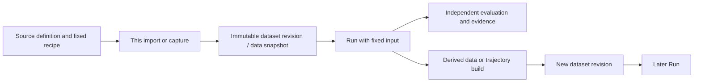

# ADR 0001: Bring Four-Kind Data Organization and Storage into the Core

Date: 2026-10-21. The decision is accepted. GymTS **0.5.1**, public interface specification **1.3.0**, is frozen as F1, with independent real four-source, portable-read and model-free-rescoring technical acceptance passed. This is neither a release nor passed model-quality acceptance. F0 GymTS 0.5.0 / interface 1.2.0 and its reports retain their original identities.

## Real Requirements and Current Gaps

The user requires GymTS itself to manage synthetic, static, simulated and external live data. The common layer covers more than an ObservationBatch within an execution: it includes discoverable persistent sources, data actually obtained, Runs that consume that data, and experiment outputs returning to the data catalog.

The original [overall design](../feishu/GymTS总体设计/GymTS总体设计.md) and [environment guide](../environment-adapters.md) already distinguish four source kinds. The 0.5.0 Environment protocol can execute all four, but its catalog mainly describes materialized static public/private shards:

| Source | Existing implementation | Missing common organization |
| --- | --- | --- |
| Static dataset | Content-addressed assets, SourceDatasetRevision, splits and readers | New projects may still save only their own files and Run CAS, without persistent catalog registration |
| Synthetic generator | External generators, seeds and actual generated values can be recorded | Catalog identity for reusable generation recipes and links to each actual generated dataset |
| Simulator | Native reset/step/close, episode traces and independent scoring | Discoverable simulator sources, data from an episode and its snapshot relationships |
| External live | Actual requests, sample/receipt times and delivered ranges can be recorded | Reusable connection definitions, fixed collection windows and independent identities for collected data |

Frozen five-project integration made the gap concrete. Data-Juicer derived results entered the source-data catalog; TimeCopilot, ITFormer, Chronos and AReaL sources mainly remained in project-specific preparation manifests and Run CAS. Their independent EvaluationSpecs are not registered reusable BenchmarkDefinitions. Existing execution evidence remains valid, but does not establish a unified data layer.

## Why the Core Must Change

An adapter can add an importer for one project and put seeds, episodes or collection windows into arbitrary metadata. Those conventions alone do not let a generic caller discover sources, bind fixed configuration, obtain data, inspect source/data relationships or reuse data in another project through one service. If each project defines those organization rules, they cannot form the framework's stable deliverable.

Therefore, **general data organization, catalogs and storage services** belong in core. Project formats, generation functions, simulator APIs, network protocols, codecs and domain scoring remain external. This corrects the boundary around the framework's data layer; it does not move external project implementations into the framework.

Reuse existing schema/version, usage-policy, content-digest and CAS mechanisms. Center the new interfaces on the required data chain instead of building another validation or authorization platform.

## Decision and the Two Main Modules

**EnvironmentTS** owns general data management, environment execution and evidence. **AutoBenchTS** continues to own benchmark definitions, evaluation plans, independent scoring and rescoring. Data services are not a third main module; a source catalog is not another model or tool registry.

Core adds two complementary resource types:

- **DataSourceDefinition**: a reusable source definition declaring one of the four kinds, fixed configuration and provider/Environment binding. Static sources may reference fixed datasets; dynamic-source definitions do not pretend to be immutable versions of future observations.
- **SourceDatasetRevision v2**: an immutable revision of actual data. Alongside existing public inputs, private references, splits and usage policies, it describes source, actual generation/collection scope, episodes or windows, and direct parent-resource/Run lineage.

The public flow stays simple: **register a source → bind this configuration → collect or import actual data → run using a fixed dataset → explicitly register derived data**. Static/already-generated data can register as a snapshot without a Run. `run_data` composes source binding, the original experiment and capture afterward. It preserves the ExperimentSpec's real Task/Candidate, neither replaces nor invents a Candidate, and adds no separate Candidate-free capture engine. Executable examples follow agreement between interfaces and implementation.

Independent packages still provide implementations. Core understands source kinds and shared data relationships; it does not interpret HF columns, ChatTS placeholders, Gymnasium states, PromQL or model outputs.

## Sources, Data, Runs and Feedback

One generator definition can produce several datasets with distinct seed/value identities; one simulator definition can produce several episodes; one live definition can produce several collection windows. They share source identity while actual dataset revisions remain separately fixed. A live connection name or query configuration is not a version of collected values.

A Run retains catalog identity and the actual snapshot it used. Derived data refers to the real parent dataset, Run or RecordSnapshot; changed contents create a new revision. Feedback is an explicit caller action. Model-generated labels do not automatically become gold, and evaluation-only data does not automatically become training data.

BenchmarkDefinition continues to fix dataset revisions and a domain resolver, resolving to the existing EvaluationSpec. An EvaluationSpec can execute directly, but only an explicitly registered definition is a reusable benchmark.

## Storage Locations

| Location | Stores |
| --- | --- |
| `data_home` | Persistent source definitions, dataset/benchmark manifests and immutable original/derived assets |
| `cache_home` | Rebuildable local read caches |
| Run-root SQLite / CAS | This execution, actual capture evidence, consumed data references, results and reports |
| Independent provider deployment directories | Upstream code, models and backend dependencies; excluded from the core package |

Active data, caches, Run stores and validation use local POSIX paths; this round's work directories are under `/tmp`. Closed evidence can be explicitly archived. Registering a source does not automatically download models, start external services or publish private data.

## Compatibility and Versions

Add `gymts.source-dataset/2` and `gymts.data-source/1` as additive catalog extensions. Existing `gymts.source-dataset/1`, BenchmarkDefinition `/1`, Runs and training exports under `gymts.dataset/1` retain their identities and read semantics. Training DatasetManifests and persistent source-data revisions remain distinct protocols.

Do not rewrite old manifests, Runs, Outcomes or reports. Existing component calls and direct ExperimentSpec workflows remain available; new sources and v2 datasets use new public services. Migrations publish new resources while retaining original references, rather than redirecting old revisions to new content.

Current version is 0.5.1 / 1.3.0. Actual signatures, all 168 core regressions and installation outside source are checked. Real external four-source execution, portable reads and model-free rescoring passed. Existing sixteen-package F1 compatibility discovered 407 tests: 346 executed passes and 61 optional-dependency skips, including the current AReaL V13 CPU draft without changing its native training or held-out status. This ADR is not a release record.

## F1 Freeze and Acceptance

Complete and freeze an exact F1 core wheel, source tree and version, then connect four real source kinds through independent external adapter packages. Check source registration/discovery, actual capture and snapshots, Runs using fixed datasets, lineage feedback, independent AutoBench evaluation and rescoring the same sealed output. New projects must not modify core after freezing; real gaps require another recorded decision and a new baseline.

Old `/1` resources, existing benchmarks, historical Run reads and the original quickstart must continue working. F0 and five-project evidence remain results for their earlier baseline. Data-layer development does not change the pending AReaL compatibility choice or held-out evaluation.

This validation concerns data organization and framework compatibility, not anticipated model quality. A complete remote HF Hub, cross-host distributed transactions, arbitrary streaming and an operating-system sandbox are outside this decision's scope.

The F1 core code-tree digest is `dad5d6a1785c4fa440a51dd4c93307f47ca000aa0d955daa70e68e32dcfac319`. Real four-source external acceptance fixes wheel SHA-256 `8944f39ffe516dbe22b7800f57fd18266cf6b3a4e84cf3a35b32cb6261ac2f1a`. Canonical digests of all 19 original core schemas equal F0; only `gymts.data-source/1`, `gymts.source-dataset/2`, `gymts.data-capture-row/1` and `gymts.data-capture/1` are added. Separate distribution checks rebuild wheels/sdists whose archive-byte digests may differ from F1, but must verify the same core code tree rather than claim the same wheel.
