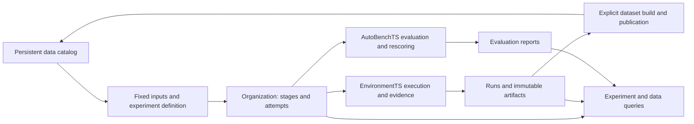

# ADR 0002: Put Experiment Organization, Dataset Publication and Linked Queries in Core

Date: 2026-10-21. Decision: accepted. The target implementation baseline is GymTS 0.6.0 / public interface specification 1.4.0; this is not a release claim. This ADR describes organization capabilities added after F1. It does not change F1's frozen identity or replace its acceptance reports. For usage, see the [experiment organization guide](../experiment-organization.md).

## Real Requirements

GymTS has four main responsibilities: **store data, connect data, organize experiments and record experiments**. Given fixed data references and an experiment definition, a caller should be able to execute dependent stages, retain every attempt and output, and inspect which data, execution and results were used. A failed stage must not overwrite completed evidence.

F1 already provides source and dataset catalogs, individual ExperimentSpecs, EvaluationSpec matrices, Run traces, immutable artifacts and independent rescoring. Real external acceptance covers all four source kinds. Three gaps remain:

1. Project scripts still connect Runs and stages that do not create Runs. Artifact references often require manual copying, with no common stage, dependency or attempt identity.
2. `gymts.dataset/1` build results reside in Run CAS, without a common explicit publication path to the persistent source-dataset catalog.
3. Individual Run evidence is available, but inspecting an entire experiment or data execution chain requires understanding project-specific journals.

These requirements do not require GymTS to reuse complete projects, internalize training algorithms or make research decisions for an Agent.

## Why Adapters Alone Cannot Solve This

An adapter can interpret formats, generate native configuration, train, score or write its own parent journal. If each adapter defines different stage states, retry behavior, data references and Run relationships, callers still have to understand each project's organization conventions.

Shared identities, states, references and storage relationships belong in the organization layer. Core should express them once; adapters return domain facts and fixed artifacts. Core need not interpret checkpoint structures, time-series column names, reward functions or network protocols.

## Decision 1: Immutable Definitions and Append-Only Execution Attempts

Add four organization protocols: `gymts.experiment-group/1`, `gymts.stage-request/1`, `gymts.stage-attempt/1` and `gymts.experiment-event/1`. The 23 pre-existing core schemas retain their identities; compatibility checks compare their canonical digests. The group definition uses `gymts.experiment-group/1`. A definition has a `group_id`, a content-fixed `revision` and named stages. Each stage declares a fixed-version `executor_ref`, an existing configuration `spec`, inputs, dependencies, input bindings and named outputs.

- `spec` keeps the existing ExperimentSpec, EvaluationSpec, ScoreSpec or relevant data-service configuration. Do not duplicate those execution contracts.
- Inputs reference fixed datasets, sources, CAS artifacts or named outputs of completed stages.
- Input bindings use JSON Pointers to write values into this execution's configuration. Outputs use JSON Pointers to select values from the stage's return object. Domain conversion belongs in an independent executor or adapter.
- Every actual stage invocation creates a new attempt. Successful, failed and interrupted attempts retain their own states and results; retries do not rewrite old attempts or Runs.
- By default, retain successful stages and execute ready pending or stale stages. Explicit retry_failed retries failed/cancelled stages; interrupted stages require explicit rerun. Rerunning an upstream stage makes its dependents stale. Stages execute only after dependencies succeed. Changing the definition creates a new revision.

The organization service selects stages and records execution. It does not introduce another Environment executor, model Runtime or domain evaluator. Built-in executors delegate to existing Run, evaluation, rescoring, capture and publication services; external executors invoke their own implementations through the same organization interface.

## Decision 2: Preserve EnvironmentTS and AutoBenchTS Responsibilities

Experiment organization is a shared service entry point, not a third domain runtime module. EnvironmentTS still owns data organization, execution and evidence. AutoBenchTS still defines expected evaluation units, invokes Scorers, saves reports and independently rescores. A successful stage is not proof that model quality passed.

## Decision 3: Explicitly Publish Build Results to the Persistent Catalog

Keep two distinct protocols:

- `gymts.dataset/1` describes training or other exported data built from fixed evidence, retaining BuildSpec, RecordSnapshot, shard, reward and tokenization references.
- `gymts.source-dataset/1` or `/2` describes a persistent, discoverable and readable dataset revision.

Explicit publication copies necessary bytes into `data_home`, fixes their content identities and retains build/source relationships. A temporary Run CAS path is not a persistent resource URI.

A build result without a genuinely registered source uses the existing `source-dataset/1`. Do not invent a generator or live source merely to fill `/2` fields. A result with a real source definition can use the existing snapshot or capture path to register `/2`. Independent adapters continue to provide readers; core does not assume every export is JSONL.

Publication does not change usage authorization. A different builder or a newly published dataset cannot remove a prohibition on training inherited from parent data or input evidence. Derived data does not automatically become gold or a benchmark.

## Decision 4: Common Record Relationships and Queries

Experiment definitions, stage attempts, resolved input configurations, returned values and errors enter the existing local record and immutable artifact system. A Run created by an attempt is associated with that attempt when the Run is created, avoiding incomplete journals written after execution.

Declared input permissions and provenance propagate to nested Runs and evaluation plans through the attempt context, including custom executors. Stage requests freeze the binding status, executor, purpose, inputs, configuration, datasets and provenance. Binding failures also produce failed-attempt evidence.

Queries start from an experiment or fixed dataset reference and list linked stages, attempts, Runs, artifacts and results. Organization records retain stage relationships. Scoring an existing Run adds an association without rewriting its original organization metadata or ownership. Original Runs, Outcomes and evaluation reports retain their own schemas and identities.

Interruption recovery identifies and marks unfinished attempts so the caller can create new attempts. It does not prove that an external backend has stopped, automatically resend an environment operation with unknown status, or fabricate continuation events within an old Run. Callers should explicitly recover only after confirming that the previous execution has ended. Only a gymts.run stage can explicitly adopt its single sealed Run. Other stages are retried at stage boundaries; recovery within an evaluation matrix is not promised.

## Storage and Compatibility

| Resource | Location and rules |
| --- | --- |
| Sources, datasets, benchmarks and persistent data bytes | Existing `data_home`; fixed revisions and immutable assets |
| Experiment definitions, stage states, attempts and Run links | Existing Run-root local records with additive organization indexes |
| Full definitions, resolved configuration, returned values and error evidence | Existing Run-root CAS with fixed artifact references |
| Native models, formats, training and scoring implementations | Independent adapter packages and their runtime environments |

These changes add resources and services. Existing `gym.run`, `gym.run_data`, AutoBench `evaluate/score`, dataset reads and DatasetBuilder interfaces remain directly usable without an experiment group.

Existing databases gain tables while retaining historical Runs; old events are neither migrated nor reinterpreted. Historical Runs without organization links remain valid execution facts and must not be presented as originally belonging to a new group. Historical data manifests and F0/F1 reports are not rewritten.

F1 remains GymTS 0.5.1 / public interface specification 1.3.0, with core code-tree SHA-256 `dad5d6a1785c4fa440a51dd4c93307f47ca000aa0d955daa70e68e32dcfac319` and real four-source acceptance wheel SHA-256 `8944f39ffe516dbe22b7800f57fd18266cf6b3a4e84cf3a35b32cb6261ac2f1a`. This round's additions require their own version, frozen identity and acceptance results; they cannot claim acceptance under F1's name.

## Freeze Validation Feedback: Parent-Dataset Queries (F2 → F2.1)

Independent frozen-core validation found that a publish-build stage can declare only its build Manifest as an artifact input while supplying fixed DatasetRefs in spec.parents. The published output retained parent relationships, but F2 queries by parent dataset ID/revision omitted the group. Data was published yet its declared parent relationship could not locate the experiment, violating this ADR's common-query requirement.

An adapter can correctly publish parent references but cannot change the framework's global query semantics. Core therefore also reads lineage.parents on standard source-dataset/2 outputs and features.parent_datasets on official source-dataset/1 build publications, requiring the latter's dataset_build marker. Only these explicit manifest relationships are used; arbitrary domain payloads are not recursively searched, and list_runs retains its meaning of querying data used by actual Runs.

The fix adds no schema and rewrites no old manifest, Run or attempt. It corrects discovery of already declared relationships. Retain the original F2 wheel and failing probe; freeze and validate the fix under a new F2.1 identity, while the working-tree version remains unreleased 0.6.0 / 1.4.0. Separately, 18 independent-package dependency upper bounds change from <0.6 to <0.7 to allow installation with the new core. A compatibility probe then found that ITFormer's core-freeze guard still accepted only stable 0.5.x. Extend only that guard to stable 0.5.x/0.6.x while retaining installed-origin, complete-payload, byte equality and independently expected wheel-hash checks. Domain implementations remain unchanged. The sixteen-package compatibility check remains separate; metadata or guard edits alone do not establish compatibility.

## Acceptance Requirements

1. Execute dependent stages from fixed data references and one experiment definition; later stages obtain named earlier outputs automatically.
2. Retain independent evidence for success, failure and retry. Retries preserve history, and stages with unmet dependencies do not execute.
3. Query Run-to-attempt links and find fixed configuration, actual Runs, outputs and evaluation reports by experiment or data.
4. Explicitly publish a real build result to the persistent catalog and read its public data without the original Run store, retaining usage restrictions and private-reference boundaries.
5. Keep existing core regressions and direct entry points working. After freezing the new core, use an independent adapter package to verify stage invocation, execution, traces, independent evaluation and rescoring without further core edits.

Organization acceptance does not prove training-quality improvement. A remote Hub, distributed scheduling, arbitrary backend process takeover and automatic research decisions are outside this ADR's acceptance requirements.

## F2.1 Verification Record

The [2026-10-21 machine-readable report](../reports/experiment-organization-2026-10-21.json) fixes the F2.1 wheel/source identities, unchanged definitions of all 23 existing schemas, 196 installed core regressions and sixteen-package compatibility with 356 passes and 61 optional-dependency skips. Source distributions and rebuilt wheels also passed installation checks.

An [independent CSV adapter example](../../examples/adapters/organization_demo/README.md) registered a 32-row ETTh1 view against the frozen core, completed four stages and two real Runs, independently reproduced numerical scores, and rescored in fresh processes and after adapter uninstall. Runtime core files, original Run results and events stayed unchanged. No quality gates were configured, so its verdict remains insufficient_evidence; this is neither the full ETT benchmark nor a model-quality acceptance claim.

Built data remained readable after deleting its original Run directory. Parent-dataset queries were verified with the exact F2.1 wheel. The initial F2 query omission, two adapter-configuration failures and subsequent successful evidence remain preserved. Closed evidence was archived locally and verified after extraction through file hashes, CAS/resource assets and another independent rescore; runtime environments and caches are excluded from source uploads.
