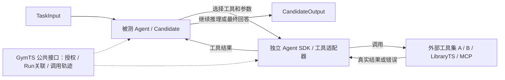

# Responsibilities of external toolsets and Agents

LibraryTS, TimeSigma tools, MCP services, and other toolsets are providers outside the framework. GymTS core does not include, manage, or require any particular project, and no toolset is a fixed framework component. The repository's `adapters/` directory contains independently distributable integrations; their location does not change this boundary.

Toolsets supply capabilities. The Agent decides when to call which tool, what arguments to pass, and how to use its result to continue reasoning. The Agent platform or external execution backend runs the tool. GymTS provides experiment-related public interfaces, authorization boundaries, call associations, and evidence recording. EnvironmentTS Runner does not schedule tools by names such as LibraryTS.

## 1. Tools within an experiment

The tested subject may be an ordinary algorithm, model, pipeline, or Agent. For an Agent, its native SDK retains the session and tool loop, while tool adapters map selected providers to interfaces that SDK accepts. GymTS does not require converting an Agent into a fixed algorithm, and does not implement a separate Agent reasoning engine.

Experiment configuration selects the permitted tool providers, fixed versions, allowlists, scopes, and budgets. It constrains available capabilities without preselecting each tool call for the Agent. Multiple external toolsets may serve one Agent. Replacing a provider changes external adaptation and configuration; the core does not gain a project catalog.

## 2. Responsibilities

| Participant | Responsibility | External boundary |
| --- | --- | --- |
| Agent | Decide whether to call a tool, choose tools and arguments, consume results, continue reasoning or finish | Use authorized tools and preserve native call IDs and sessions |
| External toolset | Algorithms/APIs, implementations and dependencies, its own asset management and publication | Supply real execution, results, or errors |
| Tool/Agent SDK adapter | Expose descriptions and schemas, map calls, connect backends, report actual effects and traces | Depend one way on the public GymTS SDK; no core project branches |
| Task and experiment configuration | Task meaning, public information, permitted capabilities, interpretation of environment requests | Do not plan for the Agent based on model/toolset names |
| EnvironmentTS | Organize Runs; check environment reads/writes; retain inputs, outputs, and actual call evidence | Do not implement a toolset's algorithms or asset platform |
| AutoBenchTS | Evaluate the Agent's task results and declared constraints against independent references | Scorers do not give private answers to the tested Agent |

The framework needs general integration, fixed identities, permissions, and evidence contracts. LibraryTS's unified asset catalog, native model persistence, review, and publication belong to that external project. Link them to GymTS experiments through fixed references or adapters; do not describe them as internal GymTS project development.

## 3. Choose a path by each tool's actual effects

A single toolset can contain several kinds of effects. Its entire catalog cannot be opened uniformly to a Run's Agent.

| Effect | Caller and execution path | Examples |
| --- | --- | --- |
| Computation over the current authorized TaskInput | Agent SDK calls an external adapter inside the session; results return to the same Agent; save ToolCall | Forecasting, features, seasonality, or distance over an existing array |
| Reading new experiment environment data | Agent expresses intent; Task produces TaskRequest; Runner checks and calls Environment; observations return to the same session | Querying a new window or reading undelivered sensor data |
| Operating the experiment environment | TaskRequest → Runner → Environment.act; record operation_id and receipt, then resume the session | Simulation step, device control, changing testbed state |
| Creating experiments, reading data assets, exporting, or publishing | Separately authorized callers/Research Agents outside the Run use the corresponding public services | GymTS.run, AutoBenchTS.evaluate, loading new data, independent experiments |
| Private evaluation | AutoBenchTS/independent Scorer; references visible only to the evaluation role | MAE or accuracy computed from private labels |

A tool named `dataset.load` is not automatically allowed to read arbitrary data, and `experiment.run` is not automatically input-only computation within the current Run. LibraryTS's `forecast.*` and `dataset.load/labts.run/labts.analyze/labts.metrics` therefore cannot share the same default Agent authorization.

Temporary internal computation may use the current input without reading future values or private references, or learning implicitly across calls. Persistent training requires explicit training authorization and fixed training views. Accepting an array argument does not authorize a tool to open the full dataset directory itself.

## 4. Agents inside Runs and Research Agents outside Runs

An Agent inside a Run is the tested Candidate. Tool and model calls link to the current run_id, input_id, and output_id. When one model request produces multiple tool calls, preserve native ID mappings to call_id/parent_call_id. Each actual execution records attempt_id, fixed tool_ref, arguments, result/error, and timestamps. Pure computation may have null environment_request_id/operation_id; environment reads/writes must link to actual Runner requests and operations.

A Research Agent outside the Run may call any authorized toolsets and use `GymTS.run` or `AutoBenchTS.evaluate/score` as experiment tools. Its platform or independent journal adapter manages the research trace, linked through real child Runs/reports. Do not invent a GymTS Run for every ordinary tool call in the parent session.

A tool_call in an Agent SDK chat message expresses intent only; it does not prove successful execution. Preserve the request, actual result, failure, or unknown state separately. If only IO is available, record IO without inventing tokens, logprobs, or hidden reasoning.

## 5. Current implementation and remaining integration

| Capability | Current status |
| --- | --- |
| Separation of core and projects | Implemented: no project imports in core; independent packages explicitly installed and enabled |
| General model/tool call evidence | Implemented: public TraceCollector and ModelCall/ToolCall contracts |
| Environment data/action path | TaskRequest → Runner → Environment and receipt/resumption foundations exist |
| LibraryTS tool wrappers | `LibraryTSTools` preserves actual requests, successes, and failures; scope separates input-only tools from other effects |
| Fixed algorithm Candidate | `libraryts-qa` chooses the configured estimator; an algorithm baseline, not autonomous Agent tool selection |
| Parent Research trace | TimeSigma adapter has an explicit-call journal, not a general autonomous Agent engine |
| General tool catalog/dispatch service | Core has no unified ToolRegistry/ToolBroker or automatic arbitrary toolset injection; v2 ToolBroker is a draft |
| Full acceptance of Agent selection and result consumption | A real-model loop with replaceable Agent SDKs and multiple providers has not been accepted; fixed-call scripts cannot substitute for it |

The current LibraryTS adapter exposes only five input-only computation tools under `scope='current_input'`; its fixed algorithm Candidate explicitly uses this scope. Catalog scope/effect declarations belong to the adapter, not a core project registry. Independent calls retain the original catalog's capabilities; environment reads/writes and private scoring cannot bypass authorization through current-input scope.

Future Agent adaptation should reuse existing SDKs: a lower-level AgentHarness or similar implementation owns the native model/tool loop, and independent adapters inject authorized tools and GymTS recording services. TimeSigma's native Research worker has its own Evidence and tool allowlist; renaming it does not make it a general framework interface.

Minimum formal acceptance requires a real model to produce call intent, a native external tool to execute, its result to return to the model, and the model to continue to an output, with all associations retained. Then replace the tool provider to show no core project change is needed. Also check failures, unknown states, unauthorized tools, budgets, and multi-turn environment resumption. Unperformed real-model acceptance remains incomplete; do not reinterpret earlier algorithm or journal reports.

This scope correction completed 14/14 independently installed native regressions and rechecked the five allowed tools with explicit current_input. Source-package rebuilding and contract tests without scientific dependencies passed. Actual current-input forecasting and request/failure CAS for five rejection categories are archived; see [scope acceptance](reports/toolset-scope-validation-2026-10-19.json). This verifies tool adaptation and boundaries, without using a real model for autonomous tool selection. Earlier native reports retain their original wheel identities; new scope checks are not written back into historical results.
