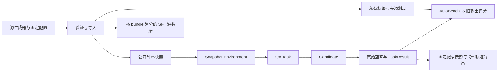

# ChatTS synthetic data and experiment pipeline

This integration uses GymTS `/1` message contracts and ships as independent adapter `gymts-chatts==0.2.0`, depending on `gymts>=0.5,<0.6`. The core does not include it, and installation does not register components automatically. Data import requires a compatible ChatTS generator repository or existing profiles separately; these materials do not ship with GymTS. Runtime execution does not depend on Python modules in the source repository. Generation invokes the upstream generator in a subprocess and preserves its configuration, seed, file hashes, code hashes, and Git working-tree state.

From the main repository root, install the core, shared domain contracts, and project adapter first:

```bash
python3 -m pip install . ./adapters/timeseries ./adapters/chatts
```

You can also install separately built wheels and run commands from any directory. The adapter uses the top-level `gymts_chatts` module and is discovered through a `gymts.integrations` entry point; the old `gymts.integrations.chatts` Python path is removed. Component IDs, component versions, task protocols, and data schemas retain their values, allowing original Runs to be scored after activation without conversion. Adapter code identity is recorded separately as `adapter_distribution`, `adapter_version`, and source-file hashes.

Implemented capabilities include generation/import, train/evaluation splits by bundle, native time-series SFT source export, Environment, Task, native ChatTS and ordinary text-LLM HTTP Candidates, numeric baselines, Scorers, AutoBenchTS evaluation, outcome attachment, original-Run rescoring, and QA trajectory export from fixed snapshots. Experiments with real ChatTS weights require a reachable native time-series inference service; ordinary text LLMs use the separate `chatts-text-http` interface. Trainers and GPU training are outside this default pipeline.

## Run with one command

Run from the GymTS project root:

```bash
python3 -B -m gymts_chatts.pipeline \
  --source-repo /path/to/ChatTS-Bench-new \
  --output .gymts/chatts-experiment-001
```

The default interpreter reuses `.conda/task-system/bin/python` in the source repository; `--python /path/to/python` selects another existing environment. The GymTS core, import, evaluation, and HTTP Candidates use only the standard library; the source generator needs its own NumPy/PyYAML and other dependencies. No dependencies are installed, source files modified, or models downloaded. Use a new output directory to avoid overwriting an experiment.

The default Candidate, `chatts-signal-baseline`, computes trend, anomaly, forecast, and other answers from public numeric signals. It is an interface-integration baseline; report scores describe that algorithm, not ChatTS model capability. By default only the bundle-held-out `eval` split is evaluated.

To connect a model, edit the service endpoint, model, deployment revision, and available `expected_system_fingerprint` in the [Candidate configuration](../adapters/chatts/examples/chatts_http_candidate.json), then run:

```bash
python3 -B -m gymts_chatts.pipeline \
  --source-repo /path/to/ChatTS-Bench-new \
  --candidate-config adapters/chatts/examples/chatts_http_candidate.json \
  --output .gymts/chatts-model-001
```

This compares the model and numeric baseline together; `--no-baseline` runs only configured candidates. The configuration may contain one `{candidate_id,spec}` object or an array of them. `api_key_env` names the credential environment variable; never put a plaintext key in configuration.

## Using an ordinary text LLM (DeepSeek)

[deepseek_candidate.json](../adapters/chatts/examples/deepseek_candidate.json) uses independently registered `chatts-text-http@1.0.0`, reusing the same public TaskInput, strict parsing, evaluation, and rescoring. Set `DEEPSEEK_API_KEY` in the current process environment through local secret management before running; configurations retain only its name. The example selects the `deepseek-flash` service alias with `thinking_mode=disabled` and `json_object=true`; requests actually send `thinking={"type":"disabled"}` and `response_format={"type":"json_object"}`.

Prefer reusing the two generated profiles. From the project root, first test connectivity with one held-out sample per task:

```bash
python3 -B -m gymts_chatts.pipeline \
  --profile-dir /path/to/profiles/native \
  --profile-dir /path/to/profiles/classical \
  --candidate-config adapters/chatts/examples/deepseek_candidate.json \
  --no-baseline --max-per-task 1 \
  --output .gymts/deepseek-text-smoke-001
```

The source paths above refer to existing generation materials; replace them with local profile directories on another machine. Remove `--max-per-task 1` to evaluate the complete held-out set, or remove `--no-baseline` to compare against the numeric baseline. Always choose a new output directory; existing experiments are not overwritten. Commands alone establish neither successful calls nor model results; reports and raw responses in the output directory determine actual outcomes.

The text Candidate uses `openai-chat-timeseries-text/v1` and serializes every public series, in original order with its original name and complete numeric values, as `named_numeric_json/v1` JSON text:

```json
{
  "representation": "named_numeric_json/v1",
  "series": [{"name": "Series 1", "values": [0.12345678901234566, -1.2345678901234567e-12]}]
}
```

Numeric serialization round-trips without normalization, rounding, sampling, or truncation. Requests use ordinary text messages, not ChatTS top-level `timeseries`, `<ts><ts/>` placeholders, or proprietary envelopes. Native arrays remain in GymTS TaskInputs and records so original numbers can be checked against the actual text sent. Private labels, source sample IDs, and generation metadata do not enter the wire payload.

A service alias is not a checkpoint. The example `model_revision=deepseek-flash-api-alias` identifies only the configured service; artifacts record `revision_provenance=configured_alias`, `model_revision_semantics=configured_service_alias`, and `weights_pinned=false`. This does not pin underlying weights. Text Candidate evidence has `evidence.kind=text_llm_http`; native evidence uses `chatts_http`, preserving the distinction between input representations in reports and trajectories.

## Other entry points

Additional entry points:

```bash
# 使用已经生成的两个 profile，不再运行生成器
python3 -B -m gymts_chatts.pipeline \
  --profile-dir /path/to/native --profile-dir /path/to/classical \
  --output .gymts/chatts-import-001

# 小规模重复实验；限定 task 也可加 --tasks pattern.trend_direction
python3 -B -m gymts_chatts.pipeline \
  --source-repo /path/to/ChatTS-Bench-new \
  --max-per-task 2 --repetitions 2 --output .gymts/chatts-smoke-001
```

After installation, `gymts-chatts` is also available. `--evaluation-split all` performs whole-dataset integration checks but includes samples exported to the training split; research results should use an independent evaluation split. `--seed` controls bundle splitting and execution repetition seeds. Generation seeds come from source-generator configurations and are recorded separately.

## Tasks and components

| Task / source version | Samples in the default profile | Output | Metric |
| --- | ---: | --- | --- |
| `pattern.trend_direction / 0.2.0` | 36 | trend_direction | accuracy |
| `anomaly.point_indices / 0.2.0` | 48 | indices | event_f1, tolerance 0 |
| `forecast.numeric / 0.2.0` | 32 | forecast | MAE, RMSE |
| `pattern.seasonality_profile / 0.1.0` | 36 | profile | accuracy |
| `process.stationarity_type / 0.1.0` | 48 | type | accuracy |
| `relation.lagged_dependence / 0.1.0` | 36 | direction, lag | exact_match |
| `similarity.shape_retrieval / 0.1.0` | 48 | candidate_id | accuracy |

Explicitly register through `GymTS(integrations=("chatts",))` or `gym.enable_integration("chatts")`; all component versions are `1.0.0`. Default `GymTS()` does not import the integration. The dedicated pipeline and `gymts-chatts` command activate it themselves; generic CLI calls use `gymts --integration chatts ...`:

| Role | adapter / plugin | Implementation |
| --- | --- | --- |
| Environment | `chatts-synthetic-snapshot` | [environment.py](../adapters/chatts/src/gymts_chatts/environment.py) |
| Task | `chatts-synthetic-qa` | [task.py](../adapters/chatts/src/gymts_chatts/task.py) |
| Candidate | `chatts-http`, `chatts-signal-baseline` | [candidate.py](../adapters/chatts/src/gymts_chatts/candidate.py) |
| Text LLM Candidate | `chatts-text-http` | [text_candidate.py](../adapters/chatts/src/gymts_chatts/text_candidate.py) |
| Scorer | `chatts-qa-scorer` | [scoring.py](../adapters/chatts/src/gymts_chatts/scoring.py) |
| Import/export | `import_profiles`, `generate_profiles`, `export_sft` | [data.py](../adapters/chatts/src/gymts_chatts/data.py) |
| Orchestration | `run_pipeline` | [pipeline.py](../adapters/chatts/src/gymts_chatts/pipeline.py) |

All tasks use `gymts.task/chatts-qa/1`; each evaluation report fixes one source Task/version. Heterogeneous tasks are not collapsed into one aggregate score. Forecast totals average per-sample MAE/RMSE, assigning equal weight to samples with different horizons.

## Data boundaries



Original `instance_id`, `bundle_id`, and `view_id` contain answer clues such as increasing or clean; generation metadata and series.properties also contain labels. Imported public samples retain only opaque SHA-256 tokens, source Task identities, and allowlisted model inputs. Original IDs, gold references, metadata, and provenance are stored in a separate private artifact.

The Environment explicitly receives public snapshot read permission through `SourceSpec.connection.artifact_refs=[public_snapshot_ref]`. The Runner authorizes only the exact immutable references listed, not nested references recursively. Tasks and Candidates do not inherit Environment artifact access. Candidates receive only their current TaskInput and cannot read the entire public snapshot or private gold.

TaskInput `payload.value` is directly:

```json
{
  "messages": [{"role": "user", "content": "..."}],
  "timeseries": [[0.1, 0.2, 0.3]],
  "series_names": ["Series 1"],
  "output_schema": {"type": "object"},
  "context": {}
}
```

Series order maps exactly to public names. Shape retrieval with five series does not assume the first is the query. Inputs retain native numeric values without premature model normalization. Source data has no real timestamps/missing masks, so the integration does not invent those observation fields; Environment steps are sample indexes. Public forecast horizons are extracted from source prompts and checked against private target shapes; future values never enter inputs.

## Inference and capture

`chatts-http` supports two wire dialects already present upstream:

- `chatts-timeseries/v1`: original messages plus top-level `timeseries` arrays.
- `chatts-vllm-text-envelope/v1`: native `chatts-timeseries:v1:` data envelopes in message content parts. If the source prompt has no placeholders, named attachments and `<ts><ts/>` are appended. Complete existing placeholders receive corresponding attachments individually; duplicate and partial matches are rejected.

Both HTTP Candidates send exactly one non-streaming request per `infer`, with separate I/O timeouts. HTTP errors, timeouts, and unknown states are never retried automatically. Native inputs, actual wire payloads, response objects, usage, finish_reason, and returned model fingerprints become immutable artifacts referenced by `CandidateOutput.payload.evidence`. Complete answer text enters `raw_text`, which the Runner saves before Task interpretation.

Native `chatts-http` `model_revision` denotes the configured fixed external deployment; prepare evidence explicitly records `revision_provenance=configured` and `revision_verified=false`. Deployment owners must pin checkpoints. If `expected_system_fingerprint` is supplied, every response is checked strictly; model/fingerprint changes within a Run also fail. Each sample is one Run, so fixing service identity across Runs requires an expected fingerprint. A client string is not a verified weight hash. `chatts-text-http` records the service-alias semantics described above.

Current capture stores native numeric arrays and QA requests/responses with `recording.model_calls=none`. It does not capture processor-internal tensors, token IDs, logprobs, or response masks, and does not treat returned token counts as token-level trajectories. General `TraceCollector`, Agent Lightning/Trinity-RFT backends, and RL rollout builders require separate integration.

## Parsing, evaluation, and failures

Tasks implement the source structured_json rules strictly using the standard library: no repairs for Markdown fences, explanatory prose, duplicate keys, or nonfinite numbers. Anomaly indices must be nonnegative, strictly increasing, and in bounds. Forecasts must cover the entire public horizon; lag and direction must agree. Format failures preserve raw text and produce invalid TaskResults. Empty strings also enter this flow without invented answers.

Each evaluation unit fixes one sample; every Scorer invocation has at most one result and eligible=1. Model exceptions, missing results/labels, and invalid results remain in the plan. Counts satisfy `eligible=scored+missing+invalid+excluded`; invalid outputs are not silently treated as parseable zero scores. Reports include coverage and execution failures, with seven tasks evaluated separately.

The pipeline first evaluates without labels, then appends source gold to sealed Runs with `allowed_uses=[evaluation]`, creates a fixed OutcomeView, and calls `AutoBenchTS.score`. Candidates and repetitions reuse the same immutable label version for the same sample. Run IDs and RunResult hashes are checked before and after rescoring, without new inference.

Default Gates check only execution failure rate 0 and scoring coverage 1: passing means interface acceptance, not sufficient accuracy. Missing or malformed results produce a nonzero pipeline exit code while preserving reports and failure evidence.

## Outputs and downstream use

```text
output_dir/
  source_profiles/                  fresh 源生成物与 source_provenance.json
  records/                          SQLite 与不可变 CAS 制品
  import.json                       固定公开/私有/归因引用
  configs/*.evaluation.json         每任务完整评价配置
  configs/*.score.json              复用旧 Run 的评分配置
  reports/*.before_labels.json      无标签初始报告
  reports/*.json                    标签到达后的正式版本报告
  datasets/synthetic_sft/            train.jsonl、eval.jsonl、manifest.json
  datasets/trajectories/             qa_trajectories.jsonl、manifest.json
  summary.json                      实验汇总、实现摘要与结果引用
```

`synthetic_sft` is a GymTS-native multimodal supervised source format containing `model_input` and `answer`, explicitly marked `answer_source=synthetic_gold` and stratified by complete counterfactual bundles. It is not directly formatted for a specific trainer. Actual training additionally needs a trainer exporter, model template, processor, and training configuration; export does not mean training ran.

`qa_trajectories.jsonl` reads sealed traces through RunResult references in a fixed RecordSnapshot, retaining input/output/result, Candidate identity, and lineage. Missing outputs after failure remain null. The manifest explicitly records `native_rollout=false`, missing token/logprob fields, and `training_eligibility=not_assessed`. Numeric-baseline outputs are not mislabeled as synthetic_gold or ChatTS model outputs.

The ordinary CLI can consume saved configurations directly; rescoring makes no model calls:

```bash
python3 -B -m gymts --integration chatts --store /path/to/output_dir/records \
  score /path/to/output_dir/configs/pattern_trend_direction.score.json
```

Existing real-generation and numeric-baseline acceptance materials are at `output/experiments/chatts-synthetic-v0.2-2026-10-12/summary.json` (local artifacts, not distributed with source). Two source profiles contain 284 samples and 88 bundles. With seed=7, train=236/eval=48 and no bundle overlap. The 48 held-out samples cover all seven tasks.

The local DeepSeek report dated 2026-10-12 at `output/experiments/deepseek-eval-2026-10-12/REPORT.md` reuses that held-out set. All 48 real API calls returned; 47 passed strict parsing, while 1 anomaly-detection answer was truncated and invalid. The anomaly scoring-coverage Gate failed; six task types passed. This real failure retains original text, the planned denominator, and evidence without automatic retries or repairs. A local one-sample-per-type smoke summary is at `output/experiments/deepseek-smoke-2026-10-12/summary.json`. Source profiles declare `formal_benchmark=false`; these small development materials do not support broad model-capability conclusions.

A read-only audit script can independently check existing experiments without reading credentials or calling APIs:

```bash
python3 -B adapters/chatts/scripts/audit_chatts_http_experiment.py \
  output/experiments/deepseek-eval-2026-10-12 \
  --output .gymts/deepseek-evidence-audit-001.json
```

The script checks CAS hashes, complete numeric/name projections from public input to actual wire payloads, raw response retention, scoring denominators, and RunResult references/content before and after rescoring. Existing audit files cannot be overwritten. `audit_status=pass` means evidence consistency; model invalid outputs still retain the experiment’s `pipeline_status=failed`.

## Validation

```bash
python3 -B -m unittest discover -s adapters/chatts/tests -v
```

Added tests cover import integrity and allowlists, bundle isolation, real Task/Runner boundaries, native and ordinary text HTTP wire formats, numeric precision, credential redaction, raw text preservation, strict parsing, denominators, multi-candidate/repetition label correlation, unchanged old Runs, and fixed-snapshot export. HTTP tests use explicitly labeled fixtures. Real model scores require actual service calls.
