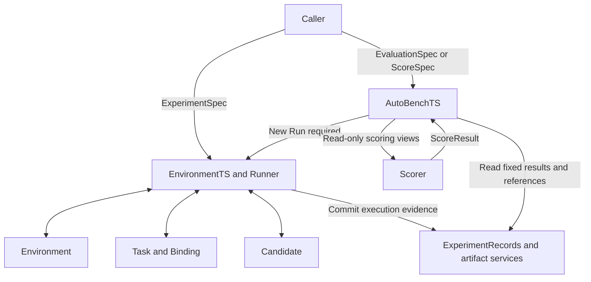

# GymTS Interface Specification

| Item | Content |
| --- | --- |
| Specification version | 1.4.0 |
| Updated | 2026-10-21 |
| Status | GymTS 0.6.0 working tree: F2.1 organization verification passed; unreleased |
| Core modules | EnvironmentTS, AutoBenchTS |
| Audience | Framework developers; environment/task integrators; algorithm/Agent adapter developers; evaluation/training integrators |

This round's **1.4.0 organization addition** is in §21 for the unreleased GymTS 0.6.0 working tree. Sections 1–19 preserve 0.5.0 / 1.2.0 baseline semantics. Section 20 retains the 0.5.1 / 1.3.0 F1 data contract and its historical acceptance scope. F1 is frozen and passed its original real four-source technical acceptance; its evidence and identity cannot replace this round's validation. The 23 existing core schemas retain their identities, with four organization schemas added. See [ADR 0001](../../adr/0001-core-data-source-catalog.md) and [ADR 0002](../../adr/0002-experiment-organization.md) for the reasons for these changes.

GymTS accepts time-series experiment plans with explicit boundaries. EnvironmentTS organizes environment interaction, task execution and evidence recording, delivering RunResult; AutoBenchTS generates EvaluationReport from a fixed evaluation plan, original execution results and independent outcome evidence. Algorithms, models, pipelines and Agents integrate through the same Candidate contract.

This specification fixes service entry points, message structures, state transitions, recording requirements and integration acceptance. Signatures express logical contracts; see the [framework implementation guide](../../framework.md) for current SDK coverage and limits. Implementation proceeds through public contracts, core framework and plugin integration. New tasks should normally integrate through plugins/configuration without task-name branches in Runner.

Reading paths: framework builders should start with §§3–10, 13–14 and 16; task integrators with §§5–8, 11, 15 and 17; LLM capture and training-data integrators with §§10 and 12.

## 1 Scope and Normative Language

### 1.1 Implementation Scope

The base implementation uses in-process synchronous calls, one environment session and one Candidate instance per Run, and serial execution within an instance. A deployment may run multiple isolated Runs; parallel scheduling, distributed workers, remote RPC and trainers are outside the base call contract.

Capabilities are divided into three independently declared profiles:

| Profile | Required capabilities |
| --- | --- |
| `core` | Experiment configuration, environment/task protocols, Candidate calls, evidence records and AutoBenchTS evaluation |
| `llm_trace` | Internal model/tool-call capture above core, associated with actual requests, responses and invocation identities |
| `training_export` | Build versioned SFT, preference or RL data with lineage from fixed evidence snapshots |

Every implementation must support core. Ordinary time-series algorithms need not implement token fields; an implementation declaring an extension must satisfy its conditionally required fields. Training-export tools read/process records or operate as external adapters and add no main GymTS module.

### 1.2 Normative Language and Compatibility

- **Must** indicates a mandatory implementation and acceptance requirement; **should** indicates the default, with deviations explained in capability declarations; **may** indicates an optional capability.
- Required in a field table means the key must be present; a type containing `null` allows an explicit null value. Omitted optional fields take their tabulated defaults, which must be expanded and saved in resolved configuration.
- Messages or artifacts with an explicit protocol version in this specification must contain protocol_version.
- `protocol_version` fixes a message contract, such as `gymts.experiment/1`; `version` fixes an adapter/plugin implementation, such as `1.0.0`. They must not be confused.
- Adding optional fields may increment the specification minor version; changing required fields, field semantics or call order must increment the protocol major version. Undeclared compatible major versions must be rejected.
- Unknown configuration fields must produce errors. Extension information belongs only in `params`, `options`, `extensions` or Payload with declared schemas; spelling errors must not be silently ignored.

## 2 Module Responsibilities and Identity Relationships

### 2.1 Responsibility Boundaries

| Object | Responsibilities | Delivers or calls |
| --- | --- | --- |
| EnvironmentTS | Validate and assemble experiments; execute, record and clean up | RunResult |
| Runner | Coordinate Environment, Task, Candidate and recording order | Internal execution flow |
| Environment | Connect historical data, generators, simulations or real systems and perform authorized reads/writes | ObservationBatch, ActionReceipt |
| Task and Binding | Define task semantics, variables/units/windows, decision targets and interpretation of requests/results | TaskInput, TaskResult, TaskRequest |
| Candidate | Call selected algorithms, models, pipelines or Agents while preserving native computation | CandidateOutput, updated artifacts |
| ExperimentRecords | Store original evidence, domain associations and late outcomes | RunRecord, event/result views |
| AutoBenchTS | Fix evaluation plans, arrange Runs, independently score, compare and apply thresholds | EvaluationReport |
| Scorer | Calculate metrics from fixed results, references and parameters | ScoreResult |
| External trainer | Consume authorized data, optimize weights and publish new artifacts | Model artifacts selectable by a subsequent Run |

Every project is an external provider participating through adapters in these roles; core internalizes no project and maintains no required toolset. LibraryTS, SkillTS and other algorithm libraries, MCP or existing services are examples of interchangeable providers. Their tool implementations and asset platforms are outside framework delivery. LabTS or callers own proposal selection, review and publication approval; successful execution and passing evaluation do not imply publication approval.



Environment owns source-field parsing; Task/Binding own public unit conversion, windows and resampling; Candidate owns its method-specific imputation, features, normalization and encoding. A sampling period must not imply interpolation, summation or averaging.

### 2.2 Identities and Associations

| Identifier | Meaning and allocator |
| --- | --- |
| `run_id` | One bounded experiment, allocated by Runner |
| `session_id` | This Run's environment session, allocated by Environment |
| `case_id` | One window, forecast issue point, diagnostic question or control decision, allocated by Task |
| `turn_id` | Integer input turn within a case, incrementing from 0, allocated by Task |
| `input_id` | One actual TaskInput, allocated by Task |
| `output_id` | Raw output from one Candidate return, preallocated by Runner before calling |
| `request_id` | One environment read or task request, allocated and mapped by Runner/Task |
| `operation_id` | Association between an environment operation and its receipt/consequences, allocated by Runner before act |
| `feedback_id` | Stable original-feedback identity, allocated by the source adapter |
| `event_id` | Stable persistent-event identity, allocated by the event producer |
| `call_id`, `attempt_id` | Internal logical model/tool call and one concrete attempt, allocated by the capture adapter |
| `evaluation_id` | One scoring/comparison operation, allocated by AutoBenchTS |
| `episode_id`, `sample_id` | Derived training episode/sample, allocated by versioned export rules |

These identifiers must not be assumed equal. A Run may contain multiple cases; a case may contain multiple queries/turns and model calls; a training episode may contain one or more cases. Export must explicitly preserve episode-to-Run/case/turn/output mappings.

Except turn_id, IDs above are opaque strings, globally unique across record storage. turn_id is an integer incrementing from 0 within a case and need not be globally unique. Retrying the same logical record must reuse its original identifier; reallocating IDs to bypass deduplication is forbidden.

## 3 Common Data and Reference Conventions

### 3.1 Basic Types

| Type | Structure and constraints |
| --- | --- |
| `JSONValue` | Serializable scalar, array or object; floating values must be finite, without NaN/Infinity |
| `TimePoint` | RFC3339 timestamp string or nonnegative integer step, fixed by environment clock domain and never mixed |
| `TimeScope` | `{start: TimePoint, end: TimePoint \| null}`; nonempty scopes use `[start,end)` |
| `Duration` | Unit-bearing string such as `60s` or `5min`; allowed units are published by the protocol, and bare numbers are rejected |
| `SchemaRef` | Registered structural-version reference precisely identifying fields and validation rules |
| `ComponentRef` | `{name, version, origin_ref: string \| null}`; fixed implementation identity |
| `ArtifactRef` | See 3.2; references a committed immutable artifact |
| `Payload` | `{schema_ref, storage: inline \| artifact, value?, artifact_ref?}`; inline requires value, artifact requires artifact_ref; mutually exclusive |

System timestamps `recorded_at/created_at/started_at/ended_at` must be UTC RFC3339 strings; Environment parses source times in their original time zones and normalizes them. Step environments still use UTC strings for system time. `Clock` (field name clock) must declare `{domain: event_time \| wall_time \| step, now: TimePoint, visible_until: TimePoint}`; `visible_until` is the session's already-exposed read frontier.

### 3.2 ArtifactRef and DataViewRef

ArtifactRef must contain:

| Field | Type | Rule |
| --- | --- | --- |
| `artifact_id`, `revision` | string | Fixed identity and immutable revision |
| `uri` | string | Location resolvable by authorized callers, containing no plaintext credentials |
| `content_hash` | string \| null | Content digest; may be null only when the backend offers equivalent immutable-revision guarantees |
| `media_type` | string | Serialization format or media type |
| `schema_ref` | SchemaRef \| null | Required for structured content; nullable for model binaries |
| `size_bytes` | int \| null | Byte count, null when unknown |

A mutable URI requires an independent snapshot with a content digest; a mutable file path alone is not evidence. A usable reference may be returned only after `save_artifact` succeeds; temporary files must not be published as committed artifacts.

DataViewRef is `{view_id, revision, source_refs: list[ArtifactRef], selection: Payload, as_of: TimePoint | null, purpose: prepare | runtime | evaluation | dataset_build}`. It represents an authorized fixed view, not access to an entire repository. Dynamic sources may resolve to fixed query definitions before execution, but actual read results must form snapshots; preserve query definitions separately from actual snapshots.

### 3.3 Live Services and Usage

```python
class EnvironmentServices:
    def resolve(self, ref: ArtifactRef) -> LocalResource: ...
    def credential(self, ref: str) -> Credential: ...
    def read_view(self, ref: DataViewRef) -> Payload: ...
    def save_artifact(self, content: bytes, metadata: ArtifactMetadata) -> ArtifactRef: ...
```

`LocalResource` is a controlled location or handle consumable by an adapter; `Credential` is a credential object excluded from ordinary records; `ArtifactMetadata` contains media_type, schema_ref, provenance and usage. Implementations must not pass these objects' private connections or credentials wholesale to Candidate.

TaskContext receives only authorized read views and saving capabilities for this execution. CandidateContext receives only this model's artifacts, explicitly selected training/runtime views and capture outlets. Evaluation-only views go only to scoring. Runtime reading, long-term retention and training export are distinct usages requiring separate source-policy authorization.

## 4 External Service Entry Points

```python
class GymTS:
    def plan(self, spec: ExperimentSpec) -> AssemblyPlan: ...
    def validate(self, spec: ExperimentSpec) -> ValidationReport: ...
    def run(self, spec: ExperimentSpec) -> RunResult: ...

class EnvironmentTS:
    def plan(self, spec: ExperimentSpec) -> AssemblyPlan: ...
    def validate(self, spec: ExperimentSpec) -> ValidationReport: ...
    def run(self, spec: ExperimentSpec) -> RunResult: ...

class AutoBenchTS:
    def evaluate(self, spec: EvaluationSpec) -> EvaluationReport: ...
    def score(self, spec: ScoreSpec) -> EvaluationReport: ...
```

GymTS.plan/validate/run delegate to EnvironmentTS and must not create duplicate Runs. `plan/validate` parse only inline configuration, schemas, fixed implementation declarations and composition constraints. They do not call plugin factories, read data/weights/credentials, connect services or commit CAS. `scene_ref` expands only at execution entry points; offline planning requires the caller's inline scene. Integrity, permission and availability checks requiring actual resources are deferred until runtime opening.

AssemblyPlan uses `gymts.assembly-plan/1`, containing `resolved_spec`, three-role `manifests`, Environment/Task `descriptions`, variables, operations, read_scope and `resource_checks=deferred_to_open`. It contains no unit_id and does not replace AutoBenchTS EvaluationPlan.

ValidationReport contains `{valid, resolved_spec_ref, resolved_spec, issues}`; each issue is `{code, path, message}`. Valid configuration returns inline resolved_spec with expanded defaults and null resolved_spec_ref; both are null when invalid. Callers explicitly save configuration when persistence is needed; AutoBenchTS commits it when creating its plan. This SDK return behavior differs from 0.4.x: migration must read resolved_spec rather than assume validate has written CAS. Existing `/1` execution evidence is neither migrated nor rewritten. `run` must revalidate actual resources and save the actually resolved configuration.

Static validation failures raise GymTSError without starting Environment. Runtime failures after Run creation deliver a RunResult with `status=failed` when records remain available. If persistent recording fails and reliable sealing is impossible, raise GymTSError with run_id and confirmed references; do not fabricate a completed RunRecord.

Base interfaces return synchronously and prescribe no HTTP routes, task queues or remote-cancellation API. Repeated run calls create new Runs by default; callers must not treat retrying the whole run as idempotent environment operation.

## 5 ExperimentSpec and Configuration Validation

### 5.1 Top-Level Structure

The protocol is `gymts.experiment/1`.

| Field | Type | Requiredness and defaults |
| --- | --- | --- |
| `protocol_version` | string | Required |
| `name` | string \| null | Optional; default null |
| `purpose` | development \| regression \| acceptance \| training_collection | Optional; default development |
| `scene` | SceneSpec | Required |
| `candidate` | CandidateSpec | Required |
| `execution` | ExecutionSpec | Required |
| `recording` | RecordingSpec | Required |
| `extensions` | JSONValue | Optional; default empty object; must conform to a registered schema |

SceneSpec is `{environment: EnvironmentSpec, task: TaskSpec, binding: BindingSpec}`. Input may alternatively use a fixed scene_ref; resolution must expand it to these three objects. scene and scene_ref must not coexist.

### 5.2 EnvironmentSpec, TaskSpec and BindingSpec

| Object | Fields |
| --- | --- |
| EnvironmentSpec | `protocol_version=gymts.environment/1`、`adapter`、`version`、`source`、`mapping`、`options` |
| SourceSpec | `kind: dataset \| generator \| simulator \| live`、`locator`、`revision: string \| null`、`connection: object`、`credential_ref: string \| null` |
| TaskSpec | `plugin`、`version`、`params: object` |
| BindingSpec | `variables: map[str,VariableBinding]`、`operations: map[str,OperationBinding]` |
| VariableBinding | `source: string`、`unit: string`、`transform: ComponentRef \| null` |
| OperationBinding | `source: string`、`arguments_schema_ref`、`transform: ComponentRef \| null` |

`mapping` configures source-field parsing; `options` contains registered backend options, with schemas declared by the adapter. A live source.revision may be null, but SessionInfo must declare actual connection identity and snapshot policy. Dataset/generator/simulator source and implementation revisions must be fixed before start.

Binding must explicitly check variable types, dimensions, units and operation arguments. transform must use a fixed implementation version; no implicit unit conversion occurs. Matching variable names alone do not establish matching semantics.

### 5.3 CandidateSpec

| Field | Type | Rule |
| --- | --- | --- |
| `adapter`, `version` | string | Required; select the invocation adapter |
| `artifact` | ArtifactRef \| null | Required; null for functions needing no model file |
| `params` | object | Required; conforms to CandidateManifest.params_schema_ref |
| `inherited_state` | list[ArtifactRef] | Optional; default empty list; cross-Run memory/state must be listed explicitly |

Record implementation version, adapter version and model-artifact revision separately. CandidateManifest.implementation_ref fixes native implementation identity, component_ref fixes adapter identity, and component_refs fixes component identities in a composite implementation; CandidateSpec fixes this execution's parameters and loaded artifacts.

### 5.4 ExecutionSpec

| Field | Type | Rule |
| --- | --- | --- |
| `mode` | batch \| stream \| interactive | Required; does not indicate physical source type |
| `start` | `{mode: reinitialize \| attach}` | Required; availability checked against environment capabilities |
| `scope` | TimeScope | Required; limits decision times for new tasks/actions |
| `feedback_until` | TimePoint \| null | Optional; default null; nonnull values later than scope.end allow draining |
| `seed` | int \| null | Optional; default null; environments without specified-seed support must reject nonnull requests |
| `learning` | LearningSpec | Required |
| `limits` | RunLimits | Required; see below |

LearningSpec is `{prepare: load_only | fit, online: frozen | update, training_view: DataViewRef | null, training_targets: DataViewRef | null, alignment_schema_ref: SchemaRef | null, allowed_feedback_sources: list[str]}`.

- In `load_only`, prepare must not fit or update persistent weights; see §8.1 for stateless input conditioning during infer. `fit` may use only the specified training view; CandidateManifest declares whether targets are needed.
- `frozen` does not call Candidate.update; accumulating Agent context and planning state within the Run remains valid. `update` requires declared Candidate support and consumes only arrived CandidateFeedback from authorized sources.
- Nonnull training_targets require a fixed pairing rule; AutoBenchTS private references must not automatically become preparation data or online feedback.
- A frozen external model service must fix an actually executable revision/handle and must not silently hot-update during the Run. Where online updates are allowed, record before/after policy identities for every change.

RunLimits is `{max_inputs: int | null, max_operations: int | null, max_turns_per_case: int, max_wall_time_s: number | null}`, defaulting to null, null, 32 and null respectively. max_inputs counts Candidate.infer attempts, max_operations counts Environment.act attempts, and max_turns_per_case counts input turns within one case; nonnull limits are positive. At least one of scope.end, max_inputs, max_operations or max_wall_time_s must provide an actually reachable finite stopping boundary. An action-count limit alone cannot bound inactive live waiting; live sessions require a time cutoff or wall limit.

Task.describe supplies warmup requirements, which Runner uses to compile read_scope as follows:

1. In a time domain with history available, read_scope.start=scope.start-warmup.duration; with null duration or no history, accumulation begins at scope.start. min_points alone neither determines a historical duration nor guarantees a complete window immediately at startup.
2. With nonnull scope.end, feedback_until must be null or no earlier than scope.end, and read_scope.end is the later of the two. With null scope.end, feedback_until and read_scope.end must also be null; explicit limits end execution.
3. read_scope.end=null means no upper time boundary; advancement formulas must not take min with null. Wall limits, permissions and the current visibility frontier still apply.
4. The base step domain supports transition only, with null warmup.duration; no seconds-per-step mapping is defined. Time windows and Duration arithmetic apply only to timestamp-string domains.
5. After start returns actual availability, effective_scope is the intersection of requested scope and actual_scope; an empty intersection fails before infer/act. TaskExecutionContext and records must preserve effective_scope, and all decisions use it; a backend's wider scope cannot expand this plan.

feedback_until extends reading only. Task emits no input until min_points is satisfied and must not fill the window using future data.

### 5.5 RecordingSpec

| Field | Type | Defaults and rules |
| --- | --- | --- |
| `store_ref` | string | Required; record-backend configuration reference |
| `inputs`, `outputs` | full \| reference | Required; reference must point to a fixed snapshot |
| `artifacts` | reference | Required |
| `model_calls` | none \| io \| native_rollout | Optional; default none |
| `on_capture_failure` | fail_run \| mark_incomplete | Optional; default fail_run; applies only to optional internal-call capture |
| `redaction_policy_ref` | ArtifactRef \| null | Optional; default null; actual redaction transformations must be recorded |
| `extra_event_kinds` | list[str] | Optional; default empty list; kinds must be registered beforehand |

Core observations, inputs, raw outputs, task results, operations, feedback, updates, artifacts and final states must not be disabled. A core-record commit failure must stop new calls and operations; mark_incomplete does not apply to lost core evidence. model_calls declares requested capabilities, with actual capture completeness recorded separately; configuration alone does not establish successful capture.

## 6 Environment Protocol

### 6.1 Methods and Lifecycle

```python
class Environment:
    def describe(self) -> EnvironmentDescription: ...
    def start(self, spec: EnvironmentStart) -> SessionInfo: ...
    def observe(self, request: ObservationRequest) -> ObservationBatch: ...
    def act(self, command: EnvironmentCommand) -> ActionReceipt: ...
    def finish(self) -> EnvironmentSummary: ...
```

An instance permits only one session. The normal path is `created → active → exhausted → closed`; active may finish directly as closed. start cannot be called again after start; exhausted permits authorized-history queries and finish but no further act. finish must be idempotent and return a cached summary, including cleanup after partial startup failure.

### 6.2 Capability Description and Startup Information

EnvironmentDescription contains these required fields:

| Field | Type and meaning |
| --- | --- |
| `environment_id`, `adapter_ref` | Environment identity and ComponentRef |
| `clock_domain` | event_time \| wall_time \| step |
| `observation_granularity` | time_window \| transition |
| `advance_mode` | on_observe \| on_action \| external |
| `variables` | map[str,VariableSpec] |
| `operations` | map[str,OperationSpec]; empty for read-only environments |
| `capabilities` | `{range, query, history, reinitialize, attach, seed, operation_idempotency}`, each bool |
| `context_schema_ref`, `native_schema_ref` | SchemaRef \| null; public context and native-observation structure |
| `default_command` | `{name: string, arguments: Payload}` \| null; only an explicitly declared on_action advancement operation |

VariableSpec is `{dtype, shape: list[int | null], unit, time_semantics, schema_ref}`; OperationSpec is `{arguments_schema_ref, receipt_schema_ref, changes_state: bool, idempotent: bool}`. Public schemas fix allowed dtype/time_semantics values; dynamic dimensions explicitly use null rather than name-based inference.

EnvironmentStart is `{run_id, mode, scope, read_scope, feedback_until, seed, permitted_variables, permitted_operations}`, compiled by Runner; Task does not choose another start. For reinitialize, the backend creates/resets only when capabilities allow; attach must not reset an already running real system.

SessionInfo is `{session_id, run_id, environment_id, source_revision, actual_mode, actual_scope, read_scope, clock, initial_cursor, seed_used, ownership, public_context}`. Unavailable source_revision/seed_used explicitly use null; ownership is created/attached; public_context is a Payload conforming to a public schema. Actual startup determines actual_scope boundaries, with differences recorded.

### 6.3 Observation Requests

ObservationRequest common fields are `{request_id, kind, entities, variables}`; entities/variables are explicit selection lists. Schemas must fix empty-list semantics; the base contract uses an empty list to select nothing.

| kind | Conditional fields | Semantics |
| --- | --- | --- |
| `next` | `cursor`; `advance_by: Duration` for time_window; `max_wait_ms: int` | Obtain the next main-stream delivery; transition does not use advance_by |
| `range` | `scope: TimeScope` | Read an authorized segment without changing the main cursor |
| `query` | `scope: TimeScope`, `query: Payload \| null` | Inspect information already exposed at that point without changing the main cursor |

max_wait_ms is nonnegative and does not authorize crossing the read frontier. range/query must obey read_scope, permitted_variables and clock.visible_until. Batch replay may expose the selected segment at startup as declared; stream/interactive must not expose future values early merely because they already exist in a file.

### 6.4 ObservationBatch

| Field | Type and constraints |
| --- | --- |
| `batch_id`, `request_id`, `session_id` | string, required |
| `status` | data \| waiting \| end |
| `cursor` | string, opaque delivery token |
| `clock` | Clock structure, including now and visible_until |
| `coverage` | TimeScope \| null; event-time interval delivered in this batch |
| `snapshot_time` | TimePoint \| null; native-transition state time or snapshot time |
| `data` | `{time_series: TimeSeriesData \| null, native: Payload \| null}` \| null |
| `context` | Payload \| null; public fields only |
| `feedback` | list[EnvironmentFeedback] |
| `end` | EndInfo \| null; required when status=end |

EndInfo is `{reason: source_exhausted | read_scope_end | backend_terminated | backend_truncated, terminated: bool, truncated: bool, detail: JSONValue | null}`. terminated/truncated preserve native values and may both be true; reaching a scope boundary does not imply task success.

Required invariants:

1. range/query return status=data even when empty; end must not mean query completion. Unauthorized access errors explicitly rather than appearing as empty data.
2. waiting has null data/coverage/snapshot_time and empty feedback, with unchanged cursor and visible_until; wall clock.now may advance.
3. A valid empty next/time_window returns data and coverage and advances the main cursor. Empty query/range still return data without advancing it. Time-window empty-interval advancement does not apply to transition.
4. end may carry final data, context and feedback; repeated next after source exhaustion returns the same end without redelivering final data/rewards.
5. query/range do not change the main cursor. cursor is a session token, not a timestamp, cross-Run resumption point or backend exactly-once guarantee. An invalid cursor raises cursor_mismatch rather than rewinding.

### 6.5 Time-Series Data and Advancement Rules

TimeSeriesData is `{series: list[Series]}`. Required Series fields are:

```text
entity: string
variable: string
unit: string
timestamps: list[TimePoint]
values: list[scalar | tensor | null]
valid_mask: list[bool]
available_at: list[TimePoint] | null
```

timestamps, values and valid_mask have equal point counts; nonnull available_at has the same length. mask=false maps to a null value and masks the entire point value. Preserve irregular spacing, missing rows and explicitly invalid points separately. VariableSpec fixes tensor structure.

available_at is when data actually becomes readable by the session. A historical source lacking it may explicitly declare and record an event_time assumption in options, but cannot claim to recover actual transmission latency. Late points are delivered in later batches in arrival order while retaining original timestamps/available_at; Task decides whether to revise windows. Configured late-point dropping must record policy and count.

For time_window, let p be the read frontier. With nonnull read_scope.end, q=min(p+advance_by, read_scope.end); otherwise q=p+advance_by. This batch covers [p,q). Replay/advanceable simulation progresses after completing the interval; an external source not yet at q or not finished reading returns waiting. Stop waiting at feedback or wall-clock limits without implicitly expanding read scope.

For transition/on_action, the required order is: start caches initial state → observe consumes initial state → act executes one native step and caches transition → observe consumes transition. At most one transition may be unconsumed; no new act until it is consumed, and observe never steps again. When a pure-observation task requires default_command advancement, Task capability requirements and the resolved plan must explicitly authorize it. Runner executes and records act with origin=runner_default without fabricating Candidate output.

### 6.6 Operations and Feedback

EnvironmentCommand is `{operation_id, request_id, output_id: string | null, origin: candidate | runner_default, trigger_batch_id: string | null, name, arguments: Payload, idempotency_key: string | null}`. candidate origin requires output_id; runner_default requires its triggering batch_id and output_id=null, without fabricated output links. Runner persists intent before execution; name must be authorized in operations. Non-idempotent backends reject retry policies claiming idempotency.

ActionReceipt is `{receipt_id, operation_id, request_id, status, received_at, payload: Payload | null, feedback: list[EnvironmentFeedback]}`; status is accepted/completed/rejected/unknown. accepted means receipt only, completed means operation completion only; neither means task-goal achievement. A timeout with possible effect must return unknown or an uncertainty error carrying operation_id, never automatically resend.

EnvironmentFeedback is `{feedback_id, operation_id: string | null, kind, event_time, available_at, source_ref: ComponentRef, payload: Payload, reward: RewardValue | null}`. kind is operation_status/reward/event; RewardValue is `{name, value: finite number, unit}`. Later observe calls deliver new states/feedback without redelivering feedback already included in a receipt.

Task/Binding converts task requests into environment commands; the adapter then converts these to native calls. Immediate receipts go to TaskSession.on_action before subsequent observations. Standalone feedback and identical in-batch feedback reuse feedback_id; reward counting and learning deduplicate by ID.

### 6.7 Cleanup and Summary

EnvironmentSummary is `{session_id: string | null, actual_scope: TimeScope | null, last_cursor: string | null, final_clock: Clock | null, end: EndInfo | null, counts, pending_operations, artifact_refs, backend_disposition}`.

counts contains batches/points/operations/late_points/dropped_points, all nonnegative integers. pending_operations lists operation_ids without confirmed completion; backend_disposition is closed/detached/not_started. created releases resources created for this execution; attached closes only this connection/subscription without stopping real business systems or undoing completed operations.

## 7 Task and Task Messages

### 7.1 Method Contracts

```python
class Task:
    def describe(self) -> TaskDescription: ...
    def bind(self, spec: TaskSpec, binding: BindingSpec,
             environment: EnvironmentDescription,
             execution: TaskExecutionContext) -> TaskSession: ...

class TaskSession:
    def next_observation(self) -> ObservationRequest: ...
    def consume(self, batch: ObservationBatch) -> TaskUpdate: ...
    def on_action(self, receipt: ActionReceipt) -> TaskUpdate: ...
    def interpret(self, task_input: TaskInput, output: CandidateOutput,
                  output_id: str) -> TaskEffect: ...
    def finish(self, reason: str) -> TaskSummary: ...
```

TaskFactory creates Task from TaskSpec; describe has no environment-advancement side effects. TaskDescription is `{plugin_ref, task_protocol_ref, input_schema_ref, output_schema_ref, result_schema_ref, outcome_schema_ref, alignment_schema_ref, required_variables, required_operations, required_capabilities, use_default_command, warmup}`.

Schema fields are SchemaRefs; outcome_schema_ref is nullable. required_variables gives public type, unit and shape requirements; required_operations gives task operation names checked through Binding; required_capabilities uses EnvironmentDescription capability names. use_default_command is bool, default false; only true compiles a declared default advancement operation into permitted_operations. warmup is `{duration: Duration | null, min_points: int}`. TaskExecutionContext contains `{run_id, session: SessionInfo, effective_scope: TimeScope, execution: ExecutionSpec, data: RestrictedDataServices}`, exposing only restricted data services.

Binding validation uses describe before start; after start, bind receives actual session information and creates a per-Run TaskSession. Method-specific features and learning stay inside Candidate; Task does not force all methods into one array shape.

### 7.2 TaskInput, TaskUpdate and CandidateFeedback

| Object | Required fields |
| --- | --- |
| TaskInput | `run_id, case_id, turn_id, input_id, task_protocol_ref, decision_time, alignment_key, observation_refs, payload` |
| TaskUpdate | `inputs: list[TaskInput], feedback: list[CandidateFeedback], closed_cases: list[CaseClosure], done: bool` |
| CandidateFeedback | `feedback_id, source_feedback_ids, source_ref, input_id: string \| null, output_id: string \| null, available_at, payload` |

TaskInput.payload is Payload; alignment_key conforms to alignment_schema_ref, for example entity, variable, issue time and target time; observation_refs are original observation event IDs or fixed snapshot references. decision_time must fall inside effective_scope; forecast target_time may lie after scope.

CaseClosure is `{case_id, status: completed | incomplete, reason: string}`; closed_cases is optional and defaults to an empty list. It lets Task directly close a case using query/action feedback without another Candidate call. One return cannot both close a case and generate a new input for it. Identical closure content for an already closed case is idempotent; different final states conflict.

Task.consume may produce zero or more ordered inputs. Insufficient windows return an empty list without fabricated padding results. The base Runner advances only one current interaction at a time; queued inputs cannot pass an unfinished case. TaskUpdate.done cannot revert from true to false; it means no new main-stream decisions, not physical environment termination. Already queued, in-scope inputs are still processed. After done, query continuation turns for started interactions remain allowed, but new main-stream cases are not.

TaskEffect.complete=false without requests means waiting for the next main-stream observation; subsequent consume must continue or close the current case. With requests, process them first; same-case continuation precedes other queued cases. complete=true closes the case, while late feedback still links through original IDs. If source end, done or a Run boundary prevents further waiting, Runner records the incomplete case and finishes rather than looping forever.

Returns from query consume and receipt on_action both reenter feedback deduplication/update and input queuing; saving a receipt while discarding new inputs is forbidden. Base Runner keeps FIFO ordering, allowing same-case continuation at the front; other cases cannot pass the unfinished current interaction.

CandidateFeedback is a task-authorized update projection, not all environment feedback. Runner must recheck learning.online, allowed_feedback_sources, available_at and deduplication state; Task cannot expand authorization.

### 7.3 TaskEffect, TaskResult and TaskRequest

TaskEffect is `{results: list[TaskResult], requests: list[TaskRequest], complete: bool}`. A base-protocol effect contains at most one environment request; results may coexist with a command. TaskResult is `{result_id, run_id, case_id, turn_id, input_id, output_id, task_protocol_ref, decision_time, alignment_key, status, payload}`, with status valid/invalid. Invalid reasons must be given in the task-result schema rather than fabricating valid numbers.

TaskRequest is this discriminated union:

| kind | Fields | Rules |
| --- | --- | --- |
| `query` | `request_id, case_id, output_id, observation: ObservationRequest` | observation.kind is query or range; complete must be false |
| `command` | `request_id, case_id, output_id, operation: string, arguments: Payload` | Converted through Binding to EnvironmentCommand; complete may be true or false |

Query results must return through consume to the same case's next TaskInput with turn_id incremented. Normal closure by TaskEffect.complete=true is equivalent to CaseClosure.completed, with Runner recording case_end. Task explicitly determines whether command ends the decision; receipts enter on_action first, and case completion must not lose feedback links. Candidate internal tools must not bypass this path to obtain new experiment-environment data or advance the system.

Raw CandidateOutput must receive output_id and be persisted before interpretation as TaskEffect. interpret must not modify original outputs using later truth. finish returns TaskSummary: `{cases_started, cases_completed, cases_incomplete, results_valid, results_invalid, pending_requests, artifact_refs}`, with nonnegative counts and a cached summary on repeated finish.

## 8 Candidate and Native Implementation Adaptation

### 8.1 Methods and Context

```python
class Candidate:
    def prepare(self, context: CandidateContext,
                training: DataViewRef | None) -> PreparationResult: ...
    def infer(self, task_input: TaskInput) -> CandidateOutput: ...
    def update(self, feedback: CandidateFeedback) -> UpdateResult: ...
    def finish(self) -> list[ArtifactRef]: ...
```

CandidateContext contains `{run_id, task_protocol_ref, candidate_spec, implementation_ref, session_context, training_targets, alignment_schema_ref, learning, resources, traces, execution_seed, rng, randomness}`. execution_seed is this Run's ExecutionSpec.seed without changing original environment-seed semantics. rng is a per-Run random.Random instance that does not alter global random state. randomness is a recordable JSON declaration requiring actual sampling seed and backend enforcement; an HTTP request without verifiable backend enforcement is unverified. Repetition seeds do not enter CandidateSpec method identity. resources provides restricted artifact/view services; traces is a nullable internal-capture outlet. During infer the framework binds capture context to current input_id and preallocated output_id rather than requiring algorithms to generate domain IDs.

PreparationResult is `{model_revision: string | null, state_refs: list[ArtifactRef], training_provenance_ref: ArtifactRef | null}`. fit must save training provenance and actual produced-state identity; load_only prepare must not fit/update persistent weights. Stateless methods temporarily conditioning on current authorized inputs during each infer may invoke native fit routines, but must explicitly declare this in the versioned adapter contract, record actual fitting scope and temporary-state digest, read neither future data nor evaluation references, retain no fitted state across calls, and not present temporary coefficients as pretrained weights. Fitting outside these conditions requires fit and authorized training views.

CandidateOutput is `{input_id, task_protocol_ref, produced_at, model_revision: string | null, payload: Payload}`. payload preserves native output; the task-output schema defines whether it represents a prediction, query or command, without framework guessing from natural language. Weightless functions may use model_revision=null; unknown external-model revisions must be explicitly unknown, never fabricated.

UpdateResult is `{feedback_id, before_revision: string | null, after_revision: string | null, state_refs: list[ArtifactRef]}`. Online-update adapters must explain state identity and persistence; frozen mode must not call update.

### 8.2 State and Capabilities

State is `created → prepared → closed`; prepare failure still requires finish cleanup. infer/update run only while prepared. finish is idempotent, and outputs must be committed ArtifactRefs. Each Run creates an independent logical instance or service session without implicit shared mutable memory; cross-Run inheritance uses only explicitly fixed CandidateSpec artifacts.

See §13 for CandidateManifest. It must declare supported task protocols, input/output schemas, fit/update, model-revision and capture capabilities. Identical names do not imply compatibility; every adaptation boundary is checked during assembly.

The Agent decides tool calls; its SDK/platform executes external tools through independent adapters and returns results to the same Agent for continued reasoning. Core supplies general authorization, call associations and trajectory interfaces, without scheduling algorithms by toolset name. Internal tools may process existing inputs, compute features and maintain plans; obtaining new environment data or performing experiment operations requires requests interpreted by Task into TaskRequests through Runner and Environment. Native Agents need not become single-call classifiers, but must pause and resume interaction at environment-request boundaries. Declare effects/scope per tool; sharing a catalog does not grant equal permissions. Private evaluation tools remain with independent Scorers. Fixed-algorithm Candidates and standalone script calls do not establish autonomous Agent tool-selection acceptance. See [external toolsets and Agents](../../agent-toolsets.md) for detailed status.

## 9 Runner Call Order and Run State

### 9.1 Assembly Order

1. Validate ExperimentSpec and resolve fixed components, schemas, models, sources and usages; expand defaults.
2. Create Environment and Task, read describe, and check Binding, warmup, capabilities, scope, Candidate compatibility and record-backend availability. Do not advance or operate the environment yet.
3. Allocate run_id, save the resolved plan and begin_run; compile EnvironmentStart.
4. start Environment and save SessionInfo; bind TaskSession from the actual session and create Candidate.
5. prepare Candidate, save actual model/state identities and enter running.

If actual-session capabilities differ from prevalidated declarations, recheck and stop incompatible execution before any infer/act. Passing validation does not waive visibility/permission checks on actual reads.

### 9.2 Normal Loop

1. Task.next_observation provides the main-stream request; Runner checks it and calls Environment.observe.
2. Commit the complete ObservationBatch before Task.consume, including the final batch. Persist TaskUpdate inputs before queuing; record case_end for closed_cases before updating current-interaction state.
3. Deduplicate arrived authorized CandidateFeedback; complete and record online updates before new infer calls in this batch.
4. Dequeue persisted TaskInputs one by one, preallocate output_id, establish call context and execute Candidate.infer.
5. Save raw CandidateOutput; Task.interpret produces results or environment requests.
6. Save TaskResult; persist query requests before reading and command intents before act.
7. Save receipts/feedback and pass them to Task.on_action or consume; advance to the next case only after the current interaction ends.

Controlled calls must not exceed limits. Hitting max_turns_per_case ends the Run as limit_reached with its incomplete case retained; do not silently discard historical context and keep calling.

### 9.3 Final Batches, Draining and State

Run lifecycle is `preparing → running → draining → succeeded`; running may succeed directly, and any nonterminal state may enter failed/cancelled. draining is independent of environment exhausted: the physical environment may still be active during draining.

- Save and consume end batches first, retaining final state, final reward and terminated/truncated; in-scope non-control TaskInputs may be processed, but further act is forbidden.
- At a new-decision boundary, create no out-of-scope predictions/actions. If feedback_until allows, enter draining and only read/process authorized feedback, producing no new infer or act.
- If an on_action backend cannot obtain new feedback without another action, do not append actions just to await feedback.
- waiting continues reading only, without repeated infer or resending accepted operations.
- The base implementation does not resume environment execution for the same stopped Run; resuming training-data reads and reexecuting an environment are different capabilities.

On success, failure or cancellation, perform best-effort finish of Candidate, Task and Environment in that order, then seal records. One cleanup failure must not prevent the remaining cleanup steps. Preserve primary and cleanup errors separately. If core recording is unavailable, stop new side effects, perform best-effort cleanup and return an unsealed error.

### 9.4 RunResult and RunRecord

The protocol is `gymts.run-result/1`.

| Field | Type and meaning |
| --- | --- |
| `protocol_version`, `run_id`, `purpose` | Fixed contract and identities |
| `status` | succeeded \| failed \| cancelled; execution-flow terminal state |
| `completion` | scope_reached \| source_exhausted \| backend_terminated \| backend_truncated \| task_completed \| limit_reached \| error \| cancelled |
| `started_at`, `ended_at` | UTC record timestamps |
| `resolved_spec_ref`, `result_ref`, `trace_ref` | Committed ArtifactRefs; result_ref may reference an empty result set |
| `artifact_refs` | list[ArtifactRef], artifacts produced in this execution |
| `evidence_status` | complete \| partial; recording fixes the completeness scope |
| `errors` | list[ErrorInfo], including stages and associated IDs |
| `summary` | `{stop_reason, counts, cleanup, environment_end}` |

summary.counts includes at least observations/inputs/outputs/results/operations/feedback/updates/cases_completed/cases_incomplete; cleanup lists Candidate/Task/Environment success, failure or not-started states. Reaching a limit may be normal termination, with specific completion retained; execution success does not mean task-quality thresholds are met.

RunRecord is `{run_id, metadata, session: SessionInfo | null, preparation: PreparationResult | null, result: RunResult | null, execution_snapshot_ref, outcome_snapshot_refs}`; unsealed runs may have null result. metadata includes resolved plan, component versions, creation time, source usage and source kind. Imported production fragments must use origin=imported and retain original production identities instead of pretending to be new executions; normal Runner output uses origin=executed.

## 10 ExperimentRecords and Internal Trajectories

### 10.1 Persistent Record Interface

```python
class ExperimentRecords:
    def begin_run(self, meta: RunMetadata) -> RunRef: ...
    def append(self, run_id: str, events: list[EventDraft]) -> AppendReceipt: ...
    def end_run(self, run_id: str, result: RunFinalization) -> RunResult: ...
    def get_run(self, run_id: str) -> RunRecord: ...
    def read_events(self, run_id: str, query: EventQuery) -> EventPage: ...
    def attach_outcomes(self, run_id: str,
                        outcomes: list[OutcomeRecord]) -> OutcomeSnapshotRef: ...
    def snapshot(self, run_ids: list[str], query: SnapshotQuery) -> RecordSnapshot: ...
```

RunMetadata is `{run_id, resolved_spec_ref, component_refs, created_at, origin, source_refs, usage_policy_ref}`; RunRef is `{run_id, record_uri}`. begin_run is idempotent for one run_id with identical content and conflicts on different content.

Successful append means configured storage has confirmed commit; placing records only in a consumable in-memory training queue is insufficient. EventDraft excludes record-service-assigned seq/recorded_at; AppendReceipt is `{positions: map[event_id,int], committed_at}`. Identical event_id/canonicalized content retries are idempotent; different content for one ID conflicts. Do not publish success receipts for incompletely committed batches. Base storage may reuse existing SQL and object stores rather than inventing a database.

RunFinalization contains all §9.4 RunResult fields except trace_ref; Runner submits a sealing draft. end_run first constructs run_end with only status/completion/ended_at/summary/errors, referencing no final trace. It then creates the immutable execution snapshot including run_end, obtains trace_ref and consistently publishes/returns complete RunResult. This avoids trace content cyclically referencing its own digest.

Repeated sealing with an identical draft returns cached RunResult; different drafts conflict. After sealing, new execution events are rejected. Identical-content retries for existing event_ids still return original commit receipts; different content still conflicts. Later attach_outcomes and new evaluations change neither original events nor RunResult.

EventQuery is `{after_seq: int, limit: int, kinds: list[str] | null, snapshot_ref: ArtifactRef | null}`; limit is 1 through 1000, default 100. EventPage is `{events: list[TraceEvent], next_after_seq: int | null}`. Empty kinds selects no types, null selects all; seq determines order, and execution facts must not be reordered by event time.

SnapshotQuery is `{through_seq: map[run_id,int] | null, outcomes_as_of: UTC timestamp | null, outcome_refs: list[OutcomeRef] | null}`; nonnull as_of and explicit outcome_refs are mutually exclusive. through_seq=null fixes the current committed boundary at creation. When as_of and outcome_refs are both null, creation fixes currently available committed outcomes rather than querying them again on future reads.

RecordSnapshot is `{snapshot_ref: ArtifactRef, captured_at: UTC timestamp, runs: list[{run_id, through_seq, result_ref: ArtifactRef | null, status}], outcome_refs: list[OutcomeRef]}`. snapshot_ref belongs to the return envelope, not its referenced content. Every boundary/result must be fixed; result_ref may be null for unsealed Runs. OutcomeSnapshotRef is an ArtifactRef for a fixed outcome list.

attach_outcomes is idempotent for identical (outcome_id,revision)/content and conflicts on different content; the service assigns recorded_at. outcomes_as_of requires both available_at and recorded_at no later than cutoff, preventing later-backfilled old labels from entering historical snapshots. Explicit outcome_refs select specified committed revisions; usage and training-cutoff constraints still require separate checks.

### 10.2 Event Envelope and Kinds

EventDraft requires `{event_id, run_id, kind, producer_ref: ComponentRef, source_event_time: TimePoint | null, caused_by: list[event_id], links, payload: Payload}`. links contains nullable session_id/case_id/turn_id/input_id/output_id/request_id/operation_id/feedback_id/call_id/attempt_id; associations existing for the kind must be populated. TraceEvent adds record-service-assigned `seq: int` and `recorded_at: UTC timestamp`.

seq is monotonically increasing commit order within one Run, not model-call start order or physical causal order. caused_by references preceding events; concurrent capture must retain call_id, parent_call_id and source times rather than replacing identity with array positions.

| kind | Payload and key associations |
| --- | --- |
| `run_start`, `run_end` | Resolved plan, actual final state |
| `observation` | Complete ObservationBatch or fixed snapshot; batch/request/session |
| `input`, `candidate_output` | TaskInput and raw CandidateOutput; input/output/case/turn |
| `task_result` | TaskResult；result/output/input |
| `case_end` | CaseClosure; case and triggering batch/receipt or output |
| `environment_request`, `environment_operation` | Read-only request or pre-execution command intent; request/operation/output |
| `environment_receipt`, `environment_feedback` | ActionReceipt or EnvironmentFeedback; operation/feedback |
| `candidate_prepare`, `candidate_update` | PreparationResult or UpdateResult; provenance and state changes |
| `model_call`, `tool_call` | Internal-call artifacts; see 10.3 |
| `artifact`, `error` | Fixed artifact or ErrorInfo |

Task results, raw outputs and observations are different evidence and cannot replace each other. Final states and rewards must be saved even without subsequent TaskInput. Native info maps into context/feedback only through public fields; remaining information may be retained as restricted debugging artifacts, not passed wholesale to Candidate.

### 10.3 ModelCallArtifact and ToolCallArtifact

The base internal-capture scope here is Candidate.infer. prepare/update and evaluation-side internal calls may extend it through separately registered phase events without fabricating input_id/output_id. model_call payload references ModelCallArtifact, protocol `gymts.model-call/1`:

| Field | Type and rules |
| --- | --- |
| `call_id`, `attempt_id`, `parent_call_id` | Logical call, concrete attempt and nullable parent call |
| `run_id`, `input_id`, `output_id` | Required domain associations; output identity is preallocated |
| `status` | succeeded \| failed \| cancelled \| unknown |
| `started_at`, `ended_at` | UTC timestamps; unconfirmed ending may be null |
| `model_ref`, `adapter_ref` | ComponentRefs declaring model and adapter identities |
| `policy_revision` | string \| null; weights/model revision actually serving this call |
| `request_ref`, `response_ref` | ArtifactRef \| null; occurred, obtainable requests must be saved; successful io capture requires a response |
| `requested_params`, `effective_params` | objects preserving caller parameters and actually effective parameters separately |
| `tokenizer_ref`, `chat_template_ref` | ArtifactRef \| null; fix versions when obtainable |
| `native_inputs_ref` | ArtifactRef \| null; time-series tensors/multimodal attachments and preprocessing versions |
| `prompt_token_ids_ref`, `response_token_ids_ref` | ArtifactRef \| null; native token sequences |
| `logprobs_ref` | ArtifactRef \| null; references LogprobArtifact below |
| `usage`、`error` | object \| null、ErrorInfo \| null |
| `capture` | `{requested_profile, acquired_fields, missing_fields, transforms, completeness}` |

LogprobArtifact is `{source: captured | recomputed, call_id, attempt_id, prompt_sequence_hash, response_sequence_hash, values: list[number], policy_ref: ArtifactRef | null, policy_revision: string | null, distribution: model | sampling, effective_params: object, computation_ref: ComponentRef | null}`. values contains finite natural-log probabilities, one per corresponding response token. Distinguish the model distribution from the sampling distribution after temperature/top-k/top-p processing. captured may have null policy_ref when weights are unavailable but must declare actual revision; recomputed requires loadable policy_ref and fixed computation_ref. Unknown distribution or parameters cannot satisfy RL contracts requiring this information.

capture.completeness is complete/partial/none; missing_fields gives individual reasons, and transforms fixes redaction/clipping versions. Unavailable or undisclosed reasoning fields must not be invented as trajectories. request/response preserve obtainable structured messages, tools, tool calls and attachment references. Actual tool execution is recorded separately as tool_call, not inferred as successful from chat messages.

ToolCallArtifact is `{call_id, attempt_id, parent_call_id, run_id, input_id, output_id, tool_ref, started_at, ended_at, status, arguments_ref, result_ref, error, environment_request_id, operation_id}`; results/association IDs may be null depending on what occurred. Environment tools must link to the Runner path; ordinary computation tools may have operation_id=null.

For native time-series models such as ChatTS, native_inputs_ref must recover actual input tensors, masks, time/windows and encoding/preprocessing versions and link to TaskInput. A text summary alone cannot stand in for actual inputs.

## 11 AutoBenchTS Evaluation Protocol

### 11.1 Two Entry Points and Failure Exits

`evaluate(EvaluationSpec)` fixes cases, Candidates/baseline, repetitions, Scorer, outcome references and comparison thresholds, saves the plan, then generates ExperimentSpecs and calls EnvironmentTS. `score(ScoreSpec)` reads original results of selected existing Runs and must not call Candidate to regenerate predictions. Both deliver version-fixed EvaluationReports.

Fix the evaluation plan before the first Run; actual execution results and scoring references form separate immutable snapshots when obtained. Late truth or Scorer changes require a new ScoreSpec and evaluation_id without modifying old reports. AutoBenchTS saves plans, unit manifests, scoring views and reports through injected artifact services.

Plan-validation failure raises GymTSError without running experiments. Individual Run failures still register final states and are scored under FailurePolicy. scorer_failure or invalid_result_policy=abort produces status=failed reports retaining obtained evidence. Only inability to commit plans/reports raises an error carrying evaluation_id and committed references; do not fabricate completed reports.

### 11.2 EvaluationSpec, ScoreSpec and Plan Objects

Their protocols are `gymts.evaluation/1` and `gymts.score/1`, respectively.

| Object | Required fields |
| --- | --- |
| EvaluationSpec | `protocol_version, name, purpose, cases, candidates, baseline_id, repetitions, scoring, comparison, failure_policy` |
| ScoreSpec | `protocol_version, name, purpose, runs, baseline_id, scoring, comparison, failure_policy, previous_evaluation_id` |

purpose is development/regression/acceptance; name is nullable. EvaluationCase is `{evaluation_case_id, scene: SceneSpec, execution: ExecutionSpec, recording: RecordingSpec, tags: map[str,scalar]}`, with optional tags defaulting to empty. evaluation_case_id identifies a test condition, not a Task-internal case_id.

candidates is a list of `{candidate_id, spec: CandidateSpec}` with unique IDs; baseline_id is null or one of these IDs. repetitions is `{count: int, seeds: list[int | null]}`, with count≥1 and seeds length equal to count. Nonnull seeds override execution seed for that repetition; null entries retain case configuration. Evaluation expands cases×Candidates×repetitions, preallocating a stable unit_id per expected unit.

RunSelection is `{unit_id, evaluation_case_id, candidate_id, repetition: int, run_id: string | null, unavailable_reason: string | null, unit_spec_ref: ArtifactRef | null}`. Optional unit_spec_ref defaults to null and references the original expected unit's fixed resolved ExperimentSpec. ScoreSpec.runs uses this structure. A null run_id requires an explanation and unit_spec_ref to obtain task/schema, Candidate and expected conditions, without guessing from other Candidates' Runs. Normal existing Runs resolve these fields from records. unit_ids cannot repeat; base support forbids presenting one Run as multiple repeated units. baseline_id must belong to this Candidate set. Actual implementation/adapter/initial artifacts, parameters and preparation policy must match the candidate_id grouping identity, not merely caller labels; explicit repeated-fit randomness and produced artifacts are recorded separately.

Specification 1.1.0 adds optional `tags: map[str,scalar]` to RunSelection, defaulting to an empty object; message major version remains `gymts.score/1`. Scoring callers explicitly supply tags, fixed in the new evaluation plan for `tags.*` grouping, without rewriting original Runs or inferring execution facts. To retain original grouping on rescoring, callers should copy corresponding tags from the original EvaluationPlan. Missing requested grouping keys must be rejected, not silently dropped.

| Object | Fixed fields and purpose |
| --- | --- |
| EvaluationPlan | `protocol_version=gymts.evaluation-plan/1, evaluation_id, spec_ref, resolved_component_refs, expected_units: list[EvaluationUnit], created_at` |
| EvaluationUnit | `unit_id, evaluation_case_id, candidate_id, repetition, seed, resolved_spec_ref, task_protocol_ref, result_schema_ref, tags` |
| RunManifest | `protocol_version=gymts.run-manifest/1, evaluation_id, entries: list[UnitExecution]` |
| UnitExecution | `unit_id, run_id: string \| null, status: succeeded \| failed \| cancelled \| not_started, run_result_ref: ArtifactRef \| null, error: ErrorInfo \| null` |

A score plan consists of selected existing Runs and scoring arrangements. Missing Runs and units for which no Run could be created must still appear in the manifest. Changing selection scope during rescoring requires a new plan and cannot continue claiming coverage of every original unit.

The base version requires homogeneous Task protocols, result schemas and reference schemas within an evaluation. Heterogeneous tasks produce separate reports without implicitly mixing their metrics. Environments, Candidates and test conditions may differ, but each must pass Task/Candidate/Scorer compatibility checks.

### 11.3 ScoringSpec, Matching and Evidence Requirements

| Field | Type and constraints |
| --- | --- |
| `scorer` | `{adapter, version, params}`, fixed implementation |
| `outcomes` | `{sources: list[DataViewRef], as_of: UTC timestamp \| null}`; snapshot fixed at actual scoring; empty snapshots allowed |
| `alignment` | `{schema_ref, keys: list[str], matching: exact \| interval \| tolerance, params: object, duplicate_policy: error \| latest_available}` |
| `metrics` | Nonempty list[str], all declared by ScorerManifest |
| `evidence_requirements` | `{min_scored: int, min_coverage: number, overrides: map[metric_id,{min_scored,min_coverage}]}`; overrides optional, default empty |
| `missing_outcome_policy` | report_insufficient; base version does not default to zero-filling or truth imputation |

min_scored≥0 and min_coverage is in [0,1]. Apply requirements separately per Candidate, expected group and metric, using overrides where present. The eligible set is fixed using ScorerManifest.metrics[metric_id].eligibility_ref before dropping missing-label/invalid-result items; do not derive the denominator from valid matches.

Task determines alignment: forecasting may use entity, variable, issue time and target time; detection may use points/intervals; control may use operations/episodes. Time tolerances, interval matching and duplicate-reference selection must be explicit. latest_available selects only within the specified as_of; conflicting content for one revision still errors.

Report eligible/scored/missing/invalid/excluded separately for each metric, with eligible equal to the sum of the latter four. coverage=scored/eligible; eligible=0 gives coverage=null and insufficient evidence. Latency, roc_auc and other metrics may have different eligible units and cannot share one missing-data denominator.

With partly missing labels, metrics may be calculated on valid matches, but are ready only if their own prerequisites and evidence thresholds hold. Metrics such as ROC-AUC return null and a reason when their prerequisites fail. Metrics requiring truth are insufficient_evidence when nothing can be scored; metrics requiring no truth may still compute normally. One missing label must neither null every metric nor silently disappear from missing counts.

### 11.4 Unit Scoring and Group Results

```python
class Scorer:
    def score(self, results: ResultView, outcomes: OutcomeView,
              context: ScoringContext) -> ScoreResult: ...
```

Each Scorer.score processes homogeneous inputs for one unit_id only. AutoBenchTS attaches Candidate/repetition identities and organizes grouping, without mixing multiple Candidates into one flat metric value.

| Object | Fields |
| --- | --- |
| ResultView | `view_ref: ArtifactRef, unit_id, task_protocol_ref, schema_ref, run_manifest_ref, records_ref, event_snapshot_ref, selection: Payload` |
| OutcomeView | `view_ref: ArtifactRef, schema_ref, as_of, source_refs, records_ref` |
| OutcomeRecord | `outcome_id, revision, alignment_key, payload, event_time, available_at, recorded_at, source_ref, supersedes_ref, allowed_uses` |
| ScoringContext | `evaluation_id, unit: EvaluationUnit, plan_ref, scoring: ScoringSpec, services: RestrictedScoringServices` |
| ScoreResult | `metrics: map[str,MetricResult], item_scores_ref: ArtifactRef \| null, diagnostics_ref: ArtifactRef \| null` |
| MetricResult | `value: number \| null, status: ready \| insufficient_evidence \| error, counts, reason: string \| null` |
| MetricEntry | `level: unit \| group \| aggregate, candidate_id, group_key: object, unit_id: string \| null, repetition: int \| null, metric_id, result: MetricResult` |

ResultView.records_ref references a fixed TaskResult snapshot with unit_id without modifying original TaskResults. event_snapshot_ref provides authorized execution evidence, such as records needed for cost/latency calculation. Unit-level MetricEntries retain unit_id/repetition; both are null at group/aggregate levels. candidate_id is always retained and cannot be aggregated away.

OutcomeRef is `{outcome_id, revision}`; supersedes_ref is a nullable OutcomeRef and source_ref a fixed ArtifactRef. event_time uses task time domain; available_at is actual UTC availability, and recorded_at is service-confirmed UTC commit time (nullable on attach input, filled by the service). as_of constrains both, fixing versions actually scored.

allowed_uses must be a duplicate-free string list. Current implementation supports evaluation/training_export/online_feedback and explicitly rejects unknown usages; Run association expands no permission. RestrictedScoringServices reads specified results/references and saves scoring artifacts without Candidate invocation or original-prediction modification capabilities.

### 11.5 Aggregation, Gates and Reports

ComparisonSpec is `{group_by: list[str], repetition_aggregation: none | mean, aggregation: none | macro_mean, baseline_method: difference | relative_change, gates: list[Gate]}`.

Base group_by must include evaluation_case_id and may add fixed tags fields; candidate_id always remains an independent axis. With repetition_aggregation=none, each repetition becomes a separate group; mean first averages repetitions within each Candidate×case group. A group becomes ready only when every expected repetition of that metric is ready and meets evidence thresholds; unit results remain available. group/aggregate counts sum their units' counts; score averaging and coverage-count merging are separate, without averaging counts.

macro_mean equally weights every expected group; any insufficient expected group makes aggregate insufficient. none produces no aggregate. Base support excludes micro; requesting it must raise unsupported_capability rather than guess mergeable statistics. Metrics with different meanings or units must not be averaged together.

Gate is `{metric: string, target: absolute | difference | relative_change, candidate_ids: list[str] | null, for_metric: string | null, operator: ge | gt | le | lt, threshold: number, scope: aggregate | all_groups}`.

- candidate_ids=null selects every nonbaseline Candidate, or the sole Candidate when only one exists. Explicit lists must be nonempty and contain no unknown IDs.
- absolute tests the original metric; difference tests Candidate minus baseline; relative_change divides that difference by absolute baseline. The latter two require valid baselines, and relative change is undefined at zero baseline.
- all_groups checks every expected group in the plan; missing groups mean insufficient evidence, not omission from checks. Plan validation must reject scope=aggregate with aggregation=none.
- metric may be a requested metric, run_failure_rate or scored_coverage. Coverage Gates require for_metric identifying the metric; other Gates use for_metric=null. The two framework-built-in values support target=absolute only.
- run_failure_rate uses every expected unit in the relevant group; scored_coverage uses the selected metric's independent counts. ScorerManifest declares original metric direction; the sign of a difference alone does not establish improvement.

FailurePolicy is `{partial_results: include | exclude, invalid_result_policy: report | abort}`. include uses only persisted valid partial results; exclude records exclusions. Failed, cancelled, unstarted and outputless units remain in RunManifest. run_failure_rate's denominator is all expected units and its numerator failed/cancelled/not_started, not successful Runs alone.

ComparisonEntry is `{candidate_id, baseline_id, group_key, metric_id, method, value: number | null, status, reason: string | null}`, with status ready/insufficient_evidence/error. GateResult is `{gate_index, candidate_id, group_key: object | null, status: pass | fail | insufficient_evidence, value: number | null, reason: string | null}`.

Required EvaluationReport fields:

```text
protocol_version: gymts.evaluation-report/1
evaluation_id: string
previous_evaluation_id: string | null
status: completed | failed
created_at: UTC timestamp
plan_ref: ArtifactRef
run_manifest_ref: ArtifactRef
result_view_refs: list[ArtifactRef]
outcome_view_ref: ArtifactRef | null
scorer_ref: ComponentRef
metrics: list[MetricEntry]
comparisons: list[ComparisonEntry]
gate_results: list[GateResult]
coverage: {expected_units, succeeded_runs, failed_runs, cancelled_runs, not_started_units}
verdict: pass | fail | insufficient_evidence
reasons: list[string]
evidence_refs: list[ArtifactRef]
errors: list[ErrorInfo]
```

MetricEntry preserves per-metric coverage counts; report coverage counts execution units only. status describes evaluation flow, while verdict describes threshold conclusions. Any decidable failing Gate yields fail; otherwise missing required references, coverage or Gate data yields insufficient_evidence; pass requires every Gate and evidence requirement. Without configured Gates, report metrics only with verdict=insufficient_evidence and reason=no_acceptance_gate. Failed evaluation flows must not report pass.

Append new OutcomeRecords when outcomes arrive; corrections use new revision and supersedes_ref. New score calls save new reference snapshots/reports while retaining original outputs and old reports. Passing a report automatically triggers neither training nor model publication.

## 12 Training Dataset Construction Extension

### 12.1 Entry Point and Boundaries

```python
def build_dataset(spec: DatasetBuildSpec,
                  records: ExperimentRecords,
                  artifacts: ArtifactServices) -> DatasetManifest: ...
```

ArtifactServices resolves/reads/saves authorized artifacts without environment operations. Builds read only fixed records and authorized references, never call Candidate or reexecute Environment. Sealed records need not have complete truth; each build fixes its outcome cutoff and concrete revisions.

Trinity-RFT, Agent Lightning and other backends consume exports or call bounded GymTS Runs through independent adapters. They own training sampling, optimization and weight synchronization; consuming training queues does not affect retention of original GymTS evidence.

### 12.2 DatasetBuildSpec

The protocol is `gymts.dataset-build/1`.

| Field | Type and constraints |
| --- | --- |
| `build_id`、`name` | string、string \| null |
| `builder_ref` | Required ComponentRef fixing build/sample-identity generation implementation |
| `input_snapshots` | list[ArtifactRef], fixed RecordSnapshots rather than dynamic queries |
| `target` | `{format: sft \| preference \| rl, schema_ref, backend_ref: ComponentRef \| null}` |
| `selection` | Payload fixing filtering, quality, usage and deduplication rules |
| `episode_mapping` | Payload fixing Run/case/turn/output-to-episode mapping |
| `splits` | Payload fixing grouping keys, time ranges, proportions/partition rules, seed and boundary handling |
| `transforms` | Ordered list of `{component_ref: ComponentRef, params: object}` |
| `reward_mapping` | `{mapper_ref: ComponentRef, params: object, source_refs: list[ArtifactRef]}` \| null |
| `pairing` | Payload \| null; conditionally required for preference |
| `tokenization` | See 12.3; nullable for token-free message data |
| `missing_data_policy` | reject_build \| exclude_samples; exclusions must record reasons/counts |
| `require_sealed_runs` | bool, default true; unsealed records require explicit event boundaries and risk acknowledgment |

Save the full BuildSpec and resolved input/reference pointers for this build. Multiple samples of the same question must not deduplicate automatically because prompts match. selection must explicitly define retry/branch/duplicate filtering and preserve original-event-to-output-sample mappings.

Multi-turn records of one case must not split across dataset partitions without explanation. Task split rules must isolate, purge or report overlapping time-series windows, forecast targets crossing boundaries and entity/source correlations; randomly shuffling rows alone does not establish no leakage. Reconstruct actual inputs under availability at decision time; later supervision labels use separately authorized outcome views.

### 12.3 Native Tokens and Post-Hoc Reconstruction

TokenizationSpec is `{mode: native_rollout | reconstructed, tokenizer_ref: ArtifactRef | null, chat_template_ref: ArtifactRef | null, mask_builder_ref: ComponentRef, reconstructor_ref: ComponentRef | null, logprob_policy: captured | recompute | not_required, recompute_policies: list[{call_id, attempt_id, policy_ref: ArtifactRef, computation_ref: ComponentRef, distribution, effective_params}]}`. reconstructed requires reconstructor_ref. Recomputation policies map per call, not merely to an unassociated checkpoint collection.

- native_rollout uses actual generation-time prompt/response token IDs and preserves actual policy identity, generation parameters, native time-series/multimodal inputs and source calls. A fixed exporter may construct action/loss masks from model-output versus tool/observation boundaries; tool returns are not model actions.
- reconstructed reapplies templates/tokenization to saved messages/inputs, recording reconstructor and tokenizer/template versions without claiming equivalence to actual generated sequences.
- logprob_policy=captured uses actually recorded probabilities, verifying exact prompt/response sequence digests against training sequences and slice positions. reconstructed must not attach captured probabilities by default, except with proven token identity and saved verification. recompute requires locating/loading the matching behavior policy and original inputs, recording per-call provenance, distribution and computation parameters. Probabilities later calculated with different weights must not be presented as rollout logprobs.
- not_required applies only when the target training contract allows. Missing logprobs do not universally require rejection; target backend contracts determine recomputability. Missing native tokens, actual policy identity or required tensors must not silently become complete native RL samples.
- Fixed transformation rules determine trajectory segmentation after context compression, template changes or token-prefix mismatches; reward attribution is explicit per segment. Truncated samples must not silently retain whole-task rewards.

### 12.4 RewardRecord and Dataset Delivery

RewardRecord is `{reward_id, target_refs, granularity: run | episode | case | call | token, value: number | list[number], source_refs, mapper_ref: ComponentRef, created_at}`. source_refs points to authorized environment feedback, annotations or evaluation versions; token-level values must match corresponding token-sequence length. Shaping creates new RewardRecords without rewriting original environment rewards or AutoBenchTS metrics; missing truth is not zero-filled by default.

DatasetManifest is:

```text
protocol_version: gymts.dataset/1
dataset_id: string
revision: string
build_id: string
build_spec_ref: ArtifactRef
builder_ref: ComponentRef
input_snapshot_refs: list[ArtifactRef]
output_schema_ref: SchemaRef
shards: list[{split, artifact_ref: ArtifactRef, sample_count: int}]
counts: {input_units, accepted_samples, excluded_units}
lineage_ref: ArtifactRef
exclusion_summary_ref: ArtifactRef
tokenization_ref: ArtifactRef | null
reward_refs: list[ArtifactRef]
created_at: UTC timestamp
```

Target output_schema must contain sample_id, and RL/multi-turn data must also contain episode_id. lineage_ref uses fixed gymts.lineage/1 schema, recording per-sample Run/events/calls/inputs/outputs, token spans/segmentation, reward-allocation sources and outcome/reward revisions. Preference samples link both chosen/rejected and pairing rules. Publish Manifest only after every output commits successfully; failures must not publish apparently complete datasets. Reprocessing creates a new revision while retaining originals.

## 13 Extension Registration and Compatibility Checks

### 13.1 Registration Interface

```python
class EnvironmentRegistry:
    def register(self, manifest: EnvironmentManifest,
                 factory: EnvironmentFactory) -> None: ...
    def resolve(self, adapter: str, version: str) -> EnvironmentManifest: ...
    def create(self, spec: EnvironmentSpec,
               services: EnvironmentServices) -> Environment: ...

class TaskRegistry:
    def register(self, manifest: TaskManifest, factory: TaskFactory) -> None: ...
    def resolve(self, plugin: str, version: str) -> TaskManifest: ...
    def create(self, spec: TaskSpec) -> Task: ...

class CandidateRegistry:
    def register(self, manifest: CandidateManifest,
                 factory: CandidateFactory) -> None: ...
    def resolve(self, adapter: str, version: str) -> CandidateManifest: ...
    def create(self, spec: CandidateSpec) -> Candidate: ...

class ScorerRegistry:
    def register(self, manifest: ScorerManifest, factory: ScorerFactory) -> None: ...
    def resolve(self, adapter: str, version: str) -> ScorerManifest: ...
    def create(self, spec: ScorerSpec) -> Scorer: ...
```

Each Factory.create takes the same arguments and returns the same type as its corresponding Registry.create. ScorerSpec is `{adapter, version, params}`. Repeated registration of different content under one name/version must conflict rather than overwrite; unregistered or unclear compatibility must prevent startup.

### 13.2 Manifest Fields

Registration Manifests for these four component kinds require `{component_ref, protocol_versions: list[str], params_schema_ref: SchemaRef | null, origin_ref: ArtifactRef | null}` plus fields below; this requirement does not apply to DatasetManifest:

| Type | Conditions and specific fields |
| --- | --- |
| EnvironmentManifest | `source_schema_ref, mapping_schema_ref, options_schema_ref`; EnvironmentSpec has no params, so common params_schema_ref=null; the other three kinds require a nonnull SchemaRef |
| TaskManifest | `task_protocol_ref, input_schema_ref, output_schema_ref, result_schema_ref, outcome_schema_ref, alignment_schema_ref`; outcome is nullable |
| CandidateManifest | `implementation_ref: ComponentRef, component_refs: list[ComponentRef], supported_task_protocols, input_schema_refs, output_schema_refs, supports_fit, fit_requires_targets, supports_update, model_revision_mode: none \| fixed \| tracked \| unknown, capture_profiles` |
| ScorerManifest | `supported_task_protocols, result_schema_refs, outcome_schema_refs, metrics` |

ScorerManifest.metrics is `map[metric_id,{direction: higher_better | lower_better | descriptive, unit: string, requires_outcome: bool, eligibility_ref: ComponentRef, eligibility_schema_ref: SchemaRef}]`. Register schemas before use; validate configuration, inputs, outputs, standard results and references at their respective boundaries. eligibility_ref fixes each metric's counting units/selection rules, and eligibility_schema_ref fixes their key structure; counting rules must not change with label availability. Compatibility requires explicit declarations, not filenames or component-name comparisons. Fixed snapshots must not contain unresolved latest or mutable branch names.

## 14 Errors and Retries

ErrorInfo is `{code, stage, method, message, run_id: string | null, links: object, retryable: bool, side_effect: none | possible | confirmed}`. GymTSError carries ErrorInfo; private credentials and sensitive request bodies must not enter message.

| code | Meaning and handling |
| --- | --- |
| `invalid_config`, `schema_mismatch` | Configuration/message violates the contract; reject before startup or stop the current Run |
| `unsupported_capability` | Undeclared environment/method capability requested; silent fallback forbidden |
| `permission_denied` | View, time, variable, operation or usage boundary crossed |
| `invalid_request`, `invalid_state` | Invalid request fields or call order |
| `cursor_mismatch` | Invalid delivery token; no automatic rewind |
| `conflict` | Different content under one identity, overwritten registered version or conflicting result revision |
| `backend_failure` | Backend read/call failed; record whether side effects may have occurred |
| `candidate_failure`, `task_failure`, `scorer_failure` | Corresponding execution-stage failure; retain committed evidence |
| `recording_failure`, `capture_incomplete` | Core recording unavailable or optional capture incomplete; handle under 5.5 |
| `deadline_exceeded` | Explicit deadline exceeded; no automatic resend if operation may have taken effect |

Business rejection of a valid request uses ActionReceipt.rejected, not a protocol error. unknown and waiting are also distinct conditions. Base Runner does not automatically retry infer, update, interpret or non-idempotent act. Read requests and declared-idempotent operations may retry only through configured adapter policies, preserving attempts/results. Physical exactly-once operations across backends are not promised.

## 15 Configuration and Interaction Examples

Example names/schemas are integration samples requiring plugin registration before execution; replace example URIs and Run IDs with actual resources. This specification does not declare these adapters implemented. Full configurations are also saved in [experiment_kpi_replay.yaml](../../examples/experiment_kpi_replay.yaml) and [score_existing_runs.yaml](../../examples/score_existing_runs.yaml).

### 15.1 KPI Replay Detection ExperimentSpec

The scenario is minute-level CPU data for server-7; Task uses the latest 60 points each minute, with Binding explicitly converting percent to ratio. Source files must cover warmup; insufficient windows produce no inputs.

```yaml
protocol_version: gymts.experiment/1
name: server-cpu-detection-example
purpose: development
scene:
  environment:
    protocol_version: gymts.environment/1
    adapter: local-kpi-replay
    version: '1.0.0'
    source:
      kind: dataset
      locator: local://datasets/server-7-cpu
      revision: example-v1
      connection: {}
      credential_ref: null
    mapping:
      time: {field: timestamp, timezone: Asia/Shanghai}
      entity: {field: server_id}
      variables:
        cpu_utilization: {field: cpu_pct, dtype: float64, unit: percent}
    options: {availability: event_time}
  task:
    plugin: point_anomaly_detection
    version: '1.0.0'
    params:
      variables: [cpu]
      sample_period: 1min
      window_points: 60
      decision_every: 1min
      missing: preserve_mask
      output: point_anomaly_score
  binding:
    variables:
      cpu:
        source: cpu_utilization
        unit: ratio
        transform: {name: divide_by_100, version: '1.0.0', origin_ref: null}
    operations: {}
candidate:
  adapter: library-window-detector
  version: '1.0.0'
  artifact: null
  params: {}
  inherited_state: []
execution:
  mode: stream
  start: {mode: reinitialize}
  scope:
    start: '2026-09-01T08:00:00+08:00'
    end: '2026-09-01T10:00:00+08:00'
  feedback_until: null
  seed: null
  learning:
    prepare: load_only
    online: frozen
    training_view: null
    training_targets: null
    alignment_schema_ref: null
    allowed_feedback_sources: []
  limits:
    max_inputs: null
    max_operations: null
    max_turns_per_case: 32
    max_wall_time_s: 60
recording:
  store_ref: local://records/default
  inputs: reference
  outputs: full
  artifacts: reference
  model_calls: none
  on_capture_failure: fail_run
  redaction_policy_ref: null
  extra_event_kinds: []
extensions: {}
```

### 15.2 Independent Scoring of Existing Runs

This example fixes the label view and scoring cutoff. With no initial labels, sources=[] may produce an insufficient-reference report. After labels arrive, another score must use a new evaluation_id.

```yaml
protocol_version: gymts.score/1
name: server-cpu-detection-score
purpose: regression
runs:
  - unit_id: cpu-detector-repeat-0
    evaluation_case_id: server-7-cpu
    candidate_id: window-detector
    repetition: 0
    run_id: example-run-001
    unavailable_reason: null
baseline_id: null
scoring:
  scorer:
    adapter: point-anomaly-scorer
    version: '1.0.0'
    params: {}
  outcomes:
    sources:
      - view_id: server-7-cpu-labels
        revision: example-labels-v1
        source_refs:
          - artifact_id: server-7-cpu-labels
            revision: example-labels-v1
            uri: local://labels/server-7-cpu/v1
            content_hash: null
            media_type: application/json
            schema_ref: gymts.example/point-anomaly-outcomes/1
            size_bytes: null
        selection:
          schema_ref: gymts.example/entity-selection/1
          storage: inline
          value: {entities: [server-7]}
        as_of: '2026-09-02T00:00:00Z'
        purpose: evaluation
    as_of: '2026-09-02T00:00:00Z'
  alignment:
    schema_ref: gymts.example/point-anomaly-alignment/1
    keys: [entity, variable, target_time]
    matching: exact
    params: {}
    duplicate_policy: error
  metrics: [roc_auc]
  evidence_requirements: {min_scored: 60, min_coverage: 0.95}
  missing_outcome_policy: report_insufficient
comparison:
  group_by: [evaluation_case_id]
  repetition_aggregation: mean
  aggregation: none
  baseline_method: difference
  gates:
    - metric: roc_auc
      target: absolute
      candidate_ids: [window-detector]
      for_metric: null
      operator: ge
      threshold: 0.90
      scope: all_groups
failure_policy:
  partial_results: exclude
  invalid_result_policy: report
previous_evaluation_id: null
```

Here content_hash=null requires the resource service to guarantee example-labels-v1 is genuinely immutable. If that URI is mutable, first save a snapshot and populate its digest rather than scoring directly.

### 15.3 Multi-Turn Diagnostic Associations

| Order | Message or event | Required associations |
| --- | --- | --- |
| 1 | Diagnostic-question input | run=R, case=C, turn=0, input=I0 |
| 2 | Model generates window query | output=O0; model call links I0/O0 |
| 3 | Task interprets query | request=Q0, complete=false; Runner performs authorized read |
| 4 | Query results return to Task | observation links Q0; case=C, turn=1, input=I1 |
| 5 | Model generates diagnostic report | output=O1; TaskResult links C/I1/O1, complete=true |
| 6 | Late confirmation outcome | New OutcomeRecord links C or task alignment key |
| 7 | Rescoring or training export | New evaluation/dataset version references fixed original events and evidence |

O0/O1 must preserve original outputs; tool results do not count as model-generated tokens. episode_mapping fixes whether C forms one training episode; this cannot be inferred automatically from Run ID.

## 16 Framework Organization and Task Integration Deliverables

### 16.1 Initial Framework Organization

The following divides implementation responsibilities; corresponding local core directories exist, with capability boundaries in the [framework implementation guide](../../framework.md):

```text
gymts/
  contracts/          Public messages, protocols, states, errors and schemas
  environment_ts/     Runner and Environment/Task/Candidate execution coordination
  autobench_ts/       Evaluation plans, result views, Scorer dispatch and reports
  registries/         Fixed-version declarations, factories and compatibility checks
  storage/            ExperimentRecords and artifact-service adapters
  plugins/            Concrete environment, task, method and scoring plugins
  integrations/       Agent-platform, capture and external training-backend adapters
```

Public contracts depend on no specific time-series model, data cloud or training framework. Runner depends only on declarations/interfaces, with storage/services injected. Trainers are not embedded in Runner's infer loop; model updates and new artifacts require explicit boundaries.

### 16.2 One Task Integration Package

| Deliverable | Required explanation |
| --- | --- |
| TaskManifest and schemas | Task protocol, parameters, inputs, raw outputs, standard results, alignment and optional outcomes |
| TaskFactory and TaskSession | Windows/targets/turns, completion conditions, request/result interpretation |
| Environment and Binding configuration | Actual source, temporal visibility, units, scope, authorized queries/operations |
| Candidate adapter and Manifest | Native implementation/artifacts, supported capabilities, actual I/O transformations |
| Scorer and evaluation plan | Applicable metrics, reference sources, matching, missing/failure policy and thresholds |
| Minimal execution materials | Fixed input fixture, one ExperimentSpec, one ScoreSpec, expected identities/results |
| Integration acceptance record | Results for applicable §17 items and unsupported-capability explanations |

Tasks needing no truth may use outcome_schema_ref=null and declare only computable metrics. New Environments/Candidates may reuse existing Tasks; new combinations of existing components mainly deliver configuration, not copied Runner implementations.

### 16.3 Implementation and Integration Order

1. Fix core data objects, schemas/Registries, references and errors; complete configuration validation and record-commit semantics.
2. Connect Run→records→AutoBenchTS using local replay, one window Task, a simple Candidate and Scorer.
3. Integrate forecasting/late outcomes, multi-turn diagnostic queries, native Gym control and live read-only access, applying the same contract acceptance per capability.
4. Add llm_trace for LLM Candidates, then training_export; connect training backends through integrations.

Every integration round completes with contract acceptance; concrete tasks/priorities may change, while public semantic changes follow §1 version rules.

## 17 Contract Acceptance Checklist

| ID | Acceptance scenario | Required result |
| --- | --- | --- |
| C01 | Missing/unknown fields, wrong version or incompatible schema | Explicit rejection before startup without environment operations |
| C02 | Same names but differing units/dimensions/capabilities | Binding/Manifest detects differences; no assumed compatibility |
| C03 | Insufficient window, empty interval, waiting | Distinct representations; waiting advances no cursor and fabricates no inputs |
| C04 | Query beyond visible_until/variable permission | permission_denied; valid empty query still returns data |
| C05 | Invalid cursor | cursor_mismatch, no automatic rewind |
| C06 | Two native Gym acts without consuming transition | Second act rejected; observe does not repeat step |
| C07 | Final batch contains final state/reward | Fully saved and deduplicated, not lost for lack of another infer |
| C08 | act times out but may have executed | Explicit unknown/possible; non-idempotent operation not automatically resent |
| C09 | Frozen Agent accumulates context | Valid; weight revision cannot change without recording |
| C10 | Online feedback precedes new inputs in the batch | Only authorized arrived feedback updates first; one feedback is not learned twice |
| C11 | Candidate/Task/record failure or cancellation | Preserve stage/partial evidence, best-effort cleanup, no false success |
| C12 | finish on attached real system | Detach only this session; stop no business service and undo no operations |
| C13 | Rewriting event_id | Identical content idempotent; different content conflicts |
| C14 | Late/corrected truth after Run | Append revisions; original outputs and old reports unchanged |
| C15 | score existing Run | No Candidate call or renewed prediction |
| C16 | Missing truth, failed Run, unstarted unit | No silently reduced denominator or zero-for-missing; required insufficient references cannot pass |
| C17 | Insufficient io/native_rollout capture capability | Explicit missing reasons; fail or mark incomplete under policy |
| C18 | Multiple samples of same prompt, retries, context compression | Original events retained; explicit export deduplication/segmentation/reward provenance |
| C19 | Training buffer consumed or deleted | Original evidence remains readable; Manifest traceable/rebuildable |
| C20 | Dataset transformation/commit failure | No complete Manifest published, no existing version overwritten |

core must pass C01–C16; llm_trace adds C17–C18; training_export adds C19–C20. Only unrelated capabilities may be marked not applicable, with justification; not-applicable status cannot bypass declared capabilities.

## 18 Naming Migration and Documentation Entry Points

The former BenchTS module is uniformly renamed **AutoBenchTS**, with service class AutoBenchTS and recommended package name autobench_ts; evaluate/score responsibilities remain unchanged. This naming migration adds no alias for the old class. For Python assembly migration from 0.4.x to 0.5.0, see §4 and §19.4; historical `/1` execution evidence retains its identity.

The old learning string becomes LearningSpec; append gains commit receipts, end_run accepts a sealing draft and returns full RunResult, and update gains state-change results. References/deliverables gain fixed versions; internal traces and training exports are profile-selected. Migrate old example configuration using §15 rather than mixing old/new fields.

- [Overall design](../GymTS总体设计/GymTS总体设计.md)
- [Execution model](../GymTS%20运行机制/GymTS%20运行机制.md)
- [Scenario integration](../场景接入/场景接入.md)
- [Historical snapshot before rewriting](../../archive/2026-10-12-before-api-v1/feishu/GymTS接口规范/GymTS接口规范.md)

This file is the current implementation contract. Historical PDFs, presentations, imported snapshots and their images preserve provenance rather than field-level authority. Where current text documentation conflicts with this specification, this specification takes precedence.


## 19 Data Resources and Reusable Benchmarks (1.2.0)

This section adds resource services, not a third main module, execution engine or reporting protocol. Data resources belong to `EnvironmentTS.datasets`; benchmark registration/resolution/evaluation organization belongs to AutoBenchTS. Resource packages register domain schemas, readers and benchmark resolvers through existing explicit integrations; core contains neither question banks nor a project-name table.

### 19.1 Assets and Source-Data Identity

DatasetAssetRef uses `gymts.dataset-asset/1` with exactly `{uri, sha256, size_bytes, media_type}`. Current built-in store URIs are `gymts-data://sha256/<hex>`, with objects under explicit data_home; these are not Run ArtifactRefs. Reads must verify byte size/SHA-256; local ArtifactRef applies only after transfer into Run CAS. Cache locations do not enter resource content identity.

SourceDatasetRevision uses `gymts.source-dataset/1` with `{protocol_version,dataset_id,config,revision,schema_ref,reader_ref,features,splits,usage_policy,source_files,importer_ref,inputs,series,targets,quality_report_ref,card_ref}`. inputs/series/targets are asset lists; source_files is a list of `{name,asset_ref}`. A split declares `{row_count,split_origin,input_indices,target_indices}`; indices fix that split's public/private shards. quality_report_ref/card_ref may be null. reader/importer use fixed ComponentRefs, and schema_ref fixes the public-row contract.

revision is `sha256:` plus the canonical JSON content digest excluding revision, fixing original-byte digests, splits, usage, importer/reader implementations and public/private representations. Explicit release labels bind only once; different content under one label conflicts, and latest/main/master are unsupported. Preserve source-row identity and duplicates without silently dropping data. Read row counts/schemas must match the published manifest.

usage_policy is `{allowed_uses,training_allowed}`, with semantic contract `gymts.source-usage-policy/1`. Evaluation-only sources forbid prepare/training/dataset_build; public inputs may project to runtime views without authorizing training. Public DatasetHandle info/indexing/batches expose no raw/targets asset references or content. Only the AutoBenchTS resolver receives explicit EvaluationDatasets services to read private references from fixed sources in its definition.

### 19.2 Benchmark Definitions and Resolution

BenchmarkDefinition uses `gymts.autobench.benchmark/1` with `{protocol_version,benchmark_id,revision,resolver_ref,datasets,params,card_ref}`. Each datasets entry is `{dataset_id,config,revision,split}`; publication resolves labels to content revisions and fixes them. resolver_ref selects domain interpretation/scoring recipes; params must fix sampling/exclusion, Task/Binding, parser/scorer, comparison, thresholds and other experiment-semantic rules. Changing rules produces a new definition revision.

A resolver provider implements `resolve(definition, resources, candidates, purpose, repetitions)`, receiving only current-store artifact services and evaluation-authorized dataset services restricted to its definition, and returns a native EvaluationSpec. It cannot change caller-selected Candidates/purpose; existing evaluate/score still own Candidate calls, unit_id, repetition expansion, expected plans, execution and scoring. Unknown question types or unresolved references retain missing/invalid and original eligible counts without fabricated gold or smaller denominators. Suites only index multiple native reports, not build another overall-scoring engine.

### 19.3 Services and Lineage

Public entry points are `EnvironmentTS.datasets.publish_asset/register_dataset/list_datasets/load_dataset` and `AutoBenchTS.register_benchmark/list_benchmarks/load_benchmark/resolve_benchmark`. load_dataset must explicitly specify fixed revision/published label, config and split. DatasetHandle supports info/features, indexing, select/filter, iter_batches and optional HF conversion. Default core depends only on the standard library; Parquet/HF backends load on demand.

Optional ExperimentSpec/EvaluationSpec provenance uses `gymts.resource-provenance/1`: `{source_refs,usage_policy_ref,benchmark_definition_ref}`, all immutable references in current Run CAS. AutoBenchTS resolution saves fixed source manifests, definition and usage, propagating them to each Run's configuration/metadata without automatically granting references to Candidate. Reports retain corresponding evidence references. Training-collection Runs and builders must reject sources forbidding training; another exporter cannot bypass this general boundary.

### 19.4 Declarative Plugin Assembly

`registry.register(manifest,factory,describe=...,compatibility=...)` registers pure `describe(spec)` and `compatibility(context)`; factory.describe_spec and factory.check_compatibility_spec are alternatives. Environment/Task need pure descriptions for offline planning without instance-construction fallback. Pure hooks declare known composition constraints beyond Candidate protocols/schemas; context contains resolved configuration, three-role manifests and Environment/Task descriptions, without services/data. Do not guess values/shapes absent source facts; revalidate actual declarations/resources after runtime opening.

Execution should establish Run and save configuration before creating/opening plugins and validating actual resources. Opening failures preserve stage, errors and partial evidence with best-effort cleanup/sealing. These Python provider extensions do not change existing Environment/Task/Candidate `/1` method messages. Old plugins lacking pure descriptions require migration for plan/validate, rather than secretly executing constructors to retain passing validation.

## 20 Four-Kind Core Data Organization Addendum (1.3.0)

This section places organization, catalogs and storage for static, synthetic, simulated and external live data within EnvironmentTS core responsibilities. Independent adapters still provide project formats, model calls, generators, native backends and codecs. AutoBenchTS continues to manage benchmarks and independent evaluation. This is an additive extension without rewriting existing resources, Runs or reports. See the ADR for implementation/F1 validation status; contract text is not execution evidence.

### 20.1 DataSourceDefinition

The protocol is `gymts.data-source/1`, with these fields:

| Field | Meaning |
| --- | --- |
| `protocol_version` | Fixed to `gymts.data-source/1` |
| `source_id`, `config`, `revision` | Source name, configuration name and content revision; registration computes a canonical content digest and resolves labels to fixed identities |
| `kind` | `static`, `synthetic`, `simulation`, `live_testbed` |
| `provider_ref` | Fixed ComponentRef for an existing Environment provider; no project-specific SourceProvider registry |
| `configuration` | Environment configuration object for that provider, interpreted by its adapter |
| `recipe` | Fixed source/generation/capture recipe object, or `null` |
| `reproducibility` | `{mode: snapshot | seeded | recorded, seed: nonnegative integer | null}` |
| `usage_policy` | Existing `gymts.source-usage-policy/1` |
| `parent_datasets` | Fixed DatasetRef array; each entry is `{dataset_id,config,revision,split}` |
| `card_ref` | DatasetAssetRef or `null` |

A source definition fixes how data is obtained; an actual dataset revision fixes what was obtained. A seeded declaration does not replace actual generated values. A live source configuration version does not promise unchanging future observations. Source registration, aliases, uses and content digests reuse existing resource mechanisms.

Synthetic sources require a fixed recipe but may declare `seeded` (requiring a seed) or `recorded` (for example, LLM generation without seed support). Generators need not all be deterministic or seedable. Declared seeds and actual SessionInfo seeds remain separate records. Clocks, episodes and capture windows come from real backend mechanisms/evidence; adapters retain their domain interpretation.

### 20.2 SourceDatasetRevision v2

`gymts.source-dataset/2` retains all v1 fields from §19.1 and adds:

| Field | Content |
| --- | --- |
| `kind` | One of the four source kinds, matching the bound source |
| `origin` | `{source_ref,source_definition}`; source_ref is fixed `{source_id,config,revision}`, while source_definition is a DatasetAssetRef for the complete definition |
| `lineage` | `{parents,parent_manifests,capture}`; parents are fixed DatasetRefs, parent_manifests are DatasetAssetRefs for the corresponding complete manifests, and capture is a capture-metadata DatasetAssetRef or `null` |
| `attachments` | Public DatasetAssetRef attachments published with the dataset |

Source or parent release labels resolve to exact content revisions in this dataset. Definitions, parent manifests and actual capture records enter `data_home` with the data, so reading it does not require the original Run CAS to remain online. A data snapshot does not replace its Run/RecordSnapshot and differs from training-export `gymts.dataset/1`.

Captured dynamic data uses `gymts.data-capture-row/1`: `{event_id,seq,kind,source_event_time,links,value}`. source_event_time is a string, number or `null`; value/links are objects. Actual episodes, clocks, seeds, source ownership, windows, status and partial results are fixed by sealed execution evidence. New wall time at registration must not fabricate collection time.

Capture metadata uses `gymts.data-capture/1`, with fixed fields `{protocol_version,run_id,source_ref,source_trace_identity,through_seq,event_kinds,status,completion,started_at,ended_at,requested_scope,session,actual_scope,seed_used,ownership,initial_clock,last_observation_clock,observation_count,environment_end,environment_cleanup,evidence_status}`. It does not copy the full trace: source_trace_identity retains the original sealed execution-snapshot digest identity, while actual data attachments are separately portable.

### 20.3 Public Data Services

These summarize implemented 0.5.1 / 1.3.0 services, with caller-supplied variables. See the [user guide](../../user-guide.md) for external F1 acceptance status and executable workflows.

```python
catalog = gym.environment_ts.datasets
catalog.register_source(definition, aliases=())
catalog.load_source(source_id, revision=revision, config="default")
catalog.list_sources()
catalog.load_manifest(dataset_id, revision=revision, config="default")
catalog.register_snapshot(
    rows, dataset_id=dataset_id, source_ref=source_ref,
    split="test", config="default", schema_ref="gymts.json/1",
    targets=None, parents=(), usage_policy=None, features=None,
    split_origin="explicit", attachments=(), capture=None, aliases=(), kind=None,
)
catalog.bind_source(spec, source_id, revision=revision, config="default")
catalog.capture_run(
    run_id, source_id=source_id, revision=revision, dataset_id=dataset_id,
    config="default", source_config="default", split="recorded",
    event_kinds=None, usage_policy=None, aliases=(),
)
```

`bind_source` accepts a complete ExperimentSpec and returns a copy, adding source definition, parents and common usage policy to provenance without changing the original spec. `register_snapshot` directly registers obtained static/generated rows and independent targets without a Run. `load_manifest` reads a complete `/1` or `/2` manifest; existing public `load_dataset` still returns a DatasetHandle.

`capture_run` fixes data and capture metadata from a sealed Run, retaining actual failed/partial execution status. By default it handles environment-data events, excluding model conversations, Outcomes and private evaluation references. Public binary/JSON artifacts in events become data assets and attachments, with original artifact identities retained as lineage. Repeating the same sealed capture does not add a new `now`; identical parameters should yield identical data-content identities.

DatasetHandle adds `read_asset` and `resolve_payload`, restricted to its public attachment scope, to read actual data referenced by capture rows. `read_capture()` returns capture metadata; targets remain available through separate evaluation services. Catalog conveniences neither change domain answers nor automatically authorize training.

### 20.4 Execution, CLI and Evaluation Reuse

```python
gym.run_data(
    spec, source_id=source_id, revision=revision, dataset_id=dataset_id,
    source_config="default", config="default", split="recorded",
)
# Returns {"run": RunResult, "dataset": SourceDatasetRevisionV2}
```

`run_data` composes `bind_source → run → capture_run`. Its spec is a complete ExperimentSpec preserving the original Task/Candidate for a real experiment; it is not another Candidate-free collection engine. Existing `run`, `evaluate` and `score` workflows remain valid.

CLI additions are `sources list/register/info`, `run-data SPEC --source ID --source-revision REV --dataset-id ID` and `datasets capture RUN_ID --source ID --source-revision REV --dataset-id ID`. Assets, source definitions and dataset manifests use `data_home`; read caches use `cache_home`; Runs/reports remain in the local POSIX store.

BenchmarkDefinition `/1` retains its protocol and may fix `/1` or `/2` datasets. AutoBenchTS still resolves native EvaluationSpecs, fixes candidates, repetitions and scoring, and rescores original output without execution. Successful source registration, capture or generation does not establish a passed benchmark or model-quality result.

### 20.5 Compatibility and Freeze Validation

Version 0.5.0 `/1` datasets, benchmarks, original ExperimentSpecs and historical Runs retain readability and behavior. New sources/captures use additional protocols without changing old content revisions. F1 validation must fix a 0.5.1 wheel and actual file identity, then use independent external packages for real static, synthetic, simulated and live sources. Check catalogs, real snapshots, execution, lineage feedback, independent evaluation and same-result rescoring. F0 five-project and pending AReaL evidence retain their original baseline rather than becoming F1 results.


## 21 Experiment Organization, Dataset Publication and Linked Queries (1.4.0)

This section describes the 0.6.0 working tree. F2.1 is frozen and passed organization technical verification; it is unreleased. See the [current evidence](../../reports/experiment-organization-2026-10-21.json) for scope. GymTS organizes data storage, data access, experiments and records; project formats, training algorithms and Agent decisions remain external. EnvironmentTS retains data, execution and evidence responsibilities; AutoBenchTS retains evaluation. These services reuse existing execution and records rather than add a domain Runtime. See the [experiment organization guide](../../experiment-organization.md) for complete usage.

### 21.1 ExperimentGroup

All normalized fields of `gymts.experiment-group/1` are required:

| Field | Type and semantics |
| --- | --- |
| `protocol_version` | Constant `gymts.experiment-group/1` |
| `group_id` | String; caller-defined experiment-group identity |
| `revision` | String; canonical definition content digest, excluding revision, after defaults and fixed resource resolution |
| `name` | String; display name |
| `stages` | Nonempty Stage array with unique stage_id values and acyclic dependencies |

Registration input may omit `protocol_version` and `revision`; null revision is computed by the service. An explicit content revision must match the definition. Changed definitions create new revisions; a group may retain multiple fixed revisions.

Normalized Stage fields are:

| Field | Type and semantics |
| --- | --- |
| `stage_id` | String; unique within this definition |
| `executor_ref` | Fixed ComponentRef; latest/main/master are forbidden |
| `spec` | Object retaining the original execution-service configuration; adapters interpret domain fields |
| `depends_on` | Unique stage_id array, default empty; stage_output inputs add their dependencies automatically |
| `purpose` | runtime / evaluation / training / prepare / dataset_build; evaluate/score default to evaluation, publish-build to dataset_build, others to runtime |
| `inputs` | input_name → InputRef object, default empty |
| `bindings` | input_name → JSON Pointer, default empty; every key names a declared input |
| `outputs` | output_name → JSON Pointer, default empty |

InputRef is exactly one of:

```text
{kind: "dataset", ref: {dataset_id, config, revision, split}}
{kind: "source", ref: {source_id, config, revision}}
{kind: "artifact", ref: ArtifactRef}
{kind: "stage_output", stage_id: string, output: string}
```

Registration resolves dataset/source release labels to fixed content revisions and checks data usage and upstream named outputs. Output references must name declared outputs. JSON Pointers do not infer data formats, model artifacts or domain conversions.

Bindings start at `spec` itself, such as `/candidate/artifact`; parent containers must exist, and an empty pointer cannot replace the entire spec. Outputs start at the return object, such as `/run_id`; empty pointer `""` selects the whole value. Use standard `~0` for `~` and `~1` for `/`. An unresolvable pointer fails the attempt and retains its request and error.

### 21.2 StageRequest

`gymts.stage-request/1` fixes the organization facts required for an actual invocation:

| Field | Type and semantics |
| --- | --- |
| `protocol_version` | Constant `gymts.stage-request/1` |
| `executor_ref` | This stage's fixed ComponentRef |
| `purpose` | The stage's usage-purpose enum |
| `binding_status` | resolved / failed |
| `inputs` | Object; resolved named inputs, or original declarations when failed |
| `spec` | Object; configuration after bindings, or original configuration when failed |
| `datasets` | Array of `{dataset_id,config,revision}` fixing resolved dataset identities |
| `provenance` | Existing `gymts.resource-provenance/1` |

Declared data and sources must allow the stage purpose. Source manifests and combined restrictive usage propagate through attempt context into nested Runs and evaluation plans, including external executor calls to existing services. Existing usage may only narrow. Provenance does not grant private data to a Candidate. Binding failure before opening components still creates an attempt and failed request rather than leaving only terminal logs.

### 21.3 StageAttempt and ExperimentEvent

Fields of `gymts.stage-attempt/1` are:

```text
protocol_version, attempt_id, group_id, revision, stage_id, ordinal,
status, started_at, ended_at, definition_ref, request_ref, dependencies,
result_ref, outputs, error
```

`ordinal` starts at 1 and increases within group/revision/stage. Status is running / succeeded / failed / cancelled / interrupted. started_at is a string; ended_at is null while running. definition_ref fixes the complete definition; request_ref fixes StageRequest. dependencies maps stage_id to the upstream attempt_id consumed. result_ref is the return object's ArtifactRef or null; outputs is an object of named values; error is an object or null.

Each actual invocation adds an attempt. A terminal attempt cannot be completed again or overwritten. Start and end versions remain immutable in CAS, with the index pointing to the current version. Run creation associates the Run with its current attempt within the same record transaction; ownership must not depend on a project journal written after execution.

Fields of `gymts.experiment-event/1` are:

```text
protocol_version, group_id, revision, seq, event_id, recorded_at,
kind, attempt_id, record_ref
```

seq increases from 1 within group/revision; attempt_id may be null. kind includes registered, attempt_started, run_linked, run_referenced and attempt_finished. record_ref fixes the corresponding fact. Organization events do not replace original execution events within a Run.

### 21.4 Execution and Recovery

`execute` selects ready stages serially in dependency order. By default it runs pending or stale stages and retains successful results. Failure blocks dependents; other ready branches may continue. In inspect output, pending/blocked/stale are derived stage states, not new attempt terminal states.

- `retry_failed=True` explicitly retries failed/cancelled stages; every actual retry adds an attempt.
- `rerun=(stage_id, ...)` explicitly reruns selected stages. An upstream attempt change makes successful stages consuming its old attempt stale; they execute again after their dependencies succeed.
- Interrupted stages are not resent by default and require explicit rerun. An open running attempt prevents another execution of the same group revision.
- `recover(attempt_id, reason=...)` only applies to an open attempt. The caller first confirms that previous work has stopped; the service records the reason and marks it interrupted.
- `adopt_run=True` only permits a gymts.run attempt to adopt its single sealed Run and derive original named outputs without repeating execution. Other executors do not support this path.

Recovery organizes new attempts at stage boundaries. It does not restore Python objects, individual units within an evaluation matrix or device operations with unknown side effects. Organization success does not override AutoBenchTS coverage, missing/invalid counts, metrics or Gate verdicts.

### 21.5 Executors and Public Entry Points

An executor is a trusted `executor(spec, gym) -> dict` callable returning a persistable JSON object. Status may be omitted; when present it must be succeeded/completed/failed/cancelled. Completed maps to attempt succeeded. Executors/adapters retain actual domain operations and input/output conversion.

Built-in ComponentRefs are gymts.run, gymts.evaluate, gymts.score, gymts.capture and gymts.publish-build, all at version 1.0.0 with null origin_ref. The first three delegate to existing Run, EvaluationSpec and ScoreSpec paths. Capture spec contains source_ref, run_id, dataset_id and capture options. Publish-build spec contains manifest, reader_ref and publication options.

```python
org = gym.experiments
fixed = org.register(definition)
org.get(group_id, revision=revision)
org.execute(group_id, revision=revision, retry_failed=False, rerun=())
org.inspect(group_id, revision=revision)
org.query(group_id=None, dataset_id=None, dataset_revision=None, status=None)
org.recover(attempt_id, reason=reason, adopt_run=False)
org.register_executor(component_ref, executor)
gym.records.list_runs(group_id=None, revision=None, attempt_id=None,
    status=None, dataset_id=None, dataset_revision=None)
gym.experiments.events(group_id, revision=revision, after_seq=0)
```

Custom executors must be explicitly registered in each calling process. Use the supplied gym's existing services to create Runs associated automatically with the current attempt. Inspect returns the fixed definition reference, derived stages, all attempts and Run summaries. Query returns matching group revisions. Dataset matching includes explicitly declared input/resolved dataset identities, datasets recorded by associated Runs, dataset outputs, and parent DatasetRefs listed in standard source-dataset/2 lineage.parents or official source-dataset/1 build-output features.parent_datasets with a dataset_build marker. It follows these explicit manifest relationships without recursively inspecting arbitrary domain payloads or inventing parentage from filenames. This parent matching applies to organization query; list_runs retains actual Run-data matching and returns summaries without expanding all raw events.

Run summaries distinguish `organization` from `associations`: the former retains original creation ownership; the latter lists each stage's association with that Run. A ScoreSpec using historical Runs adds run_referenced relationships without changing Run metadata, sealed results or events. Multiple scoring stages can reference one Run.

CLI adds experiments register/run/info/list/events/recover, runs and datasets publish-build; see the [public reference](../../reference.md). CLI uses executors registered in its process. An adapter-specific callable requires its application entry point to register it first.

### 21.6 Publish Build Results and Preserve Compatibility

```python
catalog.publish_build(build, reader_ref=reader_ref, dataset_id=None,
    config="default", usage_policy=None, parents=(), aliases=())
```

Build may be the original gymts.dataset/1 Manifest, a return object including manifest_ref, or that Manifest's ArtifactRef. The service checks BuildSpec, input snapshots, parent permissions and output identity; copies original shard bytes into data_home; and retains reader_ref and original output_schema_ref to interpret those bytes. Private source_files retain build evidence and an index from original artifacts to persistent assets, outside public inputs.

This entry point registers source-dataset/1 without inventing a source. Usage narrows from the training build and real parent evidence, without automatically granting runtime/evaluation. Captures with genuine sources retain the source-dataset/2 path in §20. These two resources and the gymts.dataset/1 build protocol remain distinct.

Additional organization tables and CAS artifacts do not rewrite historical events or data revisions. Existing run, run_data, evaluate, score, DatasetBuilder and catalog entry points remain independently usable. Canonical digests of all 23 existing core schemas must remain unchanged; only the four organization schemas above are added. F0/F1 identities and historical acceptance remain intact. This round's new 0.6.0 freeze and compatibility checks require separate evidence and cannot be inferred from contract text.
