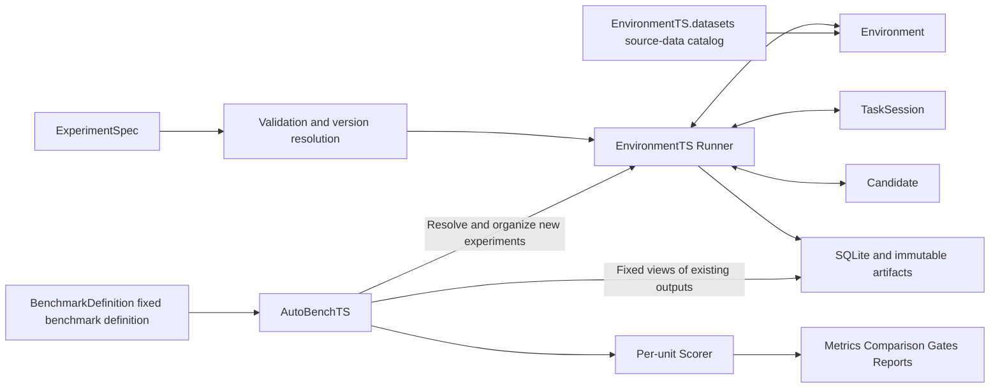

# GymTS 0.5.0 Framework Implementation and Task Integration Guide

This guide describes the implemented local framework and integration approach; this round of environment integration was validated on 2026-10-19. Field contracts follow [Interface Specification 1.2.0](feishu/GymTS接口规范/GymTS接口规范.md). Version 0.5 adds declarative assembly, execution seeds and data/benchmark resource services while retaining existing Environment/Task/Candidate `/1` method messages; older plugins without pure descriptions require explicit migration. Complete v2 messages and the general Runtime remain drafts.

## Implementation Structure

External messages are JSON dictionaries. Public types live in `gymts.contracts.types`, and plugin methods are expressed through `typing.Protocol`. `TypedDict` supplies static typing; schemas and service boundaries enforce runtime checks. Ordinary functions, algorithms, models and Agents can all implement Candidate without inheriting a framework base class.



`GymTS(root)` assembles built-in plugins, a local ArtifactStore, LocalExperimentRecords, EnvironmentTS and AutoBenchTS. Advanced callers can construct these objects separately and inject their own storage, Registries and services.

The default installation contains no project adapters. First install the independent `gymts-chatts` package (from source: `pip install . ./adapters/timeseries ./adapters/chatts`). Explicitly pass `GymTS(root, integrations=("chatts",))` when using it, or call `gym.enable_integration("chatts")` on an existing instance. `GymTS.available_integrations()` reads installed entry-point metadata without importing integration implementations. The CLI uses the global option `--integration chatts`; the dedicated `gymts-chatts` command enables its own integration.

ChatTS, TimeSigma, RL and LibraryTS live under `adapters/`, are installed independently and integrate through public mechanisms; core has no project catalog or project CLI. The five original adapter packages are version 0.2.0, and the new `gymts-bench-tsqa` is 0.1.0; all depend on core `>=0.5,<0.6`. Their project modules are `gymts_chatts`, `gymts_timesigma`, `gymts_rl` and `gymts_libraryts`. Scientific dependencies belong to adapter packages or explicitly configured native runtimes; see the [adapter guide](../adapters/README.md).

The new independent domain package [gymts-timeseries](../adapters/timeseries/README.md) provides neutral numeric snapshots/CSV sources and seven QA Tasks with Scorers. Its TaskInput contains public numbers, task semantics and response schemas, without ChatTS messages, placeholders or model processors; the package contains no model and depends on no specific model adapter. The [LibraryTS adapter](../adapters/libraryts/README.md) depends on these public domain contracts and integrates fixed NetmanAIOps/sktime native tools, real data loaders, two numeric Candidates and native forecast scoring. Current Candidates actually run native fit/predict on each authorized window and discard temporary estimators; they provide neither persistent training nor cross-call learning. The neutral domain package remains an independent plugin, not another core module; this integration does not mean the v2 Source/Method/Runtime draft is implemented.

LibraryTS is one example of an external toolset integration and follows the same boundaries as other tool providers. The framework internalizes no project's algorithms, models, tool catalog or asset platform. Projects retain their implementations and dependencies; GymTS provides general interfaces, experiment lifecycles, access boundaries and evidence records. External toolsets and their higher-level callers own their model-asset management and publication workflows.

Independent distributions can declare a `gymts.integrations` entry point pointing to `register(registries, schemas)`, for example `myteam = mypackage:register` in setup.cfg. Users explicitly enable `myteam` after installation without modifying Runner or built-in registration functions. Enabling applies only to trusted plugins and provides no Python sandbox.

This round adds five independent 0.1.0 packages: `gymts-hf-datasets`, `gymts-interaction`, `gymts-gymnasium`, `gymts-openenv` and `gymts-prometheus`. They integrate with the frozen core through the same public SDK. The neutral interaction domain package also stays outside core and adds no third main module.

## Agents and External Toolsets

The Agent decides whether to use tools. Within a Run, an Agent receives task inputs through a Candidate adapter, chooses tools and arguments, consumes tool results and continues making decisions; a toolset adapter supplies callable implementations plus version, I/O and effect declarations. A toolset is not another core module, nor must every tool register as a Candidate. Running an algorithm directly as a Candidate remains a valid experiment, but it requires separate acceptance from an experiment in which an Agent chooses tools.

Prediction, feature or distance computation on existing authorized inputs may call external tools inside the Agent session and record ModelCall/ToolCall evidence. To obtain new experiment-environment data or perform operations, an Agent request must be interpreted by Task as a TaskRequest, then checked by Runner and dispatched to Environment, returning results to the same session. Boundaries depend on each tool's actual effects; an entire catalog containing data loaders and independent-experiment entry points cannot be exposed as pure computation.

A Research Agent outside the Run may also use `GymTS.run` and `AutoBenchTS.evaluate/score` as experiment-orchestration tools, linking child Runs through a parent trajectory. This differs from the Agent completing a task within a Run. Existing LibraryTS fixed-algorithm Candidates, standalone tool calls and the TimeSigma Research journal demonstrate their respective invocation and recording capabilities, but the general “Agent selects tool → execution → continuation using results” loop has not passed acceptance. Current core has no general ToolBroker; see [Agent and toolset integration boundaries](agent-toolsets.md) for complete responsibilities and outstanding acceptance items.

## Synthetic, Static, Simulated and External Sources

Existing generators continue producing deterministic observations, and the independent ChatTS generation interface remains available. The HF adapter freezes a fixed Hub commit, save_to_disk dataset or explicit local files into versioned static resources. The Gymnasium adapter creates native environments it owns; the OpenEnv adapter creates its own sessions through the official persistent WS; the Prometheus adapter attaches read-only to an external metrics service. Formats, native APIs, public projections and domain scoring stay outside the framework. See the [environment integration guide](environment-adapters.md) for actual acceptance and calls.

Static resources store public inputs separately from private references. Interactive Sources execute step exactly once in act; observe consumes the cache and preserves final-state rewards. Scope endings are recorded separately as scope_limited without changing native terminated/truncated. External sources exposing only done use existing EndInfo.detail to preserve the unknown cause, with related classification metrics missing. Live sources distinguish sample time, received availability and delivered coverage; queries access only delivered history, and finish releases only this connection. Unsupported source seed/attach capabilities are rejected explicitly.

New packages were installed outside the source tree and the actual core was verified against the frozen wheel; no core code or formal fields changed. Existing TaskRequest.command, native Payload, EndInfo.detail, restricted CAS and ResultsView.event_snapshot_ref express these differences. HF is limited to finite one-dimensional numeric forecasting views; acceptance with real local OpenEnv/Prometheus services is not acceptance of a user's production testbed or causal online prediction. Fixed policies in examples also do not establish a completed Agent tool-selection loop.

The [eleven-package distribution check for this round](reports/environment-adapter-package-check-2026-10-19.json) passed builds, source rebuilds, independent installation, joint enabling and removal. Conditional skips in minimal environments are recorded separately from zero-skip real native results. Existing ChatTS, TimeSigma, RL, LibraryTS and benchmark adapters remain independent; new source integration has not internalized any project.

## Pure Planning and Actual Opening

`gym.plan(spec)` returns `gymts.assembly-plan/1`; `gym.validate(spec)` returns validity and issues. Both check only inline configuration, schemas, fixed Manifests, pure descriptions and composition constraints. They do not invoke plugin factories, read data/weights/credentials, connect services or commit CAS. Environment/Task register a pure `describe(spec)` or provide `factory.describe_spec(spec)`; additional composition constraints use pure `compatibility(context)` or `factory.check_compatibility_spec(context)`. Missing pure descriptions do not fall back to instance construction.

Plans explicitly state `resource_checks=deferred_to_open`. Actual `scene_ref` reads expand only at execution entry points; offline planning requires an inline scene. `run` establishes a Run and saves configuration before creating/opening components and checking actual resources; open failures retain stage, error and partial trajectories, with best-effort sealing. A static plan does not establish file existence, service availability or usable real weights, and is not AutoBenchTS's expected-evaluation-unit plan. There is currently no general worker/probe/forced-timeout Runtime.

## One Run

1. Expand prescribed defaults and reject unknown fields; purely check Environment/Task/Candidate protocols, parameters, schemas, units, dimensions, capabilities and declared fixed references, deferring actual resource checks until open.
2. Save the resolved ExperimentSpec, establish a Run and commit run_start.
3. Start Environment, record SessionInfo and check actual source, scope, clock, ownership and public context; calculate effective_scope before binding TaskSession.
4. Create a Candidate for this Run; after prepare, record actual revision and artifacts.
5. Request and commit observations, then let Task consume them; save inputs, process authorized online feedback first, then call Candidate. Save raw outputs before interpreting results/queries/actions.
6. Commit environment requests and operation intents before calling backends. Queries return to consume; action receipts return to on_action; continuation turns of the same case take priority over other queued cases.
7. At the decision boundary, continue read-only feedback as configured; perform best-effort cleanup of Candidate, Task and Environment, record incomplete cases and seal the Run.

The final batch is still processed fully. For native transitions, boundary state and reward produced by a valid in-scope action are execution evidence and must be retained; decision inputs still obey the half-open effective_scope. `waiting` advances no cursor and repeats no inference; valid empty time windows must advance coverage and cursor.

`max_inputs` and `max_operations` count attempts, and `max_turns_per_case` limits calls within one case. The framework does not automatically retry infer/update/interpret/act. An unknown operation receipt records uncertainty and stops the Run without automatically resending.

## Integrating a Task

Start with the nearest interaction form in [forecast.py](../gymts/plugins/forecast.py) or [counter.py](../gymts/plugins/counter.py), then deliver in this order.

| Deliverable | Specific requirements |
| --- | --- |
| schema | Parameters, inputs, raw outputs, standard results, alignment and optional outcomes; configuration objects use `additionalProperties=false` |
| Task | Pure `describe_spec` declares variables/operations/schemas/warmup; pure compatibility hook declares additional limits; `bind` creates a per-Run Session implementing consume/interpret/on_action/finish |
| Environment | Pure `describe_spec`, followed by execution-factory resource opening; instance implements describe/start/observe/act/finish and checks actual source, visibility frontier, capabilities, ownership and ending |
| Binding | Fix source/units per variable and argument schema per operation; do not infer semantics from matching names |
| Candidate | Manifest declares compatible tasks and I/O plus fit/update/revision capabilities; prepare/infer/update/finish preserve native computation |
| Scorer | Fix eligibility implementation and key schema; read fixed results/references only and return independent counts and missing reasons |
| Materials | Small fixed fixtures, ExperimentSpec, EvaluationSpec/ScoreSpec and corresponding contract tests |

Registration can happen in the application entry point:

```python
from gymts import GymTS

with GymTS(root=".gymts", register_builtins=False) as gym:
    # register_my_plugins 按本项目 plugins/__init__.py 的模式登记
    # schema 和完整 Manifest；factory 可以是函数或实现 create 的对象。
    register_my_plugins(gym.registries, gym.schemas)
    result = gym.run(my_experiment)
```

The application's `register_my_plugins`, Manifests, schemas and configuration must actually be implemented; the example only shows composition. Registration must precede validate/run without changing the public Runner. A registered name/version cannot overwrite an existing different implementation.

TaskInput observation_refs use committed event IDs or immutable artifact references. Task can obtain this observation's event ID through `execution['data'].observation_ref(batch_id)`; an unpersisted temporary data path is not evidence.

Candidate obtains sampling randomness from `context['execution_seed']` and its per-Run `rng`, and records the backend's actual enforcement; repetition seeds do not enter new Candidate identities. A seed merely sent over HTTP is unverified. Candidate accesses selected model/state/training views and saves new artifacts through `context['resources']`; Task uses `execution['data']`. Candidate receives neither environment connections nor evaluation-only references. Feedback-source authorization can use an exact name or `name@version`; different content for one feedback_id conflicts, while identical content is learned only once.

A file/snapshot Source may declare an `artifact_refs` list in its Manifest connection schema. Runner validates and grants only these exact immutable references to Environment; the grant does not pass to Task/Candidate or recursively authorize nested references. ChatTS integration authorizes only public time-series snapshots; gold uses an independent evaluation view. See the [ChatTS guide](chatts-integration.md) for full integration and code.

All plugins are trusted in-process code; service methods constrain access authorization. Untrusted code, forced timeouts or resource isolation require an external executor; encapsulating Python objects is not operating-system isolation.

## Independent Evaluation and Late Outcomes

AutoBenchTS saves all expected units before the first new Run. Each Scorer call processes one unit_id. Missing labels are not zero-filled, and the eligible denominator is not reduced; failed, cancelled and unstarted units remain present. Configured evidence thresholds apply at Candidate/group level, repetitions are averaged only when all are computable, and macro aggregation weights all expected groups equally. Different task contracts are evaluated separately.

A versioned Scorer determines the counting unit for each domain. The framework checks `eligible=scored+missing+invalid+excluded` and saves eligibility_ref; it cannot infer arbitrary domain sample counts from a failed Run with no outputs. Such a unit remains insufficient, while execution-failure rate still uses all expected units as its denominator.

Append labels using `gym.records.attach_outcomes(run_id, records)`, which returns an artifact reference containing a fixed OutcomeRef list. Read complete labels through `read_outcomes`, save the fixed result as a JSON artifact and construct a DataViewRef with `purpose=evaluation`. Both `available_at` and service-assigned `recorded_at` must satisfy the scoring cutoff. Revisions append a new revision and cannot overwrite an old one. See [quickstart.py](../examples/quickstart.py) for the full procedure.

`score` reads existing Runs without calling Candidate. Optional RunSelection tags default to empty; when rescoring needs original tag grouping, copy the tags from the original EvaluationPlan into selection entries, and the new plan fixes them. Tags describe this evaluation arrangement without rewriting execution facts; missing grouping keys are still rejected explicitly. Once persisted, the report object is returned, and this version can be saved/restored through `last_report_ref`.

## Training Builds and Backend Boundaries

Since 0.4.1, the formal public entry point `gymts.training.build_dataset(spec, records, artifacts)` is available alongside the structural protocols `DatasetBuilderProvider` and `DatasetBuilderRegistry`. External providers declare fixed `builder_ref`, `target_formats` and `output_schema_refs`, and implement `build(spec, records, artifacts)` without receiving GymTS, Candidate or Environment objects. Register explicitly and inject through `builders=`, or publish an entry point keyed by builder name in the `gymts.dataset_builders` group. The default entry point loads only the selected provider and explicitly rejects missing/duplicate providers or incompatible versions/target schemas.

```python
from gymts.training import build_dataset

manifest = build_dataset(build_spec, gym.records, gym.artifacts)
```

Core first rejects source usages forbidding training, then validates public BuildSpec/Manifest and fixed ComponentRefs declared by the builder and backend/transforms/reward mapping/tokenization. It checks that Manifest build_id, builder, input snapshots and output schema match the request, the complete BuildSpec in CAS has not been substituted, output artifacts are committed, and returned content matches the published Manifest. Core does not interpret domain payloads; providers own usage, selection, segmentation, rewards, token/mask and profile semantics. The public SDK is a shared extension capability of the two modules, not a third training module.

`gymts_rl.exporter.NativeRolloutBuilder` supplies the current one-call/one-case native QA profile. The old `build_dataset(gym, spec)` helper remains compatible, preserving historical component/schema/builder/sample identities. SFT, preferences, complex multi-turn interaction and other action spaces still require their own external providers; a public entry point does not establish support.

The existing `GymTSGRPOTrainer` continues to reuse TRL 0.18.2 loss/backward/optimizer and now accepts injected `artifacts` and `rollout_provider(inputs, policy, *, generation, seed_start)`. The provider samples, saves trajectories and publishes a native DatasetManifest; Trainer reads validated fixed shards rather than depending directly on GymTS or GSM8K/ChatTS data configuration, and does not treat provider in-memory rows as evidence. Closures preserve the old QA recipe. Small CPU tests verified upstream TRL loss/backward, actual optimizer.step and changed parameters; this validates backend connectivity, not new model quality. See the [RL integration guide](rl-integration.md).

The independent `rl-qa-scorer` is registered with AutoBenchTS and provides accuracy and format_valid. `gymts_rl.evaluation.score_rollout_runs` or `gymts-rl score` forms native ScoreSpec/EvaluationReport objects from sealed eval Runs and fixed evaluation Outcomes; new reference revisions can be selected explicitly for rescoring without calling or loading the model. Missing references are not zero-filled, training usage is not converted into evaluation, and no pass conclusion is issued without a Gate. Heldout verifier statistics automatically saved by training commands remain diagnostic. `checkpoint_bundle_ref` now publishes immutable base identity, adapter/config, tokenizer/processor and training lineage, and `CandidateSpec.artifact` can assemble them in a new process. Publication rejects substituted base files; loading checks embedded provenance against original reference content identity. `checkpoint_evaluation_spec` generates a native EvaluationSpec with multiple execution seeds sharing one Candidate; `rescore_checkpoint_evaluation` reuses fixed outputs/references without model calls. Historical seed-in-CandidateSpec identities remain intact.

[Complete RL acceptance](reports/rl-checkpoint-loop-2026-10-20.json) exercised two actual TRL GRPO updates, 16 training-sampling Runs, 6 new evaluation Runs in a new process, 6 repeated Runs with the same seeds and zero-inference rescoring. Controlled tiny Qwen2 produced nonzero reward differences and gradients on two official GSM8K train questions; ChatTS data was actually prepared and independently evaluated. Accuracy was 0.0 and format validity 0.5. Technical Gates check only execution and coverage, not training quality, and do not establish acceptance of large base models or every processor.

## Data and Benchmark Resources

Version 0.5 delivers a minimal local resource catalog. `EnvironmentTS.datasets` manages versioned data resources and public reads; AutoBenchTS registers, resolves and evaluates `BenchmarkDefinition`. Public entry points include `list_datasets/load_dataset` and `list_benchmarks/load_benchmark/resolve_benchmark`; DatasetHandle offers info/features, indexing, select/filter, iter_batches and optional HF conversion. Readers, domain schemas, private-reference interpretation and benchmark resolvers remain independent adapters; core contains no question bank.

```python
from gymts import GymTS

with GymTS('/tmp/runs', data_home='/path/to/resources',
           cache_home='/tmp/resource-cache', integrations=('bench-tsqa',)) as gym:
    rows = gym.environment_ts.datasets.load_dataset(
        'local/tsexam-mcq', revision='1.0.0', config='default', split='test')
    print(len(rows), rows[0]['question_original'])
    print(gym.autobench.list_benchmarks())
```

The code assumes `gymts-bench-tsqa` is installed and attachments have been explicitly imported; installing/enabling does not automatically download or import data. Original resource bytes, public/private Parquet, cards, quality reports and manifests live under separate `data_home`; caches use `cache_home` and are excluded from the core wheel. Environment variables are `GYMTS_DATA_HOME/GYMTS_CACHE_HOME`, defaulting to gymts under XDG data/cache directories. Source resources use content-digest identities and explicit release labels; Runs still use their own CAS. Benchmark resolution writes fixed manifest, definition and usage references into native EvaluationSpec/Runs without recursively granting private resources to Candidate.

The five attachments were explicitly imported as **5 evaluation-only datasets totaling 19,354 rows**, all `test/user_declared_evaluation` with `training_allowed=false`; training, prepare and dataset_build are rejected. Public DatasetHandle exposes no raw/targets references or answers. Original questions, options, conditions, all ordered numbers and duplicate rows are retained; private references are read through evaluation services. Unknown references retain missing and eligible status without fabricated gold or dropped questions. [Full 746-row evaluation acceptance](reports/bench-tsqa-full746-final-2026-10-20.json) passed public Python/CLI reads, native evaluate and sealed-Run rescoring; first-public-choice baseline accuracy of 332/746 is an integration-coverage result, not evidence of model quality. The other 18,608 rows are registered with their reference status retained, without claiming full evaluation execution.

`resolve_benchmark` returns existing `gymts.evaluation/1`; execution, expected units, repetitions, Scorers, Gates and reports still use only the native AutoBenchTS path. An external HF adapter can obtain and freeze static resources at a fixed commit; core builds no remote Hub. A complete Hub, multi-tenant catalog, visual editing and publication approval are not delivered. Concurrent resource-alias immutability has been fixed; final same-version core distribution, six independent adapter distributions, all 746 rows, and native RL/TimeSigma reruns passed. See [this delivery](framework-delivery-2026-10-20.md) for exact wheels/hashes and limits, plus the [resource catalog design and implementation status](dataset-benchmark-catalog-design.md) and [TSQA adapter](../adapters/bench_tsqa/README.md).

## Local Evidence Storage

Default root `.gymts/`:

```text
records.sqlite3       Transactional index for Runs/events/Outcomes
records.sqlite3-wal   Active SQLite WAL, when present
artifacts/blobs/      Immutable bytes stored by SHA-256
artifacts/refs/       Manifests fixing media/schema/content identity
```

Both `local` and `local://records/default` map to the injected local record backend. Transactions commit before append returns; artifacts first synchronize bytes and then atomically publish references. Artifact reads validate reference and content digest; modifying URI/metadata cannot expose other paths.

Sealing first creates run_end without a self-reference to its trace, then saves an execution snapshot containing it and consistently publishes RunResult. Seal failure rolls back the record transaction; unreferenced artifacts may remain for future garbage collection. After sealing, new execution events are rejected while identical-ID/identical-content retries remain idempotent; labels and evaluations do not rewrite execution records.

This backend supports local deployment, without remote object storage, multi-tenant authorization, backup/disaster recovery or execution resumption. Back up active SQLite through its backup API or after closing connections; copying only the main database while omitting WAL is unsafe.

The current local artifact backend uses POSIX directory descriptors and file operations that forbid following symlinks. Linux/macOS are supported; Windows is unverified and equivalent local-storage guarantees are not promised.

## Supported Scope and Remaining Capabilities

| Capability | Current behavior and integration point |
| --- | --- |
| Binding unit/parameter transformations | Nonempty transform is explicitly rejected; future fixed-version transformation services must declare input/output units and schemas |
| Real files/cloud data and live systems | Existing project sources, three external HF static-loading modes, Gymnasium, OpenEnv WS and read-only Prometheus are supported; see the environment guide for actual scope; other sources need independent adapters |
| Credentials | No default credential provider; real adapters inject environment-side dedicated services and must not write credentials into ordinary records |
| llm_trace | General none/io/native_rollout capture and completeness policies supported; local RL Candidate saves actual tokens, model/sampling logprobs, native tensors and fixed policy revision; HTTP QA still captures IO only |
| training_export | Core provides the public three-argument build entry point, external provider Registry and evidence contracts; RL supplies native QA exporter and TRL GRPO with injectable rollout provider; SFT/preferences/multi-turn and verl need separate adapters |
| Lightning/Trinity-RFT | No backend bridges yet; integrate individually against model-call identity/token/policy-version and dataset-lineage contracts |
| schema | Built-in support for an explicit JSON Schema subset; unknown keywords rejected at registration; replace SchemaRegistry for the full vocabulary |
| DataView | Local JSON selectors support all/rows/json_pointer; as_of must be null, so time cutoffs first resolve to fixed results; scoring still checks both Outcome cutoffs |
| Scheduling and timeouts | Synchronous and serial; wall limits checked at call boundaries, I/O needs backend timeouts; isolation/forced interruption/parallelism require another executor |

See the [RL integration guide](rl-integration.md) for local LLM native sampling and training. Missing fields are explicitly reported per specification; training export and backend consumption remain independently versioned, with formal snapshots and Manifests as the boundary.

The minimal data/benchmark catalog and evaluation-only import of five attachments are implemented; a complete data platform, remote execution and resource operations remain undelivered. The framework still needs acceptance of interchangeable Agents calling external toolsets, closure of the general permission/identity/lifecycle/evidence gaps they expose, and continued validation of isolated Runtime, more real methods/tasks and external training backends. Toolset asset platforms, higher-level Research/Memory autonomous loops and publication approval belong to their projects or callers and integrate through adapters when needed. Pure planning, the resource catalog and new RL checkpoint evaluation already have engineering acceptance evidence.

## Acceptance Procedure

Run `python3 -B -m unittest discover -s tests -v`. It runs core contract, Runner, storage, plugin, AutoBenchTS and CLI tests only. Project tests live in `adapters/<项目>/tests`; `python3 -B scripts/check_adapters.py` runs them in independently installed environments. Run `python3 examples/quickstart.py --root .gymts/demo` to reproduce the complete actual workflow.

Core validation uses deterministic local materials and fault injection; new sources additionally have real native HF, Gymnasium, OpenEnv and Prometheus acceptance. These do not establish acceptance of users' production testbeds, production Agents or large-model training. New plugins should add their fixtures and the applicable contract tests from Interface Specification §17 before proceeding to the next integration.
