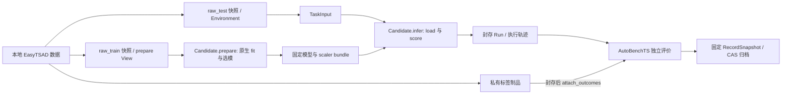

# Integrating TimeSigma with GymTS

This implementation uses `Jurmean/GymTS` as its main repository. Core 0.5.0 and independent distribution `gymts-timesigma` 0.2.0 install separately, following formal interface specification 1.2.0 with `/1` public messages. TimeSigma code, CLI, tests, and runtime dependencies reside in [`adapters/timesigma`](../adapters/timesigma/README.md), outside core wheels/sdists. The core discovers installed adapters through `gymts.integrations` entry points and loads them only after explicit activation. The integration does not replace the framework Runner, AutoBenchTS, records, or artifact storage. `docs/pluggability-contract-v2.md` remains a draft.

The earlier package split changed Python paths and distribution boundaries: imports moved from `gymts.integrations.timesigma` to `gymts_timesigma`, while component IDs, version `1.0.0`, and `/1` schemas remain unchanged. Historical Runs and CAS need no rewriting and remain readable/rescorable through AutoBenchTS after installing the new adapter. Existing model bundles still verify execution-code identity strictly; migration does not relax checks. Earlier validation and archives preserve their original facts rather than claiming verification of new installation boundaries.

## Position as an external tool provider

TimeSigma, LibraryTS, and other toolsets are external integrations; the core has no project list. Agents decide which tools to use, while independent SDKs/adapters invoke them and continue with their results. `TimeSigmaTools` currently holds explicit host GymTS services for authorized Research/experiment orchestration outside Runs. Entries such as `experiment.run` and `data.import` cannot be injected wholesale into in-Run Candidates as ordinary current-input computation to bypass environment permissions. Complete native Pi Evidence bridging and general Agent tool loops remain unaccepted. Parent-journal calls are not proof of autonomous model decisions; see [external toolsets and Agents](agent-toolsets.md).

## Three-sided interfaces

| Side | Registered component | Responsibility |
| --- | --- | --- |
| Data | `timesigma-snapshot/1.0.0` Environment | Import one fixed PlanningUnit and expose a single step-transition snapshot |
| Task | `timesigma-tsad/1.0.0` Task | Represent the complete unit as one TaskInput/TaskResult; preserve independent curves and suffix alignment |
| Model | `timesigma-native/1.0.0` Candidate | Real training in prepare, frozen scoring in infer, fitting-disabled replay in an independent process |
| Evaluation | `timesigma-official/1.0.0` Scorer | Native official evaluation of sealed scores; labels enter only with evaluation permission |

One Run is fixed as **one detector Pipeline × one Schema PlanningUnit**. Initial methods are AR and IsolationForest with `naive`, `all_in_one`, and `zero_shot`. Other Core12 Catalog methods are not claimed as integrated. Current Pipelines include native differencing, native normalization, and one detector. Operators, ensembles, and GPU methods are outside implemented scope.



Training Views grant only raw train arrays with `purpose=prepare`. The Environment receives only test snapshot references. Session context exposes membership and test lengths, not test values, labels, or source paths. Tasks use current `step + transition + on_observe` clocks with scope `[0, 1)`; an entire offline curve is not presented as online point-by-point decisions.

Shared Schemas retain native per-curve windows without concatenating curves. ZERO_SHOT retains upstream semantics: a held-out curve’s own train prefix may fit its normalization scaler, but those curves do not participate in model-weight training. `training_members`, `evaluation_members`, `preprocessing_members`, and `normalization_visibility` are recorded separately; this is not strictly inductive zero-shot. Import uses native seed=1 and fixed membership: TODS has 8 training curves and 7 held-out curves.

## Native implementation and stage separation

Pinned source revisions are TimeSigma `5a953c1a84d0a442d1c41b17b4e8aba8c013be10` and EasyTSAD `e7be92374a4543d7c52d6e34ef7047f4d6776be0`. Native method classes, shared data windows, validation-based selection, `retain_best`, `_capture_unit`, and `load_model_artifact` remain intact. No custom regressor or approximate metric substitutes for original methods.

Current GymTS calls Candidate.prepare before producing Observations. The adapter therefore separates fit and score from the original combined flow: prepare performs real training, saves checkpoints/scalers, and returns the actual bundle hash as model_revision; infer only loads that bundle. Native `TSData` normalization operates on three partitions together. Prepare uses a temporary carrier derived from raw_train to invoke the original function, then deletes `.test`; this carrier participates in neither training nor validation and does not impersonate a real test partition. Model training objects contain no test, labels, or info; only public test lengths may be read for counts. 18 dtype/differencing/normalization combinations were compared byte-for-byte with the complete native loader.

After infer, an independent replay process disables Method training and scaler.fit and verifies score dtype, shape, bytes, and model revision. Bundles fix raw training arrays, fitted scalers, model files, configuration, membership order, source hashes, and dependency versions. Loading checks actual executing code and runtime environment; matching a version number alone is insufficient. Hosts record adapter-file hashes, while workers verify the installed EasyTSAD RECORD and key source-file hashes.

Native model artifact formats, validation-selection state, and sample counts remain in the bundle. This is a GymTS model bundle, **not the complete native Pi Research Evidence job directory**.

## Installation and execution

The GymTS host keeps Python 3.9+ and a core installation without scientific dependencies. NumPy is required only when importing `.npy`:

```bash
python -m pip install .
python -m pip install './adapters/timesigma[runtime]'
```

Scientific computation runs in an explicitly selected independent Python environment. Pin a TimeSigma checkout and prepare its native environment using its README and lockfile. Upstream recommends Python 3.12.3 and `uv sync --frozen --extra torch`. That interpreter must also install the GymTS core, `gymts-timesigma`, and pinned upstream source package:

```bash
/path/to/native-env/bin/python -m pip install --no-deps -e /path/to/TimeSigma-GymTS
/path/to/native-env/bin/python -m pip install /path/to/Jurmean-GymTS
/path/to/native-env/bin/python -m pip install /path/to/Jurmean-GymTS/adapters/timesigma
```

Every host/scientific worker starts installed `gymts_timesigma.*` modules from temporary working directories, without inserting repository paths into `sys.path` or `PYTHONPATH`. Upstream editable installs retain actual-import-path checks against the pinned checkout; configured source paths are only identity checks. Missing installations fail explicitly rather than falling back to the main checkout. This does not install Node, download complete historical assets, or call paid Providers automatically.

```bash
gymts-timesigma --store /tmp/gymts-timesigma-state run \
  --dataset-root /path/to/datasets \
  --source-repo /path/to/TimeSigma-GymTS \
  --python /path/to/native-env/bin/python \
  --dataset TODS --schema naive --curve-id 0 \
  --method IsolationForest --output /tmp/timesigma-if-001
```

The data root requires `UTS/<dataset>/<curve>/{train,test,test_label}.npy`. Arrays must be one-dimensional, nonempty, and finite; labels must be binary. Output directories must be new. For explicitly recorded CPU interface validation, AR accepts `--hyper-params '{"epochs":2}'`; without overrides, original method defaults apply. `--preprocess` and `--diff-order` are available. Invalid parameters, different model revisions, and unsupported methods fail explicitly.

Python uses existing services:

```python
from gymts import GymTS
from gymts_timesigma.data import import_dataset
from gymts_timesigma.pipeline import run_experiment

with GymTS('/tmp/gymts-state', integrations=('timesigma',)) as gym:
    data = import_dataset(gym, '/path/to/datasets', dataset='TODS',
                          schema='zero_shot', source_repo='/path/to/TimeSigma-GymTS')
    experiment = run_experiment(gym, data, {
        'source_repo': '/path/to/TimeSigma-GymTS',
        'python': '/path/to/native-env/bin/python',
        'method': 'AR', 'seed': 1, 'hyper_params': {'epochs': 2},
    })
```

A manually authored ExperimentSpec runs through generic `gymts --integration timesigma run CONFIG.json`. Only `run_experiment` / the dedicated pipeline automatically attach labels after sealing and perform independent evaluation. `GymTS.root` / `--store` denotes storage, not source code. SQLite WAL and active CAS require local POSIX filesystems. This project’s S3FS mount suits offline archives; validation uses active storage in `/tmp`.

## Official evaluation and rescoring fixed outputs

Use the eight original TimeSigma IDs: `point-wise-f1`, `reduced-length-f1`, `event-wise-f1`, `delay-reduced-length-f1`, and their four corresponding `*-auprc` metrics. Calls reuse native `official_evaluations()`, Performance, and original MetricInterface add/avg with dataset margin/delay settings preserved. Each curve is evaluated separately with full-length original labels; native evaluation handles score-suffix support. Curves are not concatenated and scores are not invented.

AutoBenchTS fixes the eligible denominator to the evaluation_members count before execution. Missing results/labels count as missing, illegal results as invalid, and upstream all-normal-label rules as excluded. None are replaced by 0 or silently removed from the planned denominator. The first report has no labels; attach_outcomes then enables scoring the same Run, with unchanged Run ID and sealed-result hash verified. Acceptance Gates check execution failure rate and coverage for all eight metrics; a high score alone is not evidence of generalization.

## Tools and Research parent trajectories

`TimeSigmaTools` exposes `data.import`, `task.describe`, `model.catalog`, `experiment.run`, `experiment.rescore`, `run.inspect`, `trajectory.snapshot`, and `trajectory.export`. Every tool request is saved to CAS before execution. Successes and failures save responses/errors, and the store retains a call index.

`native.*` tools forward original TimeSigma domain payloads, with the adapter building original `timesigma.bridge.v1` envelopes and validating deadlines. Supported listed operations include health, capabilities, Memory reading, research context, and preview. `native.experiment.preview` writes a preview under upstream scope.experiment_root without consuming detector-training budget. `native.experiment.run` and native Memory publication are rejected to prevent bypassing GymTS execution.

```python
from gymts_timesigma.tools import TimeSigmaTools
from gymts_timesigma.research import ResearchEpisode
from gymts_timesigma.trajectory import export_evidence

tools = TimeSigmaTools(gym, source_repo='/path/to/TimeSigma-GymTS',
                      python='/path/to/native-env/bin/python')
budget = {'max_experiments': 1, 'max_requests': 12,
          'max_total_tokens': 120000, 'max_wall_seconds': 1200}
with ResearchEpisode(gym, budget=budget, scope={'dataset': 'TODS', 'schema': 'zero_shot'}) as parent:
    catalog = parent.call_tool(tools, 'model.catalog', {})
    child = parent.call_tool(tools, 'experiment.run', {
        'imported': data, 'params': {'method': 'AR', 'seed': 1, 'hyper_params': {'epochs': 2}},
    })
    parent_ref = parent.finish()
    export_evidence(gym, child['run_ids'], '/tmp/research-001.zip', roots=[parent_ref])
```

Parent trajectories are integration CAS hash chains and EpisodeManifests referencing real child Runs, RecordSnapshots, tool inputs/outputs, and failure evidence. They neither introduce a second Runner/SQLite trajectory framework nor create a fictional parent scientific Run. Only the head pointer is mutable, and a single-writer lock prevents forks. Restarting by episode_id restores the original budget and unsettled requests; repeated call_id values do not retrain. Experiment tools run in separate host process groups using the remaining absolute deadline and record durable receipts when real Runs are allocated. Failures/timeouts still link allocated child Runs.

External Agents may call `reserve_model_request(request, max_total_tokens=...)` before Provider requests, then `settle_model_request(ticket, response=..., total_tokens=...)` afterward to save conversations and Provider-reported usage. Callers must enforce reserved token limits in Provider requests. Unknown/failed requests retain reserved allowances; excess usage is recorded truthfully and stops subsequent execution. Journals do not issue Provider requests, read user credentials, or claim token-ID/logprob capture. Common credential fields, environment variables, and known token formats are redacted.

This round’s agreed scope is GymTS data/task/model experiments, tool calls, and parent trajectories. Pi automatic Agent loops, native Memory `complete_step` publication, and complete native-directory-parser bridging require later integration; GymTS bundles do not impersonate that format. The TimeSigma adapter currently keeps `model_calls=none`, recording native-call/Research evidence as CAS artifacts. Parent trajectories are not token-level ModelCall collectors and do not claim native token IDs/logprobs.

## Trajectory management and migration

```bash
gymts-timesigma --store /tmp/gymts-state inspect RUN_ID
gymts-timesigma --store /tmp/gymts-state export --run-id RUN_ID --output /tmp/run.zip
gymts-timesigma --store /tmp/restored import-evidence /tmp/run.zip
```

`export_evidence` fixes a native RecordSnapshot containing selected event sequence numbers, label revisions, execution records, real outcome CAS, and all recursive artifact/metadata references. Before import, each blob, metadata identity, snapshot boundary, event/result consistency, and reference closure is verified, retaining original ArtifactRefs and bytes. `inspect_archive` works offline. `import_evidence` imports historical evidence/CAS without fabricating execution indexes. A new `run_experiment` with `artifact=<model_bundle_ref>` uses `load_only`, has no training View or weight training, and creates an explicit new replay Run.

Archives are not signatures and cannot prove source-party assertions. Preserve the SHA256 returned by export when distributing externally to verify received files. Archives containing private labels/models retain original evidence permission semantics; exporting does not publish them to the cloud.

## Validation entry points

```bash
python -B -m unittest discover -s adapters/timesigma/tests -p 'test_timesigma*.py' -v
GYMTS_TIMESIGMA_NATIVE_TESTS=1 python -B -m unittest discover -s adapters/timesigma/tests -p 'test_timesigma*.py' -v
python -B scripts/check_release.py --output /tmp/gymts-release-check.json
```

Adapter sdists contain tests and `tests/fixtures`; extract and run with `-s tests` from their own directory, without main-repository tests or examples. Default regressions call neither scientific environments nor Providers. Real CPU tests require explicit opt-in; configure environments through `GYMTS_TIMESIGMA_REPO` / `GYMTS_TIMESIGMA_PYTHON`. Pure hosts without NumPy can still discover/register the integration, while import tests skip explicitly. Actual acceptance results appear separately in repository validation records.
