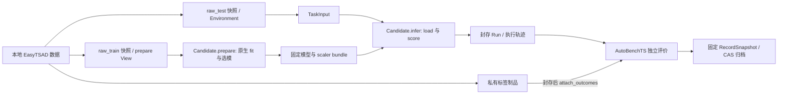

# TimeSigma 接入 GymTS

本实现以 `Jurmean/GymTS` 为主仓库。核心 0.5.0 与独立发行包 `gymts-timesigma` 0.2.0 分别安装，继续遵循正式接口规范 1.2.0，公共消息使用 `/1`。TimeSigma 代码、CLI、测试与运行依赖位于 [`adapters/timesigma`](../adapters/timesigma/README.md)，不再随核心 wheel/sdist 发布。核心通过 `gymts.integrations` entry point 发现已安装适配器，显式启用后才加载；不替换框架的 Runner、AutoBenchTS、记录服务或制品存储。`docs/pluggability-contract-v2.md` 仍是草案。

早期拆包迁移改变 Python 包路径和发行边界：导入从 `gymts.integrations.timesigma` 改为 `gymts_timesigma`，组件 ID、版本 `1.0.0` 和 `/1` schema 保持不变。历史 Run 和 CAS 无需改写，安装新适配器后仍可通过 AutoBenchTS 读取与重评分；原有模型 bundle 仍严格核对执行代码身份，不会因包迁移而放宽校验。过去的验证记录与归档保留当时事实，不表示已验证新安装边界。

## 作为外部工具提供方的位置

TimeSigma 与 LibraryTS、其他工具集均为外部接入，核心没有项目清单。Agent 决策使用哪些工具，独立 SDK/适配器负责调用与结果续推。`TimeSigmaTools` 当前持有显式宿主 GymTS 服务，用于 Run 外获准的 Research/实验编排；其 `experiment.run`、`data.import` 等入口不能整体注入 Run 内 Candidate，当作当前输入上的普通计算来绕过环境权限。原生 Pi 的完整 Evidence 适配和通用 Agent 工具循环仍未验收。父 journal 的调用记录不等于模型自主决策，具体分工见[外部工具集与 Agent](agent-toolsets.md)。

## 三侧接口

| 侧 | 已注册组件 | 责任 |
| --- | --- | --- |
| 数据 | `timesigma-snapshot/1.0.0` Environment | 导入一个固定 PlanningUnit，提供一次 step transition 快照 |
| 任务 | `timesigma-tsad/1.0.0` Task | 将完整单元表达为一个 TaskInput/TaskResult；保留独立曲线与后缀对齐 |
| 模型 | `timesigma-native/1.0.0` Candidate | prepare 真实训练、infer 冻结评分、独立进程禁止拟合的 replay |
| 评价 | `timesigma-official/1.0.0` Scorer | 对封存分数调用原生官方评价；标签仅以 evaluation 权限进入评价 |

一个 Run 固定为 **一个 detector Pipeline × 一个 Schema PlanningUnit**。首版执行方法为 AR 和 IsolationForest，支持 `naive`、`all_in_one`、`zero_shot`；不将 Core12 Catalog 中其余方法宣称为已经接入。当前 Pipeline 包含原生差分、原生归一化和单个 detector；operators、ensemble、GPU 方法不在已实现范围。



训练 View 只授予 `purpose=prepare` 的原始 train 数组。Environment 只有测试快照引用；session context 公开成员身份及测试长度，不包含测试值、标签或源文件路径。Task 使用现行 `step + transition + on_observe` 时钟，scope 为 `[0, 1)`；不会把整条离线曲线伪装成在线逐时间点决策。

共享 Schema 保留原生逐曲线窗口，不拼接不同曲线。ZERO_SHOT 继承原上游语义：held-out 曲线自己的 train 前缀可拟合该曲线的归一化器，但这些曲线不进入模型权重训练。`training_members`、`evaluation_members`、`preprocessing_members` 和 `normalization_visibility` 分开记录；这不是严格 inductive zero-shot。导入使用原生 seed=1 和固定 membership，TODS 为 8 条训练曲线、7 条 held-out 曲线。

## 原生实现与阶段拆分

固定源码为 TimeSigma `5a953c1a84d0a442d1c41b17b4e8aba8c013be10`，EasyTSAD `e7be92374a4543d7c52d6e34ef7047f4d6776be0`。原生方法类、共享数据窗口、validation 选模、`retain_best`、`_capture_unit` 和 `load_model_artifact` 保留；未用自写回归器或近似指标替代原方法。

现行 GymTS 在产生 Observation 前调用 Candidate.prepare。适配器因此拆开原先同一流程中的 fit 和 score：prepare 完成真实训练并保存 checkpoint/scaler，返回真实 bundle 哈希作为 model_revision；infer 只加载该 bundle。原 `TSData` 归一化函数同时操作三个分区，prepare 使用一个来自 raw_train 的临时载体完成原函数调用并随即删除 `.test`；该载体不进入训练或验证，也不冒充实际测试分区。模型训练对象不含 test、labels、info；计数所需测试元数据仅允许读取公开长度。18 种 dtype/差分/归一化组合与完整原生 loader 做逐字节比对。

infer 后再启动独立 replay 进程，禁用 Method 训练入口和 scaler.fit，核对真实分数 dtype、shape、字节及模型版本。模型 bundle 固化原始训练数组、拟合 scaler、模型文件、配置、成员顺序、源码摘要和依赖版本。加载时核对实际执行代码与运行环境；仅保持版本号相同不足以通过。host 记录 adapter 文件摘要，worker 对 EasyTSAD 实际安装文件的 RECORD 和关键源文件摘要做校验。

原始模型制品的制式、validation 选择状态与样本数保留在 bundle 内。这是 GymTS 模型 bundle，**不等同于原生 Pi Research 的完整 Evidence job 目录**。

## 安装与运行

GymTS host 保持 Python 3.9+ 和无科学计算依赖的核心安装。导入 `.npy` 时才需要 NumPy：

```bash
python -m pip install .
python -m pip install './adapters/timesigma[runtime]'
```

科学计算在显式指定的独立 Python 中运行。固定 TimeSigma checkout 后按其 README 和锁文件准备原生环境；上游建议 Python 3.12.3，命令为 `uv sync --frozen --extra torch`。该解释器也必须安装 GymTS 核心、`gymts-timesigma` 和固定上游源码包：

```bash
/path/to/native-env/bin/python -m pip install --no-deps -e /path/to/TimeSigma-GymTS
/path/to/native-env/bin/python -m pip install /path/to/Jurmean-GymTS
/path/to/native-env/bin/python -m pip install /path/to/Jurmean-GymTS/adapters/timesigma
```

所有 host/scientific worker 均以已安装的 `gymts_timesigma.*` 模块启动，在临时工作目录执行，不注入仓库路径到 `sys.path` 或 `PYTHONPATH`。上游 editable 安装允许保留固定 checkout 的实际导入路径校验；源路径配置仅用于身份检查。缺少安装会显式失败，不从主仓库目录兜底。此操作不会自动安装 Node、下载完整历史资产或调用收费 Provider。

```bash
gymts-timesigma --store /tmp/gymts-timesigma-state run \
  --dataset-root /path/to/datasets \
  --source-repo /path/to/TimeSigma-GymTS \
  --python /path/to/native-env/bin/python \
  --dataset TODS --schema naive --curve-id 0 \
  --method IsolationForest --output /tmp/timesigma-if-001
```

数据根目录需要 `UTS/<dataset>/<curve>/{train,test,test_label}.npy`，数据必须一维、非空、有限，标签为二元值。输出目录必须是新目录。AR 可用 `--hyper-params '{"epochs":2}'` 做明确记录的 CPU 接口验证；不提供 override 时走原方法默认配置。可使用 `--preprocess`、`--diff-order`；非法参数、不同模型版本或不支持的方法会显式失败。

Python 使用现有服务：

```python
from gymts import GymTS
from gymts_timesigma.data import import_dataset
from gymts_timesigma.pipeline import run_experiment

with GymTS('/tmp/gymts-state', integrations=('timesigma',)) as gym:
    data = import_dataset(gym, '/path/to/datasets', dataset='TODS',
                          schema='zero_shot', source_repo='/path/to/TimeSigma-GymTS')
    experiment = run_experiment(gym, data, {
        'source_repo': '/path/to/TimeSigma-GymTS',
        'python': '/path/to/native-env/bin/python',
        'method': 'AR', 'seed': 1, 'hyper_params': {'epochs': 2},
    })
```

手工 ExperimentSpec 可通过通用 `gymts --integration timesigma run CONFIG.json` 执行。只有 `run_experiment` / 专用 pipeline 自动完成封存后补标签和独立评价。`GymTS.root` / `--store` 是存储目录，不是源码目录。SQLite WAL 和活动 CAS 需要本地 POSIX 文件系统；本项目所在 S3FS 挂载适合保存离线归档，验证使用 `/tmp` 活动存储。

## 官方评价与固定输出重评分

使用原 TimeSigma 的八个 ID：`point-wise-f1`、`reduced-length-f1`、`event-wise-f1`、`delay-reduced-length-f1` 以及对应四个 `*-auprc`。调用原生 `official_evaluations()`、Performance 和原 MetricInterface 的 add/avg，保持 dataset margin/delay 配置。每条曲线分别评价，标签保持完整原长度，由原生评价处理分数后缀支持；不会拼接曲线或补造分数。

AutoBenchTS 的 eligible 分母在执行前固定为 evaluation_members 数量。缺少结果或标签计入 missing，非法结果计入 invalid，上游全正常标签规则计入 excluded；它们不会被填成 0 或悄悄从计划分母删除。首报没有标签，随后 attach_outcomes 再对同一 Run 评分，核对 Run ID 和封存结果哈希不变。验收 Gate 检查执行失败率和八指标的覆盖率，不把一个高分当成方法泛化性结论。

## 工具与 Research 父轨迹

`TimeSigmaTools` 暴露 `data.import`、`task.describe`、`model.catalog`、`experiment.run`、`experiment.rescore`、`run.inspect`、`trajectory.snapshot`、`trajectory.export`。每次工具调用先保存请求 CAS，再执行，成功和失败均保存响应/错误，并在 store 下保留工具调用索引。

`native.*` 工具转发原始 TimeSigma domain payload，由适配器构造原 `timesigma.bridge.v1` envelope 并校验截止时间；支持 health、capability、Memory 读取、research context、preview 等已列出的操作。`native.experiment.preview` 会在上游 scope.experiment_root 写 preview，不消耗 detector 训练预算。`native.experiment.run` 和原生 Memory 发布被拒绝，防止绕过 GymTS 执行。

```python
from gymts_timesigma.tools import TimeSigmaTools
from gymts_timesigma.research import ResearchEpisode
from gymts_timesigma.trajectory import export_evidence

tools = TimeSigmaTools(gym, source_repo='/path/to/TimeSigma-GymTS',
                      python='/path/to/native-env/bin/python')
budget = {'max_experiments': 1, 'max_requests': 12,
          'max_total_tokens': 120000, 'max_wall_seconds': 1200}
with ResearchEpisode(gym, budget=budget, scope={'dataset': 'TODS', 'schema': 'zero_shot'}) as parent:
    catalog = parent.call_tool(tools, 'model.catalog', {})
    child = parent.call_tool(tools, 'experiment.run', {
        'imported': data, 'params': {'method': 'AR', 'seed': 1, 'hyper_params': {'epochs': 2}},
    })
    parent_ref = parent.finish()
    export_evidence(gym, child['run_ids'], '/tmp/research-001.zip', roots=[parent_ref])
```

父轨迹是 integration 的 CAS 哈希链和 EpisodeManifest，引用真实子 Run、RecordSnapshot、工具输入输出及失败证据；不建立第二个 Runner/SQLite 轨迹框架，也不创建虚构的父科学 Run。只有 head pointer 可变，单写者锁防止分叉。重启按 episode_id 恢复原预算和未结算请求，重复 call_id 不会重做训练。实验工具在独立 host 进程组运行，使用剩余绝对截止时间，并在分配真实 Run 时记录持久 receipt；失败或超时也关联已分配子 Run。

外部 Agent 可在发起 Provider 请求前调用 `reserve_model_request(request, max_total_tokens=...)`，结束后用 `settle_model_request(ticket, response=..., total_tokens=...)` 保存对话和 Provider 报告的用量。调用方负责在 Provider 请求中落实预留 token 上限；未知/失败请求保留预留额度，超额用量如实记录并停止后续执行。Journal 不发起 Provider 请求、不读取用户凭证、不声称捕获 token IDs/logprobs。常见 credential 字段、环境变量及已知 token 格式会脱敏。

本轮范围已确定为 GymTS 三侧实验、工具调用和父轨迹。Pi 自动 Agent 循环、原生 Memory 的 `complete_step` 发布以及原生目录 parser 的完整桥接后续单独接入；当前不会把 GymTS bundle 冒充那个格式。TimeSigma 适配器目前保持 `model_calls=none`，其 native-call/Research 证据使用 CAS 制品记录；父轨迹不冒充 token 级 ModelCall collector，也不宣称捕获原生模型 token IDs/logprobs。

## 轨迹管理与迁移

```bash
gymts-timesigma --store /tmp/gymts-state inspect RUN_ID
gymts-timesigma --store /tmp/gymts-state export --run-id RUN_ID --output /tmp/run.zip
gymts-timesigma --store /tmp/restored import-evidence /tmp/run.zip
```

`export_evidence` 固定原生 RecordSnapshot，包含选定事件序号、标签版本、执行记录、真实 outcome CAS 和全部递归制品及 metadata 引用。导入前核对每个 blob、元数据身份、快照边界、事件/结果一致性和引用闭包，保留原 ArtifactRef 及字节。`inspect_archive` 可离线查看，`import_evidence` 只导入历史证据/CAS，不伪造执行索引。新一轮 `artifact=<model_bundle_ref>` 的 `run_experiment` 使用 `load_only`，无训练 View、无权重训练，会产生明确的新 replay Run。

归档不是签名，也不能证明来源方陈述的真实性；外部分发时保留导出返回的 SHA256 以核对收到的文件。包含私有标签和模型的归档保持原证据权限语义；导出归档本身不会自动发布到云端。

## 验证入口

```bash
python -B -m unittest discover -s adapters/timesigma/tests -p 'test_timesigma*.py' -v
GYMTS_TIMESIGMA_NATIVE_TESTS=1 python -B -m unittest discover -s adapters/timesigma/tests -p 'test_timesigma*.py' -v
python -B scripts/check_release.py --output /tmp/gymts-release-check.json
```

适配器 sdist 自带测试及 `tests/fixtures`，可解压后在自身目录以 `-s tests` 验证，不依赖 GymTS 主仓库的测试或 examples。默认回归不调用科学环境或 Provider。真实 CPU 测试需显式 opt-in，环境可通过 `GYMTS_TIMESIGMA_REPO` / `GYMTS_TIMESIGMA_PYTHON` 指定。无 NumPy 的纯 host 安装仍可发现和注册 integration，数据导入测试会明确跳过。实际验收结果另见本仓的验证记录。
